<div align="center">


# Kiro Proxy

#### Local proxy that converts Kiro accounts into OpenAI / Anthropic compatible endpoints.

<p>
  <a href="https://go.dev/"></a>
  <a href="https://www.docker.com/"></a>
  <a href="https://www.sqlite.org/"></a>
  <a href="LICENSE"></a>
</p>

<p>
  <a href="#-overview">Overview</a> •
  <a href="#-preview">Preview</a> •
  <a href="#-features">Features</a> •
  <a href="#-quick-start">Quick&nbsp;Start</a> •
  <a href="#-configuration">Configuration</a> •
  <a href="#-usage">Usage</a> •
  <a href="#-thinking-mode">Thinking&nbsp;Mode</a> •
  <a href="#-outbound-proxy">Outbound&nbsp;Proxy</a> •
  <a href="#-safety">Safety</a>
</p>

[English](README.md) • [简体中文](README_CN.md) • [Português (Brasil)](README_PT-BR.md) • [Tiếng Việt](README_VI.md)

</div>

---

## 🌟 Overview

**Kiro Proxy** is a small Go service that turns one or more authorized **Kiro** accounts into a local API endpoint that speaks the **OpenAI** and **Anthropic** wire formats:

1. Pools multiple Kiro accounts and load-balances requests with round-robin, weights or priorities, and session affinity.
2. Translates Anthropic `/v1/messages`, OpenAI `/v1/chat/completions`, and OpenAI `/v1/responses` calls to and from Kiro upstream, including tools, thinking, reasoning effort, and web search.
3. Refreshes access tokens automatically and streams Server-Sent Events end-to-end, with keepalives and failover.
4. Ships with a React admin panel, embedded in the binary, for account management, live observability, and request audit, in English, 简体中文, Tiếng Việt, and Português (Brasil).

> [!IMPORTANT]
> Single-binary local proxy. **Not** a hosted service, **not** affiliated with Amazon, AWS, or Kiro. You must own or be authorized to use every account you add to the pool.

If this project helps you, a Star would mean a lot.

---

## 🖼 Preview

<p align="center">
  <picture>
    <source media="(prefers-color-scheme: dark)" srcset="screenshots/en/login-dark.webp">
    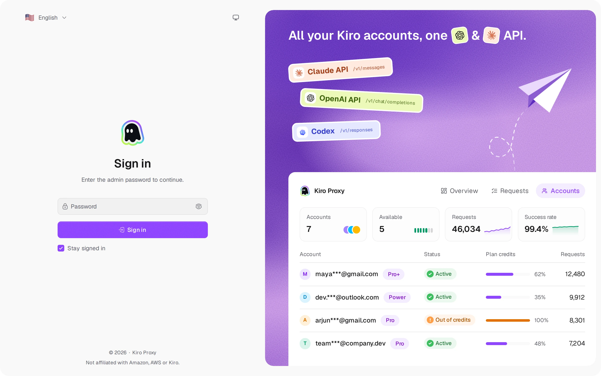
  </picture>
  <br><sub><b>Login</b> — sign-in with theme and language switches</sub>
</p>

<p align="center">
  <picture>
    <source media="(prefers-color-scheme: dark)" srcset="screenshots/en/overview-dark.webp">
    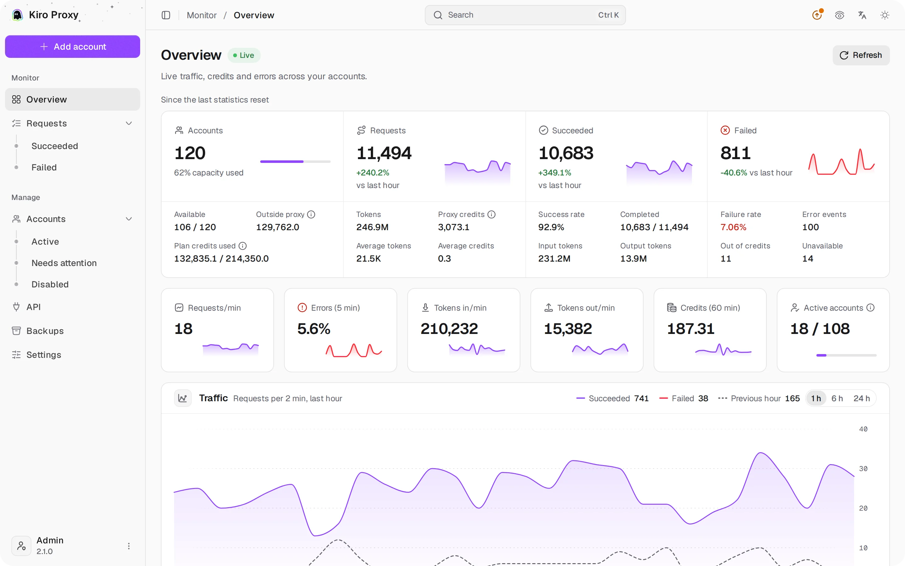
  </picture>
  <br><sub><b>Overview</b> — live traffic, credits and errors across accounts</sub>
</p>

<p align="center">
  <picture>
    <source media="(prefers-color-scheme: dark)" srcset="screenshots/en/accounts-dark.webp">
    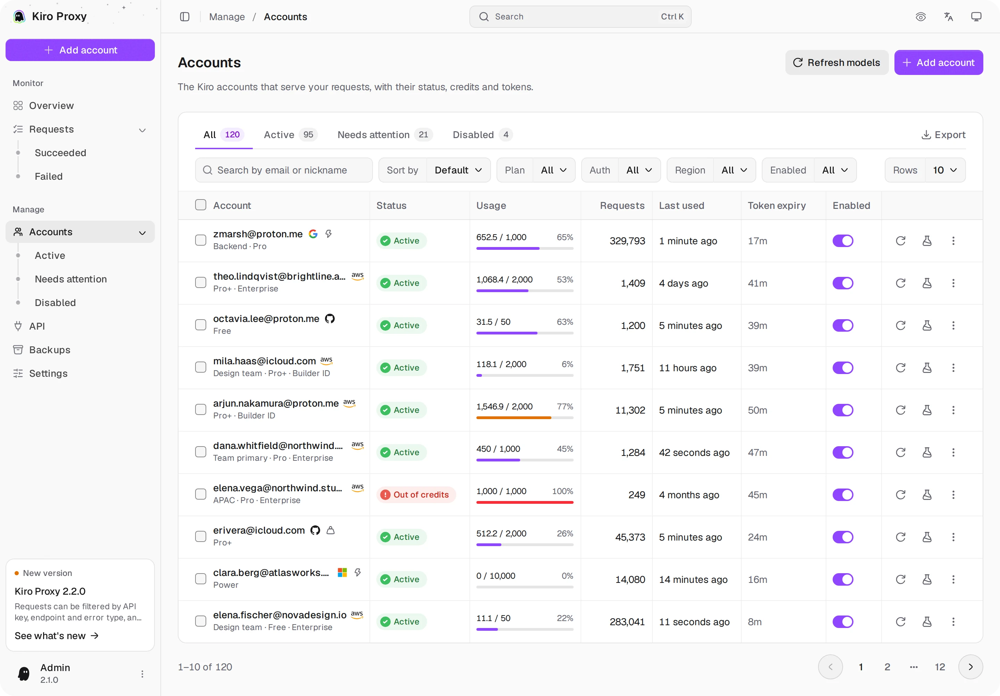
  </picture>
  <br><sub><b>Accounts</b> — plan credits, status tabs, filters, batch actions and export</sub>
</p>

<p align="center">
  <picture>
    <source media="(prefers-color-scheme: dark)" srcset="screenshots/en/accounts-add-dark.webp">
    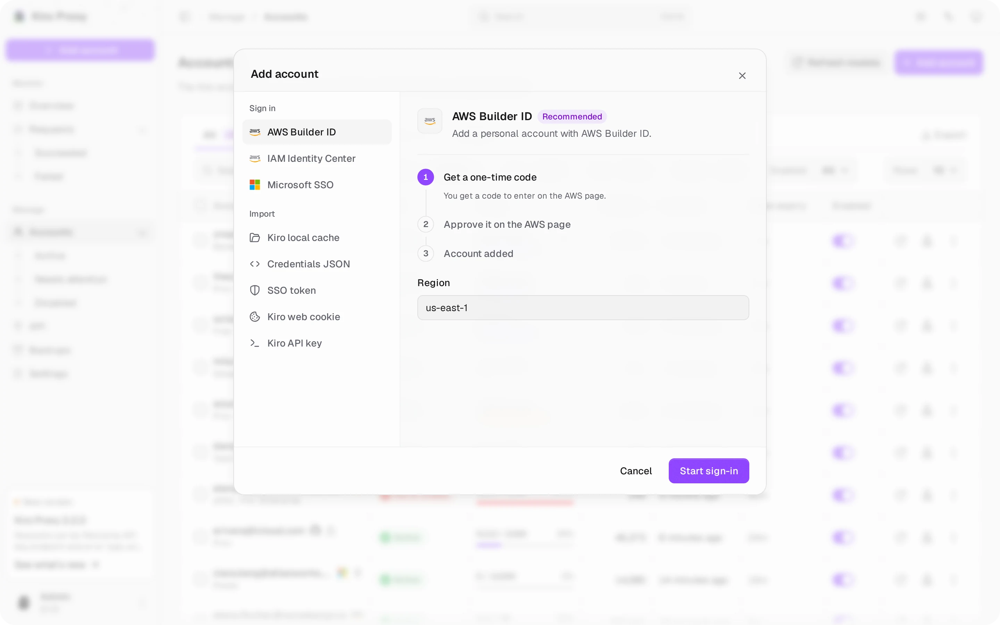
  </picture>
  <br><sub><b>Add account</b> — every sign-in and import method in one dialog, each with its steps</sub>
</p>

<p align="center">
  <picture>
    <source media="(prefers-color-scheme: dark)" srcset="screenshots/en/accounts-detail-dark.webp">
    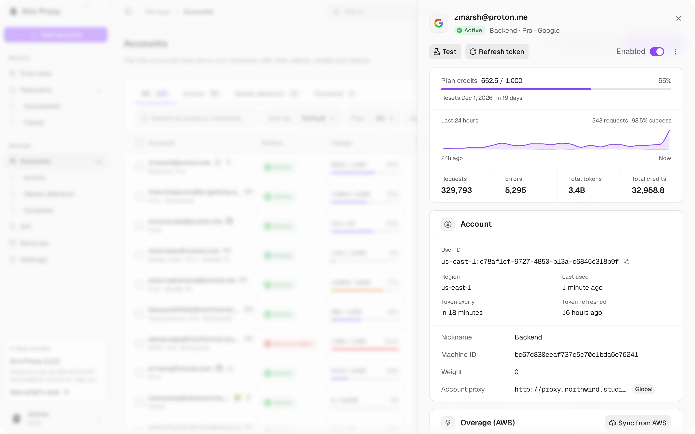
  </picture>
  <br><sub><b>Account details</b> — the sheet a row opens: plan credits, the last 24 hours, totals and settings</sub>
</p>

<p align="center">
  <picture>
    <source media="(prefers-color-scheme: dark)" srcset="screenshots/en/accounts-tester-dark.webp">
    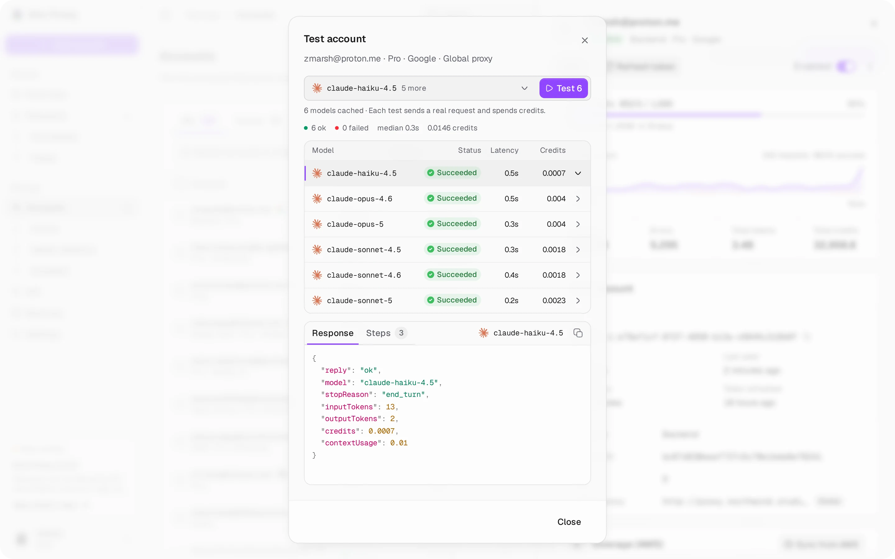
  </picture>
  <br><sub><b>Test account</b> — test one model or every cached model at once; tap a row for its response and steps</sub>
</p>

<p align="center">
  <picture>
    <source media="(prefers-color-scheme: dark)" srcset="screenshots/en/requests-dark.webp">
    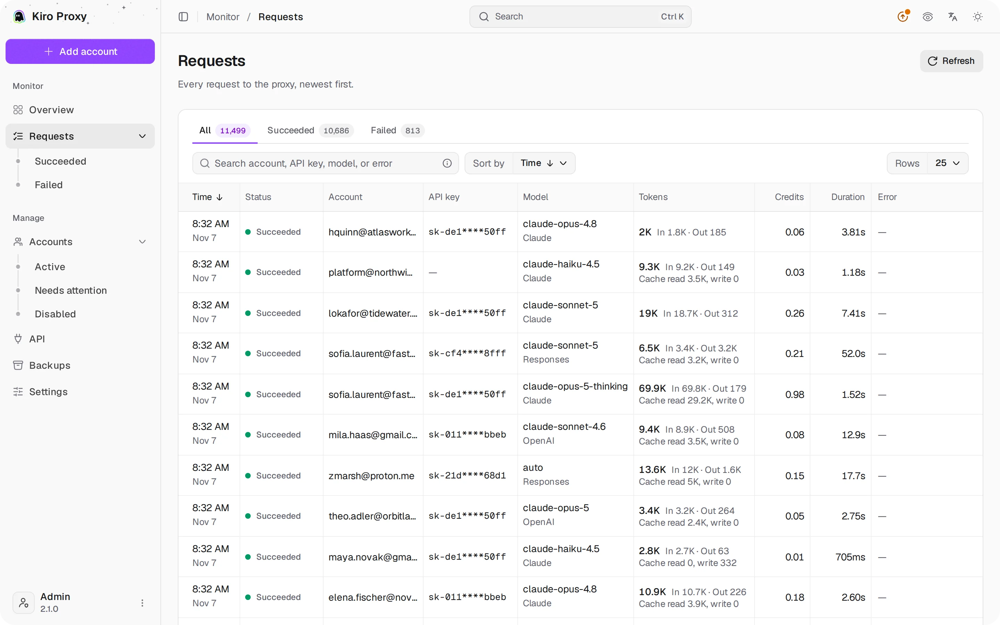
  </picture>
  <br><sub><b>Requests</b> — status tabs, search, sorting and a detail view</sub>
</p>

<p align="center">
  <picture>
    <source media="(prefers-color-scheme: dark)" srcset="screenshots/en/requests-detail-dark.webp">
    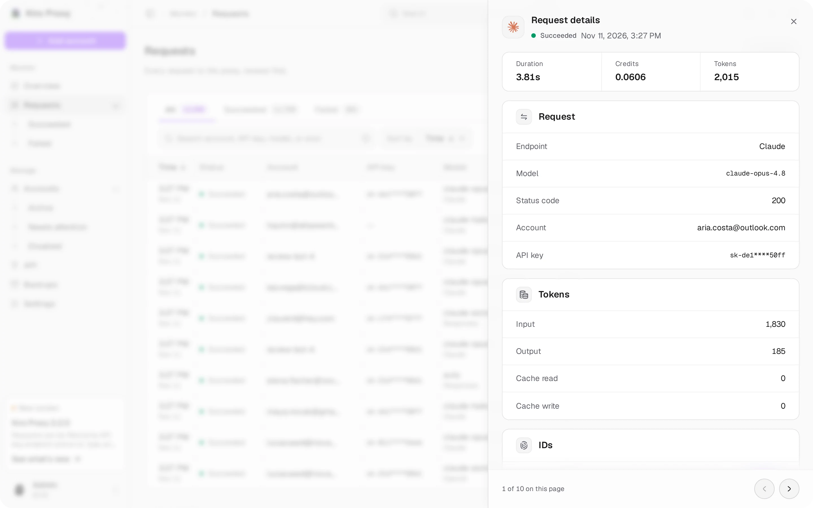
  </picture>
  <br><sub><b>Request details</b> — the sheet a row opens: duration, credits, tokens and IDs</sub>
</p>

<p align="center">
  <picture>
    <source media="(prefers-color-scheme: dark)" srcset="screenshots/en/api-dark.webp">
    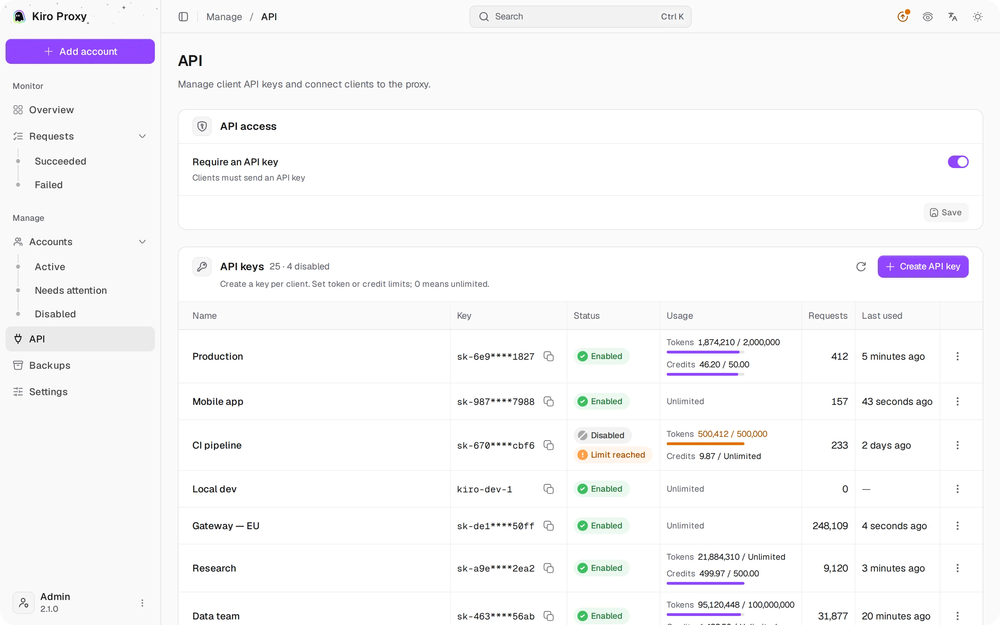
  </picture>
  <br><sub><b>API</b> — API access, per-client keys with limits, highlighted client setup</sub>
</p>

<p align="center">
  <picture>
    <source media="(prefers-color-scheme: dark)" srcset="screenshots/en/backups-dark.webp">
    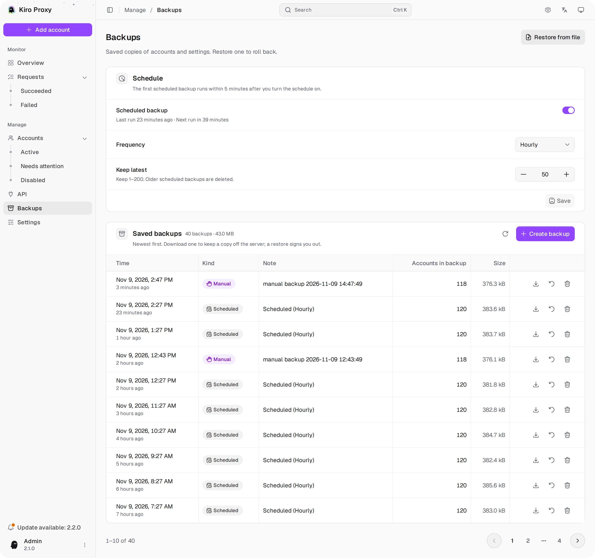
  </picture>
  <br><sub><b>Backups</b> — manual and scheduled backups, one-click restore</sub>
</p>

<p align="center">
  <picture>
    <source media="(prefers-color-scheme: dark)" srcset="screenshots/en/settings-1-dark.webp">
    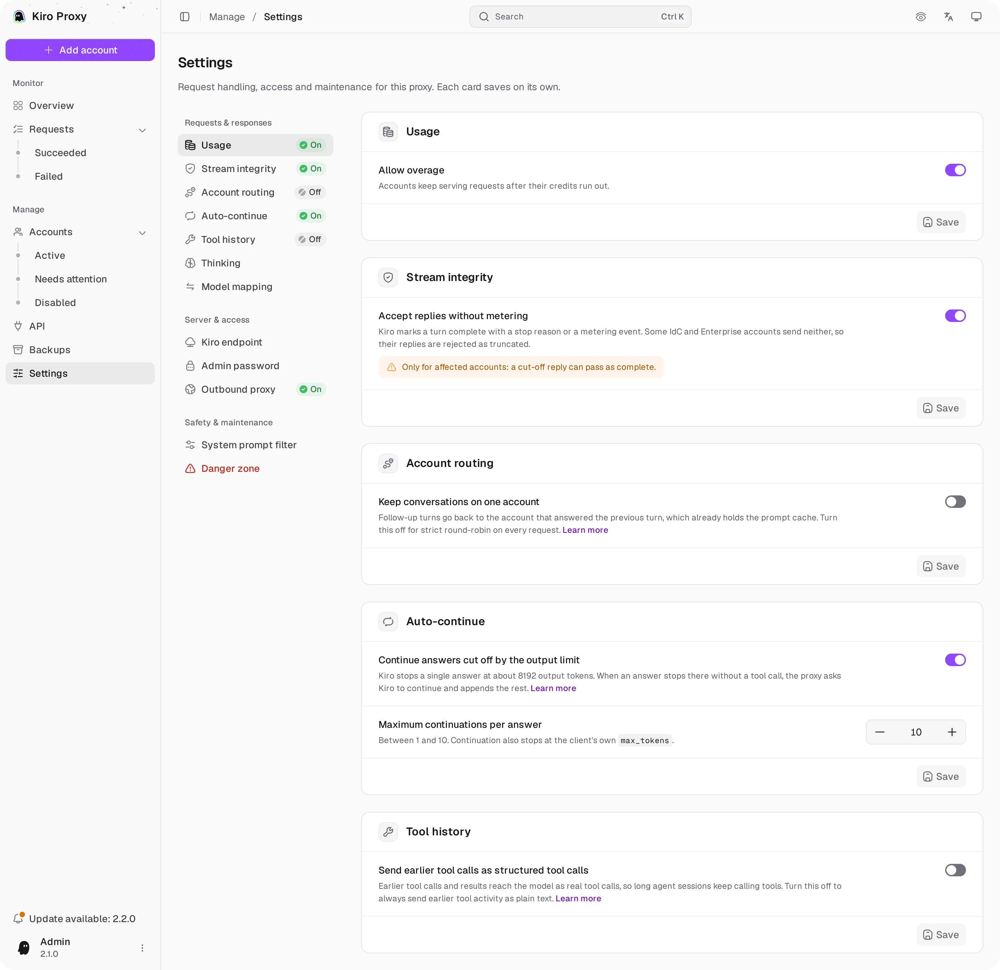
  </picture>
  <br><sub><b>Settings</b> — usage, stream integrity, routing, auto-continue</sub>
</p>

<p align="center">
  <picture>
    <source media="(prefers-color-scheme: dark)" srcset="screenshots/en/settings-2-dark.webp">
    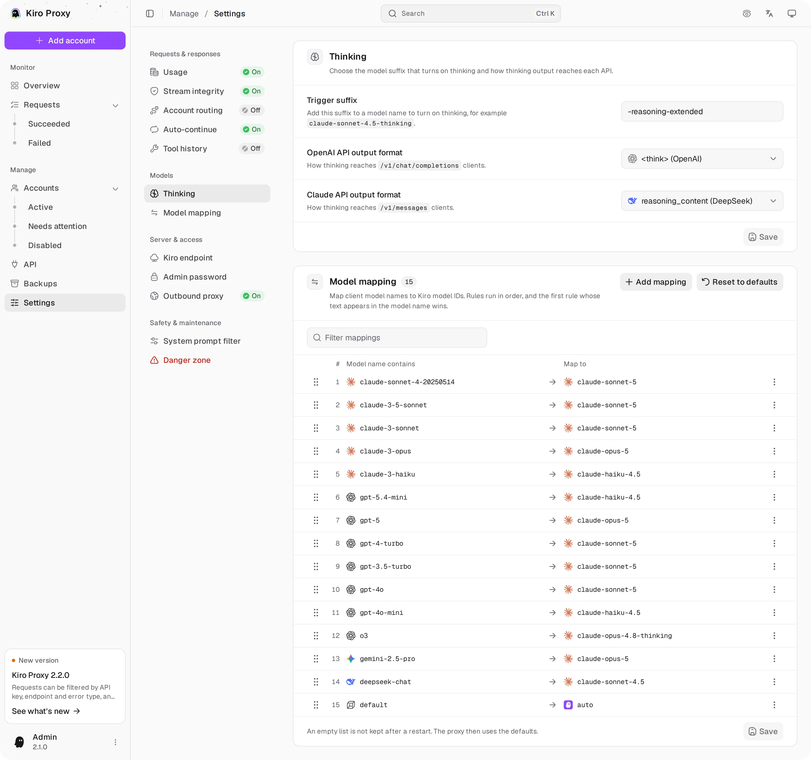
  </picture>
  <br><sub><b>Settings</b> — thinking and model mappings</sub>
</p>

<p align="center">
  <picture>
    <source media="(prefers-color-scheme: dark)" srcset="screenshots/en/settings-3-dark.webp">
    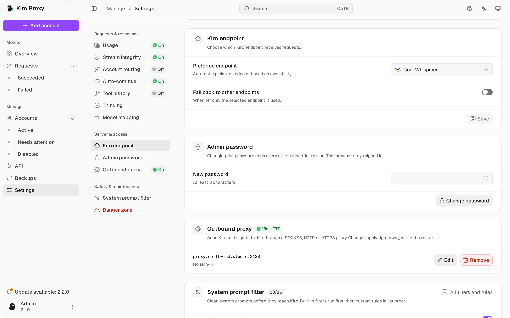
  </picture>
  <br><sub><b>Settings</b> — Kiro endpoint, admin password, outbound proxy</sub>
</p>

---

## ✨ Features

### 🛰 API surface

- Anthropic `/v1/messages` with native tool use and streaming, plus `/v1/messages/count_tokens`.
- OpenAI `/v1/chat/completions` with full tool-call shape parity.
- OpenAI `/v1/responses` with `previous_response_id` chaining and stored response retrieval.
- Codex-ready model list at `/v1/codex/models`, next to the standard `/v1/models`.
- SSE streaming for every endpoint, with mid-stream account failover on transient upstream errors and a keepalive every 15 seconds while the upstream is silent (long reasoning, held tool arguments).
- Anthropic's `web_search` server tool runs through Kiro's own web search, with results returned as search result blocks.
- Reasoning effort: OpenAI `reasoning_effort` and Claude `output_config.effort` (`low` to `xhigh`) turn on thinking and reach models that support effort levels; `minimal` turns it off.
- Structured output: OpenAI `response_format` (`json_object`, `json_schema`), Claude `output_config.format` and Responses `text.format` return bare JSON, checked against the schema (see [Structured Output](#-structured-output)).
- Thinking signatures: on `/v1/messages`, a thinking block carries the `signature` Kiro sends (`signature_delta` when streaming), and `redacted_thinking` blocks pass through.
- Tool-call rescue: tool calls that Kiro leaks into the answer as markup are turned back into real tool calls (switch off with `KIRO_TOOL_MARKUP_RESCUE=off`).
- Request body decompression (gzip/deflate) for clients that pre-compress payloads.

### 🧰 Request handling

- **Auto-continue** (opt-in): when an answer stops at Kiro's ~8192-token output cap without a tool call, the proxy asks Kiro to continue and appends the rest, up to 10 times.
- **Structured tool history**: earlier tool calls and results reach the model as real tool calls, so long agent sessions keep calling tools; a rejected request is retried once as plain text.
- **System prompt filter**: replaces Claude Code's built-in system prompt with a compact one, strips environment noise (env vars, git status, recent commits), and applies your own line or regex rules in order.
- **Model mapping**: ordered, drag-to-reorder rules that send any client model name to a Kiro model ID; the first match wins. A model Kiro lists itself only follows a rule with its full name, so a substring rule such as `gpt-5` never redirects a native model.
- **Stream integrity**: rejects replies that end without a stop reason or metering event, with an opt-in lenient mode for IdC and Enterprise accounts that send neither.
- **Endpoint choice**: pick a Kiro endpoint or let the proxy choose by availability, with optional fallback to the others.
- **Image resizing** (on by default): an image wider or taller than 1568 px, or larger than 400 KB, is scaled down and re-encoded before it goes to Kiro. Both limits are settings.
- **Response headers**: up to 20 custom headers on every API response, streams and errors included. Values can use `{request_id}`, `{model}`, `{account_id}`, `{key_id}` and `{client_ip}`; `{request_id}` is the Trace ID in the request log.

### 👥 Account pool

- Multiple Kiro accounts with two routing modes. **Weighted** (default): round-robin per model with a per-account weight (an account with weight N takes about N times as many new requests). **Priority**: each new request goes to the account with the lowest priority number (0–999) that can serve it; the next one takes over while it cools down, runs out of credits, is disabled, or lacks the model.
- Session affinity (**Keep conversations on one account**): follow-up turns return to the account that answered the previous turn and already holds the prompt cache; new conversations still follow the routing mode. Turn it off to route every request by the routing mode, for example for strict priority.
- Optional limit of 1 to 1000 requests per minute per account: an account at the limit is skipped, and when every account is at it, clients get HTTP 429. A try that never reached Kiro (a proxy or connection failure) does not count toward it. The Accounts page shows each account's live requests per minute and requests today.
- **Self-heal** (on by default): when no account can serve, the proxy lifts the auth bans and error cooldowns it set by itself and tries again, at most once every 5 minutes and 5 times in a row without a successful request (both adjustable). Kiro suspensions (a 403 "locked your account" counts as one), accounts you turned off and quota cooldowns are never lifted.
- Automatic OAuth token refresh ahead of expiry, safe under concurrent requests; account cooldowns survive restarts.
- Background refresh of usage and soon-to-expire tokens every 30 minutes by default. Pick 5 minutes to 24 hours, or Off to refresh only on demand; tokens still renew when a request needs one.
- Signing in or importing a stored account again updates it instead of adding a copy. A stored Kiro API key added again is refused with HTTP 409 (already added), unless it comes with notes or tags and the same region, as an export imported back into the same backend does: then its tags join the stored account's and empty notes and nickname are filled. Copies left from earlier versions (same refresh token, Kiro API key, user ID, or email and sign-in method) show in a notice on the Accounts page; **Review** merges each group into one account after a backup, keeping its requests, summed counters, notes and tags, and a copy's own proxy when the kept account has none.
- **Sign in again** in every account menu replaces an account's login in place and keeps its ID, settings, notes, tags and statistics. It lifts a ban, but an account you switched off stays off. When the new sign-in is a different user, the proxy asks before it replaces the identity. A sign-in that belongs to another account in the pool is refused with HTTP 409 (`relogin_other_account`) and no confirmation: this account stays as it was, and the panel names the other account and says whether it took the new tokens.
- Notes (up to 2000 characters) and up to 10 tags (24 characters each) per account. Search matches them, tags work in the Tag filter and in batch actions, and export and import keep both.
- Auth methods: AWS Builder ID, IAM Identity Center (Enterprise SSO), Microsoft SSO (Entra ID), SSO token, Kiro IDE local cache, credentials JSON, Kiro web cookie, and headless Kiro API keys (`ksk_…`). In **Add account**, each sign-in link has an open icon and a copy icon.
- Per account: its own outbound proxy, device (machine) ID, pinned Kiro profile, model list refresh, connection test, and the real Kiro overage switch.
- Optional overage: accounts keep serving after their credits run out.
- Per-account import / export and bulk operations.

### 🛡 Admin panel

- React single-page app embedded in the binary; no separate web server to run.
- Overview dashboard that updates live: four KPI cards (accounts, plan credits, and requests and failures in the last hour), traffic over time as stacked bars, a list of accounts that need attention, traffic by account, a model-mix donut, and the most active accounts. The **Plan credits** card splits Kiro credit use into the part used through the proxy and the part used outside it.
- Accounts with status tabs and counts, filters (plan, auth, region, enabled, tag), search over email, nickname, notes and tags, sorting, batch actions, a detail view, connection tests, live requests per minute and today, a duplicates review, and export.
- Requests log with status tabs and counts, search (it also matches the full API key), sorting, a detail view with error categories, the Trace ID and a timeline of every upstream attempt (account, endpoint, duration, result, failover), masked API keys, and SQLite-backed history.
- API page with client API key management (optional custom key values, enable/disable, per-key token, credit and call limits, account binding, regenerate, usage reset), a **Usage by key** chart, and a syntax-highlighted client setup builder: request code for the Anthropic Messages, OpenAI Chat Completions and OpenAI Responses APIs in curl, Python, Node.js, Go, Java, PHP, Ruby and C# (official SDK or plain HTTP, streaming or not) with a sample response, plus Claude Code and Codex setup.
- Settings for usage and background refresh, routing (mode, session affinity, per-account limit), auto-continue, tool history, image resizing, self-heal, thinking, model mappings, prompt filter, stream integrity, endpoint, upstream domain and region, outbound proxy, proxy pool, response headers, alerts, server log, admin password, log retention, and statistics reset; Backups with a schedule, upload, and one-click restore.
- Alerts to a webhook, Telegram, Discord or Slack when credits run low, an account is banned, or no account can serve requests (see [Alerts](#-alerts)).
- Command menu (<kbd>Ctrl</kbd>/<kbd>⌘</kbd> + <kbd>K</kbd>) for pages and actions, privacy mode that masks email addresses, and an update check that reads `version.json` from the repo's `main` branch.
- Changing the admin password ends every other signed-in session.
- Light, dark, and system theme; four UI languages: English, 简体中文, Tiếng Việt, and Português (Brasil).
- Works from phones to desktops.

### 🌐 Networking

- Outbound proxy support — SOCKS5, HTTP, or HTTPS, switched live without restart, with a per-account override. Saved proxy passwords show as `********`.
- Proxy pool: accounts without a proxy of their own each get one from a pool, with health checks and a move to a healthy proxy when one fails to connect (see [Proxy pool](#-proxy-pool)).
- Upstream domain and region (**Settings → Upstream domain & region**): send chat and web search to `runtime.{region}.kiro.dev` instead of `q.{region}.amazonaws.com` (usage and model lists stay on AWS), and override, for every account, the API region (`us-east-1` or `eu-central-1`) or the region Builder ID and IAM Identity Center tokens are refreshed in. A region that does not match an account makes its requests fail, but never bans the account.
- Configurable thinking-mode suffix and Anthropic `thinking` config passthrough.

### 🧩 Storage

- Single-file SQLite (`modernc.org/sqlite`) database at `kiro.db`, using DELETE journal mode.
- Final request rows, plus a rollup of the rows that log retention removed, are the source of truth for dashboard request, token, credit, success, and failed totals.
- Log retention: request and error log rows older than 90 days (1 to 3650, or keep forever) are deleted in small batches, two minutes after start and then daily.
- 30-day retention on stored responses, asynchronous writes off the request hot path.

---

## ⚙️ Requirements

| Component | Version              |
| --------- | -------------------- |
| Go        | 1.25 +               |
| Node.js   | 22 + with pnpm (only to build the admin UI from source) |
| OS        | Linux / macOS / Windows |
| Container | Docker 24+ optional  |
| Storage   | Local volume on disk |

---

## 🚀 Quick Start

### 🐳 Docker Compose (recommended)

```bash
git clone https://github.com/tanu360/kiro-reverse-api.git
cd kiro-reverse-api
docker-compose up -d
```

### 🐳 Docker Run

```bash
docker run -d \
  --name kiro-proxy \
  -p 8080:8080 \
  -e ADMIN_PASSWORD=your_secure_password \
  -v /path/to/kiro-proxy-state:/app/state \
  --restart unless-stopped \
  ghcr.io/tanu360/kiro-reverse-api:latest
```

### 📦 Download a binary

Every [release](https://github.com/tanu360/kiro-reverse-api/releases) ships a ready-to-run binary for Linux, macOS and Windows on amd64 and arm64, with the admin UI built in. You need no Go, Node.js or Docker.

```bash
# Swap linux_amd64 for your platform: linux_arm64, darwin_amd64 or darwin_arm64
curl -LO https://github.com/tanu360/kiro-reverse-api/releases/latest/download/kiro-proxy_linux_amd64.tar.gz
tar -xzf kiro-proxy_linux_amd64.tar.gz
cd kiro-proxy_linux_amd64
./kiro-proxy
```

On Windows, download `kiro-proxy_windows_amd64.zip` (or `_arm64`), extract it and run `kiro-proxy.exe` from a terminal. The database is created in the current folder; set `DATA_DIR` to keep it somewhere else. The server listens on `127.0.0.1:8080`: set `PORT` when 8080 is taken, and `LISTEN_HOST=0.0.0.0` to accept other machines. `SHA256SUMS.txt` on the release lists every archive's checksum: check a download with `sha256sum -c SHA256SUMS.txt --ignore-missing` (macOS: `shasum -a 256 -c SHA256SUMS.txt --ignore-missing`). The binaries are not signed: if macOS refuses to open `kiro-proxy`, run `xattr -d com.apple.quarantine kiro-proxy`, and Windows SmartScreen may ask before the first run.

### 🛠 Build from source

```bash
git clone https://github.com/tanu360/kiro-reverse-api.git
cd kiro-reverse-api
cd ui && pnpm install && pnpm build && cd ..
go build -o kiro-proxy .
./kiro-proxy
```

The admin UI needs Node.js 22+ and pnpm to build. `go build` embeds whatever is in `ui/dist`: without the UI build, `/` shows a "UI not built" page while the API keeps working. The Docker image builds both.

### 🎨 Admin UI development

Run these from `ui/`:

| Command         | What it does                                                                    |
| --------------- | ------------------------------------------------------------------------------- |
| `pnpm dev`      | Dev server on `http://localhost:5173/admin/`; proxies `/admin/api` and `/v1` to `127.0.0.1:8080` |
| `pnpm dev:mock` | Dev server with mock data and no backend; sign in with password `12345678`       |
| `pnpm test`     | Unit and component tests (Vitest)                                               |
| `pnpm test:e2e` | Browser smoke tests against mock mode (Playwright)                              |

> [!TIP]
> `kiro.db` is auto-created on first launch. Set `DATA_DIR` to store it somewhere else; Docker uses `/app/state`. Set `ADMIN_PASSWORD` to choose the admin password. Otherwise, the first launch generates a random 8-digit password, saves it, and prints it once in the startup logs. The login page shows it until the first successful sign-in. Docker users can read it with `docker compose logs kiro-proxy`. Restarts retain the saved password. An unclaimed 48-character password from an older version is replaced once with an 8-digit password; passwords already used to sign in or explicitly configured are preserved.

---

Request bodies are limited to 32 MiB, both on the wire and after each decompression layer. Up to three encoding layers are accepted. Oversized requests return HTTP 413. At most eight compressed bodies are decompressed at once; further compressed requests wait their turn, and uncompressed requests never wait. Body reads have a 30-second deadline.

Admin password authentication allows five failed attempts per client per minute, across sign-in and `X-Admin-Password` requests; an IPv4 address or an IPv6 /64 counts as one client. After 30 failures in a minute across all clients, each client drops to one attempt per minute for the rest of that minute, which slows distributed guessing without locking anyone out. Further attempts return HTTP 429 with `Retry-After`; existing session tokens continue working. Forwarded IP headers are not trusted, so clients behind the same reverse proxy share its IP budget. Successful password checks do not consume the failure budget. Backup restores preserve an active `ADMIN_PASSWORD` override.

## 🔧 Configuration

| Variable         | Purpose                                   | Default            |
| ---------------- | ----------------------------------------- | ------------------ |
| `DATA_DIR`        | Directory for `kiro.db`                   | `.`                |
| `ADMIN_PASSWORD` | Admin panel password (overrides config)   | —                  |
| `LISTEN_HOST`    | Address to listen on. The default accepts this machine only; set `0.0.0.0` to accept other machines. The Docker image sets `0.0.0.0` | `127.0.0.1` |
| `PORT`           | Port to listen on, 1–65535 (overrides config). An invalid value is ignored with a warning at startup. In Docker, change the host side of the port mapping instead | `8080` |
| `KIRO_TOOL_MARKUP_RESCUE` | Set `off` to stop turning tool-call markup that Kiro leaks into answer text back into tool calls | on |
| `LOG_LEVEL`      | Log level: `debug`, `info`, `warn`, or `error` (overrides config) | `info` |

> [!WARNING]
> `kiro.db` holds OAuth tokens and admin credentials. Treat it as secret — keep it out of git, screenshots, and chat threads. Mount the database directory as a private volume.

---

## 🕹 Usage

Open `http://localhost:8080`, log in, add accounts, then call the API:

```bash
# Anthropic — Claude
curl http://localhost:8080/v1/messages \
  -H "Content-Type: application/json" \
  -H "anthropic-version: 2023-06-01" \
  -d '{"model":"claude-sonnet-4.5","max_tokens":1024,"messages":[{"role":"user","content":"Hello!"}]}'

# OpenAI — Chat Completions
curl http://localhost:8080/v1/chat/completions \
  -H "Content-Type: application/json" \
  -H "Authorization: Bearer any" \
  -d '{"model":"claude-sonnet-4.5","messages":[{"role":"user","content":"Hello!"}]}'

# OpenAI — Responses
curl http://localhost:8080/v1/responses \
  -H "Content-Type: application/json" \
  -H "Authorization: Bearer any" \
  -d '{"model":"claude-sonnet-4.5","input":"Hello!"}'
```

Free accounts answer Claude Code's default `claude-*-5-5` models with a 404, so set `ANTHROPIC_MODEL` and the `ANTHROPIC_DEFAULT_*_MODEL` variables to a model your accounts serve, such as `claude-sonnet-4.5`.

For Codex, save `/v1/codex/models` to a file and set `model_catalog_json` to its path in `~/.codex/config.toml`; without it Codex has no `apply_patch` tool.

### 📌 Endpoints at a glance

| Method   | Path                            | What it does                                  |
| -------- | ------------------------------- | --------------------------------------------- |
| `POST`   | `/v1/messages`                  | Anthropic-format Claude completions           |
| `POST`   | `/v1/messages/count_tokens`     | Anthropic-format token count                  |
| `POST`   | `/v1/chat/completions`          | OpenAI-format chat completions                |
| `POST`   | `/v1/responses`                 | OpenAI Responses API (stored + chained)       |
| `GET`    | `/v1/responses/{id}`            | Retrieve a previously stored response         |
| `DELETE` | `/v1/responses/{id}`            | Delete a stored response                      |
| `GET`    | `/v1/models`                    | List available models                         |
| `GET`    | `/v1/codex/models`              | Model list in the Codex CLI format            |
| `GET`    | `/v1/stats`                     | Aggregate proxy usage statistics              |
| `GET`    | `/health`                       | Health check                                  |
| `GET`    | `/`                             | Web admin panel (embedded SPA; page links such as `/accounts` open the app, old `/admin/*` links redirect, and a client that does not ask for HTML gets the health check) |

---

## 🔑 Managed API Keys

Require API keys from the **API** page (**API access → Require an API key**). You can create multiple client keys with independent limits:

- Leave **Custom key (optional)** blank to auto-generate a secure `sk-...` key, or enter your own key value.
- Lists and request logs show masked keys such as `sk-clb****e4yo`; the full key remains stored for authentication and copying from key detail.
- Token and credit quota checks use exact raw values. Rounded or compact UI labels are display-only.
- A token, credit or call limit of `0` means unlimited for that dimension.
- **Call limit** counts successful calls only; failed requests, `/v1/models` and `count_tokens` do not count. A key that used all its calls gets HTTP 429 until you raise the limit or reset usage.
- **Accounts → Only selected accounts** binds a key to some accounts. Its requests use only those accounts, never another one (HTTP 503 when none of them is available), and its model list shows only the models they serve.
- **Regenerate key** gives a key a new value, and the old value stops working at once. The name, limits, accounts and usage stay.
- **Usage by key** charts each key's requests, tokens and credits over 24 hours, 7 days or 30 days, split into succeeded and failed, with separate rows for requests without a key, invalid keys and deleted keys.

---

## 📊 Stats Semantics

The Overview page and the Accounts page intentionally answer different questions:

- **Accounts** card: the configured Kiro accounts right now, by health (available, attention, banned, disabled).
- **Plan credits** card: this month's Kiro server quota fields, summed over all accounts (`usage_current / usage_limit`). Its bar splits the used credits into **Proxy** (credits of requests sent through this proxy) and **Outside** (the rest), next to what is **Left**.
- **Requests** and **Failed** cards: finished proxy requests in the last hour, compared with the hour before.
- **Accounts** page: the counters saved on each account record (`requestCount`, `totalTokens`, `totalCredits`).
- **Log retention**: before old rows are deleted, their totals go into a rollup, so the **Plan credits** card, the model mix and `/v1/stats` keep counting them. The Requests page and Usage by key show only the rows kept.

If an old or deleted account still has rows in `requests`, its credits still count toward **Proxy**. **Proxy** can then be too high and **Outside** too low. Use **Settings → Danger zone → Reset statistics** or a one-time DB cleanup if you want historical request rows cleared.

Token labels may display compactly (`54.5M`, `476.5K`), but backend math and quota checks use raw numbers.

---

## 🧠 Thinking Mode

Append a suffix (default `-thinking`) to the model name to enable reasoning, e.g. `claude-sonnet-4.5-thinking`.

Claude-compatible requests that include a top-level `thinking` config also enable the mode automatically:

```json
{ "type": "enabled", "budget_tokens": 2048 }
{ "type": "adaptive" }
```

OpenAI `reasoning_effort` and Claude `output_config.effort` work too: `low`, `medium`, `high`, or `xhigh` turns thinking on and is passed to models that support effort levels, and `minimal` turns it off.

On `/v1/messages` with the default thinking-block output, a thinking block carries the `signature` Kiro sends (`signature_delta` when streaming), and `redacted_thinking` blocks pass through. Kiro does not always send either. With thinking on, thinking blocks a client sends back are replayed to Kiro as text, following Anthropic's rules on which turns keep them; their signatures and redacted blocks are dropped.

Output format is configured in **Settings → Thinking** in the admin panel.

---

## 🧾 Structured Output

Kiro has no JSON mode, so the proxy asks the model for JSON, strips code fences, checks the answer against the schema, and retries once on the same account when it does not match.

| API              | Field                                                          |
| ---------------- | -------------------------------------------------------------- |
| Chat Completions | `response_format`: `json_object` or `json_schema`              |
| Messages         | `output_config.format` (or `output_format`): `json_schema`     |
| Responses        | `text.format`: `json_object` or `json_schema`                  |

On Chat and Messages, reasoning stays out of the answer: it arrives as `reasoning_content` or thinking blocks. A schema can be up to 32 KiB, and an unsupported format type returns HTTP 400. `count_tokens` includes the added JSON instruction.

---

## 🛰 Outbound Proxy

For users in restricted network regions, configure an outbound proxy in the admin panel under **Settings → Outbound proxy**.

| Type     | Example                       |
| -------- | ----------------------------- |
| SOCKS5   | `socks5://127.0.0.1:1080`     |
| HTTP     | `http://127.0.0.1:8888`       |
| HTTPS    | `https://proxy.example.com:443` |

> [!TIP]
> The setting takes effect immediately, no restart required. An account can also use its own proxy (account detail → **Account proxy**); leave it empty to use the global one. Saved passwords show as `********`; saving the masked value keeps the password.

An account's own proxy and the global proxy get 15 seconds to connect. When one fails, the request moves on to another account at once. When a request fails because no answer came from Kiro (a proxy failed, or Kiro could not be reached or did not answer in time), the client gets HTTP 503 with fixed text: `outbound proxy failed: <reason>` (for example `proxy refused the tunnel` or `connection timed out`), `upstream connection failed` or `upstream request timed out`. The text never shows the upstream URL or the proxy address; the server log and the request log keep the full error. A connection failure never bans an account: it only counts toward a short error cooldown.

### 🔁 Proxy pool

**Settings → Proxy pool** spreads accounts that have no proxy of their own over a list of up to 100 proxies (`http`, `https`, `socks5` or `socks5h`). Each account keeps the proxy it gets, and new accounts go to the healthy proxy with the fewest accounts. A proxy that fails to connect hands its accounts to a healthy one at once; a proxy failure never bans an account or cools it down. Health checks run every 10 minutes by default, and token refreshes take the same route as the account's requests.

The order is: the account's own proxy, the pool, the global proxy, then direct. When no pool proxy is healthy, requests get HTTP 503 `no healthy outbound proxy in the pool`, unless **Fall back when no proxy is healthy** is on: then they use the global proxy, or go direct when none is set.

---

## 🔔 Alerts

**Settings → Alerts** sends a message to a webhook, Telegram, Discord or Slack channel (up to 20) when:

- an account's credit usage passes a threshold (default 80, 90 and 100 %): once per threshold, and again after its credits reset;
- the credit usage of all enabled, unbanned accounts passes a threshold, at most once per cooldown (default 60 minutes);
- an account is banned: Kiro suspends it or its sign-in stops working. One alert per ban: an account that self-heal or **Sign in again** lifted, banned again for the same reason with no request served in between, does not alert again;
- no enabled account has been able to serve requests for a minute.

Nothing is checked until a channel is on, and **Send test** tries a channel once. Alerts go through the global outbound proxy, except to a receiver on this machine or the local network (`localhost`, a name without a dot or ending in `.localhost`, `.local`, `.lan`, `.internal` or `.home.arpa`, or a loopback, private or link-local IP address), which they reach directly. A webhook gets a JSON POST with `event`, `severity`, `title`, `text`, `data` and `ts`, plus an `X-Kiro-Proxy-Event` header. With a signing secret, `X-Kiro-Proxy-Signature: sha256=<hex>` carries the HMAC-SHA256 of the body. Saved URLs, tokens and secrets are never shown again.

---

## 🔐 Environment Variables

| Variable         | Description                              | Default            |
| ---------------- | ---------------------------------------- | ------------------ |
| `DATA_DIR`        | Directory for `kiro.db`                  | `.`                |
| `ADMIN_PASSWORD` | Admin panel password (overrides config)  | —                  |
| `LISTEN_HOST`    | Address to listen on. The default accepts this machine only; set `0.0.0.0` to accept other machines. The Docker image sets `0.0.0.0` | `127.0.0.1` |
| `PORT`           | Port to listen on, 1–65535 (overrides config). An invalid value is ignored with a warning at startup. In Docker, change the host side of the port mapping instead | `8080` |
| `KIRO_TOOL_MARKUP_RESCUE` | Set `off` to stop turning tool-call markup that Kiro leaks into answer text back into tool calls | on |
| `LOG_LEVEL`      | Log level: `debug`, `info`, `warn`, or `error` (overrides config) | `info` |

```diff
+ kiro.db                # local state — config, credentials, SQLite history, backup blobs
```

> [!CAUTION]
> Treat `kiro.db` as sensitive — it stores account tokens and admin credentials in plain text on disk.

---

## 🙏 Project Credits

This project is a continuation of [Quorinex/Kiro-Go](https://github.com/Quorinex/Kiro-Go). Due credit for the original work belongs to the original author; I am continuing and maintaining it forward.

The admin UI builds on open-source work from [Studio Admin](https://github.com/arhamkhnz/next-shadcn-admin-dashboard), [t3code](https://github.com/pingdotgg/t3code), [coss ui](https://github.com/cosscom/ui), [Bklit UI](https://github.com/bklit/bklit-ui) and [openstatus data-table-filters](https://github.com/openstatusHQ/data-table-filters). See [THIRD_PARTY_NOTICES.md](./THIRD_PARTY_NOTICES.md) for their licenses.

---

## 🛡 Safety

- ✅ Use only with accounts you are **authorized** to operate.
- ❌ Do **not** use for bulk account scraping or terms-of-service evasion.
- ❌ Do **not** add CAPTCHA bypass, identity spoofing, or rate-limit evasion.
- 🔐 Keep `kiro.db` out of git, public backups, and screenshots.
- 🧯 If upstream returns persistent auth errors, the proxy fails fast — investigate before retrying.

> [!IMPORTANT]
> For educational and research purposes only. Not affiliated with Amazon, AWS, or Kiro. Users are responsible for complying with applicable terms of service and laws. Use at your own risk.

---

## 📄 License

[MIT](./LICENSE)

---

<div align="center">
<sub>Built with ❤️ in Go · If this saved you time, drop a ⭐ on the repo.</sub>
</div>
