<div align="center">


# Kiro Proxy

#### 本地代理，将 Kiro 账号转换为兼容 OpenAI / Anthropic 的接口。

<p>
  <a href="https://go.dev/"></a>
  <a href="https://www.docker.com/"></a>
  <a href="https://www.sqlite.org/"></a>
  <a href="LICENSE"></a>
</p>

<p>
  <a href="#-概览">概览</a> •
  <a href="#-界面预览">界面预览</a> •
  <a href="#-功能特性">功能特性</a> •
  <a href="#-快速开始">快速开始</a> •
  <a href="#-配置">配置</a> •
  <a href="#-使用方法">使用方法</a> •
  <a href="#-思考模式">思考模式</a> •
  <a href="#-出站代理">出站代理</a> •
  <a href="#-安全须知">安全须知</a>
</p>

[English](README.md) • [简体中文](README_CN.md) • [Português (Brasil)](README_PT-BR.md) • [Tiếng Việt](README_VI.md)

</div>

---

## 🌟 概览

**Kiro Proxy** 是一个轻量级 Go 服务，将一个或多个已授权的 **Kiro** 账号转换为本地 API 端点，支持 **OpenAI** 和 **Anthropic** 协议格式：

1. 多账号池化，按轮询、权重与会话亲和对请求做负载均衡。
2. 在 Anthropic `/v1/messages`、OpenAI `/v1/chat/completions`、OpenAI `/v1/responses` 调用与 Kiro 上游之间双向翻译，涵盖工具调用、思考、推理强度与网络搜索。
3. 自动刷新访问令牌，端到端转发 Server-Sent Events 流，支持保活与故障转移。
4. 自带内嵌于二进制文件的 React 管理面板，提供账号管理、实时可观测性与请求审计，界面支持 English、简体中文、Tiếng Việt 与 Português (Brasil)。

> [!IMPORTANT]
> 单二进制本地代理。**非**托管服务，**不**隶属于 Amazon、AWS 或 Kiro。账号必须由你本人持有或经过合法授权方可加入账号池。

如果项目对你有帮助，欢迎点个 Star 鼓励一下。

---

## 🖼 界面预览

<p align="center">
  <picture>
    <source media="(prefers-color-scheme: dark)" srcset="screenshots/zh/login-dark.webp">
    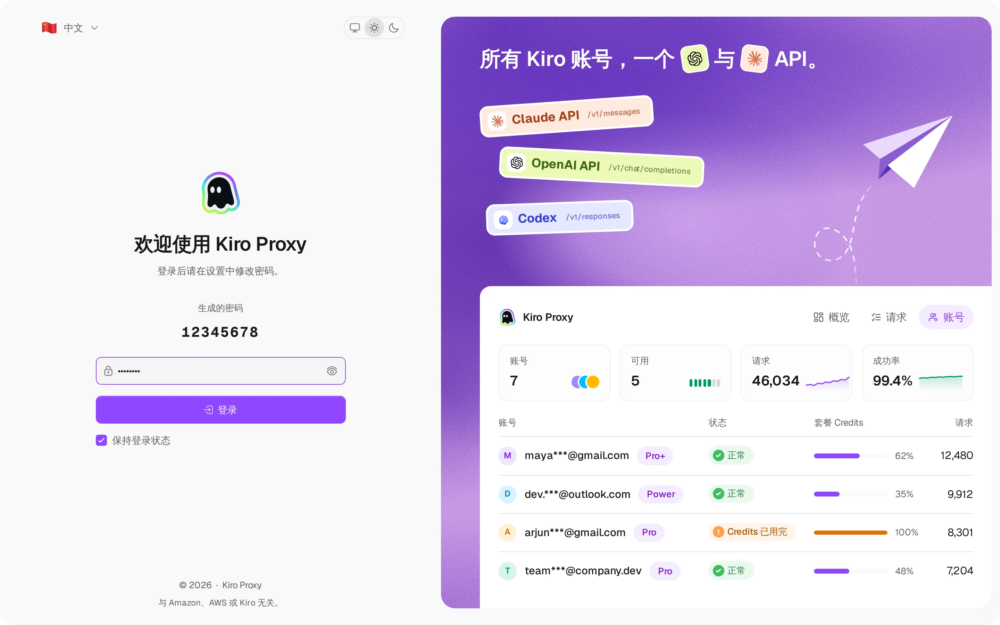
  </picture>
  <br><sub><b>登录</b> — 登录页可切换主题与界面语言</sub>
</p>

<p align="center">
  <picture>
    <source media="(prefers-color-scheme: dark)" srcset="screenshots/zh/overview-dark.webp">
    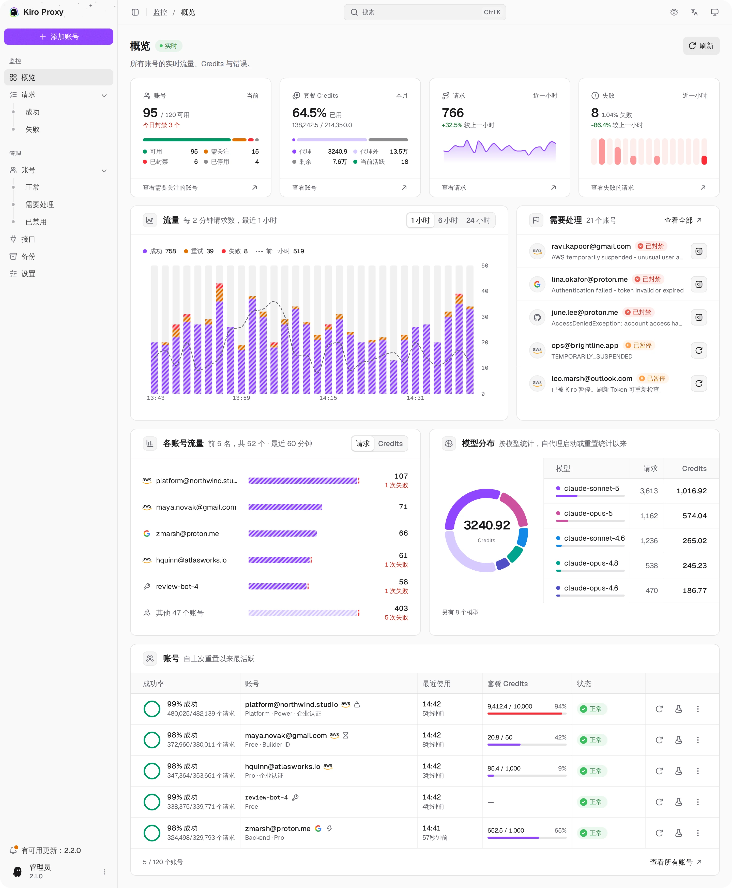
  </picture>
  <br><sub><b>概览</b> — 各账号的实时流量、Credits 与错误</sub>
</p>

<p align="center">
  <picture>
    <source media="(prefers-color-scheme: dark)" srcset="screenshots/zh/accounts-dark.webp">
    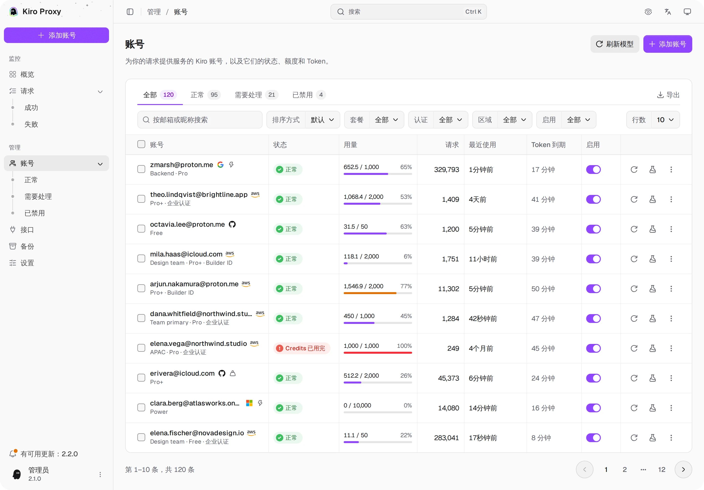
  </picture>
  <br><sub><b>账号</b> — 套餐 Credits、状态标签、筛选、批量操作与导出</sub>
</p>

<p align="center">
  <picture>
    <source media="(prefers-color-scheme: dark)" srcset="screenshots/zh/accounts-add-dark.webp">
    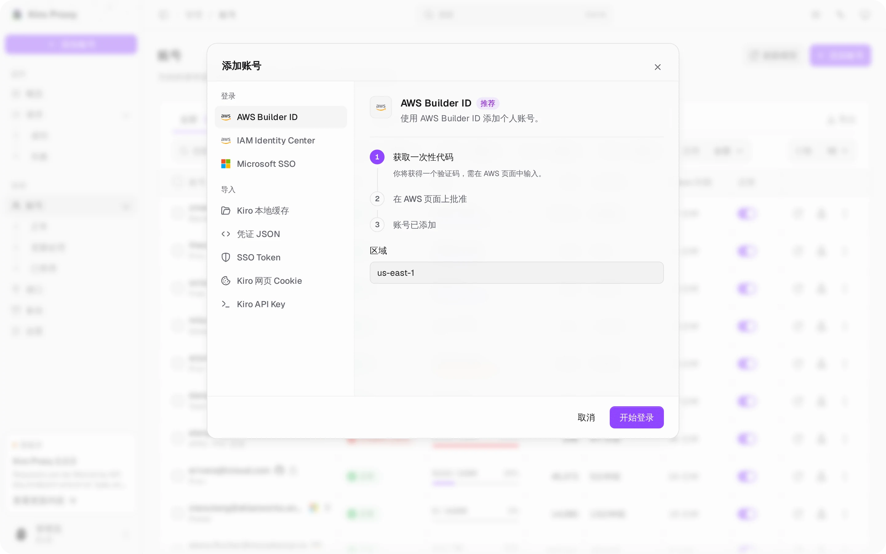
  </picture>
  <br><sub><b>添加账号</b> — 一个对话框列出全部登录与导入方式，每种都有步骤说明</sub>
</p>

<p align="center">
  <picture>
    <source media="(prefers-color-scheme: dark)" srcset="screenshots/zh/accounts-detail-dark.webp">
    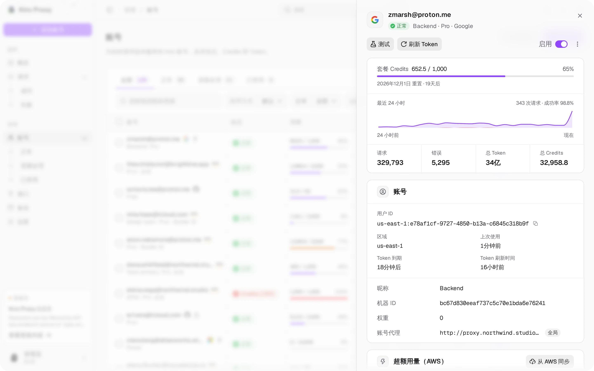
  </picture>
  <br><sub><b>账号详情</b> — 点击一行打开的详情面板：套餐 Credits、最近 24 小时、汇总与设置</sub>
</p>

<p align="center">
  <picture>
    <source media="(prefers-color-scheme: dark)" srcset="screenshots/zh/accounts-tester-dark.webp">
    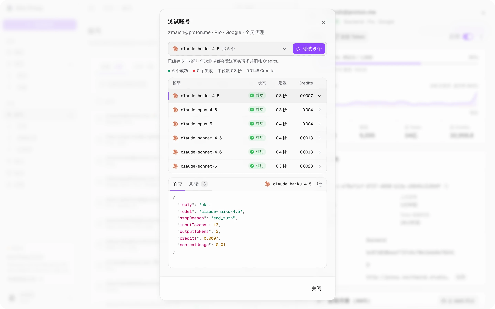
  </picture>
  <br><sub><b>模型测试</b> — 一次测试一个或全部已缓存的模型；点击一行查看响应与步骤</sub>
</p>

<p align="center">
  <picture>
    <source media="(prefers-color-scheme: dark)" srcset="screenshots/zh/requests-dark.webp">
    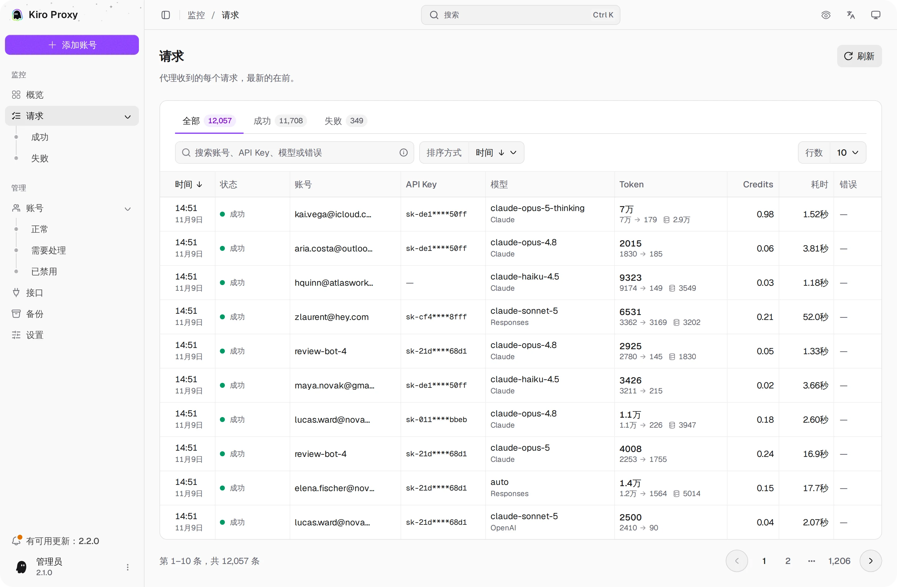
  </picture>
  <br><sub><b>请求</b> — 状态标签、搜索、排序与详情视图</sub>
</p>

<p align="center">
  <picture>
    <source media="(prefers-color-scheme: dark)" srcset="screenshots/zh/requests-detail-dark.webp">
    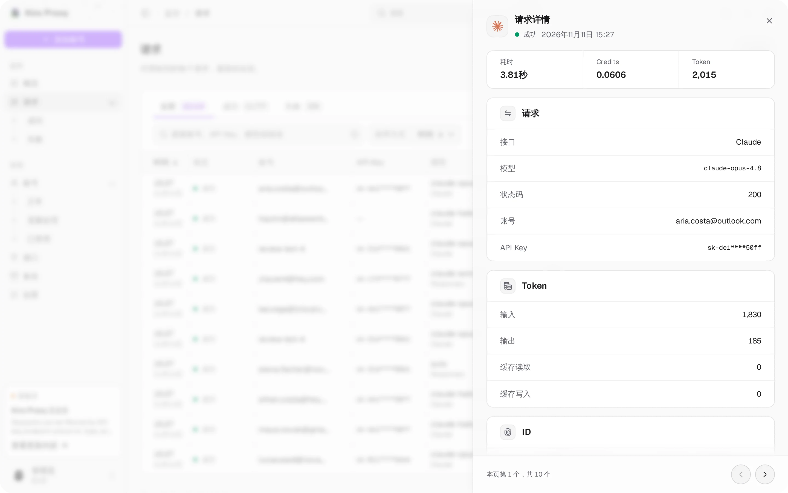
  </picture>
  <br><sub><b>请求详情</b> — 点击一行打开的详情面板：耗时、Credits、Token 与 ID</sub>
</p>

<p align="center">
  <picture>
    <source media="(prefers-color-scheme: dark)" srcset="screenshots/zh/api-dark.webp">
    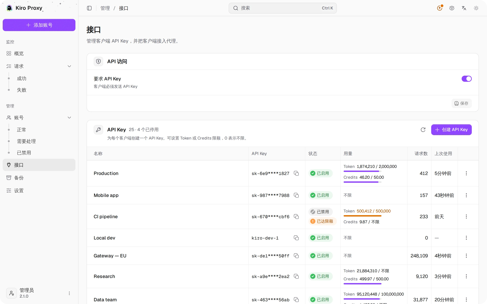
  </picture>
  <br><sub><b>接口</b> — API 访问、带限额的客户端 Key 与高亮的客户端配置</sub>
</p>

<p align="center">
  <picture>
    <source media="(prefers-color-scheme: dark)" srcset="screenshots/zh/backups-dark.webp">
    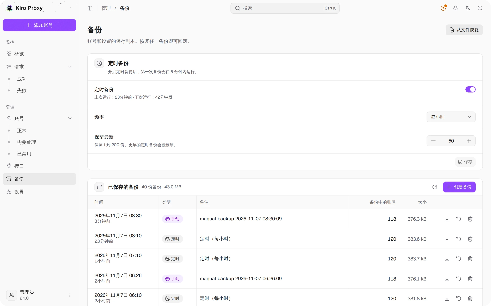
  </picture>
  <br><sub><b>备份</b> — 手动与定时备份、一键恢复</sub>
</p>

<p align="center">
  <picture>
    <source media="(prefers-color-scheme: dark)" srcset="screenshots/zh/settings-1-dark.webp">
    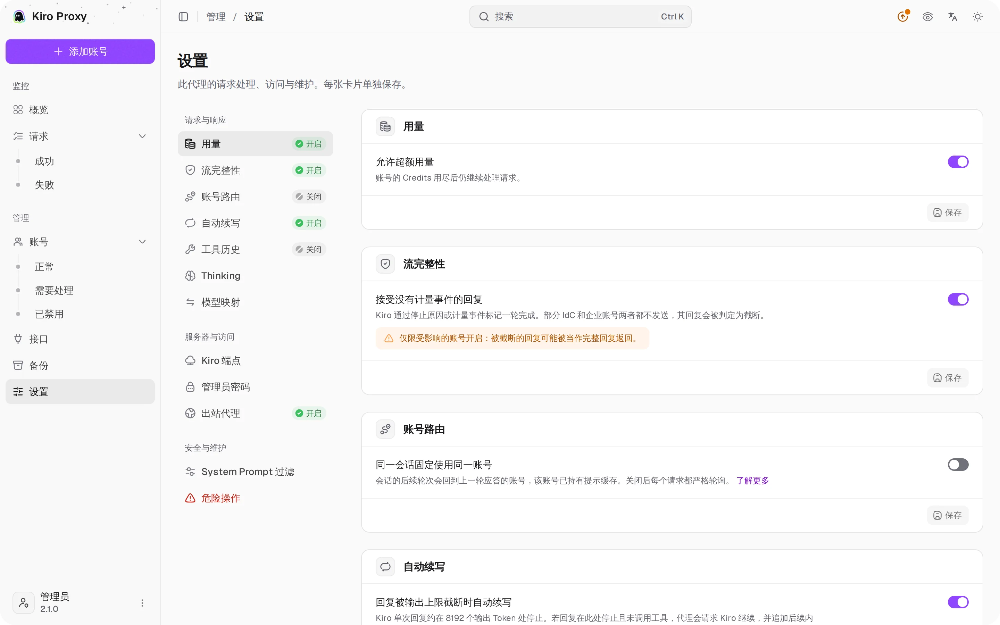
  </picture>
  <br><sub><b>设置</b> — 用量、流完整性、账号路由、自动续写</sub>
</p>

<p align="center">
  <picture>
    <source media="(prefers-color-scheme: dark)" srcset="screenshots/zh/settings-2-dark.webp">
    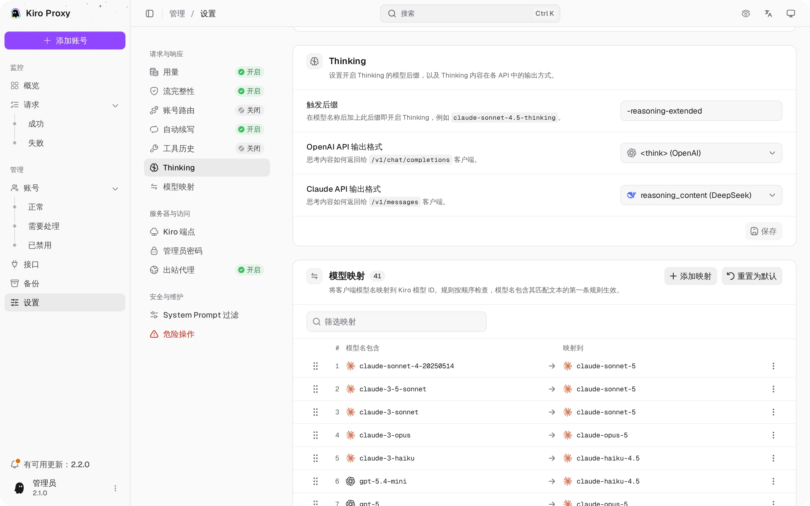
  </picture>
  <br><sub><b>设置</b> — Thinking 与模型映射</sub>
</p>

<p align="center">
  <picture>
    <source media="(prefers-color-scheme: dark)" srcset="screenshots/zh/settings-3-dark.webp">
    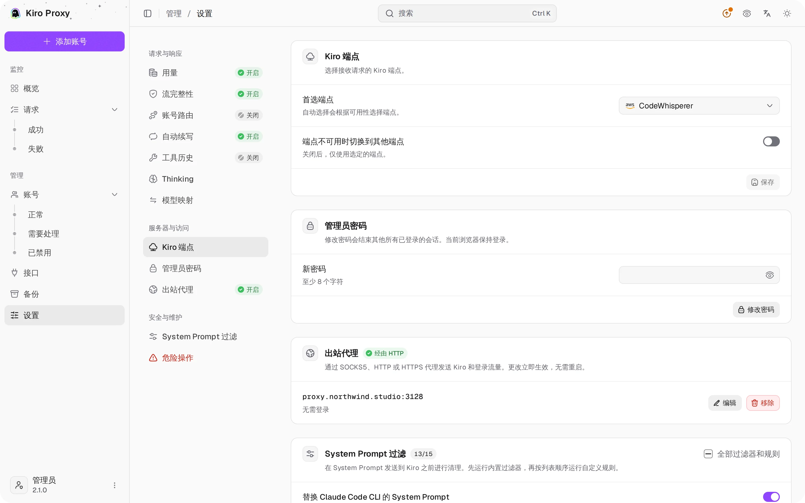
  </picture>
  <br><sub><b>设置</b> — Kiro 端点、管理员密码、出站代理</sub>
</p>

---

## ✨ 功能特性

### 🛰 API 接口

- Anthropic `/v1/messages`，原生工具调用与流式输出，另提供 `/v1/messages/count_tokens`。
- OpenAI `/v1/chat/completions`，工具调用结构完全对齐。
- OpenAI `/v1/responses`，支持 `previous_response_id` 链式调用与已存响应回查。
- `/v1/codex/models` 提供可直接用于 Codex 的模型列表，与标准的 `/v1/models` 并存。
- 全部端点支持 SSE 流式输出：上游瞬时错误时可在流中切换账号继续；上游无输出时（长时间推理、工具参数尚在缓冲）每 15 秒发送一次保活。
- Anthropic 的 `web_search` 服务端工具通过 Kiro 自带的网络搜索执行，结果以搜索结果块返回。
- 推理强度：OpenAI `reasoning_effort` 与 Claude `output_config.effort`（`low` 至 `xhigh`）会开启思考，并传递给支持强度等级的模型；`minimal` 则关闭思考。
- 工具调用还原：Kiro 以标记形式混入回复文本的工具调用会被还原为真正的工具调用（可用 `KIRO_TOOL_MARKUP_RESCUE=off` 关闭）。
- 支持请求体解压（gzip/deflate），方便预压缩负载的客户端接入。

### 🧰 请求处理

- **自动续写**（需手动开启）：回复在 Kiro 约 8192 Token 的输出上限处停止且未调用工具时，代理会请求 Kiro 继续，并追加后续内容，最多 10 次。
- **结构化工具历史**：历史中的工具调用及其结果以真实的工具调用形式发送给模型，长时间的智能体会话因此会继续调用工具；被拒绝的请求会以纯文本重试一次。
- **System Prompt 过滤**：将 Claude Code 内置的 System Prompt 替换为精简版本，去除环境噪音（环境变量、git 状态、最近提交），并按顺序应用你自定义的行级或正则规则。
- **模型映射**：有序规则，可拖拽排序，将任意客户端模型名映射到 Kiro 模型 ID；先匹配者生效。
- **流完整性**：拒绝既没有停止原因也没有计量事件就结束的回复；对两者都不发送的 IdC 和企业账号，可选择开启宽松模式。
- **端点选择**：指定 Kiro 端点，或由代理根据可用性自动选择，并可选择在不可用时切换到其他端点。

### 👥 账号池

- 多个 Kiro 账号按模型粒度轮询，并可为每个账号设置权重（权重为 N 的账号承接约 N 倍的新请求）。
- 会话亲和：会话的后续轮次会回到上一轮应答的账号，该账号已持有提示缓存；新会话仍在各账号间轮询。
- OAuth 令牌在过期前自动刷新，并发请求下也安全；账号冷却状态在重启后保留。
- 鉴权方式：AWS Builder ID、IAM Identity Center（企业 SSO）、Microsoft SSO（Entra ID）、SSO Token、Kiro IDE 本地缓存、凭证 JSON、Kiro 网页 Cookie，以及无界面的 Kiro API Key（`ksk_…`）。
- 单账号可配置：独立的出站代理、设备（机器）ID、锁定的 Kiro Profile、模型列表刷新、连接测试，以及真实的 Kiro 超额用量开关。
- 可选超额用量：账号的 Credits 用尽后仍继续处理请求。
- 单账号导入导出与批量操作。

### 🛡 管理面板

- React 单页应用内嵌于二进制文件，无需另行部署 Web 服务。
- 实时更新的概览仪表盘：账号、请求、成功与失败的 KPI 卡片及每小时趋势，带迷你走势图的每分钟实时指标，流量趋势，模型分布环形图，以及按账号堆叠的流量柱状图。统计卡片区分 Kiro 账号的 Credits 用量与本代理产生的请求用量。
- 账号页支持带计数的状态标签页、筛选（套餐、认证、区域、启用）、排序、批量操作、详情视图、连接测试与导出。
- 请求日志支持带计数的状态标签页、搜索（也会匹配完整的 API Key）、排序、含错误分类的详情视图、脱敏 API Key，以及基于 SQLite 的历史记录。
- 接口页管理客户端 API Key（可自定义 Key 值、启用/禁用、按 Key 设置 Token 与 Credits 限额、重置用量），并提供 curl、Claude Code、Codex 与 OpenAI SDK 的语法高亮接入示例。
- 设置页涵盖用量、账号路由、自动续写、工具历史、Thinking、模型映射、System Prompt 过滤、流完整性、Kiro 端点、出站代理、管理员密码与重置统计；备份页支持定时备份、上传与一键恢复。
- 命令菜单（<kbd>Ctrl</kbd>/<kbd>⌘</kbd> + <kbd>K</kbd>）可快速打开页面和执行操作；隐私模式可隐藏邮箱地址；支持对照 GitHub Releases 检查更新。
- 修改管理员密码会结束其他所有已登录的会话。
- 浅色 / 深色 / 跟随系统主题；界面支持四种语言：English、简体中文、Tiếng Việt 与 Português (Brasil)。
- 从手机到桌面均可流畅使用。

### 🌐 网络

- 支持出站代理：SOCKS5、HTTP 或 HTTPS，热切换无需重启，并可按账号单独设置。
- 思考模式后缀可配置，Anthropic `thinking` 配置直通透传。

### 🧩 存储

- 单文件 SQLite（`modernc.org/sqlite`）数据库 `kiro.db`，使用 DELETE journal 模式。
- 最终请求行是仪表盘请求数、Token、Credit、成功数与失败数的统计来源。
- 已存响应保留 30 天，写盘异步进行，不阻塞请求主路径。

---

## ⚙️ 环境要求

| 组件   | 版本                 |
| ------ | -------------------- |
| Go     | 1.25+                |
| Node.js | 22+ 及 pnpm（仅从源码构建管理面板时需要） |
| 操作系统 | Linux / macOS        |
| 容器   | Docker 24+（可选）   |
| 存储   | 本地磁盘卷           |

---

## 🚀 快速开始

### 🐳 Docker Compose（推荐）

```bash
git clone https://github.com/tanu360/kiro-reverse-api.git
cd kiro-reverse-api
docker-compose up -d
```

### 🐳 Docker Run

```bash
docker run -d \
  --name kiro-proxy \
  -p 8080:8080 \
  -e ADMIN_PASSWORD=your_secure_password \
  -v /path/to/kiro-proxy-state:/app/state \
  --restart unless-stopped \
  ghcr.io/tanu360/kiro-reverse-api:latest
```

### 🛠 源码编译

```bash
git clone https://github.com/tanu360/kiro-reverse-api.git
cd kiro-reverse-api
cd ui && pnpm install && pnpm build && cd ..
go build -o kiro-proxy .
./kiro-proxy
```

构建管理面板需要 Node.js 22+ 与 pnpm。`go build` 会内嵌 `ui/dist` 中的内容：未构建 UI 时，`/` 会显示 "UI not built" 页面，API 仍可正常使用。Docker 镜像会同时构建两者。

### 🎨 管理面板开发

以下命令在 `ui/` 目录下运行：

| 命令            | 说明                                                                            |
| --------------- | ------------------------------------------------------------------------------- |
| `pnpm dev`      | 开发服务器，地址 `http://localhost:5173/admin/`；将 `/admin/api` 与 `/v1` 代理到 `127.0.0.1:8080` |
| `pnpm dev:mock` | 使用模拟数据的开发服务器，无需后端；登录密码 `12345678`                          |
| `pnpm test`     | 单元与组件测试（Vitest）                                                        |
| `pnpm test:e2e` | 基于模拟模式的浏览器冒烟测试（Playwright）                                      |

> [!TIP]
> 首次运行会自动创建 `kiro.db`。可通过 `DATA_DIR` 指定存储目录；Docker 使用 `/app/state`。通过 `ADMIN_PASSWORD` 设置管理密码；未设置时，首次启动会生成并保存 8 位随机数字密码，在启动日志中显示一次，并在登录页面显示至首次成功登录。Docker 用户可运行 `docker compose logs kiro-proxy` 查看。重启后保留已保存的密码。旧版本生成且尚未用于登录的 48 字符密码会一次性替换为 8 位数字密码；已用于登录或显式设置的密码保持不变。

---

请求体上限为 32 MiB，传输时与每一层解压后均受此限制。最多接受三层编码。超出上限的请求返回 HTTP 413。同一时间最多解压八个压缩请求体；其余压缩请求排队等待，未压缩的请求从不等待。读取请求体的时限为 30 秒。

管理员密码验证允许每个客户端每分钟失败五次，登录与 `X-Admin-Password` 请求合并计数；一个 IPv4 地址或一个 IPv6 /64 网段算作一个客户端。若所有客户端在一分钟内累计失败 30 次，则在该分钟剩余时间内每个客户端降为每分钟一次尝试，以减缓分布式猜测，同时不会把任何人锁在门外。超出限制的尝试返回 HTTP 429 并附带 `Retry-After`；已有的会话令牌继续有效。代理不信任转发的 IP 头，因此位于同一反向代理之后的客户端共享该代理 IP 的额度。密码验证成功不消耗失败额度。恢复备份时会保留当前生效的 `ADMIN_PASSWORD` 覆盖设置。

## 🔧 配置

| 变量             | 用途                                | 默认值             |
| ---------------- | ----------------------------------- | ------------------ |
| `DATA_DIR`        | `kiro.db` 所在目录                  | `.`                |
| `ADMIN_PASSWORD` | 管理面板密码（覆盖配置文件）        | —                  |
| `LISTEN_HOST`    | 监听地址。默认只接受本机连接；设为 `0.0.0.0` 可接受其他机器连接。Docker 镜像已设为 `0.0.0.0` | `127.0.0.1` |
| `KIRO_TOOL_MARKUP_RESCUE` | 设为 `off` 时，不再把 Kiro 混入回复文本的工具调用标记还原为工具调用 | 开启 |
| `LOG_LEVEL`      | 日志级别：`debug`、`info`、`warn` 或 `error`（覆盖配置文件） | `info` |

> [!WARNING]
> `kiro.db` 包含 OAuth 令牌与管理员凭证。请按敏感信息处理，切勿提交到 git、截图或聊天记录中。数据库目录请挂载为私有卷。

---

## 🕹 使用方法

打开 `http://localhost:8080`，登录后添加账号即可调用 API：

```bash
# Anthropic — Claude
curl http://localhost:8080/v1/messages \
  -H "Content-Type: application/json" \
  -H "anthropic-version: 2023-06-01" \
  -d '{"model":"claude-sonnet-4.5","max_tokens":1024,"messages":[{"role":"user","content":"Hello!"}]}'

# OpenAI — Chat Completions
curl http://localhost:8080/v1/chat/completions \
  -H "Content-Type: application/json" \
  -H "Authorization: Bearer any" \
  -d '{"model":"gpt-4o","messages":[{"role":"user","content":"Hello!"}]}'

# OpenAI — Responses
curl http://localhost:8080/v1/responses \
  -H "Content-Type: application/json" \
  -H "Authorization: Bearer any" \
  -d '{"model":"gpt-4o","input":"Hello!"}'
```

### 📌 端点速查

| 方法     | 路径                            | 说明                                          |
| -------- | ------------------------------- | --------------------------------------------- |
| `POST`   | `/v1/messages`                  | Anthropic 协议的 Claude 补全                  |
| `POST`   | `/v1/messages/count_tokens`     | Anthropic 协议的 Token 计数                   |
| `POST`   | `/v1/chat/completions`          | OpenAI 协议的对话补全                         |
| `POST`   | `/v1/responses`                 | OpenAI Responses 接口（支持存储与链式调用）   |
| `GET`    | `/v1/responses/{id}`            | 读取已存储的响应                              |
| `DELETE` | `/v1/responses/{id}`            | 删除已存储的响应                              |
| `GET`    | `/v1/models`                    | 列出可用模型                                  |
| `GET`    | `/v1/codex/models`              | Codex CLI 格式的模型列表                      |
| `GET`    | `/v1/stats`                     | 代理使用聚合统计                              |
| `GET`    | `/health`                       | 健康检查                                      |
| `GET`    | `/`                             | Web 管理面板（内嵌 SPA；`/accounts` 等页面链接直接打开应用，旧的 `/admin/*` 链接会重定向，不请求 HTML 的客户端得到健康检查） |

---

## 🔑 托管 API Key

可在「**接口**」页面（「**API 访问 → 要求 API Key**」）中要求客户端使用 API Key。可以创建多个客户端 Key，每个 Key 单独设置限额：

- **自定义 API Key（可选）** 留空时自动生成安全的 `sk-...` Key；也可以手动输入自己的 Key 值。
- 列表与请求日志中会显示脱敏格式，例如 `sk-clb****e4yo`；完整 Key 仍会保存，用于鉴权，并可在 Key 详情中复制。
- Token 与 Credit 限额检查使用原始精确数值；界面上四舍五入或紧凑格式的标签仅用于显示。
- Token 或 Credit 限额为 `0` 表示该维度不限制。

---

## 📊 统计口径

「概览」页面与「账号」页面回答的是不同问题：

- **账号卡片**：当前配置的 Kiro 账号，使用 Kiro 服务器返回的配额字段（`usage_current / usage_limit`）。
- **请求卡片**：本代理的 SQLite `requests` 历史：`COUNT(*)`、`SUM(total_tokens)`、`SUM(credits)`。
- **成功 / 失败卡片**：同一个 `requests` 表中的最终代理请求结果。
- **账号列表卡片**：当前可见账号记录里保存的计数器（`requestCount`、`totalTokens`、`totalCredits`）。

如果旧账号或已删除账号在 `requests` 表中仍有历史行，「概览」页的「**代理 Credits**」可能高于当前可见账号的 Credits 总和。需要清空历史请求行时，可使用「**设置 → 危险操作 → 重置统计**」或进行一次性数据库清理。

Token 标签可能显示为紧凑格式（如 `54.5M`、`476.5K`），但后端计算与限额检查始终使用原始数值。

---

## 🧠 思考模式

在模型名后追加后缀（默认 `-thinking`）即可启用推理，例如 `claude-sonnet-4.5-thinking`。

Claude 兼容请求如果带有顶层 `thinking` 配置，也会自动启用：

```json
{ "type": "enabled", "budget_tokens": 2048 }
{ "type": "adaptive" }
```

OpenAI `reasoning_effort` 与 Claude `output_config.effort` 同样可用：`low`、`medium`、`high` 或 `xhigh` 会开启思考，并传递给支持强度等级的模型；`minimal` 则关闭思考。

输出格式可在管理面板「**设置 → Thinking**」中配置。

---

## 🛰 出站代理

如果你的网络受限，可在管理面板「**设置 → 出站代理**」中配置出站代理。

| 类型     | 示例                          |
| -------- | ----------------------------- |
| SOCKS5   | `socks5://127.0.0.1:1080`     |
| HTTP     | `http://127.0.0.1:8888`       |
| HTTPS    | `https://proxy.example.com:443` |

> [!TIP]
> 设置保存后即时生效，无需重启服务。单个账号也可以使用独立代理（账号详情 → **账号代理**）；留空则使用全局代理。

---

## 🔐 环境变量

| 变量             | 说明                                  | 默认值             |
| ---------------- | ------------------------------------- | ------------------ |
| `DATA_DIR`        | `kiro.db` 所在目录                    | `.`                |
| `ADMIN_PASSWORD` | 管理面板密码（覆盖配置文件）          | —                  |
| `LISTEN_HOST`    | 监听地址。默认只接受本机连接；设为 `0.0.0.0` 可接受其他机器连接。Docker 镜像已设为 `0.0.0.0` | `127.0.0.1` |
| `KIRO_TOOL_MARKUP_RESCUE` | 设为 `off` 时，不再把 Kiro 混入回复文本的工具调用标记还原为工具调用 | 开启 |
| `LOG_LEVEL`      | 日志级别：`debug`、`info`、`warn` 或 `error`（覆盖配置文件） | `info` |

```diff
+ kiro.db                # local state — config, credentials, SQLite history, backup blobs
```

> [!CAUTION]
> `kiro.db` 是敏感文件，账号令牌与管理员凭证以明文形式落盘存储，请严加保护。

---

## 🙏 项目致谢

本项目是 [Quorinex/Kiro-Go](https://github.com/Quorinex/Kiro-Go) 的延续。原始项目的贡献与功劳归原作者所有；我在此基础上继续维护和推进。

管理面板基于以下开源项目：[Studio Admin](https://github.com/arhamkhnz/next-shadcn-admin-dashboard)、[t3code](https://github.com/pingdotgg/t3code)、[coss ui](https://github.com/cosscom/ui)、[Bklit UI](https://github.com/bklit/bklit-ui) 与 [openstatus data-table-filters](https://github.com/openstatusHQ/data-table-filters)。许可证详见 [THIRD_PARTY_NOTICES.md](./THIRD_PARTY_NOTICES.md)。

---

## 🛡 安全须知

- ✅ 仅用于你**有权限**操作的账号。
- ❌ **不得**用于批量账号爬取或绕过服务条款。
- ❌ **不得**叠加 CAPTCHA 绕过、身份伪造、限流绕过等行为。
- 🔐 `kiro.db` 切勿出现在 git、公开备份与截图中。
- 🧯 若上游持续返回鉴权错误，代理会快速失败，请先排查再重试。

> [!IMPORTANT]
> 本项目仅供学习与研究使用，与 Amazon、AWS 或 Kiro 无关联。用户需自行确保符合相关服务条款与法律法规，使用风险自负。

---

## 📄 开源许可

[MIT](./LICENSE)

---

<div align="center">
<sub>用 ❤️ 与 Go 构建 · 如果项目帮你省了时间，请回仓库点个 ⭐</sub>
</div>
