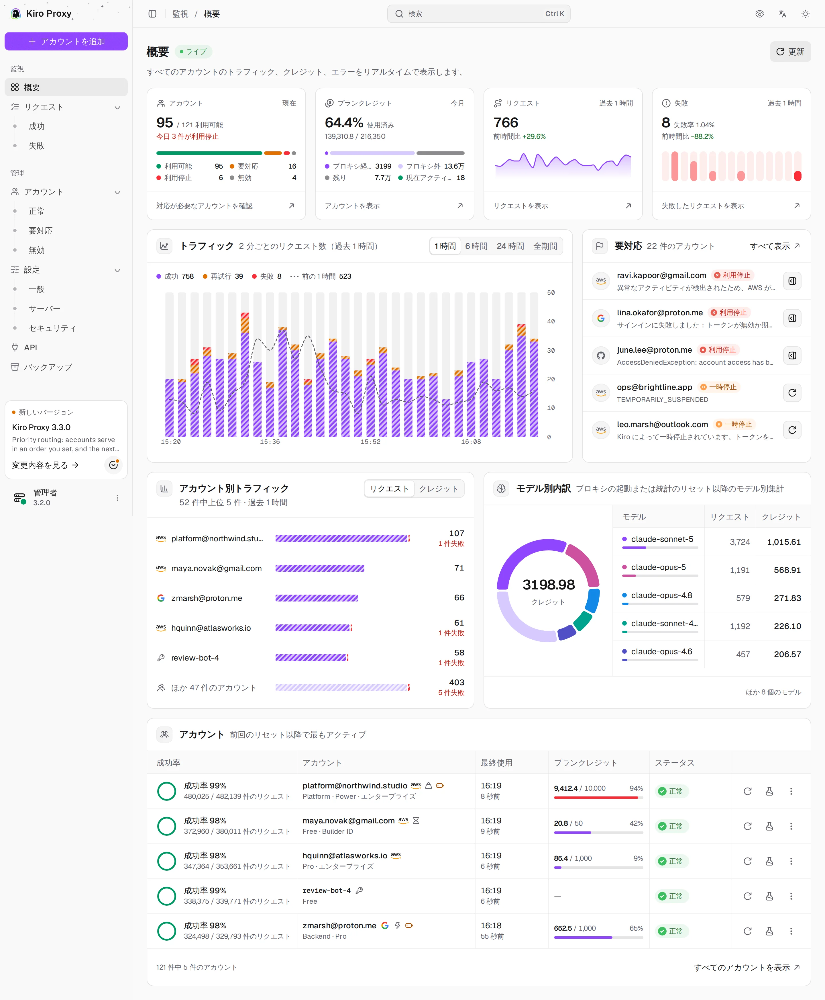

<div align="center">


# Kiro Proxy

#### Kiro アカウントを OpenAI / Anthropic 互換のエンドポイントに変換するローカルプロキシ。

<p>
  <a href="https://go.dev/"></a>
  <a href="https://www.docker.com/"></a>
  <a href="https://www.sqlite.org/"></a>
  <a href="LICENSE"></a>
</p>

<p>
  <a href="#-概要">概要</a> •
  <a href="#-プレビュー">プレビュー</a> •
  <a href="#-機能">機能</a> •
  <a href="#-クイックスタート">クイックスタート</a> •
  <a href="#-設定">設定</a> •
  <a href="#-使い方">使い方</a> •
  <a href="#-思考モード">思考モード</a> •
  <a href="#-送信プロキシ">送信プロキシ</a> •
  <a href="#-利用上の注意">利用上の注意</a>
</p>

[English](README.md) • [简体中文](README_CN.md) • [日本語](README_JA.md) • [Português (Brasil)](README_PT-BR.md) • [Tiếng Việt](README_VI.md)

</div>

---

## 🌟 概要

**Kiro Proxy** は、使用権限を持つ 1 つ以上の **Kiro** アカウントを、**OpenAI** と **Anthropic** の通信形式に対応したローカル API エンドポイントに変える、小さな Go サービスです。

1. 複数の Kiro アカウントをプールし、ラウンドロビン、重み付けまたは優先度、セッションアフィニティによってリクエストを負荷分散します。
2. Anthropic `/v1/messages`、OpenAI `/v1/chat/completions`、OpenAI `/v1/responses` の呼び出しと Kiro のアップストリームとの間を双方向に変換します。ツール、思考、推論強度、Web 検索にも対応しています。
3. アクセストークンを自動で更新し、Server-Sent Events をエンドツーエンドでストリーミングします。キープアライブとフェイルオーバーにも対応しています。
4. バイナリに組み込まれた React 製の管理パネルを同梱しています。アカウント管理、リアルタイムの監視、リクエストの監査ができ、English、简体中文、日本語、Tiếng Việt、Português (Brasil) で利用できます。ユーザーパネルでは、各 API キーの利用者がそのキーの使用量を確認できます。

> [!IMPORTANT]
> 単一バイナリのローカルプロキシです。ホスト型のサービスでは**ありません**。また、Amazon、AWS、Kiro とは**一切関係ありません**。プールに追加するすべてのアカウントについて、自分で所有しているか、使用する権限を持っている必要があります。

このプロジェクトが役に立ったら、Star をいただけるととても励みになります。

---

## 🖼 プレビュー

<p align="center">
  <picture>
    <source media="(prefers-color-scheme: dark)" srcset="screenshots/ja/overview-dark.webp">
    
  </picture>
  <br><sub><b>概要</b> — 全アカウントのリアルタイムのトラフィック、クレジット、エラー</sub>
</p>

<p align="center">📸 <a href="docs/SCREENSHOTS_JA.md"><b>その他のスクリーンショット</b></a> — アカウント、リクエスト、API、バックアップ、設定、ユーザーパネル</p>

## ✨ 機能

### 🛰 対応 API

- Anthropic `/v1/messages`：ネイティブのツール使用とストリーミングに対応し、`/v1/messages/count_tokens` も提供します。
- OpenAI `/v1/chat/completions`：ツール呼び出しの構造を完全に再現します。
- OpenAI `/v1/responses`：`previous_response_id` によるチェーンと、保存済みレスポンスの取得に対応します。
- 標準の `/v1/models` に加えて、Codex ですぐに使えるモデル一覧を `/v1/codex/models` で提供します。
- すべてのエンドポイントで SSE ストリーミングに対応します。アップストリームで一時的なエラーが起きた場合はストリームの途中でもアカウントをフェイルオーバーし、アップストリームからの出力が途切れている間（長い推論や、ツール引数の保留中）は 15 秒ごとにキープアライブを送信します。
- Anthropic の `web_search` サーバーツールと OpenAI のホスト型 `web_search` ツールは、Kiro 自身の Web 検索で実行されます。`/v1/messages` は検索結果ブロックを、`/v1/responses` は `web_search_call` アイテムを返し、どちらの OpenAI API も回答が引用した結果を `url_citation` アノテーションとして示します。`/v1/chat/completions` では、`web_search_options` によって `tools: [{"type": "web_search"}]` と同じ検索が有効になります。`search_context_size` は検索 1 回あたりに保持する結果を 3 件（`low`）、5 件（`medium`、デフォルト）、10 件（`high`）のいずれかにします。`user_location` は、場所が関係する場合にクエリへ含められるようモデルに渡されます。それ以外のフィールドは無視されます。
- 推論強度：OpenAI の `reasoning_effort` と Claude の `output_config.effort`（`low` 〜 `xhigh`）は思考を有効にし、強度レベルに対応したモデルに渡されます。`minimal` を指定すると思考は無効になります。
- 構造化出力：OpenAI の `response_format`（`json_object`、`json_schema`）、Claude の `output_config.format`、Responses の `text.format` は、スキーマで検証した JSON だけを返します（[構造化出力](#-構造化出力) を参照）。
- 思考の署名：`/v1/messages` では、思考ブロックに Kiro が送る `signature`（ストリーミング時は `signature_delta`）が含まれ、`redacted_thinking` ブロックはそのまま渡されます。
- ツール呼び出しの復元：Kiro が回答の中にマークアップとして漏らしたツール呼び出しを、本来のツール呼び出しに戻します（`KIRO_TOOL_MARKUP_RESCUE=off` で無効にできます）。
- ペイロードを事前に圧縮するクライアント向けに、リクエストボディの展開（gzip/deflate）に対応します。

### 🧰 リクエスト処理

- **自動継続**（オプトイン）：回答がツール呼び出しのないまま Kiro の出力上限（約 8192 トークン）で止まった場合、プロキシが Kiro に続きを依頼して残りを連結します。最大 10 回まで行います。
- **構造化ツール履歴**：過去のツール呼び出しとその結果を本来のツール呼び出しとしてモデルに渡すため、長いエージェントセッションでもツールを呼び出し続けられます。リクエストが拒否された場合は、プレーンテキストとして 1 回だけ再試行します。
- **システムプロンプトフィルター**：Claude Code に組み込まれたシステムプロンプトをコンパクトなものに置き換え、環境に関するノイズ（環境変数、git のステータス、最近のコミット）を取り除いたうえで、独自の行ルールや正規表現ルールを順番に適用します。
- **モデルマッピング**：ドラッグで並べ替えられる順序付きのルールで、クライアントが指定した任意のモデル名を Kiro のモデル ID に対応付けます。最初に一致したルールが適用されます。Kiro 自身が一覧に載せているモデルは、完全な名前を指定したルールにしか従わないため、`gpt-5` のような部分一致のルールでネイティブモデルが別のモデルに転送されることはありません。
- **ストリームの完全性**：停止理由も計測イベントもないまま終わった応答を拒否します。どちらも送らない IdC アカウントや Enterprise アカウント向けに、オプトインの緩和モードもあります。
- **エンドポイントの選択**：Kiro のエンドポイントを指定するか、可用性に応じてプロキシに選ばせます。ほかのエンドポイントへのフォールバックも設定できます。
- **Kiro の新しいチャット API**：Kiro は一部のアカウントを CreateResponse（`runtime.{region}.kiro.dev` 上の `/v1/responses`）に移行しつつあり、移行したアカウントはクレジットが残っていても旧 API から HTTP 429 `USER_REQUEST_RATE_EXCEEDED` を受け取ります。プロキシは Kiro IDE と同じように各アカウントのフラグを Kiro から読み取り（15 分間保持し、旧 API がこの 429 を返したときはすぐに読み直します）、そのアカウントのチャットを Kiro が選んだ API に送ります。「**設定 → Kiro エンドポイント → チャット API**」（設定の `chatApi`：`auto`、`responses`、`legacy`）を使うと、すべてのアカウントを 1 つの API に固定できます。Kiro API キーは常に Kiro CLI のランタイムを使用します。
- **画像のリサイズ**（デフォルトで有効）：幅または高さが 1568 px を超える画像や、400 KB を超える画像は、縮小して再エンコードしてから Kiro に送ります。どちらの上限も設定で変更できます。
- **レスポンスヘッダー**：ストリームやエラーを含むすべての API レスポンスに、最大 20 個のカスタムヘッダーを付けられます。値には `{request_id}`、`{model}`、`{account_id}`、`{key_id}`、`{client_ip}` を使用できます。`{request_id}` はリクエストログのトレース ID です。

### 👥 アカウントプール

- 複数の Kiro アカウントを 3 つのルーティングモードで扱えます。**重み付け**（デフォルト）：モデルごとのラウンドロビンで、アカウントごとに重みを設定できます（重み N のアカウントは新しいリクエストを約 N 倍多く受け持ちます）。**優先度**：新しいリクエストは、処理できるアカウントのうち優先度の数値（0〜999）が最も大きいアカウントに送られます。そのアカウントがクールダウン中、クレジット切れ、無効、またはモデルに非対応の間は、次のアカウントが引き継ぎます。どのアカウントも 0 から始まるため、1 つのアカウントの数値を上げればそのアカウントが最優先になります。同じ数値のアカウントは一覧の順に並びます。**リセットが近い順**：新しいリクエストは、クレジットが残っているアカウントのうち、クレジットのリセットが最も早いアカウントに送られます。これにより、リセット時に失効するクレジットから先に使われます。同じ日にリセットされるアカウント同士では、残りクレジットが最も多いアカウントが優先されます。クレジットが残っていないアカウントは最後に回され、超過利用が許可されている場合にのみ使われます。
- セッションアフィニティ（**会話を同じアカウントに固定**）：会話の 2 ターン目以降は、前のターンに応答し、すでにプロンプトキャッシュを持っているアカウントに戻ります。新しい会話は引き続きルーティングモードに従います。優先度モードでは優先度が先に考慮されます。優先度の高いアカウントが再び空くと、進行中の会話の次のターンはそのアカウントに送られますが、同じ優先度のアカウントが会話を引き取ることはありません。リセットが近い順モードでは、クレジットのリセット日がより早いアカウントにだけターンが移ります。無効にすると、すべてのリクエストがルーティングモードに従って振り分けられます。
- アカウントごとに 1 分あたり 1〜1000 リクエストの上限を任意で設定できます。上限に達したアカウントはスキップされ、すべてのアカウントが上限に達するとクライアントには HTTP 429 が返ります。Kiro に到達しなかった試行（プロキシや接続の失敗）はカウントされません。アカウントページには、各アカウントの現在の 1 分あたりのリクエスト数と今日のリクエスト数が表示されます。
- クレジットの予測：各アカウントの過去 7 日間のクレジット消費をもとに、そのペースでクレジットをいつ使い切るか、リセット時にどれだけ未使用のまま残るかを詳細に表示します。アカウント一覧では、クレジットのリセット前に使い切りそうなアカウントに印が付きます。
- **自動修復**（デフォルトで有効）：処理できるアカウントがなくなると、プロキシは自分で設定した認証による利用停止とエラーのクールダウンを解除して再試行します。実行は最大で 5 分に 1 回、リクエストが 1 件も成功しないまま連続 5 回までです（どちらも変更できます）。Kiro による停止（「locked your account」という 403 も停止とみなします）、あなたが無効にしたアカウント、クォータのクールダウンが解除されることはありません。
- OAuth トークンを有効期限の前に自動で更新します。同時リクエストがあっても安全で、アカウントのクールダウンは再起動後も維持されます。
- 使用量と期限切れ間近のトークンを、デフォルトでは 30 分ごとにバックグラウンドで更新します。間隔は 5 分〜24 時間から選べるほか、「オフ」にすると必要なときだけ更新します。その場合も、リクエストに必要なトークンは引き続き更新されます。
- 保存済みのアカウントにもう一度サインインしたり、インポートし直したりすると、複製を追加するのではなく既存のアカウントを更新します。保存済みの Kiro API キーをもう一度追加すると HTTP 409（追加済み）で拒否されます。ただし、同じバックエンドにエクスポートを読み込み直す場合のように、メモやタグが付いていてリージョンも同じ場合は例外で、タグは保存済みアカウントのタグに統合され、空のメモとニックネームが補完されます。以前のバージョンで生じた複製（リフレッシュトークン、Kiro API キー、ユーザー ID、またはメールアドレスとサインイン方法が同じもの）は、アカウントページの通知に表示されます。「**確認**」を使うと、バックアップを取ったうえで各グループを 1 つのアカウントに統合します。リクエスト、合算したカウンター、メモ、タグは保持され、残すアカウントに個別プロキシがない場合は複製側のプロキシも引き継がれます。
- すべてのアカウントメニューにある「**再サインイン**」は、アカウントのログイン情報をその場で置き換え、ID、設定、メモ、タグ、統計を維持します。利用停止は解除されますが、あなたが無効にしたアカウントは無効のままです。新しいサインインが別のユーザーのものである場合、プロキシは ID を置き換える前に確認を求めます。プール内の別のアカウントに属するサインインは、確認なしで HTTP 409（`relogin_other_account`）で拒否されます。このアカウントは変更されず、パネルにはその別のアカウントと、そのアカウントが新しいトークンを取り込んだかどうかが表示されます。
- アカウントごとにメモ（最大 2000 文字）とタグ（最大 10 個、各 24 文字まで）を付けられます。検索はメモとタグにも一致し、タグはタグフィルターと一括操作で使えます。エクスポートとインポートでは両方が保持されます。
- 認証方法：AWS Builder ID、IAM Identity Center（Enterprise SSO）、Microsoft SSO（Entra ID）、SSO トークン、Kiro IDE のローカルキャッシュ、認証情報 JSON、Kiro の Web Cookie、ヘッドレスの Kiro API キー（`ksk_…`）。「**アカウントを追加**」では、各サインインリンクに「開く」アイコンと「コピー」アイコンがあります。
- アカウントごとの設定：個別プロキシ、デバイス（マシン）ID、固定する Kiro プロファイル、モデル一覧の更新、接続テスト、Kiro 本来の超過利用スイッチ。
- 任意の超過利用：クレジットを使い切った後もアカウントがリクエストを処理し続けます。
- アカウント単位のインポート／エクスポートと一括操作。

### 🛡 管理パネル

- バイナリに組み込まれた React のシングルページアプリです。別途 Web サーバーを動かす必要はありません。
- リアルタイムに更新される概要ダッシュボード：4 つの KPI カード（アカウント、プランクレジット、直近 1 時間のリクエスト数と失敗数）、直近 1 時間・6 時間・24 時間・全期間のトラフィックを示す積み上げ棒グラフ、対応が必要なアカウントの一覧、アカウント別のトラフィック、モデル別内訳のドーナツグラフ、最もアクティブなアカウント。「**プランクレジット**」カードは、Kiro クレジットの使用量をプロキシ経由で使われた分とプロキシ外で使われた分に分けて表示します。
- アカウントページ：件数付きのステータスタブ、フィルター（プラン、認証、リージョン、有効状態、タグ）、メールアドレス・ニックネーム・メモ・タグの検索、並べ替え、一括操作、詳細ビュー、接続テスト、現在の 1 分あたりのリクエスト数と今日のリクエスト数、重複の確認、エクスポート。
- リクエストログ：件数付きのステータスタブ、検索（完全な API キーにも一致）、並べ替え、エラー分類付きの詳細ビュー、トレース ID とアップストリームへの各試行のタイムライン（アカウント、エンドポイント、所要時間、結果、フェイルオーバー）、マスクされた API キー、SQLite に保存される履歴。各行のモデルの下には、呼び出したクライアント（Claude Code、Codex、opencode、Cline、Roo Code、Kilo Code、いずれでもない場合は Anthropic API、OpenAI API、OpenAI Responses）が表示されます。プロキシは User-Agent といくつかのクライアントヘッダーからクライアントを判別し、User-Agent 自体は保存しません。トークンは入力、キャッシュ、出力に分けた 1 本のバーで表示されます。リクエストの詳細からは、そのリクエストが属する会話（ターンの順序、各ターンで使われたアカウント、フェイルオーバー、合計）を開き、ログをその会話に絞り込めます。また「**再送信**」では、記録されたリクエストを選んだアカウントとモデルで再実行できます（[会話と再送信](#-会話と再送信) を参照）。
- API ページ：クライアント API キーの管理（任意のカスタムキー値、有効化／無効化、キーごとのトークン・クレジット・呼び出し回数の上限、1 分あたりのリクエスト数、有効期限、許可するモデル、アカウント単位またはタグ単位でのアカウントの割り当て、キーごとのルーティングモード、再生成、使用量のリセット）、各キーの上限に対する使用状況（75 % 以上で黄色、上限を使い切ると赤）、「**キー別の使用量**」グラフ、構文ハイライト付きのクライアント設定ビルダー。ビルダーは Anthropic Messages、OpenAI Chat Completions、OpenAI Responses の各 API について、curl、Python、Node.js、Go、Java、PHP、Ruby、C# のリクエストコード（公式 SDK またはプレーンな HTTP、ストリーミングの有無を選択）とサンプルレスポンスを生成し、Claude Code と Codex の設定も用意します。
- 設定：使用量とバックグラウンド更新、ルーティング（モード、セッションアフィニティ、アカウントごとの上限）、自動継続、ツール履歴、画像のリサイズ、自動修復、思考、モデルマッピング、プロンプトフィルター、ストリームの完全性、エンドポイント、公開リンク、アップストリームのドメインとリージョン、送信プロキシ、プロキシプール、レスポンスヘッダー、アラート、サーバーログ、管理者パスワード、2 段階認証、Prometheus メトリクス、ログの保持、統計のリセット。バックアップでは、スケジュール、アップロード、ワンクリック復元に対応します。
- クレジットが残り少なくなったとき、アカウントが利用停止になったとき、リクエストを処理できるアカウントがなくなったときに、Webhook、Telegram、Discord、Slack へアラートを送信します。任意で日次の使用量サマリーも送れます（[アラート](#-アラート) を参照）。
- ページや操作を呼び出せるコマンドメニュー（<kbd>Ctrl</kbd>/<kbd>⌘</kbd> + <kbd>K</kbd>）、メールアドレスをマスクするプライバシーモード、リポジトリの `main` ブランチにある `version.json` を読み取るアップデートチェック。
- バイナリ版の自己アップデート：アップデートダイアログがサーバーのプラットフォーム向けの新しいリリースをダウンロードし、リリースの `SHA256SUMS.txt` で検証してから、実行中のプログラムと置き換えます。古いプログラムは `<name>.old` として隣に残ります。「**再起動して更新**」は処理中のリクエストに最大 30 秒の猶予を与えてから新しいバージョンを起動し、サインインは再起動後も維持されます。コンテナ内のサーバー、リリースビルドのないプラットフォーム上のサーバー、自身のフォルダーに書き込めないサーバーには、手動で更新する手順が表示されます。
- **ユーザーパネル**（`/user`）：API キーの利用者がそのキーでサインインし、そのキーの情報だけを確認できます。状態、上限、設定、24 時間・7 日・30 日・全期間の 4 つの KPI カード（リクエスト、失敗、クレジット、トークン）、使用量の推移、モデル別とクライアント別の使用量、詳細ビュー付きの最近のリクエスト、エンドポイント、クライアントの設定（[API キーの管理](#-api-キーの管理) を参照）。
- 管理者パスワードを変更すると、ほかのすべてのサインイン中のセッションが終了します。
- 認証アプリによる 2 段階認証と、10 個の使い捨てリカバリーコード（[2 段階認証](#-2-段階認証) を参照）。
- ライト、ダーク、システムのテーマ。UI は English、简体中文、日本語、Tiếng Việt、Português (Brasil) の 5 言語に対応しています。
- スマートフォンからデスクトップまで対応します。

### 🌐 ネットワーク

- 送信プロキシ（SOCKS5、HTTP、HTTPS）に対応します。再起動なしで切り替えられ、アカウントごとに上書きすることもできます。保存済みのプロキシのパスワードは `********` と表示されます。
- プロキシプール：個別プロキシのないアカウントに、プールからプロキシを 1 つずつ割り当てます。ヘルスチェック、プロキシごとのオン／オフスイッチ、3 回連続で失敗したときの正常なプロキシへの移動に対応し、グローバルプロキシとアカウントの個別プロキシも検出されたプロキシとしてチェックします（[プロキシプール](#-プロキシプール) を参照）。
- アップストリームのドメインとリージョン（「**設定 → アップストリームのドメインとリージョン**」）：チャットと Web 検索の送信先を `q.{region}.amazonaws.com` から `runtime.{region}.kiro.dev` に変更できます（使用量とモデル一覧は AWS のままです）。また、すべてのアカウントについて、API リージョン（`us-east-1` または `eu-central-1`）や、Builder ID と IAM Identity Center のトークンを更新するリージョンを上書きできます。アカウントに合わないリージョンを指定するとそのアカウントのリクエストは失敗しますが、アカウントが利用停止になることはありません。
- 思考モードのサフィックスを設定でき、Anthropic の `thinking` 設定もそのまま渡せます。
- 公開リンク：スイッチ 1 つで、Tailscale Funnel を通じて管理パネルと API を `https://kiro-proxy.tail1234.ts.net` のような公開 HTTPS アドレスで公開できます。ポートフォワーディングは不要です（[公開リンク](#-公開リンク) を参照）。

### 🧩 ストレージ

- 単一ファイルの SQLite（`modernc.org/sqlite`）データベースを `kiro.db` に保存し、WAL モードを使用します。管理画面の読み取りは書き込みと並行して動くため、リクエストログの記録を待たせません。正常に停止すると `kiro.db-wal` は `kiro.db` に書き戻されます。サーバー稼働中にコピーする場合は `kiro.db-wal` も一緒にコピーしてください。
- ダッシュボードのリクエスト数、トークン、クレジット、成功数、失敗数の合計は、確定したリクエスト行と、ログの保持によって削除された行の集計をもとに算出します。
- ログの保持：90 日（1〜365 日、0 で無期限）より古いリクエストログとエラーログの行は、起動の 2 分後とその後は毎日、小さなバッチに分けて削除されます。
- 保存済みレスポンスは 30 日間保持し、書き込みはリクエストのホットパスから外して非同期で行います。
- 再送信用にリクエスト本文を 30 日間保持します。1 件あたり最大 2 MiB で圧縮して保存し、クライアントのキーはマスクされます。合計は 256 MiB までで、古いものから削除されます。

---

## ⚙️ 動作要件

| コンポーネント | バージョン           |
| -------------- | -------------------- |
| Go             | 1.25 +               |
| Node.js        | 22 + と pnpm（管理 UI をソースからビルドする場合のみ） |
| OS             | Linux / macOS / Windows |
| コンテナ       | Docker 24+（任意）   |
| ストレージ     | ディスク上のローカルボリューム |

---

## 🚀 クイックスタート

### 🐳 Docker Compose（推奨）

```bash
git clone https://github.com/tanu360/kiro-reverse-api.git
cd kiro-reverse-api
docker-compose up -d
```

### 🐳 Docker Run

```bash
docker run -d \
  --name kiro-proxy \
  -p 8080:8080 \
  -e ADMIN_PASSWORD=your_secure_password \
  -v /path/to/kiro-proxy-state:/app/state \
  --restart unless-stopped \
  ghcr.io/tanu360/kiro-reverse-api:latest
```

### 📦 バイナリをダウンロード

各 [リリース](https://github.com/tanu360/kiro-reverse-api/releases) には、Linux、macOS、Windows（x64 と arm64）向けのすぐに実行できるバイナリが、管理 UI を組み込んだ状態で含まれています。Go、Node.js、Docker は不要です。

```bash
# linux-x64 をお使いのプラットフォームに置き換えてください：linux-arm64、macos-apple-silicon、macos-intel
curl -LO https://github.com/tanu360/kiro-reverse-api/releases/latest/download/kiro-proxy-linux-x64.tar.gz
tar -xzf kiro-proxy-linux-x64.tar.gz
cd kiro-proxy-linux-x64
./kiro-proxy
```

Windows では `kiro-proxy-windows-x64.zip`（または `kiro-proxy-windows-arm64.zip`）をダウンロードして展開し、ターミナルから `kiro-proxy.exe` を実行します。データベースはカレントフォルダーに作成されます。別の場所に保存するには `DATA_DIR` を設定してください。サーバーは `127.0.0.1:8080` で待ち受けます。8080 が使用中の場合は `PORT` を、ほかのマシンからの接続を受け付ける場合は `LISTEN_HOST=0.0.0.0` を設定してください。リリースの `SHA256SUMS.txt` にはすべてのアーカイブのチェックサムが記載されており、`sha256sum -c SHA256SUMS.txt --ignore-missing`（macOS では `shasum -a 256 -c SHA256SUMS.txt --ignore-missing`）でダウンロードしたファイルを検証できます。バイナリには署名がありません。macOS で `kiro-proxy` を開けない場合は `xattr -d com.apple.quarantine kiro-proxy` を実行してください。Windows では、初回実行時に SmartScreen が確認を求めることがあります。以降のリリースは管理パネルのアップデートダイアログからインストールできるため、手動でダウンロードする必要はありません。

### 🛠 ソースからビルド

```bash
git clone https://github.com/tanu360/kiro-reverse-api.git
cd kiro-reverse-api
cd ui && pnpm install && pnpm build && cd ..
go build -o kiro-proxy .
./kiro-proxy
```

管理 UI のビルドには Node.js 22+ と pnpm が必要です。`go build` は `ui/dist` にある内容をそのまま埋め込みます。UI をビルドしていない場合、`/` には「UI not built」ページが表示されますが、API は引き続き動作します。Docker イメージは両方をビルドします。

### 🎨 管理 UI の開発

以下のコマンドは `ui/` ディレクトリで実行します。

| コマンド        | 内容                                                                            |
| --------------- | ------------------------------------------------------------------------------- |
| `pnpm dev`      | 開発サーバー（`http://localhost:5173/`）。`/admin/api`、`/user/api`、`/v1` を `127.0.0.1:8080` にプロキシします |
| `pnpm dev:mock` | モックデータを使う、バックエンド不要の開発サーバー。新規インストールと同じく、サインインページに初回起動時の 8 桁のパスワードが表示されます。`/user/login` にはデモ用 API キーが一覧表示されます |
| `pnpm test`     | ユニットテストとコンポーネントテスト（Vitest）                                  |
| `pnpm test:timings` | ユニットテストを実行して各ファイルの所要時間を記録します。CI はこれを使ってテストを均等なシャードに分割します |
| `pnpm test:e2e` | モックモードに対するブラウザーのスモークテスト（Playwright）                    |

> [!TIP]
> `kiro.db` は初回起動時に自動で作成されます。別の場所に保存するには `DATA_DIR` を設定してください。Docker では `/app/state` を使用します。管理者パスワードを指定するには `ADMIN_PASSWORD` を設定します。設定しない場合は、初回起動時にランダムな 8 桁のパスワードが生成されて保存され、起動ログに 1 度だけ表示されます。サインインページにも、最初にサインインに成功するまで表示されます。Docker では `docker compose logs kiro-proxy` で確認できます。保存したパスワードは再起動後も保持されます。旧バージョンで生成され、まだ使われていない 48 文字のパスワードは、1 度だけ 8 桁のパスワードに置き換えられます。すでにサインインに使ったパスワードや、明示的に設定したパスワードは変更されません。

---

リクエストボディの上限は 32 MiB で、転送時と、エンコードの各レイヤーを展開した後の両方に適用されます。エンコードのレイヤーは 3 層まで受け付けます。上限を超えるリクエストには HTTP 413 を返します。同時に展開する圧縮ボディは最大 8 件で、それ以上の圧縮リクエストは順番を待ちます。非圧縮のリクエストが待たされることはありません。ボディの読み取りには 30 秒の期限があります。

管理者パスワードの認証では、サインインと `X-Admin-Password` リクエストを合わせて、クライアントごとに 1 分あたり 5 回まで失敗が許容されます。IPv4 アドレス 1 つ、または IPv6 の /64 を 1 クライアントとして数えます。全クライアントで 1 分間に 30 回失敗すると、その 1 分の残りの間は各クライアントの試行が 1 分に 1 回までになります。これにより、誰もロックアウトすることなく分散型の推測を遅らせます。それ以上の試行には `Retry-After` 付きの HTTP 429 を返します。既存のセッショントークンは引き続き有効です。転送された IP ヘッダーは信頼しないため、同じリバースプロキシの背後にあるクライアントは、そのプロキシの IP の試行枠を共有します。パスワードの確認に成功しても失敗枠は消費されません。バックアップから復元しても、有効な `ADMIN_PASSWORD` による上書きは維持されます。

## 🔧 設定

| 変数             | 用途                                      | デフォルト         |
| ---------------- | ----------------------------------------- | ------------------ |
| `DATA_DIR`        | `kiro.db` を置くディレクトリ              | `.`                |
| `ADMIN_PASSWORD` | 管理パネルのパスワード（設定を上書き）    | —                  |
| `LISTEN_HOST`    | 待ち受けるアドレス。デフォルトではこのマシンからの接続だけを受け付けます。ほかのマシンからも受け付けるには `0.0.0.0` を設定します。Docker イメージでは `0.0.0.0` が設定されています | `127.0.0.1` |
| `PORT`           | 待ち受けるポート（1〜65535、設定を上書き）。無効な値は起動時に警告を出して無視されます。Docker では、代わりにポートマッピングのホスト側を変更してください | `8080` |
| `KIRO_TOOL_MARKUP_RESCUE` | `off` にすると、Kiro が回答テキストに漏らしたツール呼び出しのマークアップをツール呼び出しに戻す処理を止めます | 有効 |
| `LOG_LEVEL`      | ログレベル：`debug`、`info`、`warn`、`error`（設定を上書き） | `info` |
| `ADMIN_RESET_2FA` | `1` にすると、起動時に管理者の 2 段階認証を無効にします。認証アプリとリカバリーコードの両方を失った場合に使います。使用後は削除してください。設定されている間は、起動のたびに再び無効になります | — |
| `KIRO_TUNNEL_BIN` | ダウンロードする代わりに実行する公開リンク用ヘルパー。Docker イメージでは設定済みです | — |

> [!WARNING]
> `kiro.db` には OAuth トークンと管理者の認証情報が含まれます。機密情報として扱い、git、スクリーンショット、チャットのスレッドに含めないでください。データベースのディレクトリはプライベートなボリュームとしてマウントしてください。

---

## 🕹 使い方

`http://localhost:8080` を開いてサインインし、アカウントを追加したら、次のように API を呼び出します。

```bash
# Anthropic — Claude
curl http://localhost:8080/v1/messages \
  -H "Content-Type: application/json" \
  -H "anthropic-version: 2023-06-01" \
  -d '{"model":"claude-sonnet-4.5","max_tokens":1024,"messages":[{"role":"user","content":"Hello!"}]}'

# OpenAI — Chat Completions
curl http://localhost:8080/v1/chat/completions \
  -H "Content-Type: application/json" \
  -H "Authorization: Bearer any" \
  -d '{"model":"claude-sonnet-4.5","messages":[{"role":"user","content":"Hello!"}]}'

# OpenAI — Responses
curl http://localhost:8080/v1/responses \
  -H "Content-Type: application/json" \
  -H "Authorization: Bearer any" \
  -d '{"model":"claude-sonnet-4.5","input":"Hello!"}'
```

無料アカウントは Claude Code のデフォルトである `claude-*-5-5` モデルに 404 を返します。そのため、`ANTHROPIC_MODEL` と `ANTHROPIC_DEFAULT_*_MODEL` の各変数には、`claude-sonnet-4.5` など、お使いのアカウントで使えるモデルを設定してください。

Codex を使う場合は、`/v1/codex/models` の内容をファイルに保存し、`~/.codex/config.toml` の `model_catalog_json` にそのパスを設定してください。設定しないと、Codex で `apply_patch` ツールを使えません。

### 📌 エンドポイント一覧

| メソッド | パス                            | 内容                                          |
| -------- | ------------------------------- | --------------------------------------------- |
| `POST`   | `/v1/messages`                  | Anthropic 形式の Claude 補完                  |
| `POST`   | `/v1/messages/count_tokens`     | Anthropic 形式のトークン数カウント            |
| `POST`   | `/v1/chat/completions`          | OpenAI 形式のチャット補完                     |
| `POST`   | `/v1/responses`                 | OpenAI Responses API（保存とチェーンに対応）  |
| `GET`    | `/v1/responses/{id}`            | 保存済みレスポンスの取得                      |
| `DELETE` | `/v1/responses/{id}`            | 保存済みレスポンスの削除                      |
| `GET`    | `/v1/models`                    | 利用可能なモデルの一覧                        |
| `GET`    | `/v1/codex/models`              | Codex CLI 形式のモデル一覧                    |
| `GET`    | `/v1/stats`                     | プロキシの使用状況の集計統計                  |
| `GET`    | `/metrics`                      | Prometheus メトリクス。デフォルトでは無効で、Bearer トークンが必要です（[Prometheus メトリクス](#-prometheus-メトリクス) を参照） |
| `GET`    | `/health`                       | ヘルスチェック                                |
| `GET`    | `/user`                         | ユーザーパネル。API キーの利用者が `/user/login` でそのキーを使ってサインインし、使用量を確認します |
| `GET`    | `/`                             | Web 管理パネル（組み込みの SPA。`/accounts` などのページリンクはアプリを開き、旧 `/admin/*` リンクはリダイレクトされます。HTML を要求しないクライアントにはヘルスチェックを返します） |

---

## 🔑 API キーの管理

「**API**」ページ（「**API アクセス → API キーを必須にする**」）で API キーを必須にできます。クライアントキーは複数作成でき、それぞれに個別の上限を設定できます。

- 「**カスタムキー（任意）**」を空欄にすると、安全な `sk-...` キーが自動生成されます。独自のキー値を入力することもできます。
- 一覧とリクエストログには、`sk-clb****e4yo` のようにマスクされたキーが表示されます。完全なキーは、認証とキーの詳細からのコピーのために保存されています。
- トークンとクレジットのクォータチェックには、正確な生の値を使います。UI 上で丸められた値やコンパクトな表記は表示専用です。
- トークン、クレジット、呼び出し回数の上限を `0` にすると、その項目は無制限になります。
- 「**呼び出し回数の上限**」は、成功した呼び出しだけを数えます。失敗したリクエスト、`/v1/models`、`count_tokens` は数えません。呼び出し回数を使い切ったキーには、上限を引き上げるか使用量をリセットするまで HTTP 429 が返ります。
- 「**アカウント → 選択したアカウントのみ**」を使うと、キーを一部のアカウントに割り当てられます。アカウントは 1 つずつ選ぶことも、タグで選ぶこともできます。キーのいずれかのタグが付いたアカウントは、後からタグを付けたものも含めて、選択したアカウントに加わります。そのキーのリクエストはそれらのアカウントだけを使い、ほかのアカウントには決して送られません（どれも利用できない場合は HTTP 503 を返し、キーのタグがどのアカウントにも一致しない場合は専用のメッセージを返します）。また、モデル一覧にはそれらのアカウントが提供するモデルだけが表示されます。
- 「**ルーティングモード**」では、キーのアカウントに独自のルーティングモード（重み付け、優先度、リセットが近い順）を指定するか、「**設定**」に従うかを選べます。クールダウン、利用停止、モデルチェック、アカウントごとの上限は通常どおり適用されます。独自のアカウントまたはルーティングモードを持つキーは会話の割り当ても独自に保持するため、同じ会話を送る別のキーがその会話を移動させることはありません。
- 「**1 分あたりのリクエスト数**」は、キーがスライディングウィンドウの 1 分間に開始できるリクエスト数を制限します（`0` は無制限）。`/v1/messages`、`/v1/chat/completions`、`/v1/responses` へのリクエストは、失敗したものも含めてすべて数えます。`/v1/models` と `count_tokens` は数えません。上限を超えると、アカウントごとの上限と同様に、クライアントには HTTP 429 が返り、`Retry-After` には次のリクエストを開始できるまでの秒数が設定されます。
- 「**有効期限**」を設定すると、ローカル時刻で指定した日時にキーが停止します（Unix 時間として保存されます）。それ以降、そのキーのクライアントには HTTP 401 `API key expired at … UTC` が返ります。すでにストリーミング中のレスポンスは最後まで送られ、API ページではそのキーが「**期限切れ**」と表示されます。日時をクリアすると、キーは再び使えるようになります。
- 「**許可するモデル**」は、キーで使えるモデルを制限します。チェックの対象はクライアントが送った名前ではなく、思考サフィックスとモデルマッピングを適用した後に解決されたモデルで、大文字と小文字は区別しません。`claude-haiku-4-5`、`claude-haiku-4.5-thinking`、`claude-haiku-4.5` を指すマッピングはどれも `claude-haiku-4.5` とみなされ、どのエイリアスを使っても一覧にないモデルには到達できません。ほかのモデルには HTTP 403（Anthropic API では `permission_error`、OpenAI API ではコード `model_not_allowed`）が返り、`/v1/models` には許可されたモデルだけが表示されます。
- 「**キーを再生成**」はキーに新しい値を割り当て、古い値はすぐに使えなくなります。名前、上限、アカウント、使用量はそのまま維持されます。
- 「**キー別の使用量**」は、各キーのリクエスト数、トークン、クレジットを 24 時間、7 日、30 日、全期間のグラフで表示し、成功と失敗に分けて示します。キーなしのリクエスト、無効なキー、削除済みのキーは、それぞれ別の行に表示されます。
- キーの利用者は、自分の API キーで `/user/login` にサインインします。`/user` では、そのキーの状態、上限、設定、使用量の推移、モデル別とクライアント別の使用量、最近のリクエストとその詳細、エンドポイント、クライアントの設定を確認できます。アカウント、ほかのキー、アップストリームのエラーメッセージ、リクエストの本文が表示されることはありません。
- 無効、期限切れ、上限に達したキーを含め、どのキーでもサインインでき、ページにはそのキーのリクエストが拒否される理由が表示されます。「**API キーを必須にする**」がオフの場合、サーバー自身のアドレスへの呼び出しはどのキーにも集計されず、ページにもその旨が表示されます。サインインは 12 時間（「**サインインしたままにする**」をオンにすると 30 日）有効で、サーバーを再起動しても維持され、キーを削除または再生成すると終了します。
- キーを作成すると、API ページに利用者に渡す使用量ページのリンクが表示されます。公開リンクが有効な間はその公開リンク、そうでない場合は管理パネルを開いているアドレスです。

---

## 📊 統計の見方

概要ページとアカウントページは、意図的に異なる問いに答えています。

- 「**アカウント**」カード：現時点で設定されている Kiro アカウントを、状態別（利用可能、要対応、利用停止、無効）に表示します。
- 「**プランクレジット**」カード：今月の Kiro サーバーのクォータ項目を全アカウント分合計したもの（`usage_current / usage_limit`）です。バーは使用済みクレジットを「**プロキシ経由**」（このプロキシを通じて送ったリクエストのクレジット）と「**プロキシ外**」（それ以外）に分け、「**残り**」と並べて表示します。
- 「**リクエスト**」カードと「**失敗**」カード：直近 1 時間に完了したプロキシのリクエストを、その前の 1 時間と比較して表示します。
- 「**アカウント**」ページ：各アカウントのレコードに保存されたカウンター（`requestCount`、`totalTokens`、`totalCredits`）を表示します。
- 「**ログの保持**」：古い行を削除する前に、その合計を集計に移すため、「**プランクレジット**」カード、モデル別内訳、`/v1/stats` では引き続きカウントされます。削除された各日の日次合計も保持されるため、キー別の使用量と概要のトラフィックグラフでは、7 日、30 日、全期間の表示に引き続き含まれます。リクエストページには、保持されている行だけが表示されます。

古いアカウントや削除済みのアカウントの行が `requests` に残っている場合、そのクレジットは引き続き「**プロキシ経由**」にカウントされます。その結果、「**プロキシ経由**」が実際より多く、「**プロキシ外**」が少なく表示されることがあります。過去のリクエスト行を消去したい場合は、「**設定 → 危険な操作 → 統計をリセット**」を使うか、データベースを 1 回だけクリーンアップしてください。

トークンのラベルはコンパクトに表示されることがありますが（`54.5M`、`476.5K`）、バックエンドの計算とクォータチェックには生の数値を使います。

---

## 🧠 思考モード

モデル名にサフィックス（デフォルトは `-thinking`）を付けると推論が有効になります。例：`claude-sonnet-4.5-thinking`。

Claude 互換のリクエストにトップレベルの `thinking` 設定が含まれている場合も、自動的にこのモードが有効になります。

```json
{ "type": "enabled", "budget_tokens": 2048 }
{ "type": "adaptive" }
```

OpenAI の `reasoning_effort` と Claude の `output_config.effort` も使えます。`low`、`medium`、`high`、`xhigh` を指定すると思考が有効になり、強度レベルに対応したモデルに渡されます。`minimal` を指定すると思考は無効になります。

デフォルトの思考ブロック出力で `/v1/messages` を使う場合、思考ブロックには Kiro が送る `signature`（ストリーミング時は `signature_delta`）が含まれ、`redacted_thinking` ブロックはそのまま渡されます。ただし、Kiro が常にこれらを送るとは限りません。思考が有効な場合、クライアントが送り返した思考ブロックは、どのターンに残すかについての Anthropic のルールに従って、テキストとして Kiro に再送されます。その際、署名と `redacted_thinking` ブロックは破棄されます。

出力形式は、管理パネルの「**設定 → 思考**」で設定します。

---

## 🧾 構造化出力

Kiro には JSON モードがないため、プロキシはモデルに JSON での回答を求め、コードフェンスを取り除き、回答をスキーマで検証します。一致しない場合は、同じアカウントで 1 回だけ再試行します。

| API              | フィールド                                                     |
| ---------------- | -------------------------------------------------------------- |
| Chat Completions | `response_format`：`json_object` または `json_schema`          |
| Messages         | `output_config.format`（または `output_format`）：`json_schema` |
| Responses        | `text.format`：`json_object` または `json_schema`              |

Chat と Messages では、推論は回答に混ざらず、`reasoning_content` または思考ブロックとして返されます。スキーマは最大 32 KiB で、サポートされていない形式タイプには HTTP 400 を返します。`count_tokens` には、追加される JSON の指示も含まれます。

---

## 🛰 送信プロキシ

ネットワークが制限された地域で利用する場合は、管理パネルの「**設定 → 送信プロキシ**」で送信プロキシを設定してください。

| 種類     | 例                            |
| -------- | ----------------------------- |
| SOCKS5   | `socks5://127.0.0.1:1080`     |
| HTTP     | `http://127.0.0.1:8888`       |
| HTTPS    | `https://proxy.example.com:443` |

> [!TIP]
> 設定はすぐに反映され、再起動は不要です。アカウントごとに個別プロキシを使うこともできます（アカウントの詳細 → **アカウントのプロキシ**）。空欄にするとグローバルプロキシを使用します。保存済みのパスワードは `********` と表示され、マスクされた値のまま保存するとパスワードは変更されません。

アカウントの個別プロキシとグローバルプロキシの接続タイムアウトは 15 秒です。接続に失敗すると、リクエストはすぐに別のアカウントに移ります。Kiro から応答が得られずにリクエストが失敗した場合（プロキシの障害、Kiro に到達できない、または Kiro が時間内に応答しなかった場合）、クライアントには HTTP 503 と次のいずれかの固定テキストが返ります：`outbound proxy failed: <reason>`（例：`proxy refused the tunnel`、`connection timed out`）、`upstream connection failed`、`upstream request timed out`。このテキストにアップストリームの URL やプロキシのアドレスが含まれることはなく、完全なエラーはサーバーログとリクエストログに記録されます。接続の失敗でアカウントが利用停止になることはなく、短いエラークールダウンにカウントされるだけです。

### 🔁 プロキシプール

「**設定 → プロキシプール**」は、個別プロキシのないアカウントを、最大 100 個のプロキシ（`http`、`https`、`socks5`、`socks5h`）のリストに振り分けます。各アカウントは割り当てられたプロキシを使い続け、新しいアカウントは割り当て数が最も少ない正常なプロキシに割り当てられます。ヘルスチェックは各プロキシを経由して Kiro 自身のホストに接続し、デフォルトでは 10 分ごとに行われます。トークンの更新も、そのアカウントのリクエストと同じ経路を通ります。

- **3 回ルール。** プロキシがローテーションから外れ、そのアカウントが正常なプロキシに移るのは、チェックまたは接続に 3 回連続で失敗した場合だけです。1 回成功するとカウントはリセットされます。プロキシで失敗したリクエストは、すぐに別の経路で再試行されます。このとき別の正常なプロキシに移るのはそのアカウントだけで、プロキシには失敗が 1 回カウントされます。自動的に無効になったプロキシは、チェックに合格するとすぐに復帰します。プロキシの失敗でアカウントが利用停止になったり、クールダウンに入ったりすることはありません。
- **オン／オフスイッチ。** 各プロキシには専用のスイッチがあります。オフにしたプロキシは使用もチェックもされず、そのアカウントはすぐに移動します。チェックによってオンに戻ることはありません。
- **検出されたプロキシ。** グローバルプロキシとアカウントの個別プロキシは「検出されたプロキシ」に表示され、プールのプロキシと同じようにチェックされ、失敗も数えられます。これらがほかのアカウントと共有されることはありません。認証情報を含まないものは「**プールに追加**」をクリックしたときだけプールに加わり、認証情報を含むものはプールに加えられません。
- カードには、正常、異常（失敗中だがローテーションには残っている）、自動で無効化、オフにしたプロキシの数が表示されます。

使われる順序は、アカウントの個別プロキシ、プール、グローバルプロキシ、直接接続の順です。正常なプールのプロキシがない場合、リクエストには HTTP 503 `no healthy outbound proxy in the pool` が返ります。ただし、「**正常なプロキシがないときはフォールバック**」が有効な場合はグローバルプロキシを使い、グローバルプロキシが未設定なら直接接続します。

---

## 🌍 公開リンク

「**設定 → 公開リンク**」は、[Tailscale Funnel](https://tailscale.com/docs/features/tailscale-funnel) を通じて、このサーバー（管理パネルと API）を公開 HTTPS アドレスで公開します。Windows、macOS、Linux、Docker で動作し、ポートフォワーディングは不要です。

1. 「**公開 HTTPS リンク**」を有効にします。プロキシは Tailscale のヘルパー `kiro-tunnel`（約 8 MB）をこのバージョンの GitHub リリースからダウンロードし、プロキシに組み込まれた SHA-256 で検証します。Docker イメージにはヘルパーが同梱されています。このバージョンのヘルパーをダウンロードできない場合（リリースの公開処理中、または GitHub に接続できない場合）、プロキシは以前のバージョン用にダウンロードしたヘルパーを実行し、その旨をカードに表示します。ソースからビルドしてディスク上にヘルパーがない場合は、最新リリースのヘルパーを取得し、そのリリースの `SHA256SUMS.txt` で検証します。
2. 「**Tailscale にサインイン**」を選び、無料の Tailscale アカウントでサインインします。サーバーは `kiro-proxy` という名前のデバイスとして tailnet に参加します。名前は「**デバイス名**」で変更できます。
3. 初回は「**Funnel を有効化**」を選びます。tailnet の HTTPS と Funnel が一度に有効になります。
4. インターネットから開けるようになると、カードに `https://kiro-proxy.tail1234.ts.net` のようなリンクが表示されます。これには数分かかることがあります。再起動してもリンクは変わりません。
5. Tailscale はデフォルトで 180 日後にデバイスをサインアウトさせ、再びサインインするまでリンクは停止します。カードには期限の日付と「**キーの有効期限を無効化**」が表示されます。これを選ぶと、Tailscale 管理コンソールでこのデバイスのページが開きます。そこでキーの有効期限を一度オフにすれば、カードから日付の表示が消えます。

リンクを知っていれば誰でもサインインページと API にアクセスできます。また、Funnel の名前は公開の証明書ログに記録されるため、いずれボットに見つかります。リンク経由のアクセスには、次のルールが適用されます。

- 「**API キーを必須にする**」がオフでも、クライアントからのすべての API 呼び出しに API キーが必要です。
- 初回起動時のパスワードは表示されません。先に独自の管理者パスワードを設定してください。
- サインインのロックアウトは、訪問者ごとのアドレスで数えられます。

リンクを共有する前に 2 段階認証を有効にしてください。「**Tailscale からサインアウト**」を選ぶと、デバイスが tailnet から削除され、`DATA_DIR` 配下の `tailscale/` に保存されたサインイン情報も消去されます。Tailscale のログのアップロードは無効のままです。Funnel 自体にも制限があります。使える名前は `*.ts.net` だけで、Tailscale が公表していない帯域幅の上限があり、無料プランは個人利用に限られます。

---

## 🔐 2 段階認証

「**設定 → 2 段階認証**」を有効にすると、管理者パスワードの後に、認証アプリ（Google Authenticator、1Password、Aegis など）の 6 桁のコードを求めます。

- 「**有効化**」を選ぶと、QR コードとシークレットのテキストが表示されます。アプリのコードで確認すると、10 個の使い捨てリカバリーコードが 1 度だけ表示されるので、安全な場所に保管してください。有効にすると、ほかのすべてのサインイン中のセッションが終了します。
- 以降のサインインでは、パスワードの後にコードを求められます。リカバリーコードは、コードの代わりに 1 回だけ使えます。コードは RFC 6238（SHA-1、30 秒）に準拠し、前後 1 ステップ分の時刻のずれを許容します。各コードは 1 回しか使えません。間違ったコードは、間違ったパスワードと同じ試行回数の制限にカウントされます。
- 「**無効化**」には、現在のコードまたは管理者パスワードが必要です。「**コードを再生成**」を選ぶと、古いリカバリーコードが置き換えられます。
- 2 段階認証が有効な間は、`X-Admin-Password` でパスワードを送るスクリプトに HTTP 401 `totp_required` が返ります。`POST /admin/api/session` と `{"password": "…", "code": "123456"}` でサインインし、取得したトークンを `X-Admin-Token` で送ってください。
- ロックアウトされた場合は、`ADMIN_RESET_2FA=1` を付けてサーバーを 1 度起動してください。2 段階認証が無効になり、警告がログに記録されます。パスワードでサインインした後、この変数を削除してください。`ADMIN_PASSWORD` と初回起動時のパスワードは、これまでどおり使えます。

シークレットは管理者パスワードと同様に `kiro.db` に保存され、リカバリーコードは SHA-256 ハッシュとしてのみ保存されます。どちらもログに記録されることはありません。

---

## 📈 Prometheus メトリクス

「**設定 → Prometheus メトリクス**」を有効にすると、`GET /metrics` を Prometheus のテキスト形式で提供します。デフォルトでは無効です。有効にすると Bearer トークンが作成され、すぐに使える `prometheus.yml` のスクレイプジョブとともにカードに表示されます。トークンがない場合は 401、無効の間は 404 を返します。「**トークンを再生成**」を選ぶと、トークンがすぐに置き換えられます。

| メトリクス | タイプ | ラベル |
| ---------- | ------ | ------ |
| `kiro_requests_total` | counter | `outcome`、`status`、`model`、`account`、`api_key` |
| `kiro_tokens_total` | counter | `kind`（input、output、cache_read、cache_write）、`model`、`account`、`api_key` |
| `kiro_credits_total` | counter | `model`、`account`、`api_key` |
| `kiro_request_duration_seconds` | histogram | `endpoint`、`outcome` |
| `kiro_upstream_errors_total` | counter | `category`（リクエストログのエラー種別）、`account` |
| `kiro_account_state`、`kiro_accounts` | gauge | `account`、`state`（active、cooldown、over_limit、banned、disabled） |
| `kiro_account_usage_ratio` | gauge | `account` |
| `kiro_proxy_state`、`kiro_proxy_failures`、`kiro_proxy_latency_seconds`、`kiro_proxies` | gauge | `proxy`、`kind`（pool、detected）、`state` |
| `kiro_build_info`、`kiro_uptime_seconds` | gauge | `version` |

`account` はアカウントのメールアドレス、`api_key` はクライアントキーの ID です（キーそのものではありません）。カウンターはサーバーの起動時にゼロから始まります。

---

## 🧵 会話と再送信

ルーティングされたすべてのリクエストは、所属する会話の情報を持ちます。これはセッションアフィニティのキーで、1 つのチャットのすべてのターンで共通です。リクエストの詳細から「**会話**」を開くと、ターンの順序、各ターンで使われたアカウントとモデル、フェイルオーバー、トークン・クレジット・時間の合計が表示されます。「**ログで表示**」を選ぶと、リクエストページがその会話に絞り込まれます。

「**再送信**」は、記録されたリクエストを、選んだアカウントとモデルでストリーミングなしで再実行し、回答を表示します。再送信したリクエストは、再送信の印が付いた新しいリクエストとして記録され、そのアカウントのクレジットを消費します。再送信にはリクエスト本文が必要です。サーバーは本文を 30 日間、1 件あたり最大 2 MiB、合計 256 MiB まで保持し、クライアントの API キーはマスクされます。管理者のみが使用できます。

---

## 🔔 アラート

「**設定 → アラート**」は、次の場合に Webhook、Telegram、Discord、Slack の通知先（最大 20 件）にメッセージを送信します。

- アカウントのクレジット使用量がしきい値（デフォルトは 80、90、100 %）を超えたとき。しきい値ごとに 1 回送信し、クレジットのリセット後は再び送信します。
- 有効で利用停止になっていないすべてのアカウントのクレジット使用量がしきい値を超えたとき。送信はクールダウン（デフォルトは 60 分）ごとに最大 1 回です。
- アカウントが利用停止になったとき（Kiro がアカウントを停止した、またはサインインできなくなった場合）。アラートは利用停止 1 回につき 1 回です。自動修復または「**再サインイン**」で解除されたアカウントが、その間に 1 件もリクエストを処理しないまま同じ理由で再び利用停止になった場合、アラートは再送されません。
- 有効なアカウントがどれも 1 分間リクエストを処理できなかったとき。
- 1 日 1 回の「**日次使用量サマリー**」：直前 24 時間のリクエスト数、失敗数、クレジット、トークン、利用の多いアカウントとキーの上位 3 件、対応が必要なアカウント（利用停止、クレジット切れ、またはクレジットのリセット前に使い切りそうなもの）。

日次サマリーは、オンにするまで送信されません。送信時刻はローカル時刻で選び、サーバーは UTC で保存します（デフォルトは 09:00 UTC）。そのため、夏時間の開始時と終了時には、ローカル時刻で見た送信時刻が 1 時間ずれます。送信時刻にサーバーが停止していた場合は、再起動時に最大 3 時間遅れで送信し、同じ日に 2 回送ることはありません。サマリーの「**テスト送信**」は、直近 24 時間の内容を有効なすべての通知先に送信します。これはその日のサマリーとしてはカウントされません。

通知先が 1 つも有効でない間は、チェックを行いません。「**テスト送信**」は、通知先への送信を 1 回だけ試みます。アラートはグローバルプロキシを経由して送信されますが、このマシンやローカルネットワーク上の受信先（`localhost`、ドットを含まない名前、`.localhost`、`.local`、`.lan`、`.internal`、`.home.arpa` で終わる名前、ループバック・プライベート・リンクローカルの IP アドレス）には直接送信されます。Webhook には、`event`、`severity`、`title`、`text`、`data`、`ts` を含む JSON の POST が `X-Kiro-Proxy-Event` ヘッダー付きで送られます。署名シークレットを設定すると、`X-Kiro-Proxy-Signature: sha256=<hex>` にボディの HMAC-SHA256 が入ります。保存した URL、トークン、シークレットが再び表示されることはありません。

---

## 🔐 環境変数

| 変数             | 説明                                     | デフォルト         |
| ---------------- | ---------------------------------------- | ------------------ |
| `DATA_DIR`        | `kiro.db` を置くディレクトリ             | `.`                |
| `ADMIN_PASSWORD` | 管理パネルのパスワード（設定を上書き）   | —                  |
| `LISTEN_HOST`    | 待ち受けるアドレス。デフォルトではこのマシンからの接続だけを受け付けます。ほかのマシンからも受け付けるには `0.0.0.0` を設定します。Docker イメージでは `0.0.0.0` が設定されています | `127.0.0.1` |
| `PORT`           | 待ち受けるポート（1〜65535、設定を上書き）。無効な値は起動時に警告を出して無視されます。Docker では、代わりにポートマッピングのホスト側を変更してください | `8080` |
| `KIRO_TOOL_MARKUP_RESCUE` | `off` にすると、Kiro が回答テキストに漏らしたツール呼び出しのマークアップをツール呼び出しに戻す処理を止めます | 有効 |
| `LOG_LEVEL`      | ログレベル：`debug`、`info`、`warn`、`error`（設定を上書き） | `info` |
| `ADMIN_RESET_2FA` | `1` にすると、起動時に管理者の 2 段階認証を無効にします。認証アプリとリカバリーコードの両方を失った場合に使います。使用後は削除してください。設定されている間は、起動のたびに再び無効になります | — |
| `KIRO_TUNNEL_BIN` | ダウンロードする代わりに実行する公開リンク用ヘルパー。Docker イメージでは設定済みです | — |

```diff
+ kiro.db                # local state — config, credentials, SQLite history, backup blobs
```

> [!CAUTION]
> `kiro.db` は機密情報として扱ってください。アカウントのトークンと管理者の認証情報が、ディスク上に平文で保存されています。

---

## 🙏 謝辞

このプロジェクトは [Quorinex/Kiro-Go](https://github.com/Quorinex/Kiro-Go) を引き継いだものです。元の成果の功績は原作者にあります。私はこれを引き継ぎ、今後も保守と開発を続けていきます。

管理 UI は、[Studio Admin](https://github.com/arhamkhnz/next-shadcn-admin-dashboard)、[t3code](https://github.com/pingdotgg/t3code)、[coss ui](https://github.com/cosscom/ui)、[Bklit UI](https://github.com/bklit/bklit-ui)、[openstatus data-table-filters](https://github.com/openstatusHQ/data-table-filters) のオープンソースの成果をもとに作られています。各ライセンスについては [THIRD_PARTY_NOTICES.md](./THIRD_PARTY_NOTICES.md) を参照してください。

---

## 🛡 利用上の注意

- ✅ 操作する**権限を持つ**アカウントでのみ使用してください。
- ❌ アカウントの大量スクレイピングや、利用規約の回避には使用**しないでください**。
- ❌ CAPTCHA の回避、なりすまし、レート制限の回避を追加**しないでください**。
- 🔐 `kiro.db` を git、公開バックアップ、スクリーンショットに含めないでください。
- 🧯 アップストリームが認証エラーを返し続ける場合、プロキシはすぐに失敗します。再試行する前に原因を調べてください。

> [!IMPORTANT]
> 教育および研究目的でのみ使用してください。Amazon、AWS、Kiro とは一切関係ありません。適用される利用規約と法律を守る責任は利用者にあります。自己責任でご利用ください。

---

## 📄 ライセンス

[MIT](./LICENSE)

---

<div align="center">
<sub>❤️ と Go で開発 · 時間の節約になったら、リポジトリに ⭐ をお願いします。</sub>
</div>
