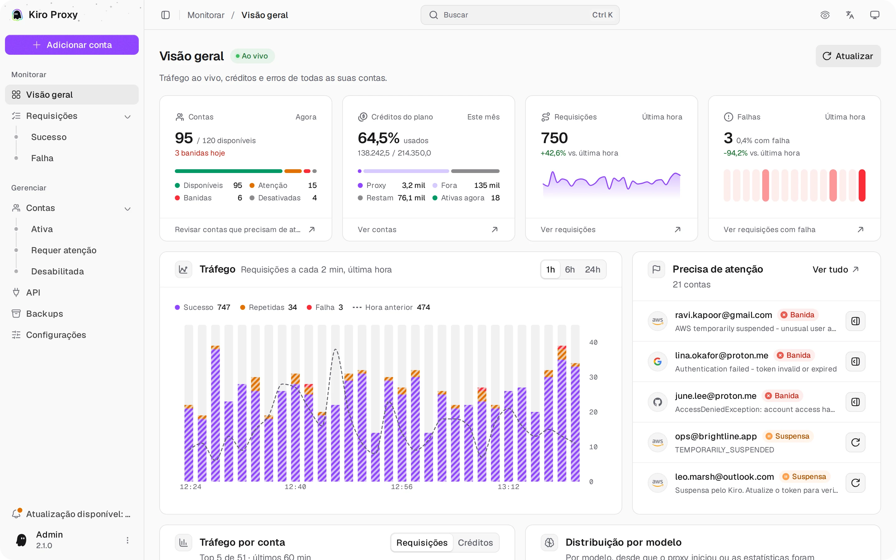

<div align="center">


# Kiro Proxy

#### Proxy local que converte contas Kiro em endpoints compatíveis com OpenAI / Anthropic.

<p>
  <a href="https://go.dev/"></a>
  <a href="https://www.docker.com/"></a>
  <a href="https://www.sqlite.org/"></a>
  <a href="LICENSE"></a>
</p>

<p>
  <a href="#-visão-geral">Visão geral</a> •
  <a href="#-prévia">Prévia</a> •
  <a href="#-recursos">Recursos</a> •
  <a href="#-início-rápido">Início&nbsp;rápido</a> •
  <a href="#-configuração">Configuração</a> •
  <a href="#-uso">Uso</a> •
  <a href="#-modo-de-raciocínio">Modo&nbsp;de&nbsp;raciocínio</a> •
  <a href="#-proxy-de-saída">Proxy&nbsp;de&nbsp;saída</a> •
  <a href="#-segurança">Segurança</a>
</p>

[English](README.md) • [简体中文](README_CN.md) • [Português (Brasil)](README_PT-BR.md) • [Tiếng Việt](README_VI.md)

</div>

---

## 🌟 Visão geral

**Kiro Proxy** é um pequeno serviço em Go que transforma uma ou mais contas **Kiro** autorizadas em um endpoint de API local que fala os formatos de comunicação da **OpenAI** e da **Anthropic**:

1. Agrupa várias contas Kiro e distribui as requisições com round-robin, pesos ou prioridades e afinidade de sessão.
2. Traduz chamadas Anthropic `/v1/messages`, OpenAI `/v1/chat/completions` e OpenAI `/v1/responses` de e para o upstream do Kiro, incluindo ferramentas, raciocínio, nível de esforço do raciocínio e busca na web.
3. Atualiza os tokens de acesso automaticamente e transmite Server-Sent Events de ponta a ponta, com keepalives e failover.
4. Inclui um painel de administração em React, embutido no binário, para gerenciar contas, acompanhar tudo ao vivo e auditar requisições, em English, 简体中文, Tiếng Việt e Português (Brasil).

> [!IMPORTANT]
> Proxy local em um único binário. **Não** é um serviço hospedado e **não** tem vínculo com a Amazon, a AWS ou a Kiro. Você precisa ser dono de cada conta que adicionar ao pool ou ter autorização para usá-la.

Se este projeto ajuda você, uma Star significaria muito.

---

## 🖼 Prévia

<p align="center">
  <picture>
    <source media="(prefers-color-scheme: dark)" srcset="screenshots/pt-BR/overview-dark.webp">
    
  </picture>
  <br><sub><b>Visão geral</b> — tráfego ao vivo, créditos e erros de todas as contas</sub>
</p>

<p align="center">📸 <a href="docs/SCREENSHOTS_PT-BR.md"><b>Mais capturas de tela</b></a> — contas, requisições, API, backups e configurações</p>

## ✨ Recursos

### 🛰 Superfície da API

- Anthropic `/v1/messages` com uso nativo de ferramentas e streaming, além de `/v1/messages/count_tokens`.
- OpenAI `/v1/chat/completions` com paridade total no formato das chamadas de ferramenta.
- OpenAI `/v1/responses` com encadeamento por `previous_response_id` e recuperação de respostas armazenadas.
- Lista de modelos pronta para o Codex em `/v1/codex/models`, ao lado do `/v1/models` padrão.
- Streaming SSE em todos os endpoints, com failover de conta no meio do stream em erros transitórios do upstream e um keepalive a cada 15 segundos enquanto o upstream fica em silêncio (raciocínio longo, argumentos de ferramenta retidos).
- A ferramenta de servidor `web_search` da Anthropic roda pela própria busca na web do Kiro, com os resultados devolvidos como blocos de resultado de busca.
- Nível de esforço: `reasoning_effort` da OpenAI e `output_config.effort` do Claude (de `low` a `xhigh`) ativam o raciocínio e chegam aos modelos que aceitam níveis de esforço; `minimal` o desativa.
- Saída estruturada: `response_format` da OpenAI (`json_object`, `json_schema`), `output_config.format` do Claude e `text.format` da Responses devolvem JSON puro, conferido contra o schema (veja [Saída estruturada](#-saída-estruturada)).
- Assinaturas de raciocínio: em `/v1/messages`, um bloco de raciocínio traz a `signature` que o Kiro envia (`signature_delta` no streaming), e blocos `redacted_thinking` passam direto.
- Resgate de chamadas de ferramenta: chamadas de ferramenta que o Kiro vaza na resposta como marcação voltam a ser chamadas de ferramenta reais (desative com `KIRO_TOOL_MARKUP_RESCUE=off`).
- Descompressão do corpo da requisição (gzip/deflate) para clientes que comprimem o payload antes de enviar.

### 🧰 Tratamento de requisições

- **Continuação automática** (opcional): quando uma resposta para no limite de saída de ~8192 tokens do Kiro sem chamada de ferramenta, o proxy pede ao Kiro para continuar e anexa o restante, até 10 vezes.
- **Histórico estruturado de ferramentas**: chamadas de ferramenta e resultados anteriores chegam ao modelo como chamadas reais, então sessões longas de agente continuam chamando ferramentas; uma requisição rejeitada é tentada novamente uma vez como texto simples.
- **Filtro de system prompt**: substitui o system prompt integrado do Claude Code por um compacto, remove ruído do ambiente (variáveis de ambiente, status do git, commits recentes) e aplica suas próprias regras de linha ou de regex, em ordem.
- **Mapeamento de modelos**: regras ordenadas, reordenáveis arrastando, que enviam qualquer nome de modelo do cliente para um ID de modelo do Kiro; vence a primeira correspondência. Um modelo que o próprio Kiro lista só segue uma regra com o nome completo dele, então uma regra de substring como `gpt-5` nunca redireciona um modelo nativo.
- **Integridade do stream**: rejeita respostas que terminam sem motivo de parada ou evento de medição, com um modo tolerante opcional para contas IdC e Enterprise que não enviam nenhum dos dois.
- **Escolha de endpoint**: escolha um endpoint do Kiro ou deixe o proxy escolher pela disponibilidade, com alternativa opcional para os demais.
- **Redimensionamento de imagens** (ligado por padrão): uma imagem com largura ou altura acima de 1568 px, ou com mais de 400 KB, é reduzida e recodificada antes de ir para o Kiro. Os dois limites são configuráveis.
- **Cabeçalhos de resposta**: até 20 cabeçalhos personalizados em toda resposta da API, incluindo streams e erros. Os valores podem usar `{request_id}`, `{model}`, `{account_id}`, `{key_id}` e `{client_ip}`; `{request_id}` é o ID de rastreio no log de requisições.

### 👥 Pool de contas

- Várias contas Kiro com três modos de roteamento. **Ponderado** (padrão): round-robin por modelo com peso por conta (uma conta com peso N recebe cerca de N vezes mais requisições novas). **Prioridade**: cada requisição nova vai para a conta com o menor número de prioridade (0–999) que pode atendê-la; a próxima assume enquanto ela está em espera, sem créditos, desativada ou sem o modelo. **Renova antes**: cada requisição nova vai para a conta cujos créditos renovam primeiro, entre as contas com créditos restantes, para que os créditos que expirariam na renovação sejam usados antes; entre contas que renovam no mesmo dia, vai primeiro a que tem mais créditos restantes. Contas sem créditos restantes ficam por último e só atendem quando o uso além do limite é permitido.
- Afinidade de sessão (**Manter conversas em uma conta**): os turnos seguintes voltam para a conta que respondeu ao turno anterior e já tem o cache do prompt; conversas novas seguem o modo de roteamento. No modo Prioridade, a prioridade vem primeiro: assim que uma conta de prioridade maior estiver livre de novo, o próximo turno de uma conversa em andamento vai para ela, e uma conta com a mesma prioridade nunca tira a conversa da conta dela. No modo Renova antes, um turno só muda para uma conta cujos créditos renovam num dia anterior. Desligue-a para rotear cada requisição pelo modo de roteamento.
- Limite opcional de 1 a 1000 requisições por minuto por conta: uma conta no limite é pulada e, quando todas estão no limite, os clientes recebem HTTP 429. Uma tentativa que nunca chegou ao Kiro (uma falha de proxy ou de conexão) não conta para o limite. A página Contas mostra ao vivo as requisições por minuto e as de hoje de cada conta.
- Previsão de créditos: a partir do gasto de créditos de cada conta nos últimos 7 dias, os detalhes mostram quando os créditos acabam nesse ritmo e quantos vão sobrar sem uso na renovação. A lista de contas marca uma conta que fica sem créditos antes de renovar.
- **Autorrecuperação** (ligada por padrão): quando nenhuma conta pode atender, o proxy retira os bloqueios de autenticação e os períodos de espera por erro que ele mesmo aplicou e tenta de novo, no máximo uma vez a cada 5 minutos e 5 vezes seguidas sem uma requisição bem-sucedida (ambos ajustáveis). Suspensões do Kiro (um 403 "locked your account" conta como uma), contas que você desligou e períodos de espera por cota nunca são retirados.
- Atualização automática do token OAuth antes de expirar, segura com requisições simultâneas; os períodos de espera das contas continuam valendo após reinicializações.
- Atualização em segundo plano do uso e dos tokens prestes a expirar a cada 30 minutos por padrão. Escolha de 5 minutos a 24 horas, ou Desabilitada para atualizar só sob demanda; os tokens continuam sendo renovados quando uma requisição precisa.
- Entrar de novo ou importar uma conta já salva atualiza essa conta em vez de criar uma cópia. Uma chave de API do Kiro já salva, adicionada de novo, é recusada com HTTP 409 (já adicionada), a menos que venha com notas ou tags e na mesma região, como uma exportação importada de volta no mesmo backend: aí as tags dela se juntam às da conta salva, e notas e apelido vazios são preenchidos. Cópias deixadas por versões anteriores (mesmo refresh token, chave de API do Kiro, ID de usuário, ou mesmo e-mail e método de login) aparecem em um aviso na página Contas; **Revisar** mescla cada grupo em uma conta depois de um backup, mantendo as requisições, somando os contadores, juntando notas e tags e mantendo o proxy próprio de uma cópia quando a conta mantida não tem um.
- **Entrar novamente**, no menu de cada conta, troca o login da conta no lugar e mantém o ID, as configurações, as notas, as tags e as estatísticas. Ele retira um banimento, mas uma conta que você desligou continua desligada. Quando o novo login é de outro usuário, o proxy pede confirmação antes de trocar a identidade. Um login que pertence a outra conta do pool é recusado com HTTP 409 (`relogin_other_account`), sem confirmação: esta conta fica como estava, e o painel mostra qual é a outra conta e se ela passou a usar os novos tokens.
- Notas (até 2000 caracteres) e até 10 tags (de 24 caracteres cada) por conta. A busca encontra as duas, as tags funcionam no filtro Tag e nas ações em lote, e a exportação e a importação mantêm ambas.
- Métodos de autenticação: AWS Builder ID, IAM Identity Center (Enterprise SSO), Microsoft SSO (Entra ID), token SSO, cache local do Kiro IDE, JSON de credenciais, cookie web do Kiro e chaves de API headless do Kiro (`ksk_…`). Em **Adicionar conta**, cada link de login tem um ícone para abrir e outro para copiar.
- Por conta: proxy de saída próprio, ID de dispositivo (máquina), perfil do Kiro fixado, atualização da lista de modelos, teste de conexão e a chave real de excedente do Kiro.
- Excedente opcional: as contas continuam atendendo depois que os créditos acabam.
- Importação / exportação por conta e operações em lote.

### 🛡 Painel de administração

- Aplicativo React de página única embutido no binário; não há servidor web separado para rodar.
- Painel Visão geral atualizado ao vivo: quatro cartões de KPI (contas, créditos do plano, e requisições e falhas na última hora), o tráfego da última hora, das últimas 6 ou 24 horas ou de todo o período em barras empilhadas, uma lista das contas que precisam de atenção, o tráfego por conta, um gráfico de rosca com a distribuição por modelo e as contas mais ativas. O cartão **Créditos do plano** separa o uso de créditos do Kiro em uso pelo proxy e uso fora dele.
- Contas com abas de status e contagens, filtros (plano, autenticação, região, ligada, tag), busca por e-mail, apelido, notas e tags, ordenação, ações em lote, visão de detalhes, testes de conexão, requisições por minuto e de hoje ao vivo, revisão de duplicadas e exportação.
- Log de requisições com abas de status e contagens, busca (que também compara a chave de API completa), ordenação, visão de detalhes com categorias de erro, o ID de rastreio e uma linha do tempo de cada tentativa no upstream (conta, endpoint, duração, resultado, failover), chaves de API mascaradas e histórico guardado em SQLite. O detalhe de uma requisição abre a conversa dela (os turnos em ordem, a conta de cada um, as trocas de conta e os totais) e filtra o log por ela, e **Repetir** roda uma requisição registrada de novo numa conta e num modelo que você escolher (veja [Conversas e repetição](#-conversas-e-repetição)).
- Página API com gerenciamento de chaves de API dos clientes (valores de chave personalizados opcionais, habilitar/desabilitar, limites de tokens, créditos e chamadas por chave, requisições por minuto, horário de expiração, modelos permitidos, vínculo com contas por conta ou por tag, modo de roteamento por chave, gerar nova chave, redefinição de uso), um gráfico **Uso por chave** e um gerador de configuração do cliente com destaque de sintaxe: código de requisição para as APIs Anthropic Messages, OpenAI Chat Completions e OpenAI Responses em curl, Python, Node.js, Go, Java, PHP, Ruby e C# (SDK oficial ou HTTP puro, com ou sem streaming) com uma resposta de exemplo, além da configuração do Claude Code e do Codex.
- Configurações de uso e atualização em segundo plano, roteamento (modo, afinidade de sessão, limite por conta), continuação automática, histórico de ferramentas, redimensionamento de imagens, autorrecuperação, raciocínio, mapeamento de modelos, filtro de system prompt, integridade do stream, endpoint, domínio e região upstream, proxy de saída, pool de proxies, cabeçalhos de resposta, alertas, log do servidor, senha de administrador, login em duas etapas, métricas do Prometheus, retenção de logs e redefinição de estatísticas; Backups com agendamento, upload e restauração com um clique.
- Alertas para webhook, Telegram, Discord ou Slack quando os créditos estão acabando, uma conta é banida ou nenhuma conta consegue atender requisições, e um resumo diário de uso opcional (veja [Alertas](#-alertas)).
- Menu de comandos (<kbd>Ctrl</kbd>/<kbd>⌘</kbd> + <kbd>K</kbd>) para páginas e ações, modo privacidade que oculta endereços de e-mail e verificação de atualizações pelo `version.json` da branch `main` do repositório.
- Alterar a senha de administrador encerra todas as outras sessões conectadas.
- Login em duas etapas com um app autenticador, com dez códigos de recuperação de uso único (veja [Login em duas etapas](#-login-em-duas-etapas)).
- Tema claro, escuro e do sistema; quatro idiomas na interface: English, 简体中文, Tiếng Việt e Português (Brasil).
- Funciona de celulares a desktops.

### 🌐 Rede

- Suporte a proxy de saída — SOCKS5, HTTP ou HTTPS, trocado ao vivo sem reiniciar, com substituição por conta. Senhas de proxy salvas aparecem como `********`.
- Pool de proxies: cada conta sem proxy próprio recebe um proxy do pool, com verificações de saúde, uma chave liga/desliga por proxy, a troca para um proxy saudável depois de três falhas seguidas, e os proxies global e das contas verificados como entradas detectadas (veja [Pool de proxies](#-pool-de-proxies)).
- Domínio e região upstream (**Configurações → Domínio e região upstream**): envie o chat e a busca na web para `runtime.{region}.kiro.dev` em vez de `q.{region}.amazonaws.com` (uso e listas de modelos continuam na AWS) e substitua, para todas as contas, a região da API (`us-east-1` ou `eu-central-1`) ou a região em que os tokens do Builder ID e do IAM Identity Center são renovados. Uma região que não combina com a conta faz as requisições dela falharem, mas nunca bane a conta.
- Sufixo do modo de raciocínio configurável e repasse da configuração `thinking` da Anthropic.

### 🧩 Armazenamento

- Banco de dados SQLite em arquivo único (`modernc.org/sqlite`) em `kiro.db`, no modo de journal DELETE.
- As linhas finais de requisição, mais um resumo das linhas que a retenção de logs removeu, são a fonte da verdade para os totais de requisições, tokens, créditos, sucessos e falhas do painel.
- Retenção de logs: linhas do log de requisições e de erros com mais de 90 dias (de 1 a 3650, ou guardar para sempre) são excluídas em pequenos lotes, dois minutos depois da inicialização e depois uma vez por dia.
- Retenção de 30 dias para respostas armazenadas, com gravações assíncronas fora do caminho crítico da requisição.
- Corpos das requisições guardados por 30 dias para repetição: até 2 MiB cada, compactados, com a chave do cliente mascarada, 256 MiB no total (os mais antigos saem primeiro).

---

## ⚙️ Requisitos

| Componente    | Versão               |
| ------------- | -------------------- |
| Go            | 1.25 +               |
| Node.js       | 22 + com pnpm (só para compilar a UI de administração a partir do código-fonte) |
| SO            | Linux / macOS / Windows |
| Contêiner     | Docker 24+ opcional  |
| Armazenamento | Volume local em disco |

---

## 🚀 Início rápido

### 🐳 Docker Compose (recomendado)

```bash
git clone https://github.com/tanu360/kiro-reverse-api.git
cd kiro-reverse-api
docker-compose up -d
```

### 🐳 Docker Run

```bash
docker run -d \
  --name kiro-proxy \
  -p 8080:8080 \
  -e ADMIN_PASSWORD=your_secure_password \
  -v /path/to/kiro-proxy-state:/app/state \
  --restart unless-stopped \
  ghcr.io/tanu360/kiro-reverse-api:latest
```

### 📦 Baixar um binário

Cada [release](https://github.com/tanu360/kiro-reverse-api/releases) traz um binário pronto para Linux, macOS e Windows em x64 e arm64, com a UI de administração embutida. Não é preciso Go, Node.js nem Docker.

```bash
# Troque linux-x64 pela sua plataforma: linux-arm64, macos-apple-silicon ou macos-intel
curl -LO https://github.com/tanu360/kiro-reverse-api/releases/latest/download/kiro-proxy-linux-x64.tar.gz
tar -xzf kiro-proxy-linux-x64.tar.gz
cd kiro-proxy-linux-x64
./kiro-proxy
```

No Windows, baixe `kiro-proxy-windows-x64.zip` (ou `kiro-proxy-windows-arm64.zip`), extraia e execute `kiro-proxy.exe` em um terminal. O banco de dados é criado na pasta atual; defina `DATA_DIR` para guardá-lo em outro lugar. O servidor escuta em `127.0.0.1:8080`: defina `PORT` se a porta 8080 estiver ocupada e `LISTEN_HOST=0.0.0.0` para aceitar outras máquinas. O `SHA256SUMS.txt` da release lista o checksum de cada arquivo: confira um download com `sha256sum -c SHA256SUMS.txt --ignore-missing` (macOS: `shasum -a 256 -c SHA256SUMS.txt --ignore-missing`). Os binários não são assinados: se o macOS bloquear a execução, rode `xattr -d com.apple.quarantine kiro-proxy`; o SmartScreen do Windows pode pedir confirmação na primeira execução.

### 🛠 Compilar a partir do código-fonte

```bash
git clone https://github.com/tanu360/kiro-reverse-api.git
cd kiro-reverse-api
cd ui && pnpm install && pnpm build && cd ..
go build -o kiro-proxy .
./kiro-proxy
```

A UI de administração precisa de Node.js 22+ e pnpm para compilar. O `go build` embute o que estiver em `ui/dist`: sem a compilação da UI, `/` mostra uma página "UI not built" enquanto a API continua funcionando. A imagem Docker compila as duas.

### 🎨 Desenvolvimento da UI de administração

Execute estes comandos a partir de `ui/`:

| Comando         | O que faz                                                                       |
| --------------- | ------------------------------------------------------------------------------- |
| `pnpm dev`      | Servidor de desenvolvimento em `http://localhost:5173/admin/`; faz proxy de `/admin/api` e `/v1` para `127.0.0.1:8080` |
| `pnpm dev:mock` | Servidor de desenvolvimento com dados simulados e sem backend; entre com a senha `12345678` |
| `pnpm test`     | Testes unitários e de componentes (Vitest)                                      |
| `pnpm test:e2e` | Smoke tests no navegador contra o modo mock (Playwright)                        |

> [!TIP]
> O `kiro.db` é criado automaticamente na primeira execução. Defina `DATA_DIR` para guardá-lo em outro lugar; o Docker usa `/app/state`. Defina `ADMIN_PASSWORD` para escolher a senha de administrador. Caso contrário, a primeira execução gera uma senha aleatória de 8 dígitos, salva essa senha e a exibe uma vez nos logs de inicialização. A página de login mostra a senha até o primeiro login bem-sucedido. Quem usa Docker pode lê-la com `docker compose logs kiro-proxy`. Reinicializações mantêm a senha salva. Uma senha de 48 caracteres de uma versão antiga que nunca foi usada é substituída uma vez por uma senha de 8 dígitos; senhas já usadas para entrar ou configuradas explicitamente são preservadas.

---

Os corpos das requisições são limitados a 32 MiB, tanto na transmissão quanto depois de cada camada de descompressão. São aceitas até três camadas de codificação. Requisições grandes demais retornam HTTP 413. No máximo oito corpos comprimidos são descomprimidos ao mesmo tempo; outras requisições comprimidas aguardam a vez, e requisições sem compressão nunca esperam. A leitura do corpo tem prazo de 30 segundos.

A autenticação por senha de administrador permite cinco tentativas com falha por cliente por minuto, somando o login e as requisições com `X-Admin-Password`; um endereço IPv4 ou um /64 IPv6 conta como um cliente. Depois de 30 falhas em um minuto somando todos os clientes, cada cliente cai para uma tentativa por minuto pelo resto daquele minuto, o que desacelera tentativas distribuídas sem bloquear ninguém. Tentativas além disso retornam HTTP 429 com `Retry-After`; tokens de sessão existentes continuam funcionando. Cabeçalhos de IP encaminhado não são considerados confiáveis, então clientes atrás do mesmo proxy reverso compartilham a cota desse IP. Verificações de senha bem-sucedidas não consomem a cota de falhas. Restaurar um backup preserva a substituição ativa feita por `ADMIN_PASSWORD`.

## 🔧 Configuração

| Variável         | Finalidade                                | Padrão             |
| ---------------- | ----------------------------------------- | ------------------ |
| `DATA_DIR`        | Diretório do `kiro.db`                    | `.`                |
| `ADMIN_PASSWORD` | Senha do painel de administração (substitui a configuração) | —  |
| `LISTEN_HOST`    | Endereço de escuta. O padrão aceita só esta máquina; defina `0.0.0.0` para aceitar outras máquinas. A imagem Docker define `0.0.0.0` | `127.0.0.1` |
| `PORT`           | Porta de escuta, de 1 a 65535 (substitui a configuração). Um valor inválido é ignorado, com um aviso na inicialização. No Docker, troque o lado do host no mapeamento de portas | `8080` |
| `KIRO_TOOL_MARKUP_RESCUE` | Defina `off` para deixar de converter de volta em chamadas de ferramenta a marcação de chamada de ferramenta que o Kiro vaza no texto da resposta | on |
| `LOG_LEVEL`      | Nível de log: `debug`, `info`, `warn` ou `error` (substitui a configuração) | `info` |
| `ADMIN_RESET_2FA` | Defina `1` para desligar o login em duas etapas do administrador na inicialização, se você perdeu o app e os códigos de recuperação. Remova depois: enquanto estiver definido, cada inicialização o desliga de novo | — |

> [!WARNING]
> O `kiro.db` guarda tokens OAuth e credenciais de administrador. Trate-o como segredo — mantenha-o fora do git, de capturas de tela e de conversas em chat. Monte o diretório do banco de dados como um volume privado.

---

## 🕹 Uso

Abra `http://localhost:8080`, entre, adicione contas e depois chame a API:

```bash
# Anthropic — Claude
curl http://localhost:8080/v1/messages \
  -H "Content-Type: application/json" \
  -H "anthropic-version: 2023-06-01" \
  -d '{"model":"claude-sonnet-4.5","max_tokens":1024,"messages":[{"role":"user","content":"Hello!"}]}'

# OpenAI — Chat Completions
curl http://localhost:8080/v1/chat/completions \
  -H "Content-Type: application/json" \
  -H "Authorization: Bearer any" \
  -d '{"model":"claude-sonnet-4.5","messages":[{"role":"user","content":"Hello!"}]}'

# OpenAI — Responses
curl http://localhost:8080/v1/responses \
  -H "Content-Type: application/json" \
  -H "Authorization: Bearer any" \
  -d '{"model":"claude-sonnet-4.5","input":"Hello!"}'
```

Contas gratuitas respondem aos modelos padrão `claude-*-5-5` do Claude Code com um 404, então defina `ANTHROPIC_MODEL` e as variáveis `ANTHROPIC_DEFAULT_*_MODEL` com um modelo que suas contas atendem, como `claude-sonnet-4.5`.

Para o Codex, salve `/v1/codex/models` em um arquivo e defina `model_catalog_json` com o caminho dele no `~/.codex/config.toml`; sem isso, o Codex fica sem a ferramenta `apply_patch`.

### 📌 Endpoints em resumo

| Método   | Caminho                         | O que faz                                     |
| -------- | ------------------------------- | --------------------------------------------- |
| `POST`   | `/v1/messages`                  | Completions do Claude no formato Anthropic    |
| `POST`   | `/v1/messages/count_tokens`     | Contagem de tokens no formato Anthropic       |
| `POST`   | `/v1/chat/completions`          | Chat completions no formato OpenAI            |
| `POST`   | `/v1/responses`                 | OpenAI Responses API (armazenadas + encadeadas) |
| `GET`    | `/v1/responses/{id}`            | Recupera uma resposta armazenada anteriormente |
| `DELETE` | `/v1/responses/{id}`            | Exclui uma resposta armazenada                |
| `GET`    | `/v1/models`                    | Lista os modelos disponíveis                  |
| `GET`    | `/v1/codex/models`              | Lista de modelos no formato do Codex CLI      |
| `GET`    | `/v1/stats`                     | Estatísticas agregadas de uso do proxy        |
| `GET`    | `/metrics`                      | Métricas do Prometheus, desligadas por padrão, com bearer token (veja [Métricas do Prometheus](#-métricas-do-prometheus)) |
| `GET`    | `/health`                       | Verificação de saúde                          |
| `GET`    | `/`                             | Painel de administração web (SPA embutido; links de página como `/accounts` abrem o app, links antigos `/admin/*` redirecionam e um cliente que não pede HTML recebe o health check) |

---

## 🔑 Chaves de API gerenciadas

Exija chaves de API na página **API** (**Acesso à API → Exigir chave de API**). Você pode criar várias chaves de cliente com limites independentes:

- Deixe **Chave personalizada (opcional)** em branco para gerar automaticamente uma chave `sk-...` segura, ou informe seu próprio valor de chave.
- Listas e logs de requisições mostram chaves mascaradas como `sk-clb****e4yo`; a chave completa continua armazenada para autenticação e para ser copiada nos detalhes da chave.
- As verificações de cota de tokens e créditos usam os valores brutos exatos. Rótulos arredondados ou compactos na interface servem só para exibição.
- Um limite de tokens, créditos ou chamadas igual a `0` significa ilimitado nessa dimensão.
- O **Limite de chamadas** conta só as chamadas bem-sucedidas; requisições com falha, `/v1/models` e `count_tokens` não contam. Uma chave que usou todas as chamadas recebe HTTP 429 até você aumentar o limite ou redefinir o uso.
- **Contas → Só as contas selecionadas** vincula uma chave a algumas contas, escolhidas uma a uma ou por tag: toda conta que tem uma das tags da chave entra, inclusive uma conta marcada depois. As requisições dela usam só essas contas, nunca outra (HTTP 503 quando nenhuma delas está disponível, com uma mensagem própria quando as tags da chave não correspondem a nenhuma conta), e a lista de modelos dela mostra só os modelos que essas contas atendem.
- **Modo de roteamento** dá a uma chave o próprio modo de roteamento sobre as contas dela (ponderado, prioridade ou renova antes), ou segue as **Configurações**. Períodos de espera, banimentos, a checagem de modelo e o limite por conta valem como sempre. Uma chave com contas ou modo de roteamento próprios guarda os próprios vínculos de conversa, então outra chave que envie a mesma conversa nunca a move.
- **Requisições por minuto** limita as requisições que uma chave pode iniciar num minuto móvel (`0` significa ilimitado). Toda requisição para `/v1/messages`, `/v1/chat/completions` e `/v1/responses` conta, mesmo uma que falhe; `/v1/models` e `count_tokens` não contam. Acima do limite, os clientes recebem HTTP 429 com `Retry-After` igual aos segundos até poder iniciar uma requisição de novo, como no limite por conta.
- **Expira em** desliga uma chave num horário que você escolhe no seu horário local (guardado como horário Unix). A partir daí os clientes dela recebem HTTP 401 `API key expired at … UTC`, uma resposta que já está em streaming termina normalmente, e a página API mostra a chave como **Expirada**. Apague o horário para a chave voltar a funcionar.
- **Modelos permitidos** limita uma chave a alguns modelos. Vale o modelo que a requisição usa depois do sufixo de thinking e dos mapeamentos de modelo, sem diferenciar maiúsculas, e não o nome que o cliente enviou: `claude-haiku-4-5`, `claude-haiku-4.5-thinking` e um mapeamento que aponta para `claude-haiku-4.5` contam todos como `claude-haiku-4.5`, e nenhum apelido alcança um modelo fora da lista. Outros modelos recebem HTTP 403 (`permission_error` na API Anthropic, código `model_not_allowed` nas APIs OpenAI), e `/v1/models` lista só os modelos permitidos.
- **Gerar nova chave** dá um novo valor à chave, e o valor antigo para de funcionar na hora. Nome, limites, contas e uso continuam iguais.
- **Uso por chave** mostra em gráfico as requisições, os tokens e os créditos de cada chave nas últimas 24 horas, 7 dias, 30 dias ou em todo o período, separados entre sucesso e falha, com linhas próprias para requisições sem chave, chaves inválidas e chaves excluídas.

---

## 📊 Semântica das estatísticas

A página Visão geral e a página Contas respondem, de propósito, a perguntas diferentes:

- **Cartão Contas**: as contas Kiro configuradas agora, agrupadas por situação (disponíveis, atenção, banidas, desabilitadas).
- **Cartão Créditos do plano**: os campos de cota do servidor do Kiro neste mês, somados entre todas as contas (`usage_current / usage_limit`). A barra divide os créditos usados em **Proxy** (créditos das requisições feitas por este proxy) e **Fora** (o restante), e mostra o que ainda resta (**Restam**).
- **Cartões Requisições e Falhas**: requisições do proxy concluídas na última hora, comparadas com a hora anterior.
- **Página Contas**: os contadores salvos no registro de cada conta (`requestCount`, `totalTokens`, `totalCredits`).
- **Retenção de logs**: antes de excluir linhas antigas, os totais delas vão para um resumo, então o cartão **Créditos do plano**, a distribuição por modelo e o `/v1/stats` continuam contando essas linhas. Cada dia excluído também guarda seus totais diários, então o Uso por chave e o gráfico de tráfego da Visão geral continuam mostrando esse dia em 7 dias, 30 dias e em todo o período. A página Requisições mostra só as linhas mantidas.

Se uma conta antiga ou excluída ainda tiver linhas em `requests`, os créditos dela continuam contando em **Proxy**. Assim, **Proxy** pode ficar alto demais, e **Fora**, baixo demais. Use **Configurações → Zona de perigo → Redefinir estatísticas** ou uma limpeza única no banco de dados se quiser apagar as linhas históricas de requisições.

Os rótulos de tokens podem aparecer de forma compacta (`54.5M`, `476.5K`), mas os cálculos do backend e as verificações de cota usam os números brutos.

---

## 🧠 Modo de raciocínio

Adicione um sufixo (padrão `-thinking`) ao nome do modelo para habilitar o raciocínio, por exemplo `claude-sonnet-4.5-thinking`.

Requisições compatíveis com o Claude que incluem uma configuração `thinking` no nível superior também habilitam o modo automaticamente:

```json
{ "type": "enabled", "budget_tokens": 2048 }
{ "type": "adaptive" }
```

O `reasoning_effort` da OpenAI e o `output_config.effort` do Claude também funcionam: `low`, `medium`, `high` ou `xhigh` ativa o raciocínio e é repassado aos modelos que aceitam níveis de esforço, e `minimal` o desativa.

Em `/v1/messages`, com a saída padrão em blocos de raciocínio, um bloco de raciocínio traz a `signature` que o Kiro envia (`signature_delta` no streaming), e blocos `redacted_thinking` passam direto. O Kiro nem sempre envia um ou outro. Com o raciocínio ligado, blocos de raciocínio que o cliente devolve são reenviados ao Kiro como texto, seguindo as regras da Anthropic sobre quais turnos os mantêm; as assinaturas e os blocos `redacted_thinking` deles são descartados.

O formato de saída é configurado em **Configurações → Raciocínio** no painel de administração.

---

## 🧾 Saída estruturada

O Kiro não tem modo JSON, então o proxy pede JSON ao modelo, remove cercas de código, confere a resposta contra o schema e tenta de novo uma vez, na mesma conta, quando ela não bate.

| API              | Campo                                                          |
| ---------------- | -------------------------------------------------------------- |
| Chat Completions | `response_format`: `json_object` ou `json_schema`              |
| Messages         | `output_config.format` (ou `output_format`): `json_schema`     |
| Responses        | `text.format`: `json_object` ou `json_schema`                  |

No Chat e no Messages, o raciocínio fica fora da resposta: ele chega como `reasoning_content` ou como blocos de raciocínio. Um schema pode ter até 32 KiB, e um tipo de formato sem suporte retorna HTTP 400. O `count_tokens` inclui a instrução de JSON adicionada.

---

## 🛰 Proxy de saída

Para quem está em regiões com rede restrita, configure um proxy de saída no painel de administração em **Configurações → Proxy de saída**.

| Tipo     | Exemplo                       |
| -------- | ----------------------------- |
| SOCKS5   | `socks5://127.0.0.1:1080`     |
| HTTP     | `http://127.0.0.1:8888`       |
| HTTPS    | `https://proxy.example.com:443` |

> [!TIP]
> A configuração vale na hora, sem reiniciar. Uma conta também pode usar o próprio proxy (detalhes da conta → **Proxy da conta**); deixe vazio para usar o proxy global. Senhas salvas aparecem como `********`; salvar o valor mascarado mantém a senha.

O proxy próprio de uma conta e o proxy global têm 15 segundos para conectar. Quando um deles falha, a requisição passa na hora para outra conta. Quando uma requisição falha porque nenhuma resposta veio do Kiro (um proxy falhou, ou o Kiro não pôde ser alcançado ou não respondeu a tempo), o cliente recebe HTTP 503 com um texto fixo: `outbound proxy failed: <reason>` (por exemplo `proxy refused the tunnel` ou `connection timed out`), `upstream connection failed` ou `upstream request timed out`. O texto nunca mostra a URL upstream nem o endereço do proxy; o log do servidor e o log de requisições guardam o erro completo. Uma falha de conexão nunca bane uma conta: ela só conta para um curto período de espera por erro.

### 🔁 Pool de proxies

**Configurações → Pool de proxies** distribui as contas sem proxy próprio por uma lista de até 100 proxies (`http`, `https`, `socks5` ou `socks5h`). Cada conta fica com o proxy que recebe, e contas novas vão para o proxy saudável com menos contas. As verificações de saúde conectam ao host do próprio Kiro por cada proxy, a cada 10 minutos por padrão, e a renovação de tokens usa a mesma rota das requisições da conta.

- **Três falhas.** Um proxy sai do rodízio, e as contas dele vão para um saudável, só depois de três verificações ou conexões falhas seguidas; um sucesso zera a contagem. Uma requisição que falha num proxy ainda tenta de novo na hora por outra rota: só aquela conta passa para outro proxy saudável, e o proxy ganha uma falha. Um proxy tirado do rodízio volta assim que passa numa verificação. Uma falha de proxy nunca bane uma conta nem a põe em espera.
- **Chave liga/desliga.** Cada proxy tem sua chave. Um proxy desligado nunca é usado nem verificado, as contas dele saem na hora, e nenhuma verificação o liga de novo.
- **Proxies detectados.** O proxy de saída global e os proxies próprios das contas aparecem como entradas detectadas, verificados como os do pool, com as falhas contadas. Nunca são compartilhados com outras contas: um sem login só entra no pool quando você clica em **Adicionar ao pool**, e um com login não pode entrar.
- O card conta os proxies saudáveis, com falhas (ainda no rodízio), fora do rodízio e desligados.

A ordem é: o proxy próprio da conta, o pool, o proxy global e, por último, a conexão direta. Quando nenhum proxy do pool está saudável, as requisições recebem HTTP 503 `no healthy outbound proxy in the pool`, a menos que **Usar alternativa se nenhum proxy estiver saudável** esteja ligado: aí elas usam o proxy global, ou vão direto quando não há um.

---

## 🔐 Login em duas etapas

**Configurações → Login em duas etapas** pede um código de seis dígitos de um app autenticador (Google Authenticator, 1Password, Aegis e similares) depois da senha de administrador.

- **Ligar** mostra um QR code e a chave em texto. Um código do app confirma, e dez códigos de recuperação de uso único aparecem uma vez: guarde-os num lugar seguro. Ligar encerra todas as outras sessões conectadas.
- O login passa a pedir o código depois da senha. Um código de recuperação funciona no lugar dele, uma vez. Os códigos seguem a RFC 6238 (SHA-1, 30 segundos), aceitam um passo de diferença de relógio para cada lado, e cada código funciona uma só vez. Códigos errados contam no mesmo limite de tentativas das senhas erradas.
- **Desligar** pede um código atual ou a senha de administrador. **Novos códigos de recuperação** substitui os antigos.
- Scripts que enviavam a senha em `X-Admin-Password` recebem HTTP 401 `totp_required` enquanto estiver ligado: entre com `POST /admin/api/session` e `{"password": "…", "code": "123456"}`, depois envie o token em `X-Admin-Token`.
- Ficou sem acesso? Inicie o servidor uma vez com `ADMIN_RESET_2FA=1`. Isso desliga o login em duas etapas e registra um aviso; entre com a senha e depois remova a variável. `ADMIN_PASSWORD` e a senha da primeira execução funcionam como antes.

A chave fica guardada como a senha de administrador, no `kiro.db`; os códigos de recuperação, só como hashes SHA-256. Nenhum dos dois vai para o log.

---

## 📈 Métricas do Prometheus

**Configurações → Métricas do Prometheus** serve `GET /metrics` no formato de texto do Prometheus. Fica desligado por padrão; ao ligar, um bearer token é gerado e aparece no card com um job de scrape pronto para o `prometheus.yml`. Sem o token o endpoint responde 401 e, desligado, 404. **Novo token** troca o token na hora.

| Métrica | Tipo | Rótulos |
| ------- | ---- | ------- |
| `kiro_requests_total` | counter | `outcome`, `status`, `model`, `account`, `api_key` |
| `kiro_tokens_total` | counter | `kind` (input, output, cache_read, cache_write), `model`, `account`, `api_key` |
| `kiro_credits_total` | counter | `model`, `account`, `api_key` |
| `kiro_request_duration_seconds` | histogram | `endpoint`, `outcome` |
| `kiro_upstream_errors_total` | counter | `category` (os tipos de erro do log de requisições), `account` |
| `kiro_account_state`, `kiro_accounts` | gauge | `account`, `state` (active, cooldown, over_limit, banned, disabled) |
| `kiro_account_usage_ratio` | gauge | `account` |
| `kiro_proxy_state`, `kiro_proxy_failures`, `kiro_proxy_latency_seconds`, `kiro_proxies` | gauge | `proxy`, `kind` (pool, detected), `state` |
| `kiro_build_info`, `kiro_uptime_seconds` | gauge | `version` |

`account` é o e-mail da conta, `api_key` é o id da chave do cliente (nunca a chave). Os contadores começam do zero quando o servidor inicia.

---

## 🧵 Conversas e repetição

Cada requisição roteada carrega sua conversa: a chave de afinidade de sessão, a mesma em todos os turnos de um chat. O detalhe de uma requisição abre **Conversa**: os turnos em ordem, a conta e o modelo de cada um, as trocas de conta e os totais de tokens, créditos e tempo. **Mostrar no log** filtra a página Requisições por essa conversa.

**Repetir** roda uma requisição registrada de novo, sem streaming, numa conta e num modelo que você escolher, e mostra a resposta. Ela entra no log como uma requisição nova marcada como repetição e gasta créditos dessa conta. A repetição precisa do corpo da requisição: o servidor guarda os corpos por 30 dias, até 2 MiB cada e 256 MiB no total, com a chave de API do cliente mascarada. Só para administradores.

---

## 🔔 Alertas

**Configurações → Alertas** envia uma mensagem para um canal de webhook, Telegram, Discord ou Slack (até 20) quando:

- o uso de créditos de uma conta passa de um limite (padrão 80, 90 e 100 %): uma vez por limite, e de novo depois que os créditos da conta são renovados;
- o uso de créditos de todas as contas ligadas e não banidas passa de um limite, no máximo uma vez por intervalo entre alertas (padrão 60 minutos);
- uma conta é banida: o Kiro a suspende ou o login dela para de funcionar. Um alerta por banimento: uma conta liberada pela autorrecuperação ou por **Entrar novamente** e banida de novo pelo mesmo motivo, sem nenhuma requisição atendida nesse meio-tempo, não gera outro alerta;
- nenhuma conta ligada consegue atender requisições por um minuto;
- uma vez por dia, o **resumo diário de uso**: as requisições, falhas, créditos e tokens das 24 horas anteriores, as três contas e as três chaves mais usadas e as contas que precisam de atenção (banidas, sem créditos ou que ficam sem créditos antes de renovar).

O resumo diário fica desligado até você ligá-lo. Você escolhe o horário no seu horário local; o servidor o guarda em UTC (09:00 UTC por padrão), então no seu horário ele muda uma hora quando o horário de verão começa ou termina. Um servidor que estava fora do ar nesse horário envia o resumo quando volta, com até 3 horas de atraso, e nunca duas vezes no mesmo dia. O **Enviar teste** do resumo envia agora as últimas 24 horas para todos os canais ligados, sem contar como o resumo do dia.

Nada é verificado enquanto nenhum canal está ligado, e **Enviar teste** tenta um canal uma vez. Os alertas passam pelo proxy de saída global, exceto para um receptor nesta máquina ou na rede local (`localhost`, um nome sem ponto ou terminado em `.localhost`, `.local`, `.lan`, `.internal` ou `.home.arpa`, ou um endereço IP de loopback, privado ou link-local), que eles alcançam diretamente. Um webhook recebe um POST JSON com `event`, `severity`, `title`, `text`, `data` e `ts`, além do cabeçalho `X-Kiro-Proxy-Event`. Com um segredo de assinatura, `X-Kiro-Proxy-Signature: sha256=<hex>` leva o HMAC-SHA256 do corpo. URLs, tokens e segredos salvos nunca são mostrados de novo.

---

## 🔐 Variáveis de ambiente

| Variável         | Descrição                                | Padrão             |
| ---------------- | ---------------------------------------- | ------------------ |
| `DATA_DIR`        | Diretório do `kiro.db`                   | `.`                |
| `ADMIN_PASSWORD` | Senha do painel de administração (substitui a configuração) | — |
| `LISTEN_HOST`    | Endereço de escuta. O padrão aceita só esta máquina; defina `0.0.0.0` para aceitar outras máquinas. A imagem Docker define `0.0.0.0` | `127.0.0.1` |
| `PORT`           | Porta de escuta, de 1 a 65535 (substitui a configuração). Um valor inválido é ignorado, com um aviso na inicialização. No Docker, troque o lado do host no mapeamento de portas | `8080` |
| `KIRO_TOOL_MARKUP_RESCUE` | Defina `off` para deixar de converter de volta em chamadas de ferramenta a marcação de chamada de ferramenta que o Kiro vaza no texto da resposta | on |
| `LOG_LEVEL`      | Nível de log: `debug`, `info`, `warn` ou `error` (substitui a configuração) | `info` |
| `ADMIN_RESET_2FA` | Defina `1` para desligar o login em duas etapas do administrador na inicialização, se você perdeu o app e os códigos de recuperação. Remova depois: enquanto estiver definido, cada inicialização o desliga de novo | — |

```diff
+ kiro.db                # local state — config, credentials, SQLite history, backup blobs
```

> [!CAUTION]
> Trate o `kiro.db` como sensível — ele guarda tokens de contas e credenciais de administrador em texto simples no disco.

---

## 🙏 Agradecimentos

Este projeto é uma continuação de [Quorinex/Kiro-Go](https://github.com/Quorinex/Kiro-Go). O crédito pelo trabalho original pertence ao autor original; eu sigo dando continuidade e manutenção ao projeto.

A UI de administração se baseia em trabalhos open source de [Studio Admin](https://github.com/arhamkhnz/next-shadcn-admin-dashboard), [t3code](https://github.com/pingdotgg/t3code), [coss ui](https://github.com/cosscom/ui), [Bklit UI](https://github.com/bklit/bklit-ui) e [openstatus data-table-filters](https://github.com/openstatusHQ/data-table-filters). Veja [THIRD_PARTY_NOTICES.md](./THIRD_PARTY_NOTICES.md) para as licenças.

---

## 🛡 Segurança

- ✅ Use só com contas que você está **autorizado** a operar.
- ❌ **Não** use para scraping de contas em massa nem para burlar termos de serviço.
- ❌ **Não** adicione contorno de CAPTCHA, falsificação de identidade ou evasão de limites de requisições.
- 🔐 Mantenha o `kiro.db` fora do git, de backups públicos e de capturas de tela.
- 🧯 Se o upstream retornar erros de autenticação persistentes, o proxy falha rápido — investigue antes de tentar novamente.

> [!IMPORTANT]
> Apenas para fins educacionais e de pesquisa. Sem vínculo com a Amazon, a AWS ou a Kiro. Os usuários são responsáveis por cumprir os termos de serviço e as leis aplicáveis. Use por sua conta e risco.

---

## 📄 Licença

[MIT](./LICENSE)

---

<div align="center">
<sub>Feito com ❤️ em Go · Se isto economizou seu tempo, deixe uma ⭐ no repositório.</sub>
</div>
