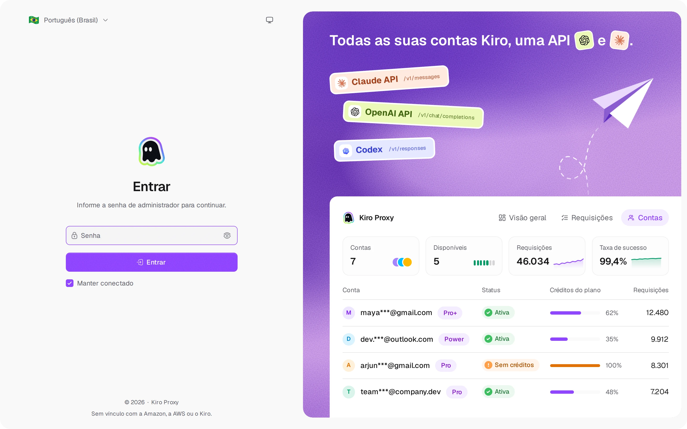
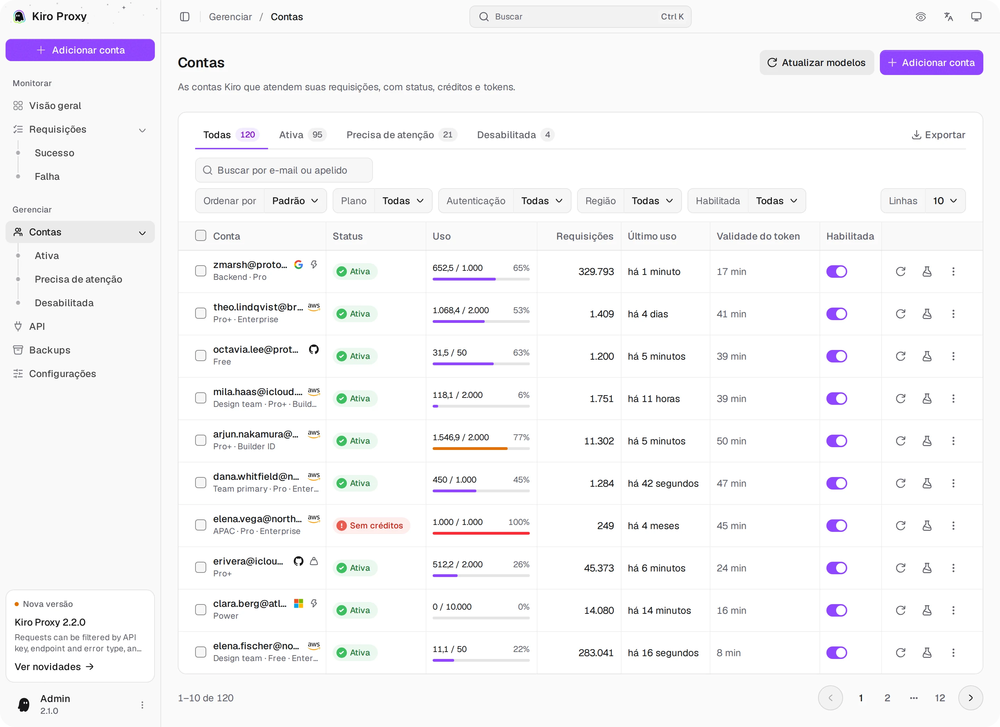
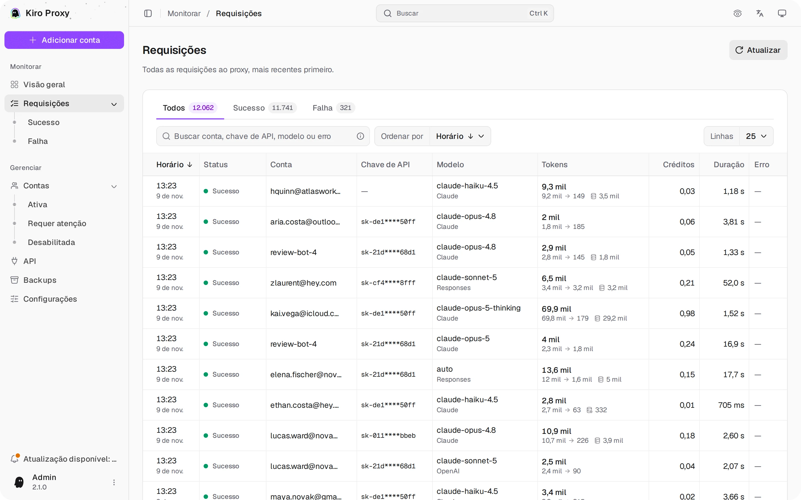
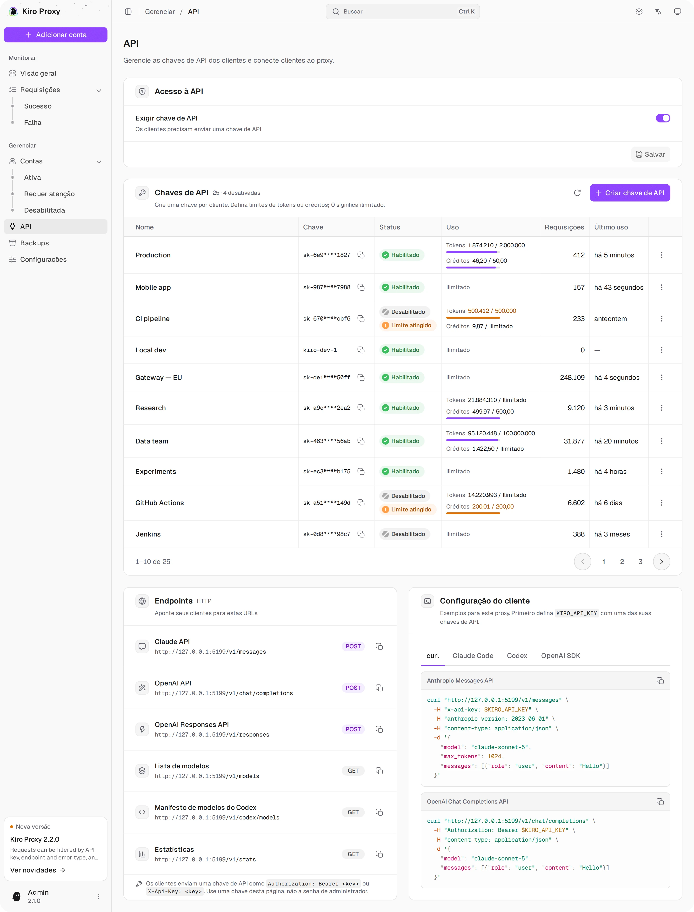
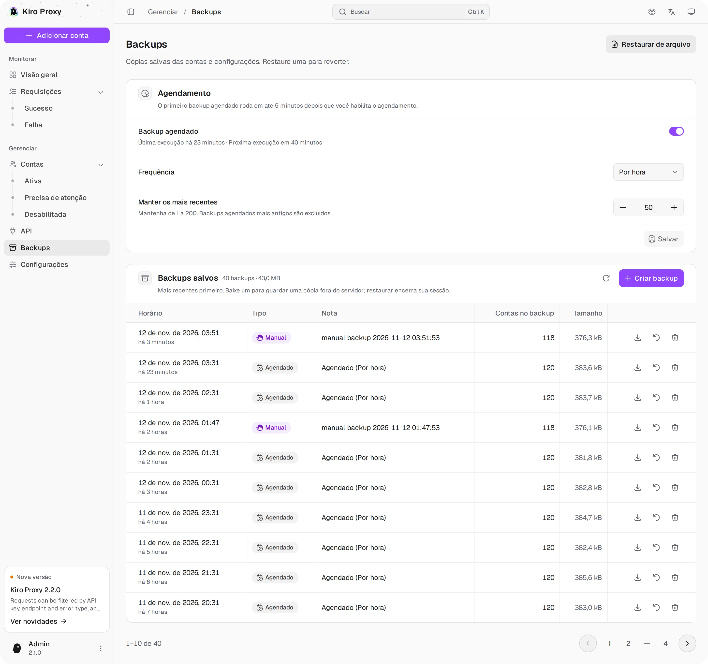
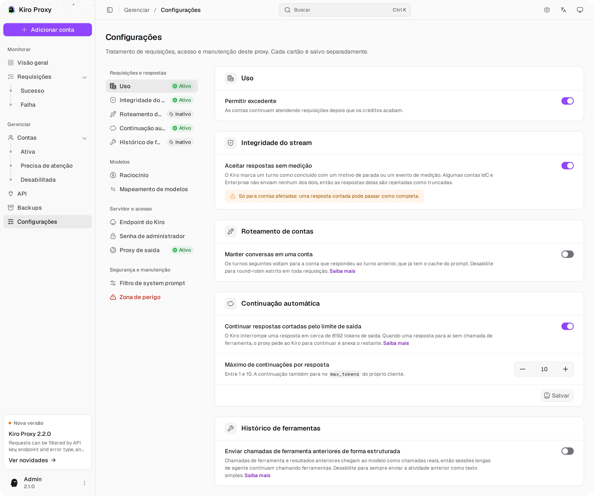
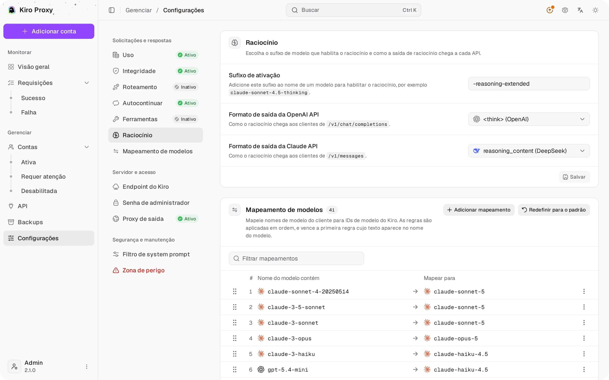
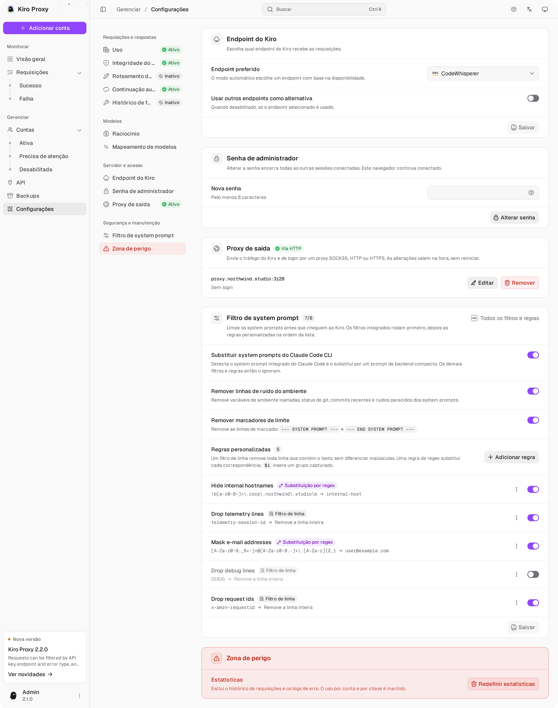

<div align="center">


# Kiro Proxy

#### Proxy local que converte contas Kiro em endpoints compatíveis com OpenAI / Anthropic.

<p>
  <a href="https://go.dev/"></a>
  <a href="https://www.docker.com/"></a>
  <a href="https://www.sqlite.org/"></a>
  <a href="LICENSE"></a>
</p>

<p>
  <a href="#-visão-geral">Visão geral</a> •
  <a href="#-prévia">Prévia</a> •
  <a href="#-recursos">Recursos</a> •
  <a href="#-início-rápido">Início&nbsp;rápido</a> •
  <a href="#-configuração">Configuração</a> •
  <a href="#-uso">Uso</a> •
  <a href="#-modo-de-raciocínio">Modo&nbsp;de&nbsp;raciocínio</a> •
  <a href="#-proxy-de-saída">Proxy&nbsp;de&nbsp;saída</a> •
  <a href="#-segurança">Segurança</a>
</p>

[English](README.md) • [简体中文](README_CN.md) • [Português (Brasil)](README_PT-BR.md) • [Tiếng Việt](README_VI.md)

</div>

---

## 🌟 Visão geral

**Kiro Proxy** é um pequeno serviço em Go que transforma uma ou mais contas **Kiro** autorizadas em um endpoint de API local que fala os formatos de comunicação da **OpenAI** e da **Anthropic**:

1. Agrupa várias contas Kiro e distribui as requisições com round-robin, pesos e afinidade de sessão.
2. Traduz chamadas Anthropic `/v1/messages`, OpenAI `/v1/chat/completions` e OpenAI `/v1/responses` de e para o upstream do Kiro, incluindo ferramentas, raciocínio, nível de esforço do raciocínio e busca na web.
3. Atualiza os tokens de acesso automaticamente e transmite Server-Sent Events de ponta a ponta, com keepalives e failover.
4. Inclui um painel de administração em React, embutido no binário, para gerenciar contas, acompanhar tudo ao vivo e auditar requisições, em English, 简体中文, Tiếng Việt e Português (Brasil).

> [!IMPORTANT]
> Proxy local em um único binário. **Não** é um serviço hospedado e **não** tem vínculo com a Amazon, a AWS ou a Kiro. Você precisa ser dono de cada conta que adicionar ao pool ou ter autorização para usá-la.

Se este projeto ajuda você, uma Star significaria muito.

---

## 🖼 Prévia

<p align="center">
  <picture>
    <source media="(prefers-color-scheme: dark)" srcset="screenshots/pt-BR/login-dark.webp">
    
  </picture>
  <br><sub><b>Entrar</b> — login com seletores de tema e idioma</sub>
</p>

<p align="center">
  <picture>
    <source media="(prefers-color-scheme: dark)" srcset="screenshots/pt-BR/overview-dark.webp">
    
  </picture>
  <br><sub><b>Visão geral</b> — tráfego ao vivo, créditos e erros de todas as contas</sub>
</p>

<p align="center">
  <picture>
    <source media="(prefers-color-scheme: dark)" srcset="screenshots/pt-BR/accounts-dark.webp">
    
  </picture>
  <br><sub><b>Contas</b> — créditos do plano, abas de status, filtros, ações em lote e exportação</sub>
</p>

<p align="center">
  <picture>
    <source media="(prefers-color-scheme: dark)" srcset="screenshots/pt-BR/requests-dark.webp">
    
  </picture>
  <br><sub><b>Requisições</b> — abas de status, busca, ordenação e visão de detalhes</sub>
</p>

<p align="center">
  <picture>
    <source media="(prefers-color-scheme: dark)" srcset="screenshots/pt-BR/api-dark.webp">
    
  </picture>
  <br><sub><b>API</b> — acesso à API, chaves por cliente com limites, configuração do cliente destacada</sub>
</p>

<p align="center">
  <picture>
    <source media="(prefers-color-scheme: dark)" srcset="screenshots/pt-BR/backups-dark.webp">
    
  </picture>
  <br><sub><b>Backups</b> — backups manuais e agendados, restauração com um clique</sub>
</p>

<p align="center">
  <picture>
    <source media="(prefers-color-scheme: dark)" srcset="screenshots/pt-BR/settings-1-dark.webp">
    
  </picture>
  <br><sub><b>Configurações</b> — uso, integridade do stream, roteamento, autocontinuar</sub>
</p>

<p align="center">
  <picture>
    <source media="(prefers-color-scheme: dark)" srcset="screenshots/pt-BR/settings-2-dark.webp">
    
  </picture>
  <br><sub><b>Configurações</b> — raciocínio e mapeamento de modelos</sub>
</p>

<p align="center">
  <picture>
    <source media="(prefers-color-scheme: dark)" srcset="screenshots/pt-BR/settings-3-dark.webp">
    
  </picture>
  <br><sub><b>Configurações</b> — endpoint do Kiro, senha de administrador, proxy de saída</sub>
</p>

---

## ✨ Recursos

### 🛰 Superfície da API

- Anthropic `/v1/messages` com uso nativo de ferramentas e streaming, além de `/v1/messages/count_tokens`.
- OpenAI `/v1/chat/completions` com paridade total no formato das chamadas de ferramenta.
- OpenAI `/v1/responses` com encadeamento por `previous_response_id` e recuperação de respostas armazenadas.
- Lista de modelos pronta para o Codex em `/v1/codex/models`, ao lado do `/v1/models` padrão.
- Streaming SSE em todos os endpoints, com failover de conta no meio do stream em erros transitórios do upstream e um keepalive a cada 15 segundos enquanto o upstream fica em silêncio (raciocínio longo, argumentos de ferramenta retidos).
- A ferramenta de servidor `web_search` da Anthropic roda pela própria busca na web do Kiro, com os resultados devolvidos como blocos de resultado de busca.
- Nível de esforço: `reasoning_effort` da OpenAI e `output_config.effort` do Claude (de `low` a `xhigh`) ativam o raciocínio e chegam aos modelos que aceitam níveis de esforço; `minimal` o desativa.
- Resgate de chamadas de ferramenta: chamadas de ferramenta que o Kiro vaza na resposta como marcação voltam a ser chamadas de ferramenta reais (desative com `KIRO_TOOL_MARKUP_RESCUE=off`).
- Descompressão do corpo da requisição (gzip/deflate) para clientes que comprimem o payload antes de enviar.

### 🧰 Tratamento de requisições

- **Autocontinuar** (opcional): quando uma resposta para no limite de saída de ~8192 tokens do Kiro sem chamada de ferramenta, o proxy pede ao Kiro para continuar e anexa o restante, até 10 vezes.
- **Histórico estruturado de ferramentas**: chamadas de ferramenta e resultados anteriores chegam ao modelo como chamadas reais, então sessões longas de agente continuam chamando ferramentas; uma requisição rejeitada é tentada novamente uma vez como texto simples.
- **Filtro de system prompt**: substitui o system prompt integrado do Claude Code por um compacto, remove ruído do ambiente (variáveis de ambiente, status do git, commits recentes) e aplica suas próprias regras de linha ou de regex, em ordem.
- **Mapeamento de modelos**: regras ordenadas, reordenáveis arrastando, que enviam qualquer nome de modelo do cliente para um ID de modelo do Kiro; vence a primeira correspondência.
- **Integridade do stream**: rejeita respostas que terminam sem motivo de parada ou evento de medição, com um modo tolerante opcional para contas IdC e Enterprise que não enviam nenhum dos dois.
- **Escolha de endpoint**: escolha um endpoint do Kiro ou deixe o proxy escolher pela disponibilidade, com alternativa opcional para os demais.

### 👥 Pool de contas

- Várias contas Kiro com seleção round-robin por modelo e peso por conta (uma conta com peso N recebe cerca de N vezes mais requisições novas).
- Afinidade de sessão: os turnos seguintes voltam para a conta que respondeu ao turno anterior e já tem o cache do prompt; conversas novas continuam alternando entre as contas.
- Atualização automática do token OAuth antes de expirar, segura com requisições simultâneas; os períodos de espera das contas continuam valendo após reinicializações.
- Métodos de autenticação: AWS Builder ID, IAM Identity Center (Enterprise SSO), Microsoft SSO (Entra ID), token SSO, cache local do Kiro IDE, JSON de credenciais, cookie web do Kiro e chaves de API headless do Kiro (`ksk_…`).
- Por conta: proxy de saída próprio, ID de dispositivo (máquina), perfil do Kiro fixado, atualização da lista de modelos, teste de conexão e a chave real de excedente do Kiro.
- Excedente opcional: as contas continuam atendendo depois que os créditos acabam.
- Importação / exportação por conta e operações em lote.

### 🛡 Painel de administração

- Aplicativo React de página única embutido no binário; não há servidor web separado para rodar.
- Painel Visão geral atualizado ao vivo: cartões de KPI de contas, requisições, sucessos e falhas com tendências por hora, indicadores ao vivo por minuto com sparklines, tráfego ao longo do tempo, um gráfico de rosca com a distribuição por modelo e o tráfego por conta em barras empilhadas. Os cartões separam o uso de créditos das contas Kiro do uso de requisições do proxy.
- Contas com abas de status e contagens, filtros (plano, autenticação, região, ligada), ordenação, ações em lote, visão de detalhes, testes de conexão e exportação.
- Log de requisições com abas de status e contagens, busca (que também compara a chave de API completa), ordenação, visão de detalhes com categorias de erro, chaves de API mascaradas e histórico guardado em SQLite.
- Página API com gerenciamento de chaves de API dos clientes (valores de chave personalizados opcionais, habilitar/desabilitar, limites de tokens e créditos por chave, redefinição de uso) e snippets de configuração do cliente com destaque de sintaxe para curl, Claude Code, Codex e o OpenAI SDK.
- Configurações de uso, roteamento, autocontinuar, histórico de ferramentas, raciocínio, mapeamento de modelos, filtro de system prompt, integridade do stream, endpoint, proxy de saída, senha de administrador e redefinição de estatísticas; Backups com agendamento, upload e restauração com um clique.
- Menu de comandos (<kbd>Ctrl</kbd>/<kbd>⌘</kbd> + <kbd>K</kbd>) para páginas e ações, modo privacidade que oculta endereços de e-mail e verificação de atualizações nas versões publicadas no GitHub.
- Alterar a senha de administrador encerra todas as outras sessões conectadas.
- Tema claro, escuro e do sistema; quatro idiomas na interface: English, 简体中文, Tiếng Việt e Português (Brasil).
- Funciona de celulares a desktops.

### 🌐 Rede

- Suporte a proxy de saída — SOCKS5, HTTP ou HTTPS, trocado ao vivo sem reiniciar, com substituição por conta.
- Sufixo do modo de raciocínio configurável e repasse da configuração `thinking` da Anthropic.

### 🧩 Armazenamento

- Banco de dados SQLite em arquivo único (`modernc.org/sqlite`) em `kiro.db`, no modo de journal DELETE.
- As linhas finais de requisição são a fonte da verdade para os totais de requisições, tokens, créditos, sucessos e falhas do painel.
- Retenção de 30 dias para respostas armazenadas, com gravações assíncronas fora do caminho crítico da requisição.

---

## ⚙️ Requisitos

| Componente    | Versão               |
| ------------- | -------------------- |
| Go            | 1.25 +               |
| Node.js       | 22 + com pnpm (só para compilar a UI de administração a partir do código-fonte) |
| SO            | Linux / macOS        |
| Contêiner     | Docker 24+ opcional  |
| Armazenamento | Volume local em disco |

---

## 🚀 Início rápido

### 🐳 Docker Compose (recomendado)

```bash
git clone https://github.com/tanu360/kiro-reverse-api.git
cd kiro-reverse-api
docker-compose up -d
```

### 🐳 Docker Run

```bash
docker run -d \
  --name kiro-proxy \
  -p 8080:8080 \
  -e ADMIN_PASSWORD=your_secure_password \
  -v /path/to/kiro-proxy-state:/app/state \
  --restart unless-stopped \
  ghcr.io/tanu360/kiro-reverse-api:latest
```

### 🛠 Compilar a partir do código-fonte

```bash
git clone https://github.com/tanu360/kiro-reverse-api.git
cd kiro-reverse-api
cd ui && pnpm install && pnpm build && cd ..
go build -o kiro-proxy .
./kiro-proxy
```

A UI de administração precisa de Node.js 22+ e pnpm para compilar. O `go build` embute o que estiver em `ui/dist`: sem a compilação da UI, `/admin` mostra uma página "UI not built" enquanto a API continua funcionando. A imagem Docker compila as duas.

### 🎨 Desenvolvimento da UI de administração

Execute estes comandos a partir de `ui/`:

| Comando         | O que faz                                                                       |
| --------------- | ------------------------------------------------------------------------------- |
| `pnpm dev`      | Servidor de desenvolvimento em `http://localhost:5173/admin/`; faz proxy de `/admin/api` e `/v1` para `127.0.0.1:8080` |
| `pnpm dev:mock` | Servidor de desenvolvimento com dados simulados e sem backend; entre com a senha `12345678` |
| `pnpm test`     | Testes unitários e de componentes (Vitest)                                      |
| `pnpm test:e2e` | Smoke tests no navegador contra o modo mock (Playwright)                        |

> [!TIP]
> O `kiro.db` é criado automaticamente na primeira execução. Defina `DATA_DIR` para guardá-lo em outro lugar; o Docker usa `/app/state`. Defina `ADMIN_PASSWORD` para escolher a senha de administrador. Caso contrário, a primeira execução gera uma senha aleatória de 8 dígitos, salva essa senha e a exibe uma vez nos logs de inicialização. A página de login mostra a senha até o primeiro login bem-sucedido. Quem usa Docker pode lê-la com `docker compose logs kiro-proxy`. Reinicializações mantêm a senha salva. Uma senha de 48 caracteres de uma versão antiga que nunca foi usada é substituída uma vez por uma senha de 8 dígitos; senhas já usadas para entrar ou configuradas explicitamente são preservadas.

---

Os corpos das requisições são limitados a 32 MiB, tanto na transmissão quanto depois de cada camada de descompressão. São aceitas até três camadas de codificação. Requisições grandes demais retornam HTTP 413. No máximo oito corpos comprimidos são descomprimidos ao mesmo tempo; outras requisições comprimidas aguardam a vez, e requisições sem compressão nunca esperam. A leitura do corpo tem prazo de 30 segundos.

A autenticação por senha de administrador permite cinco tentativas com falha por cliente por minuto, somando o login e as requisições com `X-Admin-Password`; um endereço IPv4 ou um /64 IPv6 conta como um cliente. Depois de 30 falhas em um minuto somando todos os clientes, cada cliente cai para uma tentativa por minuto pelo resto daquele minuto, o que desacelera tentativas distribuídas sem bloquear ninguém. Tentativas além disso retornam HTTP 429 com `Retry-After`; tokens de sessão existentes continuam funcionando. Cabeçalhos de IP encaminhado não são considerados confiáveis, então clientes atrás do mesmo proxy reverso compartilham a cota desse IP. Verificações de senha bem-sucedidas não consomem a cota de falhas. Restaurar um backup preserva a substituição ativa feita por `ADMIN_PASSWORD`.

## 🔧 Configuração

| Variável         | Finalidade                                | Padrão             |
| ---------------- | ----------------------------------------- | ------------------ |
| `DATA_DIR`        | Diretório do `kiro.db`                    | `.`                |
| `ADMIN_PASSWORD` | Senha do painel de administração (substitui a configuração) | —  |
| `LISTEN_HOST`    | Endereço de escuta. O padrão aceita só esta máquina; defina `0.0.0.0` para aceitar outras máquinas. A imagem Docker define `0.0.0.0` | `127.0.0.1` |
| `KIRO_TOOL_MARKUP_RESCUE` | Defina `off` para deixar de converter de volta em chamadas de ferramenta a marcação de chamada de ferramenta que o Kiro vaza no texto da resposta | on |
| `LOG_LEVEL`      | Nível de log: `debug`, `info`, `warn` ou `error` (substitui a configuração) | `info` |

> [!WARNING]
> O `kiro.db` guarda tokens OAuth e credenciais de administrador. Trate-o como segredo — mantenha-o fora do git, de capturas de tela e de conversas em chat. Monte o diretório do banco de dados como um volume privado.

---

## 🕹 Uso

Abra `http://localhost:8080/admin`, entre, adicione contas e depois chame a API:

```bash
# Anthropic — Claude
curl http://localhost:8080/v1/messages \
  -H "Content-Type: application/json" \
  -H "anthropic-version: 2023-06-01" \
  -d '{"model":"claude-sonnet-4.5","max_tokens":1024,"messages":[{"role":"user","content":"Hello!"}]}'

# OpenAI — Chat Completions
curl http://localhost:8080/v1/chat/completions \
  -H "Content-Type: application/json" \
  -H "Authorization: Bearer any" \
  -d '{"model":"gpt-4o","messages":[{"role":"user","content":"Hello!"}]}'

# OpenAI — Responses
curl http://localhost:8080/v1/responses \
  -H "Content-Type: application/json" \
  -H "Authorization: Bearer any" \
  -d '{"model":"gpt-4o","input":"Hello!"}'
```

### 📌 Endpoints em resumo

| Método   | Caminho                         | O que faz                                     |
| -------- | ------------------------------- | --------------------------------------------- |
| `POST`   | `/v1/messages`                  | Completions do Claude no formato Anthropic    |
| `POST`   | `/v1/messages/count_tokens`     | Contagem de tokens no formato Anthropic       |
| `POST`   | `/v1/chat/completions`          | Chat completions no formato OpenAI            |
| `POST`   | `/v1/responses`                 | OpenAI Responses API (armazenadas + encadeadas) |
| `GET`    | `/v1/responses/{id}`            | Recupera uma resposta armazenada anteriormente |
| `DELETE` | `/v1/responses/{id}`            | Exclui uma resposta armazenada                |
| `GET`    | `/v1/models`                    | Lista os modelos disponíveis                  |
| `GET`    | `/v1/codex/models`              | Lista de modelos no formato do Codex CLI      |
| `GET`    | `/v1/stats`                     | Estatísticas agregadas de uso do proxy        |
| `GET`    | `/health`                       | Verificação de saúde                          |
| `GET`    | `/admin`                        | Painel de administração web (SPA embutido; links diretos em `/admin/*` caem no app) |

---

## 🔑 Chaves de API gerenciadas

Exija chaves de API na página **API** (**Acesso à API → Exigir chave de API**). Você pode criar várias chaves de cliente com limites independentes:

- Deixe **Chave personalizada (opcional)** em branco para gerar automaticamente uma chave `sk-...` segura, ou informe seu próprio valor de chave.
- Listas e logs de requisições mostram chaves mascaradas como `sk-clb****e4yo`; a chave completa continua armazenada para autenticação e para ser copiada nos detalhes da chave.
- As verificações de cota de tokens e créditos usam os valores brutos exatos. Rótulos arredondados ou compactos na interface servem só para exibição.
- Um limite de tokens ou créditos igual a `0` significa ilimitado nessa dimensão.

---

## 📊 Semântica das estatísticas

A página Visão geral e a página Contas respondem, de propósito, a perguntas diferentes:

- **Cartão Contas**: contas Kiro configuradas no momento, com os campos de cota do servidor do Kiro (`usage_current / usage_limit`).
- **Cartão Requisições**: histórico do app/proxy a partir das linhas `requests` do SQLite: `COUNT(*)`, `SUM(total_tokens)` e `SUM(credits)`.
- **Cartões Sucesso / Falha**: resultados finais das requisições do proxy, da mesma tabela `requests`.
- **Cartões de conta**: contadores atuais das contas visíveis, salvos no registro da conta (`requestCount`, `totalTokens`, `totalCredits`).

Se uma conta antiga/excluída ainda tiver linhas em `requests`, os **Créditos do proxy** da Visão geral podem ficar acima da soma dos créditos das contas visíveis. Use **Configurações → Zona de perigo → Redefinir estatísticas** ou uma limpeza única no banco de dados se quiser apagar as linhas históricas de requisições.

Os rótulos de tokens podem aparecer de forma compacta (`54.5M`, `476.5K`), mas os cálculos do backend e as verificações de cota usam os números brutos.

---

## 🧠 Modo de raciocínio

Adicione um sufixo (padrão `-thinking`) ao nome do modelo para habilitar o raciocínio, por exemplo `claude-sonnet-4.5-thinking`.

Requisições compatíveis com o Claude que incluem uma configuração `thinking` no nível superior também habilitam o modo automaticamente:

```json
{ "type": "enabled", "budget_tokens": 2048 }
{ "type": "adaptive" }
```

O `reasoning_effort` da OpenAI e o `output_config.effort` do Claude também funcionam: `low`, `medium`, `high` ou `xhigh` ativa o raciocínio e é repassado aos modelos que aceitam níveis de esforço, e `minimal` o desativa.

O formato de saída é configurado em **Configurações → Raciocínio** no painel de administração.

---

## 🛰 Proxy de saída

Para quem está em regiões com rede restrita, configure um proxy de saída no painel de administração em **Configurações → Proxy de saída**.

| Tipo     | Exemplo                       |
| -------- | ----------------------------- |
| SOCKS5   | `socks5://127.0.0.1:1080`     |
| HTTP     | `http://127.0.0.1:8888`       |
| HTTPS    | `https://proxy.example.com:443` |

> [!TIP]
> A configuração vale na hora, sem reiniciar. Uma conta também pode usar o próprio proxy (detalhes da conta → **Proxy da conta**); deixe vazio para usar o proxy global.

---

## 🔐 Variáveis de ambiente

| Variável         | Descrição                                | Padrão             |
| ---------------- | ---------------------------------------- | ------------------ |
| `DATA_DIR`        | Diretório do `kiro.db`                   | `.`                |
| `ADMIN_PASSWORD` | Senha do painel de administração (substitui a configuração) | — |
| `LISTEN_HOST`    | Endereço de escuta. O padrão aceita só esta máquina; defina `0.0.0.0` para aceitar outras máquinas. A imagem Docker define `0.0.0.0` | `127.0.0.1` |
| `KIRO_TOOL_MARKUP_RESCUE` | Defina `off` para deixar de converter de volta em chamadas de ferramenta a marcação de chamada de ferramenta que o Kiro vaza no texto da resposta | on |
| `LOG_LEVEL`      | Nível de log: `debug`, `info`, `warn` ou `error` (substitui a configuração) | `info` |

```diff
+ kiro.db                # local state — config, credentials, SQLite history, backup blobs
```

> [!CAUTION]
> Trate o `kiro.db` como sensível — ele guarda tokens de contas e credenciais de administrador em texto simples no disco.

---

## 🙏 Agradecimentos

Este projeto é uma continuação de [Quorinex/Kiro-Go](https://github.com/Quorinex/Kiro-Go). O crédito pelo trabalho original pertence ao autor original; eu sigo dando continuidade e manutenção ao projeto.

A UI de administração se baseia em trabalhos open source de [Studio Admin](https://github.com/arhamkhnz/next-shadcn-admin-dashboard), [t3code](https://github.com/pingdotgg/t3code), [coss ui](https://github.com/cosscom/ui), [Bklit UI](https://github.com/bklit/bklit-ui) e [openstatus data-table-filters](https://github.com/openstatusHQ/data-table-filters). Veja [THIRD_PARTY_NOTICES.md](./THIRD_PARTY_NOTICES.md) para as licenças.

---

## 🛡 Segurança

- ✅ Use só com contas que você está **autorizado** a operar.
- ❌ **Não** use para scraping de contas em massa nem para burlar termos de serviço.
- ❌ **Não** adicione contorno de CAPTCHA, falsificação de identidade ou evasão de limites de requisições.
- 🔐 Mantenha o `kiro.db` fora do git, de backups públicos e de capturas de tela.
- 🧯 Se o upstream retornar erros de autenticação persistentes, o proxy falha rápido — investigue antes de tentar novamente.

> [!IMPORTANT]
> Apenas para fins educacionais e de pesquisa. Sem vínculo com a Amazon, a AWS ou a Kiro. Os usuários são responsáveis por cumprir os termos de serviço e as leis aplicáveis. Use por sua conta e risco.

---

## 📄 Licença

[MIT](./LICENSE)

---

<div align="center">
<sub>Feito com ❤️ em Go · Se isto economizou seu tempo, deixe uma ⭐ no repositório.</sub>
</div>
