<div align="center">


# Kiro Proxy

#### Proxy cục bộ chuyển tài khoản Kiro thành endpoint tương thích OpenAI / Anthropic.

<p>
  <a href="https://go.dev/"></a>
  <a href="https://www.docker.com/"></a>
  <a href="https://www.sqlite.org/"></a>
  <a href="LICENSE"></a>
</p>

<p>
  <a href="#-tổng-quan">Tổng&nbsp;quan</a> •
  <a href="#-xem-trước">Xem&nbsp;trước</a> •
  <a href="#-tính-năng">Tính&nbsp;năng</a> •
  <a href="#-bắt-đầu-nhanh">Bắt&nbsp;đầu&nbsp;nhanh</a> •
  <a href="#-cấu-hình">Cấu&nbsp;hình</a> •
  <a href="#-cách-dùng">Cách&nbsp;dùng</a> •
  <a href="#-chế-độ-thinking">Chế&nbsp;độ&nbsp;Thinking</a> •
  <a href="#-proxy-outbound">Proxy&nbsp;outbound</a> •
  <a href="#-an-toàn">An&nbsp;toàn</a>
</p>

[English](README.md) • [简体中文](README_CN.md) • [Português (Brasil)](README_PT-BR.md) • [Tiếng Việt](README_VI.md)

</div>

---

## 🌟 Tổng quan

**Kiro Proxy** là một dịch vụ Go nhỏ, biến một hoặc nhiều tài khoản **Kiro** đã được cấp quyền thành một endpoint API cục bộ dùng định dạng giao tiếp của **OpenAI** và **Anthropic**:

1. Gộp nhiều tài khoản Kiro và cân bằng tải yêu cầu bằng round-robin, trọng số và cơ chế giữ hội thoại trên cùng một tài khoản.
2. Chuyển đổi hai chiều giữa các lệnh gọi Anthropic `/v1/messages`, OpenAI `/v1/chat/completions`, OpenAI `/v1/responses` và upstream Kiro, bao gồm tool, thinking, mức suy luận (reasoning effort) và tìm kiếm web.
3. Tự động làm mới access token và stream Server-Sent Events xuyên suốt từ đầu đến cuối, kèm keepalive và failover.
4. Đi kèm trang quản trị React nhúng sẵn trong binary để quản lý tài khoản, theo dõi trực tiếp và kiểm tra yêu cầu, với giao diện English, 简体中文, Tiếng Việt và Português (Brasil).

> [!IMPORTANT]
> Proxy cục bộ chỉ gồm một binary. **Không phải** dịch vụ được host sẵn, **không** liên kết với Amazon, AWS hay Kiro. Bạn phải sở hữu hoặc được cấp quyền sử dụng mọi tài khoản bạn thêm vào nhóm tài khoản.

Nếu dự án này giúp ích cho bạn, một Star sẽ rất có ý nghĩa.

---

## 🖼 Xem trước

<p align="center">
  <picture>
    <source media="(prefers-color-scheme: dark)" srcset="screenshots/vi/login-dark.webp">
    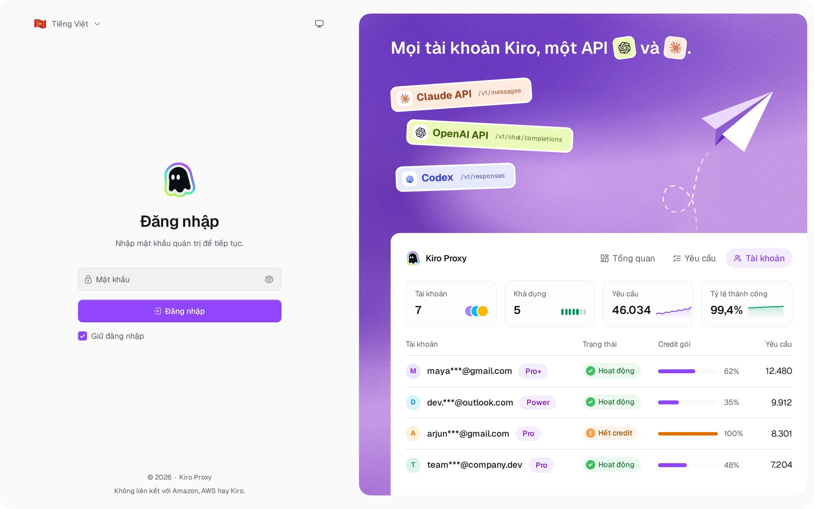
  </picture>
  <br><sub><b>Đăng nhập</b> — trang đăng nhập với nút chuyển giao diện và ngôn ngữ</sub>
</p>

<p align="center">
  <picture>
    <source media="(prefers-color-scheme: dark)" srcset="screenshots/vi/overview-dark.webp">
    
  </picture>
  <br><sub><b>Tổng quan</b> — lưu lượng, credit và lỗi trực tiếp trên các tài khoản</sub>
</p>

<p align="center">
  <picture>
    <source media="(prefers-color-scheme: dark)" srcset="screenshots/vi/accounts-dark.webp">
    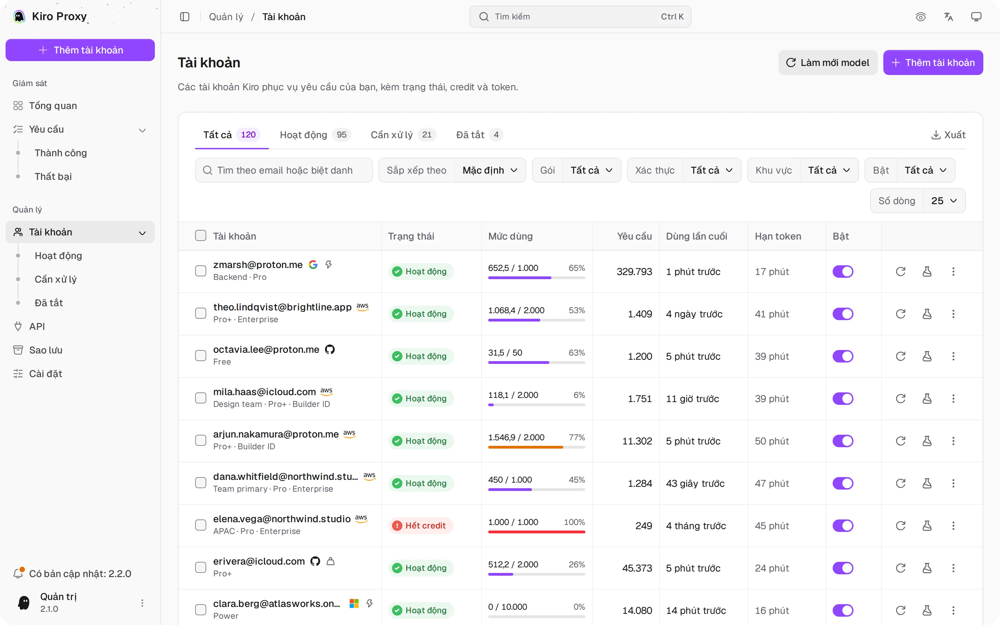
  </picture>
  <br><sub><b>Tài khoản</b> — credit gói, tab trạng thái, bộ lọc, thao tác hàng loạt và xuất</sub>
</p>

<p align="center">
  <picture>
    <source media="(prefers-color-scheme: dark)" srcset="screenshots/vi/accounts-add-dark.webp">
    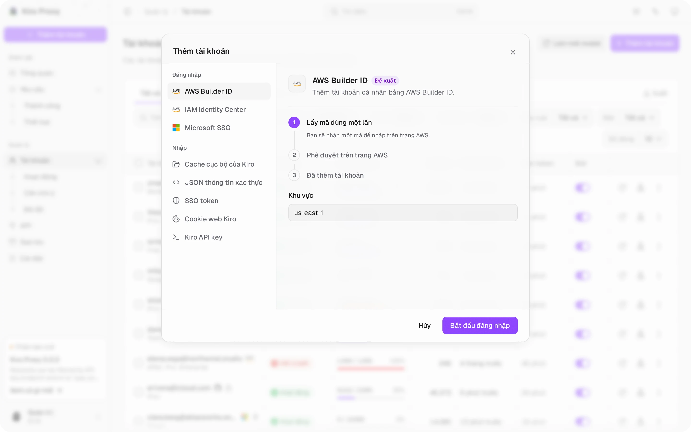
  </picture>
  <br><sub><b>Thêm tài khoản</b> — mọi cách đăng nhập và nhập trong một hộp thoại, mỗi cách kèm các bước</sub>
</p>

<p align="center">
  <picture>
    <source media="(prefers-color-scheme: dark)" srcset="screenshots/vi/accounts-detail-dark.webp">
    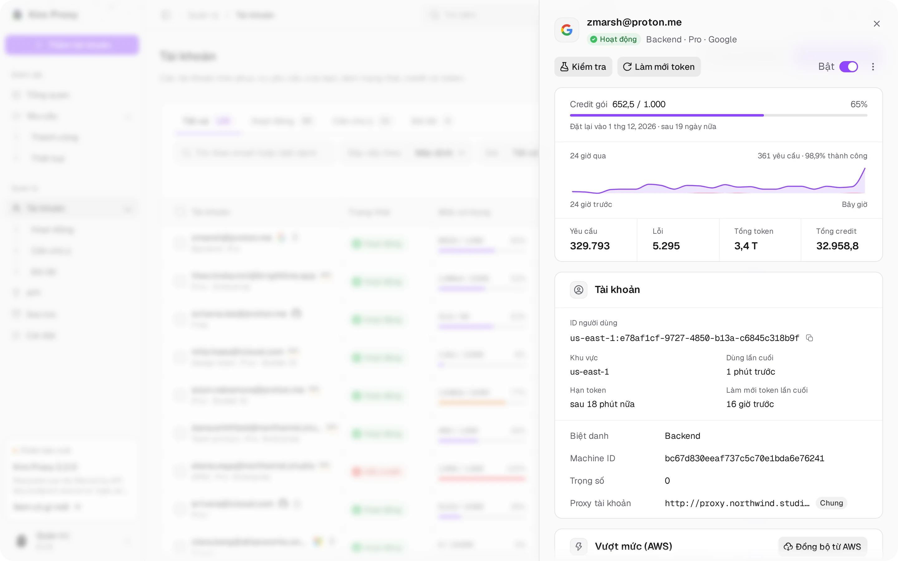
  </picture>
  <br><sub><b>Chi tiết tài khoản</b> — bảng mở ra khi bấm một dòng: credit gói, 24 giờ qua, tổng số và cài đặt</sub>
</p>

<p align="center">
  <picture>
    <source media="(prefers-color-scheme: dark)" srcset="screenshots/vi/accounts-tester-dark.webp">
    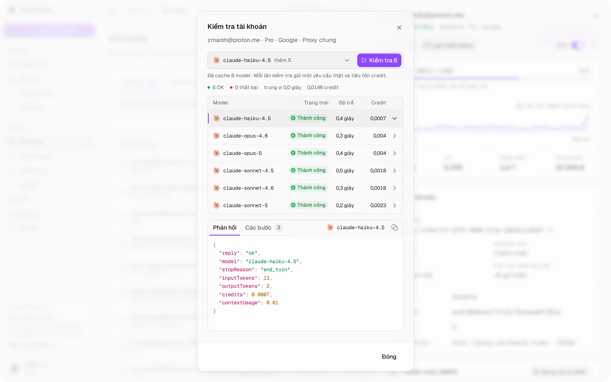
  </picture>
  <br><sub><b>Kiểm tra model</b> — kiểm tra một model hoặc mọi model đã lưu cùng lúc; chạm vào một dòng để xem phản hồi và các bước</sub>
</p>

<p align="center">
  <picture>
    <source media="(prefers-color-scheme: dark)" srcset="screenshots/vi/requests-dark.webp">
    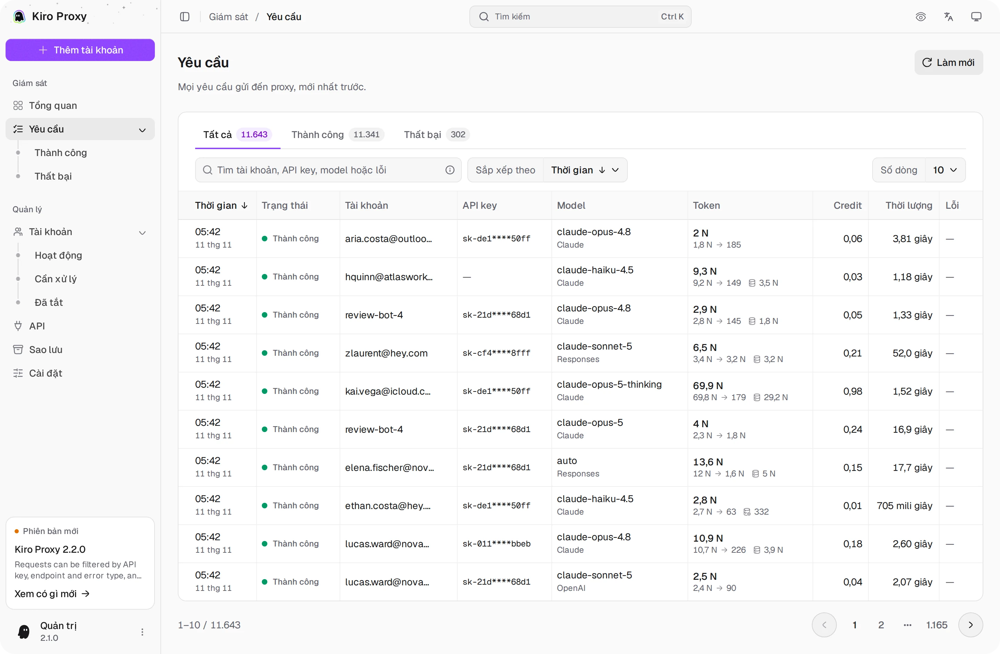
  </picture>
  <br><sub><b>Yêu cầu</b> — tab trạng thái, tìm kiếm, sắp xếp và xem chi tiết</sub>
</p>

<p align="center">
  <picture>
    <source media="(prefers-color-scheme: dark)" srcset="screenshots/vi/requests-detail-dark.webp">
    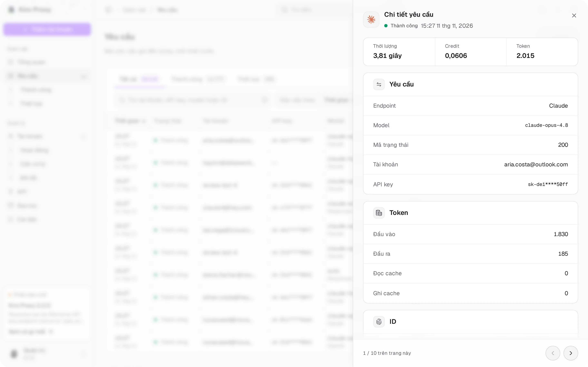
  </picture>
  <br><sub><b>Chi tiết yêu cầu</b> — bảng mở ra khi bấm một dòng: thời lượng, credit, token và ID</sub>
</p>

<p align="center">
  <picture>
    <source media="(prefers-color-scheme: dark)" srcset="screenshots/vi/api-dark.webp">
    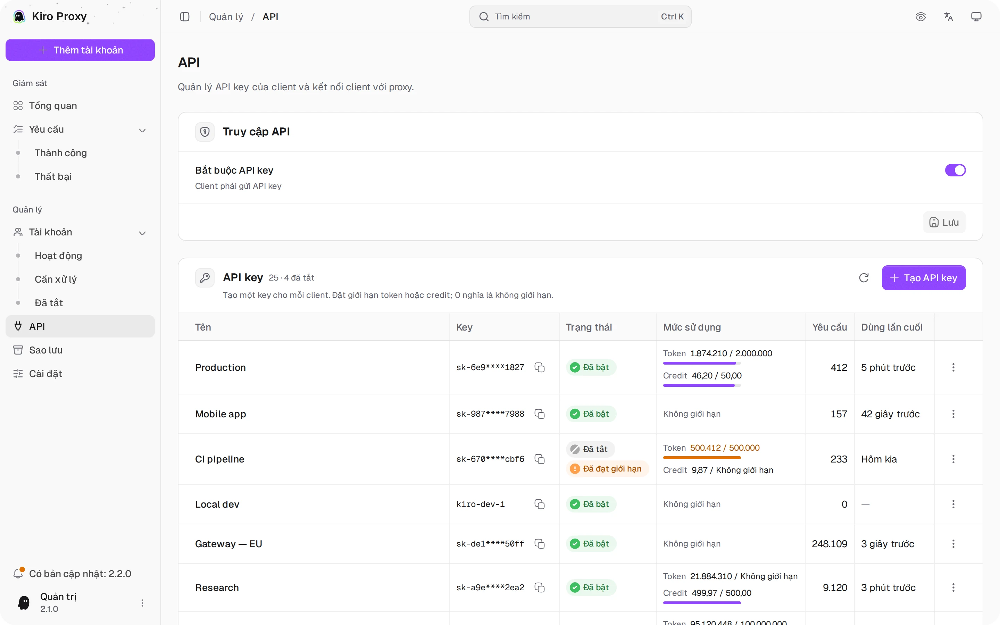
  </picture>
  <br><sub><b>API</b> — truy cập API, key riêng cho từng client kèm giới hạn, thiết lập client có tô sáng</sub>
</p>

<p align="center">
  <picture>
    <source media="(prefers-color-scheme: dark)" srcset="screenshots/vi/backups-dark.webp">
    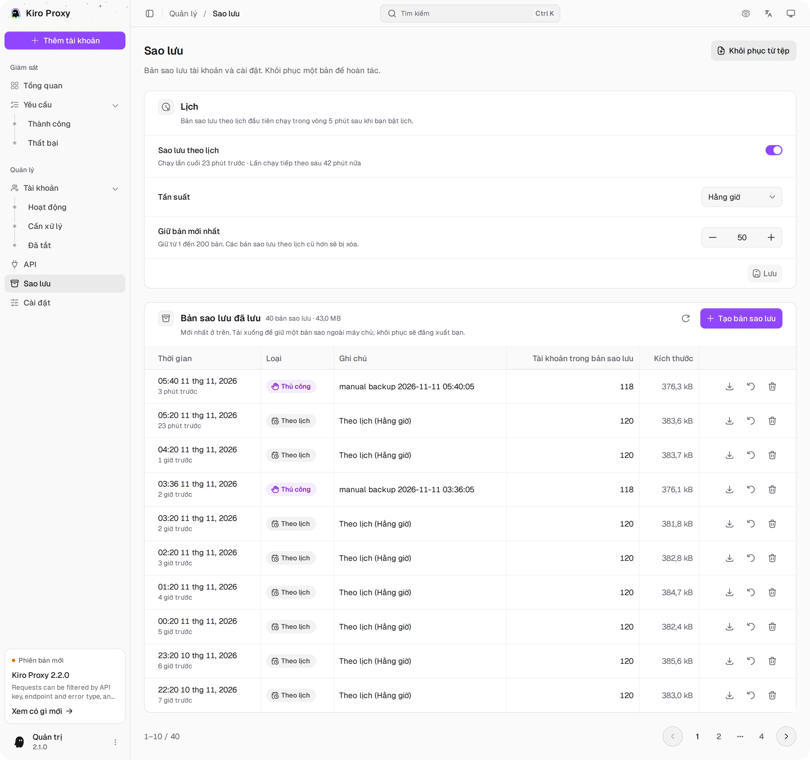
  </picture>
  <br><sub><b>Sao lưu</b> — sao lưu thủ công và theo lịch, khôi phục bằng một cú nhấp</sub>
</p>

<p align="center">
  <picture>
    <source media="(prefers-color-scheme: dark)" srcset="screenshots/vi/settings-1-dark.webp">
    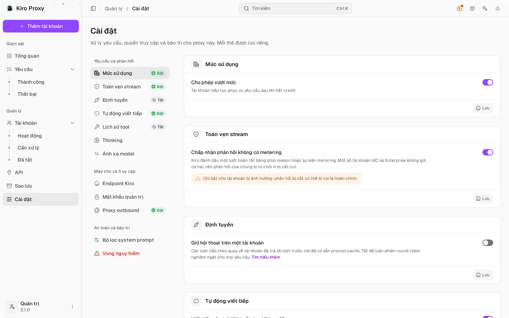
  </picture>
  <br><sub><b>Cài đặt</b> — mức sử dụng, toàn vẹn stream, định tuyến, tự động viết tiếp</sub>
</p>

<p align="center">
  <picture>
    <source media="(prefers-color-scheme: dark)" srcset="screenshots/vi/settings-2-dark.webp">
    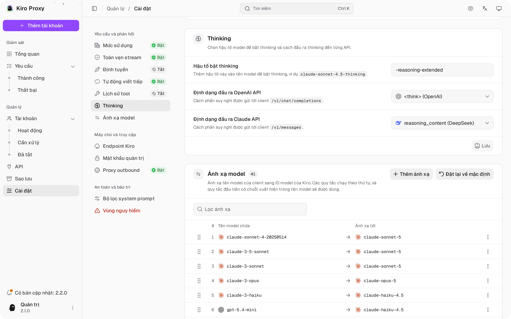
  </picture>
  <br><sub><b>Cài đặt</b> — thinking và ánh xạ model</sub>
</p>

<p align="center">
  <picture>
    <source media="(prefers-color-scheme: dark)" srcset="screenshots/vi/settings-3-dark.webp">
    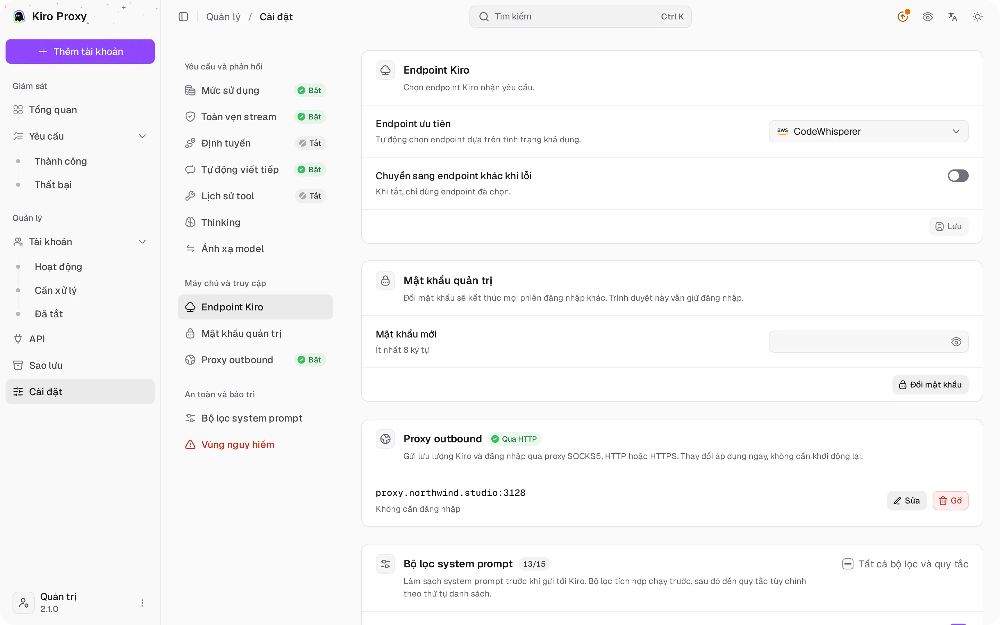
  </picture>
  <br><sub><b>Cài đặt</b> — endpoint Kiro, mật khẩu quản trị, proxy outbound</sub>
</p>

---

## ✨ Tính năng

### 🛰 API hỗ trợ

- Anthropic `/v1/messages` hỗ trợ tool use gốc và streaming, cùng với `/v1/messages/count_tokens`.
- OpenAI `/v1/chat/completions` với định dạng lệnh gọi tool tương thích đầy đủ.
- OpenAI `/v1/responses` hỗ trợ nối chuỗi bằng `previous_response_id` và truy xuất response đã lưu.
- Danh sách model dành cho Codex tại `/v1/codex/models`, bên cạnh `/v1/models` tiêu chuẩn.
- Streaming SSE cho mọi endpoint, có failover sang tài khoản khác ngay giữa stream khi upstream gặp lỗi tạm thời, và gửi keepalive mỗi 15 giây khi upstream im lặng (suy luận dài, tham số tool đang bị giữ lại).
- Server tool `web_search` của Anthropic chạy qua tính năng tìm kiếm web của chính Kiro, kết quả trả về dưới dạng các khối search result.
- Mức suy luận: `reasoning_effort` của OpenAI và `output_config.effort` của Claude (`low` đến `xhigh`) bật thinking và được chuyển tới các model hỗ trợ mức effort; `minimal` tắt thinking.
- Khôi phục lệnh gọi tool: lệnh gọi tool mà Kiro để lọt vào câu trả lời dưới dạng markup được chuyển lại thành lệnh gọi tool thật (tắt bằng `KIRO_TOOL_MARKUP_RESCUE=off`).
- Giải nén body yêu cầu (gzip/deflate) cho các client nén payload trước khi gửi.

### 🧰 Xử lý yêu cầu

- **Tự động viết tiếp** (mặc định tắt): khi câu trả lời dừng ở giới hạn đầu ra khoảng 8192 token của Kiro mà không có lệnh gọi tool, proxy yêu cầu Kiro viết tiếp và nối phần còn lại, tối đa 10 lần.
- **Lịch sử tool có cấu trúc**: lệnh gọi tool và kết quả trước đó đến model dưới dạng lệnh gọi tool thật, nên các phiên agent dài vẫn tiếp tục gọi tool; yêu cầu bị từ chối sẽ được thử lại một lần ở dạng văn bản thuần.
- **Bộ lọc system prompt**: thay system prompt tích hợp của Claude Code bằng một prompt gọn hơn, loại bỏ nhiễu môi trường (biến môi trường, git status, commit gần đây) và áp dụng các quy tắc lọc dòng hoặc regex của riêng bạn theo thứ tự.
- **Ánh xạ model**: các quy tắc có thứ tự, kéo để sắp xếp, chuyển bất kỳ tên model nào của client sang một ID model Kiro; quy tắc khớp đầu tiên được dùng.
- **Toàn vẹn stream**: từ chối phản hồi kết thúc mà không có stop reason hoặc sự kiện metering, kèm chế độ nới lỏng (phải tự bật) cho tài khoản IdC và Enterprise không gửi cả hai.
- **Chọn endpoint**: chọn một endpoint Kiro hoặc để proxy tự chọn theo tình trạng khả dụng, có thể chuyển sang các endpoint khác khi lỗi.

### 👥 Nhóm tài khoản

- Nhiều tài khoản Kiro, chọn theo round-robin cho từng model và có trọng số cho từng tài khoản (tài khoản có trọng số N nhận số yêu cầu mới gấp khoảng N lần).
- Giữ hội thoại trên một tài khoản: các lượt tiếp theo quay về tài khoản đã trả lời lượt trước, nơi đã có sẵn prompt cache; hội thoại mới vẫn luân phiên giữa các tài khoản.
- Tự động làm mới OAuth token trước khi hết hạn, an toàn khi có yêu cầu đồng thời; thời gian chờ của tài khoản được giữ lại qua các lần khởi động lại.
- Phương thức xác thực: AWS Builder ID, IAM Identity Center (Enterprise SSO), Microsoft SSO (Entra ID), SSO token, cache cục bộ của Kiro IDE, JSON thông tin xác thực, cookie web Kiro và Kiro API key cho môi trường không giao diện (`ksk_…`).
- Cho từng tài khoản: proxy outbound riêng, ID thiết bị (machine ID), Kiro profile được ghim, làm mới danh sách model, kiểm tra kết nối và công tắc vượt mức thật của Kiro.
- Vượt mức (tùy chọn): tài khoản tiếp tục phục vụ yêu cầu sau khi hết credit.
- Nhập / xuất theo từng tài khoản và thao tác hàng loạt.

### 🛡 Trang quản trị

- Ứng dụng React một trang nhúng trong binary; không cần chạy web server riêng.
- Bảng điều khiển Tổng quan cập nhật trực tiếp: thẻ KPI cho tài khoản, yêu cầu, thành công và thất bại kèm xu hướng theo giờ, ô số liệu trực tiếp theo phút có sparkline, lưu lượng theo thời gian, biểu đồ donut phân bổ model và lưu lượng theo tài khoản dạng cột chồng. Các thẻ tách riêng mức dùng credit của tài khoản Kiro với mức dùng của yêu cầu qua proxy.
- Tài khoản với tab trạng thái kèm số lượng, bộ lọc (gói, xác thực, khu vực, bật), sắp xếp, thao tác hàng loạt, chế độ xem chi tiết, kiểm tra kết nối và xuất.
- Nhật ký yêu cầu với tab trạng thái kèm số lượng, tìm kiếm (khớp cả API key đầy đủ), sắp xếp, chế độ xem chi tiết có phân loại lỗi, API key được che và lịch sử lưu trong SQLite.
- Trang API quản lý API key của client (giá trị key tùy chỉnh không bắt buộc, bật/tắt, giới hạn token và credit cho từng key, đặt lại mức sử dụng) và trình tạo mã thiết lập client có tô sáng cú pháp: mã gọi các API Anthropic Messages, OpenAI Chat Completions và OpenAI Responses bằng curl, Python, Node.js, Go, Java, PHP, Ruby và C# (SDK chính thức hoặc HTTP thuần, có hoặc không stream) kèm phản hồi mẫu, cùng cấu hình Claude Code và Codex.
- Cài đặt cho mức sử dụng, định tuyến, tự động viết tiếp, lịch sử tool, thinking, ánh xạ model, bộ lọc system prompt, toàn vẹn stream, endpoint, proxy outbound, mật khẩu quản trị và đặt lại thống kê; Sao lưu có lịch, tải lên và khôi phục bằng một cú nhấp.
- Menu lệnh (<kbd>Ctrl</kbd>/<kbd>⌘</kbd> + <kbd>K</kbd>) để mở trang và chạy thao tác, chế độ riêng tư ẩn địa chỉ email, và kiểm tra cập nhật qua `version.json` trên nhánh `main` của repo.
- Đổi mật khẩu quản trị sẽ kết thúc mọi phiên đăng nhập khác.
- Giao diện sáng, tối và theo hệ thống; bốn ngôn ngữ giao diện: English, 简体中文, Tiếng Việt và Português (Brasil).
- Dùng được trên cả điện thoại lẫn máy tính.

### 🌐 Mạng

- Hỗ trợ proxy outbound — SOCKS5, HTTP hoặc HTTPS, chuyển đổi trực tiếp không cần khởi động lại, có thể ghi đè riêng cho từng tài khoản.
- Hậu tố chế độ thinking có thể tùy chỉnh và chuyển tiếp nguyên cấu hình `thinking` của Anthropic.

### 🧩 Lưu trữ

- Cơ sở dữ liệu SQLite một tệp (`modernc.org/sqlite`) tại `kiro.db`, dùng chế độ journal DELETE.
- Các dòng yêu cầu cuối cùng là nguồn dữ liệu chuẩn cho tổng số yêu cầu, token, credit, thành công và thất bại trên bảng điều khiển.
- Response đã lưu được giữ 30 ngày; việc ghi chạy bất đồng bộ, nằm ngoài đường xử lý chính của yêu cầu.

---

## ⚙️ Yêu cầu hệ thống

| Thành phần   | Phiên bản            |
| ------------ | -------------------- |
| Go           | 1.25 +               |
| Node.js      | 22 + kèm pnpm (chỉ cần khi build giao diện quản trị từ mã nguồn) |
| Hệ điều hành | Linux / macOS        |
| Container    | Docker 24+, không bắt buộc |
| Lưu trữ      | Volume cục bộ trên ổ đĩa |

---

## 🚀 Bắt đầu nhanh

### 🐳 Docker Compose (khuyến nghị)

```bash
git clone https://github.com/tanu360/kiro-reverse-api.git
cd kiro-reverse-api
docker-compose up -d
```

### 🐳 Docker Run

```bash
docker run -d \
  --name kiro-proxy \
  -p 8080:8080 \
  -e ADMIN_PASSWORD=your_secure_password \
  -v /path/to/kiro-proxy-state:/app/state \
  --restart unless-stopped \
  ghcr.io/tanu360/kiro-reverse-api:latest
```

### 🛠 Build từ mã nguồn

```bash
git clone https://github.com/tanu360/kiro-reverse-api.git
cd kiro-reverse-api
cd ui && pnpm install && pnpm build && cd ..
go build -o kiro-proxy .
./kiro-proxy
```

Giao diện quản trị cần Node.js 22+ và pnpm để build. `go build` nhúng mọi thứ có trong `ui/dist`: nếu chưa build giao diện, `/` hiển thị trang "UI not built" trong khi API vẫn hoạt động. Docker image build cả hai.

### 🎨 Phát triển giao diện quản trị

Chạy các lệnh sau trong `ui/`:

| Lệnh            | Tác dụng                                                                        |
| --------------- | ------------------------------------------------------------------------------- |
| `pnpm dev`      | Dev server tại `http://localhost:5173/admin/`; chuyển tiếp `/admin/api` và `/v1` tới `127.0.0.1:8080` |
| `pnpm dev:mock` | Dev server dùng dữ liệu giả, không cần backend; đăng nhập bằng mật khẩu `12345678` |
| `pnpm test`     | Test unit và component (Vitest)                                                 |
| `pnpm test:e2e` | Smoke test trên trình duyệt ở chế độ mock (Playwright)                          |

> [!TIP]
> `kiro.db` được tự động tạo ở lần chạy đầu tiên. Đặt `DATA_DIR` để lưu tệp ở nơi khác; Docker dùng `/app/state`. Đặt `ADMIN_PASSWORD` để chọn mật khẩu quản trị. Nếu không đặt, lần chạy đầu tiên sẽ tạo một mật khẩu ngẫu nhiên gồm 8 chữ số, lưu lại và in một lần trong log khởi động. Trang đăng nhập hiển thị mật khẩu này cho đến lần đăng nhập thành công đầu tiên. Người dùng Docker có thể xem bằng `docker compose logs kiro-proxy`. Mật khẩu đã lưu được giữ nguyên qua các lần khởi động lại. Mật khẩu 48 ký tự chưa từng được dùng từ phiên bản cũ sẽ được thay một lần bằng mật khẩu 8 chữ số; mật khẩu đã dùng để đăng nhập hoặc được cấu hình rõ ràng sẽ được giữ nguyên.

---

Body yêu cầu bị giới hạn ở 32 MiB, cả khi truyền qua mạng lẫn sau mỗi lớp giải nén. Chấp nhận tối đa ba lớp encoding. Yêu cầu vượt quá kích thước trả về HTTP 413. Tối đa tám body nén được giải nén cùng lúc; các yêu cầu nén tiếp theo phải chờ đến lượt, còn yêu cầu không nén không bao giờ phải chờ. Việc đọc body có thời hạn 30 giây.

Xác thực bằng mật khẩu quản trị cho phép năm lần thử sai cho mỗi client mỗi phút, tính chung cho đăng nhập và các yêu cầu `X-Admin-Password`; một địa chỉ IPv4 hoặc một dải IPv6 /64 được tính là một client. Sau 30 lần thất bại trong một phút trên tất cả client, mỗi client chỉ còn một lần thử mỗi phút cho đến hết phút đó, giúp làm chậm việc dò mật khẩu phân tán mà không khóa ai. Các lần thử tiếp theo trả về HTTP 429 kèm `Retry-After`; token phiên hiện có vẫn hoạt động. Header IP được chuyển tiếp không được tin cậy, nên các client đứng sau cùng một reverse proxy dùng chung hạn mức theo IP của proxy đó. Lần kiểm tra mật khẩu thành công không bị tính vào hạn mức thất bại. Khi khôi phục bản sao lưu, giá trị ghi đè `ADMIN_PASSWORD` đang có hiệu lực vẫn được giữ.

## 🔧 Cấu hình

| Biến             | Mục đích                                  | Mặc định           |
| ---------------- | ----------------------------------------- | ------------------ |
| `DATA_DIR`        | Thư mục chứa `kiro.db`                    | `.`                |
| `ADMIN_PASSWORD` | Mật khẩu trang quản trị (ghi đè cấu hình) | —                  |
| `LISTEN_HOST`    | Địa chỉ lắng nghe. Mặc định chỉ nhận kết nối từ máy này; đặt `0.0.0.0` để nhận kết nối từ máy khác. Docker image đặt sẵn `0.0.0.0` | `127.0.0.1` |
| `KIRO_TOOL_MARKUP_RESCUE` | Đặt `off` để ngừng chuyển markup lệnh gọi tool mà Kiro để lọt vào văn bản câu trả lời trở lại thành lệnh gọi tool | on |
| `LOG_LEVEL`      | Mức log: `debug`, `info`, `warn` hoặc `error` (ghi đè cấu hình) | `info` |

> [!WARNING]
> `kiro.db` chứa OAuth token và thông tin đăng nhập quản trị. Hãy giữ bí mật tệp này — không đưa vào git, ảnh chụp màn hình hay các cuộc trò chuyện. Gắn thư mục cơ sở dữ liệu dưới dạng volume riêng tư.

---

## 🕹 Cách dùng

Mở `http://localhost:8080`, đăng nhập, thêm tài khoản, rồi gọi API:

```bash
# Anthropic — Claude
curl http://localhost:8080/v1/messages \
  -H "Content-Type: application/json" \
  -H "anthropic-version: 2023-06-01" \
  -d '{"model":"claude-sonnet-4.5","max_tokens":1024,"messages":[{"role":"user","content":"Hello!"}]}'

# OpenAI — Chat Completions
curl http://localhost:8080/v1/chat/completions \
  -H "Content-Type: application/json" \
  -H "Authorization: Bearer any" \
  -d '{"model":"gpt-4o","messages":[{"role":"user","content":"Hello!"}]}'

# OpenAI — Responses
curl http://localhost:8080/v1/responses \
  -H "Content-Type: application/json" \
  -H "Authorization: Bearer any" \
  -d '{"model":"gpt-4o","input":"Hello!"}'
```

### 📌 Danh sách endpoint

| Phương thức | Đường dẫn                       | Tác dụng                                      |
| ----------- | ------------------------------- | --------------------------------------------- |
| `POST`   | `/v1/messages`                  | Claude completions theo định dạng Anthropic   |
| `POST`   | `/v1/messages/count_tokens`     | Đếm token theo định dạng Anthropic            |
| `POST`   | `/v1/chat/completions`          | Chat completions theo định dạng OpenAI        |
| `POST`   | `/v1/responses`                 | OpenAI Responses API (lưu trữ + nối chuỗi)    |
| `GET`    | `/v1/responses/{id}`            | Lấy một response đã lưu trước đó              |
| `DELETE` | `/v1/responses/{id}`            | Xóa một response đã lưu                       |
| `GET`    | `/v1/models`                    | Liệt kê các model khả dụng                    |
| `GET`    | `/v1/codex/models`              | Danh sách model theo định dạng Codex CLI      |
| `GET`    | `/v1/stats`                     | Thống kê tổng hợp mức sử dụng proxy           |
| `GET`    | `/health`                       | Kiểm tra tình trạng hoạt động                 |
| `GET`    | `/`                             | Trang quản trị web (SPA nhúng; link trang như `/accounts` mở ứng dụng, link cũ `/admin/*` được chuyển hướng, client không yêu cầu HTML nhận health check) |

---

## 🔑 Quản lý API key

Bắt buộc API key từ trang **API** (**Truy cập API → Bắt buộc API key**). Bạn có thể tạo nhiều key cho client với giới hạn độc lập:

- Để trống **Key tùy chỉnh (không bắt buộc)** để tự tạo một key `sk-...` an toàn, hoặc nhập giá trị key của riêng bạn.
- Danh sách và nhật ký yêu cầu hiển thị key đã che, ví dụ `sk-clb****e4yo`; key đầy đủ vẫn được lưu để xác thực và để sao chép từ chi tiết key.
- Việc kiểm tra hạn mức token và credit dùng giá trị thô chính xác. Nhãn làm tròn hoặc rút gọn trên giao diện chỉ dùng để hiển thị.
- Giới hạn token hoặc credit bằng `0` nghĩa là không giới hạn cho loại đó.

---

## 📊 Ý nghĩa số liệu thống kê

Trang Tổng quan và trang Tài khoản cố ý trả lời những câu hỏi khác nhau:

- **Thẻ Tài khoản**: các tài khoản Kiro đang được cấu hình, dùng các trường hạn mức từ máy chủ Kiro (`usage_current / usage_limit`).
- **Thẻ Yêu cầu**: lịch sử của ứng dụng/proxy từ các dòng `requests` trong SQLite: `COUNT(*)`, `SUM(total_tokens)` và `SUM(credits)`.
- **Thẻ Thành công / Thất bại**: kết quả cuối cùng của yêu cầu qua proxy, lấy từ cùng bảng `requests`.
- **Thẻ của từng tài khoản**: bộ đếm hiện tại của các tài khoản đang hiển thị, lưu trên bản ghi tài khoản (`requestCount`, `totalTokens`, `totalCredits`).

Nếu một tài khoản cũ hoặc đã xóa vẫn còn dòng trong `requests`, **Credit qua proxy** trên trang Tổng quan có thể cao hơn tổng credit của các tài khoản đang hiển thị. Dùng **Cài đặt → Vùng nguy hiểm → Đặt lại thống kê** hoặc dọn DB một lần nếu bạn muốn xóa các dòng yêu cầu cũ.

Nhãn token có thể hiển thị dạng rút gọn (`54.5M`, `476.5K`), nhưng phép tính ở backend và việc kiểm tra hạn mức dùng số thô.

---

## 🧠 Chế độ Thinking

Thêm hậu tố (mặc định `-thinking`) vào tên model để bật suy luận, ví dụ `claude-sonnet-4.5-thinking`.

Các yêu cầu tương thích Claude có cấu hình `thinking` ở cấp cao nhất cũng tự động bật chế độ này:

```json
{ "type": "enabled", "budget_tokens": 2048 }
{ "type": "adaptive" }
```

`reasoning_effort` của OpenAI và `output_config.effort` của Claude cũng dùng được: `low`, `medium`, `high` hoặc `xhigh` bật thinking và được chuyển tới các model hỗ trợ mức effort, còn `minimal` tắt thinking.

Định dạng đầu ra được cấu hình tại **Cài đặt → Thinking** trong trang quản trị.

---

## 🛰 Proxy outbound

Nếu bạn ở khu vực có mạng bị hạn chế, hãy cấu hình proxy outbound trong trang quản trị tại **Cài đặt → Proxy outbound**.

| Loại     | Ví dụ                         |
| -------- | ----------------------------- |
| SOCKS5   | `socks5://127.0.0.1:1080`     |
| HTTP     | `http://127.0.0.1:8888`       |
| HTTPS    | `https://proxy.example.com:443` |

> [!TIP]
> Cài đặt có hiệu lực ngay, không cần khởi động lại. Mỗi tài khoản cũng có thể dùng proxy riêng (chi tiết tài khoản → **Proxy tài khoản**); để trống để dùng proxy chung.

---

## 🔐 Biến môi trường

| Biến             | Mô tả                                    | Mặc định           |
| ---------------- | ---------------------------------------- | ------------------ |
| `DATA_DIR`        | Thư mục chứa `kiro.db`                   | `.`                |
| `ADMIN_PASSWORD` | Mật khẩu trang quản trị (ghi đè cấu hình) | —                 |
| `LISTEN_HOST`    | Địa chỉ lắng nghe. Mặc định chỉ nhận kết nối từ máy này; đặt `0.0.0.0` để nhận kết nối từ máy khác. Docker image đặt sẵn `0.0.0.0` | `127.0.0.1` |
| `KIRO_TOOL_MARKUP_RESCUE` | Đặt `off` để ngừng chuyển markup lệnh gọi tool mà Kiro để lọt vào văn bản câu trả lời trở lại thành lệnh gọi tool | on |
| `LOG_LEVEL`      | Mức log: `debug`, `info`, `warn` hoặc `error` (ghi đè cấu hình) | `info` |

```diff
+ kiro.db                # local state — config, credentials, SQLite history, backup blobs
```

> [!CAUTION]
> Hãy coi `kiro.db` là dữ liệu nhạy cảm — tệp này lưu token tài khoản và thông tin đăng nhập quản trị dưới dạng văn bản thuần trên ổ đĩa.

---

## 🙏 Ghi công dự án

Dự án này là phần tiếp nối của [Quorinex/Kiro-Go](https://github.com/Quorinex/Kiro-Go). Công lao của bản gốc thuộc về tác giả ban đầu; tôi đang tiếp tục phát triển và duy trì dự án.

Giao diện quản trị dựa trên các dự án mã nguồn mở [Studio Admin](https://github.com/arhamkhnz/next-shadcn-admin-dashboard), [t3code](https://github.com/pingdotgg/t3code), [coss ui](https://github.com/cosscom/ui), [Bklit UI](https://github.com/bklit/bklit-ui) và [openstatus data-table-filters](https://github.com/openstatusHQ/data-table-filters). Xem [THIRD_PARTY_NOTICES.md](./THIRD_PARTY_NOTICES.md) để biết giấy phép của các dự án này.

---

## 🛡 An toàn

- ✅ Chỉ dùng với những tài khoản bạn được **cấp quyền** vận hành.
- ❌ **Không** dùng để thu thập tài khoản hàng loạt hoặc lách điều khoản dịch vụ.
- ❌ **Không** thêm tính năng vượt CAPTCHA, giả mạo danh tính hoặc lách giới hạn tốc độ.
- 🔐 Không đưa `kiro.db` vào git, bản sao lưu công khai hay ảnh chụp màn hình.
- 🧯 Nếu upstream liên tục trả về lỗi xác thực, proxy sẽ báo lỗi ngay — hãy tìm nguyên nhân trước khi thử lại.

> [!IMPORTANT]
> Chỉ dành cho mục đích học tập và nghiên cứu. Không liên kết với Amazon, AWS hay Kiro. Người dùng tự chịu trách nhiệm tuân thủ điều khoản dịch vụ và pháp luật hiện hành. Bạn tự chịu rủi ro khi sử dụng.

---

## 📄 Giấy phép

[MIT](./LICENSE)

---

<div align="center">
<sub>Xây dựng bằng Go với ❤️ · Nếu dự án giúp bạn tiết kiệm thời gian, hãy để lại một ⭐ cho repo.</sub>
</div>
