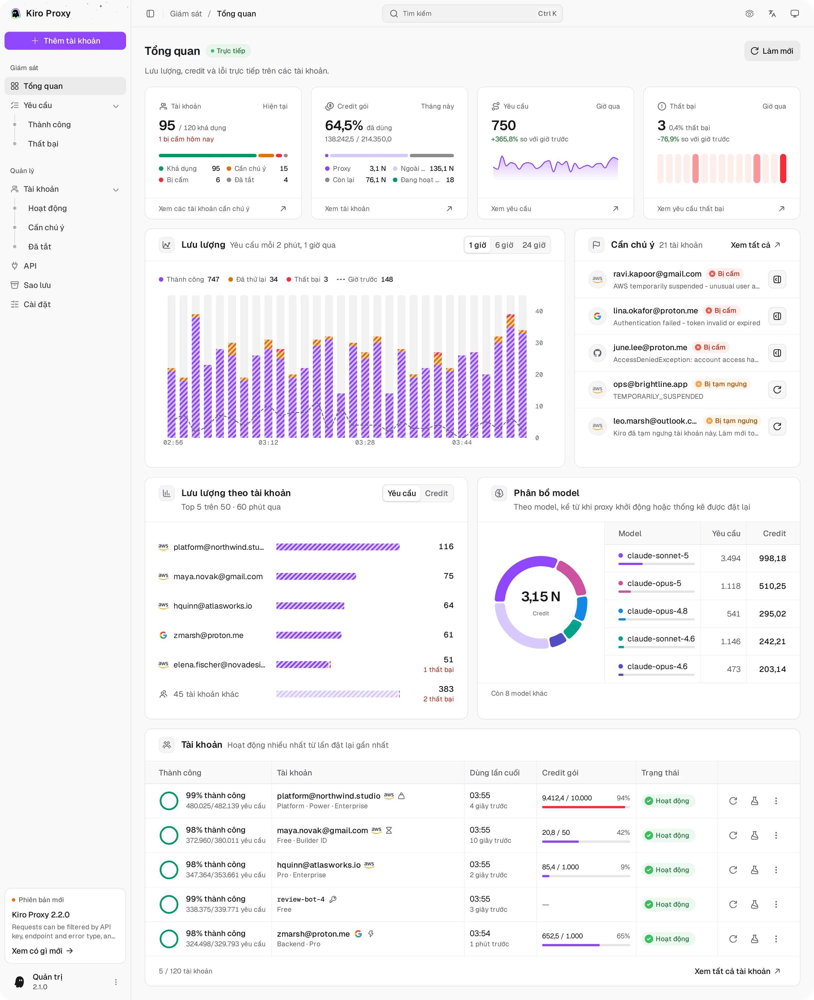

<div align="center">


# Kiro Proxy

#### Proxy cục bộ chuyển tài khoản Kiro thành endpoint tương thích OpenAI / Anthropic.

<p>
  <a href="https://go.dev/"></a>
  <a href="https://www.docker.com/"></a>
  <a href="https://www.sqlite.org/"></a>
  <a href="LICENSE"></a>
</p>

<p>
  <a href="#-tổng-quan">Tổng&nbsp;quan</a> •
  <a href="#-xem-trước">Xem&nbsp;trước</a> •
  <a href="#-tính-năng">Tính&nbsp;năng</a> •
  <a href="#-bắt-đầu-nhanh">Bắt&nbsp;đầu&nbsp;nhanh</a> •
  <a href="#-cấu-hình">Cấu&nbsp;hình</a> •
  <a href="#-cách-dùng">Cách&nbsp;dùng</a> •
  <a href="#-chế-độ-thinking">Chế&nbsp;độ&nbsp;Thinking</a> •
  <a href="#-proxy-outbound">Proxy&nbsp;outbound</a> •
  <a href="#-an-toàn">An&nbsp;toàn</a>
</p>

[English](README.md) • [简体中文](README_CN.md) • [Português (Brasil)](README_PT-BR.md) • [Tiếng Việt](README_VI.md)

</div>

---

## 🌟 Tổng quan

**Kiro Proxy** là một dịch vụ Go nhỏ, biến một hoặc nhiều tài khoản **Kiro** đã được cấp quyền thành một endpoint API cục bộ dùng định dạng giao tiếp của **OpenAI** và **Anthropic**:

1. Gộp nhiều tài khoản Kiro và cân bằng tải yêu cầu bằng round-robin, trọng số hoặc mức ưu tiên, cùng cơ chế giữ hội thoại trên cùng một tài khoản.
2. Chuyển đổi hai chiều giữa các lệnh gọi Anthropic `/v1/messages`, OpenAI `/v1/chat/completions`, OpenAI `/v1/responses` và upstream Kiro, bao gồm tool, thinking, mức suy luận (reasoning effort) và tìm kiếm web.
3. Tự động làm mới access token và stream Server-Sent Events xuyên suốt từ đầu đến cuối, kèm keepalive và failover.
4. Đi kèm trang quản trị React nhúng sẵn trong binary để quản lý tài khoản, theo dõi trực tiếp và kiểm tra yêu cầu, với giao diện English, 简体中文, Tiếng Việt và Português (Brasil).

> [!IMPORTANT]
> Proxy cục bộ chỉ gồm một binary. **Không phải** dịch vụ được host sẵn, **không** liên kết với Amazon, AWS hay Kiro. Bạn phải sở hữu hoặc được cấp quyền sử dụng mọi tài khoản bạn thêm vào nhóm tài khoản.

Nếu dự án này giúp ích cho bạn, một Star sẽ rất có ý nghĩa.

---

## 🖼 Xem trước

<p align="center">
  <picture>
    <source media="(prefers-color-scheme: dark)" srcset="screenshots/vi/overview-dark.webp">
    
  </picture>
  <br><sub><b>Tổng quan</b> — lưu lượng, credit và lỗi trực tiếp trên các tài khoản</sub>
</p>

<p align="center">📸 <a href="docs/SCREENSHOTS_VI.md"><b>Xem thêm ảnh chụp màn hình</b></a> — tài khoản, yêu cầu, API, sao lưu và cài đặt</p>

## ✨ Tính năng

### 🛰 API hỗ trợ

- Anthropic `/v1/messages` hỗ trợ tool use gốc và streaming, cùng với `/v1/messages/count_tokens`.
- OpenAI `/v1/chat/completions` với định dạng lệnh gọi tool tương thích đầy đủ.
- OpenAI `/v1/responses` hỗ trợ nối chuỗi bằng `previous_response_id` và truy xuất response đã lưu.
- Danh sách model dành cho Codex tại `/v1/codex/models`, bên cạnh `/v1/models` tiêu chuẩn.
- Streaming SSE cho mọi endpoint, có failover sang tài khoản khác ngay giữa stream khi upstream gặp lỗi tạm thời, và gửi keepalive mỗi 15 giây khi upstream im lặng (suy luận dài, tham số tool đang bị giữ lại).
- Server tool `web_search` của Anthropic chạy qua tính năng tìm kiếm web của chính Kiro, kết quả trả về dưới dạng các khối search result.
- Mức suy luận: `reasoning_effort` của OpenAI và `output_config.effort` của Claude (`low` đến `xhigh`) bật thinking và được chuyển tới các model hỗ trợ mức effort; `minimal` tắt thinking.
- Đầu ra có cấu trúc: `response_format` của OpenAI (`json_object`, `json_schema`), `output_config.format` của Claude và `text.format` của Responses trả về JSON thuần, được kiểm tra theo schema (xem [Đầu ra có cấu trúc](#-đầu-ra-có-cấu-trúc)).
- Chữ ký thinking: trên `/v1/messages`, khối thinking mang `signature` do Kiro gửi (`signature_delta` khi stream), và các khối `redacted_thinking` được chuyển tiếp nguyên vẹn.
- Khôi phục lệnh gọi tool: lệnh gọi tool mà Kiro để lọt vào câu trả lời dưới dạng markup được chuyển lại thành lệnh gọi tool thật (tắt bằng `KIRO_TOOL_MARKUP_RESCUE=off`).
- Giải nén body yêu cầu (gzip/deflate) cho các client nén payload trước khi gửi.

### 🧰 Xử lý yêu cầu

- **Tự động viết tiếp** (mặc định tắt): khi câu trả lời dừng ở giới hạn đầu ra khoảng 8192 token của Kiro mà không có lệnh gọi tool, proxy yêu cầu Kiro viết tiếp và nối phần còn lại, tối đa 10 lần.
- **Lịch sử tool có cấu trúc**: lệnh gọi tool và kết quả trước đó đến model dưới dạng lệnh gọi tool thật, nên các phiên agent dài vẫn tiếp tục gọi tool; yêu cầu bị từ chối sẽ được thử lại một lần ở dạng văn bản thuần.
- **Bộ lọc system prompt**: thay system prompt tích hợp của Claude Code bằng một prompt gọn hơn, loại bỏ nhiễu môi trường (biến môi trường, git status, commit gần đây) và áp dụng các quy tắc lọc dòng hoặc regex của riêng bạn theo thứ tự.
- **Ánh xạ model**: các quy tắc có thứ tự, kéo để sắp xếp, chuyển bất kỳ tên model nào của client sang một ID model Kiro; quy tắc khớp đầu tiên được dùng. Model mà chính Kiro liệt kê chỉ đi theo quy tắc ghi đúng tên đầy đủ của nó, nên quy tắc khớp chuỗi con như `gpt-5` không bao giờ chuyển hướng một model gốc.
- **Toàn vẹn stream**: từ chối phản hồi kết thúc mà không có stop reason hoặc sự kiện metering, kèm chế độ nới lỏng (phải tự bật) cho tài khoản IdC và Enterprise không gửi cả hai.
- **Chọn endpoint**: chọn một endpoint Kiro hoặc để proxy tự chọn theo tình trạng khả dụng, có thể chuyển sang các endpoint khác khi lỗi.
- **Thu nhỏ hình ảnh** (mặc định bật): ảnh có chiều rộng hoặc chiều cao vượt 1568 px, hoặc nặng hơn 400 KB, được thu nhỏ và mã hóa lại trước khi gửi tới Kiro. Cả hai giới hạn đều chỉnh được trong cài đặt.
- **Header phản hồi**: tối đa 20 header tùy chỉnh trên mọi phản hồi API, kể cả stream và lỗi. Giá trị có thể dùng `{request_id}`, `{model}`, `{account_id}`, `{key_id}` và `{client_ip}`; `{request_id}` chính là Mã truy vết trong nhật ký yêu cầu.

### 👥 Nhóm tài khoản

- Nhiều tài khoản Kiro với hai chế độ định tuyến. **Theo trọng số** (mặc định): round-robin cho từng model và có trọng số cho từng tài khoản (tài khoản có trọng số N nhận số yêu cầu mới gấp khoảng N lần). **Theo ưu tiên**: mỗi yêu cầu mới đến tài khoản có số ưu tiên nhỏ nhất (0–999) phục vụ được nó; tài khoản kế tiếp sẽ thay thế khi tài khoản đó đang trong thời gian chờ, hết credit, bị tắt hoặc không có model.
- Giữ hội thoại trên một tài khoản: các lượt tiếp theo quay về tài khoản đã trả lời lượt trước, nơi đã có sẵn prompt cache; hội thoại mới đi theo chế độ định tuyến. Ở chế độ theo ưu tiên, mức ưu tiên được xét trước: ngay khi một tài khoản có ưu tiên cao hơn rảnh trở lại, lượt tiếp theo của hội thoại đang diễn ra sẽ đến tài khoản đó, còn tài khoản cùng mức ưu tiên không bao giờ lấy hội thoại đi. Tắt tính năng này để mọi yêu cầu đều được định tuyến lại theo chế độ định tuyến.
- Giới hạn tùy chọn từ 1 đến 1000 yêu cầu mỗi phút cho mỗi tài khoản: tài khoản chạm giới hạn sẽ bị bỏ qua, và khi mọi tài khoản đều chạm giới hạn, client nhận HTTP 429. Lần thử chưa tới được Kiro (lỗi proxy hoặc lỗi kết nối) không bị tính vào giới hạn. Trang Tài khoản hiển thị trực tiếp số yêu cầu mỗi phút và số yêu cầu hôm nay của từng tài khoản.
- **Tự phục hồi** (mặc định bật): khi không còn tài khoản nào phục vụ được, proxy gỡ các lệnh cấm xác thực và thời gian chờ do lỗi mà chính nó đặt ra rồi thử lại, tối đa một lần mỗi 5 phút và 5 lần liên tiếp mà không có yêu cầu thành công (cả hai đều chỉnh được). Tài khoản bị Kiro đình chỉ (lỗi 403 "locked your account" cũng được tính là đình chỉ), tài khoản bạn đã tắt và thời gian chờ do hết hạn mức không bao giờ được gỡ.
- Tự động làm mới OAuth token trước khi hết hạn, an toàn khi có yêu cầu đồng thời; thời gian chờ của tài khoản được giữ lại qua các lần khởi động lại.
- Làm mới mức sử dụng và token sắp hết hạn trong nền, mặc định mỗi 30 phút. Chọn từ 5 phút đến 24 giờ, hoặc Tắt để chỉ làm mới khi cần; token vẫn được gia hạn khi một yêu cầu cần đến.
- Đăng nhập lại hoặc nhập lại một tài khoản đã lưu sẽ cập nhật tài khoản đó thay vì tạo bản sao. Thêm lại một Kiro API key đã lưu sẽ bị từ chối với HTTP 409 (đã được thêm), trừ khi nó đi kèm ghi chú hoặc thẻ và cùng khu vực, như khi nhập lại bản xuất vào chính backend đó: khi ấy thẻ của nó được gộp vào thẻ của tài khoản đã lưu, còn ghi chú và biệt danh đang trống được điền vào. Các bản sao còn sót từ phiên bản cũ (cùng refresh token, Kiro API key, user ID, hoặc cùng email và phương thức đăng nhập) hiện thành thông báo trên trang Tài khoản; **Xem lại** gộp mỗi nhóm thành một tài khoản sau khi sao lưu, giữ lại các yêu cầu, cộng dồn bộ đếm, gộp ghi chú và thẻ, và giữ proxy riêng của một bản sao khi tài khoản được giữ lại chưa có proxy riêng.
- **Đăng nhập lại** trong menu của mỗi tài khoản thay thông tin đăng nhập ngay tại chỗ và giữ nguyên ID, cài đặt, ghi chú, thẻ và thống kê. Thao tác này gỡ lệnh cấm, nhưng tài khoản bạn đã tắt vẫn tắt. Khi lần đăng nhập mới là một người dùng khác, proxy hỏi xác nhận trước khi thay danh tính. Lần đăng nhập thuộc về một tài khoản khác trong pool bị từ chối với HTTP 409 (`relogin_other_account`) mà không hỏi xác nhận: tài khoản này giữ nguyên, và trang quản trị cho biết đó là tài khoản nào và tài khoản đó đã nhận token mới hay chưa.
- Ghi chú (tối đa 2000 ký tự) và tối đa 10 thẻ (mỗi thẻ 24 ký tự) cho mỗi tài khoản. Tìm kiếm khớp cả ghi chú lẫn thẻ, thẻ dùng được trong bộ lọc Thẻ và thao tác hàng loạt, và cả xuất lẫn nhập đều giữ cả hai.
- Phương thức xác thực: AWS Builder ID, IAM Identity Center (Enterprise SSO), Microsoft SSO (Entra ID), SSO token, cache cục bộ của Kiro IDE, JSON thông tin xác thực, cookie web Kiro và Kiro API key cho môi trường không giao diện (`ksk_…`). Trong **Thêm tài khoản**, mỗi liên kết đăng nhập có một biểu tượng mở và một biểu tượng sao chép.
- Cho từng tài khoản: proxy outbound riêng, ID thiết bị (machine ID), Kiro profile được ghim, làm mới danh sách model, kiểm tra kết nối và công tắc vượt mức thật của Kiro.
- Vượt mức (tùy chọn): tài khoản tiếp tục phục vụ yêu cầu sau khi hết credit.
- Nhập / xuất theo từng tài khoản và thao tác hàng loạt.

### 🛡 Trang quản trị

- Ứng dụng React một trang nhúng trong binary; không cần chạy web server riêng.
- Bảng điều khiển Tổng quan cập nhật trực tiếp: bốn thẻ KPI (tài khoản, credit gói, cùng số yêu cầu và số yêu cầu thất bại trong giờ qua), lưu lượng trong 1 giờ, 6 giờ, 24 giờ qua hoặc toàn bộ thời gian dạng cột chồng, danh sách tài khoản cần chú ý, lưu lượng theo tài khoản, biểu đồ donut phân bổ model và các tài khoản hoạt động nhiều nhất. Thẻ **Credit gói** chia mức dùng credit Kiro thành phần dùng qua proxy và phần dùng ngoài proxy.
- Tài khoản với tab trạng thái kèm số lượng, bộ lọc (gói, xác thực, khu vực, bật, thẻ), tìm kiếm theo email, biệt danh, ghi chú và thẻ, sắp xếp, thao tác hàng loạt, chế độ xem chi tiết, kiểm tra kết nối, số yêu cầu mỗi phút và hôm nay theo thời gian thực, xem lại tài khoản trùng lặp và xuất.
- Nhật ký yêu cầu với tab trạng thái kèm số lượng, tìm kiếm (khớp cả API key đầy đủ), sắp xếp, chế độ xem chi tiết có phân loại lỗi, Mã truy vết và dòng thời gian của từng lần thử upstream (tài khoản, endpoint, thời lượng, kết quả, failover), API key được che và lịch sử lưu trong SQLite. Chi tiết một yêu cầu mở được cuộc hội thoại của nó (các lượt theo thứ tự, tài khoản của từng lượt, các lần chuyển dự phòng và tổng cộng) và lọc nhật ký theo hội thoại đó; **Chạy lại** chạy lại một yêu cầu đã ghi trên tài khoản và model bạn chọn (xem [Hội thoại và chạy lại](#-hội-thoại-và-chạy-lại)).
- Trang API quản lý API key của client (giá trị key tùy chỉnh không bắt buộc, bật/tắt, giới hạn token, credit và lượt gọi cho từng key, gắn key với tài khoản, tạo lại key, đặt lại mức sử dụng), biểu đồ **Mức sử dụng theo key** và trình tạo mã thiết lập client có tô sáng cú pháp: mã gọi các API Anthropic Messages, OpenAI Chat Completions và OpenAI Responses bằng curl, Python, Node.js, Go, Java, PHP, Ruby và C# (SDK chính thức hoặc HTTP thuần, có hoặc không stream) kèm phản hồi mẫu, cùng cấu hình Claude Code và Codex.
- Cài đặt cho mức sử dụng và làm mới trong nền, định tuyến (chế độ, giữ hội thoại, giới hạn mỗi tài khoản), tự động viết tiếp, lịch sử tool, thu nhỏ hình ảnh, tự phục hồi, thinking, ánh xạ model, bộ lọc system prompt, toàn vẹn stream, endpoint, tên miền và khu vực Kiro, proxy outbound, nhóm proxy, header phản hồi, cảnh báo, nhật ký máy chủ, mật khẩu quản trị, đăng nhập hai bước, chỉ số Prometheus, lưu giữ nhật ký và đặt lại thống kê; Sao lưu có lịch, tải lên và khôi phục bằng một cú nhấp.
- Cảnh báo qua webhook, Telegram, Discord hoặc Slack khi sắp hết credit, khi tài khoản bị cấm hoặc khi không còn tài khoản nào phục vụ được yêu cầu (xem [Cảnh báo](#-cảnh-báo)).
- Menu lệnh (<kbd>Ctrl</kbd>/<kbd>⌘</kbd> + <kbd>K</kbd>) để mở trang và chạy thao tác, chế độ riêng tư ẩn địa chỉ email, và kiểm tra cập nhật qua `version.json` trên nhánh `main` của repo.
- Đổi mật khẩu quản trị sẽ kết thúc mọi phiên đăng nhập khác.
- Đăng nhập hai bước bằng ứng dụng xác thực, kèm mười mã khôi phục dùng một lần (xem [Đăng nhập hai bước](#-đăng-nhập-hai-bước)).
- Giao diện sáng, tối và theo hệ thống; bốn ngôn ngữ giao diện: English, 简体中文, Tiếng Việt và Português (Brasil).
- Dùng được trên cả điện thoại lẫn máy tính.

### 🌐 Mạng

- Hỗ trợ proxy outbound — SOCKS5, HTTP hoặc HTTPS, chuyển đổi trực tiếp không cần khởi động lại, có thể ghi đè riêng cho từng tài khoản. Mật khẩu proxy đã lưu hiển thị dạng `********`.
- Nhóm proxy: mỗi tài khoản không có proxy riêng được gán một proxy trong nhóm, có kiểm tra tình trạng, công tắc bật/tắt cho từng proxy, chuyển sang proxy hoạt động tốt sau ba lần lỗi liên tiếp, và proxy chung cùng proxy riêng của tài khoản được kiểm tra như các mục phát hiện được (xem [Nhóm proxy](#-nhóm-proxy)).
- Tên miền và khu vực Kiro (**Cài đặt → Tên miền và khu vực Kiro**): gửi chat và tìm kiếm web tới `runtime.{region}.kiro.dev` thay vì `q.{region}.amazonaws.com` (mức sử dụng và danh sách model vẫn đi qua AWS), và ghi đè cho mọi tài khoản khu vực API (`us-east-1` hoặc `eu-central-1`) hoặc khu vực dùng để làm mới token Builder ID và IAM Identity Center. Khu vực không khớp với tài khoản khiến yêu cầu của tài khoản đó thất bại, nhưng không bao giờ làm tài khoản bị cấm.
- Hậu tố chế độ thinking có thể tùy chỉnh và chuyển tiếp nguyên cấu hình `thinking` của Anthropic.

### 🧩 Lưu trữ

- Cơ sở dữ liệu SQLite một tệp (`modernc.org/sqlite`) tại `kiro.db`, dùng chế độ journal DELETE.
- Các dòng yêu cầu cuối cùng, cùng bản tổng hợp của các dòng mà tính năng lưu giữ nhật ký đã xóa, là nguồn dữ liệu chuẩn cho tổng số yêu cầu, token, credit, thành công và thất bại trên bảng điều khiển.
- Lưu giữ nhật ký: các dòng nhật ký yêu cầu và lỗi cũ hơn 90 ngày (từ 1 đến 3650, hoặc giữ vĩnh viễn) bị xóa theo từng lô nhỏ, hai phút sau khi khởi động rồi mỗi ngày một lần.
- Response đã lưu được giữ 30 ngày; việc ghi chạy bất đồng bộ, nằm ngoài đường xử lý chính của yêu cầu.
- Nội dung yêu cầu được giữ 30 ngày để chạy lại: tối đa 2 MiB mỗi yêu cầu, nén lại, API key của client được che, tổng cộng 256 MiB (cũ nhất bị xóa trước).

---

## ⚙️ Yêu cầu hệ thống

| Thành phần   | Phiên bản            |
| ------------ | -------------------- |
| Go           | 1.25 +               |
| Node.js      | 22 + kèm pnpm (chỉ cần khi build giao diện quản trị từ mã nguồn) |
| Hệ điều hành | Linux / macOS / Windows |
| Container    | Docker 24+, không bắt buộc |
| Lưu trữ      | Volume cục bộ trên ổ đĩa |

---

## 🚀 Bắt đầu nhanh

### 🐳 Docker Compose (khuyến nghị)

```bash
git clone https://github.com/tanu360/kiro-reverse-api.git
cd kiro-reverse-api
docker-compose up -d
```

### 🐳 Docker Run

```bash
docker run -d \
  --name kiro-proxy \
  -p 8080:8080 \
  -e ADMIN_PASSWORD=your_secure_password \
  -v /path/to/kiro-proxy-state:/app/state \
  --restart unless-stopped \
  ghcr.io/tanu360/kiro-reverse-api:latest
```

### 📦 Tải binary dựng sẵn

Mỗi [bản phát hành](https://github.com/tanu360/kiro-reverse-api/releases) đều kèm binary chạy ngay cho Linux, macOS và Windows trên x64 và arm64, đã tích hợp sẵn giao diện quản trị. Không cần Go, Node.js hay Docker.

```bash
# Đổi linux-x64 theo nền tảng của bạn: linux-arm64, macos-apple-silicon hoặc macos-intel
curl -LO https://github.com/tanu360/kiro-reverse-api/releases/latest/download/kiro-proxy-linux-x64.tar.gz
tar -xzf kiro-proxy-linux-x64.tar.gz
cd kiro-proxy-linux-x64
./kiro-proxy
```

Trên Windows, tải `kiro-proxy-windows-x64.zip` (hoặc `kiro-proxy-windows-arm64.zip`), giải nén rồi chạy `kiro-proxy.exe` trong terminal. Cơ sở dữ liệu được tạo trong thư mục hiện tại; đặt `DATA_DIR` để lưu ở nơi khác. Server lắng nghe tại `127.0.0.1:8080`: đặt `PORT` khi cổng 8080 đã bị dùng, và `LISTEN_HOST=0.0.0.0` để nhận kết nối từ máy khác. File `SHA256SUMS.txt` trong bản phát hành liệt kê checksum của từng file nén: kiểm tra file đã tải bằng `sha256sum -c SHA256SUMS.txt --ignore-missing` (macOS: `shasum -a 256 -c SHA256SUMS.txt --ignore-missing`). Các binary chưa được ký: nếu macOS chặn, hãy chạy `xattr -d com.apple.quarantine kiro-proxy`; Windows SmartScreen có thể hỏi xác nhận ở lần chạy đầu tiên.

### 🛠 Build từ mã nguồn

```bash
git clone https://github.com/tanu360/kiro-reverse-api.git
cd kiro-reverse-api
cd ui && pnpm install && pnpm build && cd ..
go build -o kiro-proxy .
./kiro-proxy
```

Giao diện quản trị cần Node.js 22+ và pnpm để build. `go build` nhúng mọi thứ có trong `ui/dist`: nếu chưa build giao diện, `/` hiển thị trang "UI not built" trong khi API vẫn hoạt động. Docker image build cả hai.

### 🎨 Phát triển giao diện quản trị

Chạy các lệnh sau trong `ui/`:

| Lệnh            | Tác dụng                                                                        |
| --------------- | ------------------------------------------------------------------------------- |
| `pnpm dev`      | Dev server tại `http://localhost:5173/admin/`; chuyển tiếp `/admin/api` và `/v1` tới `127.0.0.1:8080` |
| `pnpm dev:mock` | Dev server dùng dữ liệu giả, không cần backend; đăng nhập bằng mật khẩu `12345678` |
| `pnpm test`     | Test unit và component (Vitest)                                                 |
| `pnpm test:e2e` | Smoke test trên trình duyệt ở chế độ mock (Playwright)                          |

> [!TIP]
> `kiro.db` được tự động tạo ở lần chạy đầu tiên. Đặt `DATA_DIR` để lưu tệp ở nơi khác; Docker dùng `/app/state`. Đặt `ADMIN_PASSWORD` để chọn mật khẩu quản trị. Nếu không đặt, lần chạy đầu tiên sẽ tạo một mật khẩu ngẫu nhiên gồm 8 chữ số, lưu lại và in một lần trong log khởi động. Trang đăng nhập hiển thị mật khẩu này cho đến lần đăng nhập thành công đầu tiên. Người dùng Docker có thể xem bằng `docker compose logs kiro-proxy`. Mật khẩu đã lưu được giữ nguyên qua các lần khởi động lại. Mật khẩu 48 ký tự chưa từng được dùng từ phiên bản cũ sẽ được thay một lần bằng mật khẩu 8 chữ số; mật khẩu đã dùng để đăng nhập hoặc được cấu hình rõ ràng sẽ được giữ nguyên.

---

Body yêu cầu bị giới hạn ở 32 MiB, cả khi truyền qua mạng lẫn sau mỗi lớp giải nén. Chấp nhận tối đa ba lớp encoding. Yêu cầu vượt quá kích thước trả về HTTP 413. Tối đa tám body nén được giải nén cùng lúc; các yêu cầu nén tiếp theo phải chờ đến lượt, còn yêu cầu không nén không bao giờ phải chờ. Việc đọc body có thời hạn 30 giây.

Xác thực bằng mật khẩu quản trị cho phép năm lần thử sai cho mỗi client mỗi phút, tính chung cho đăng nhập và các yêu cầu `X-Admin-Password`; một địa chỉ IPv4 hoặc một dải IPv6 /64 được tính là một client. Sau 30 lần thất bại trong một phút trên tất cả client, mỗi client chỉ còn một lần thử mỗi phút cho đến hết phút đó, giúp làm chậm việc dò mật khẩu phân tán mà không khóa ai. Các lần thử tiếp theo trả về HTTP 429 kèm `Retry-After`; token phiên hiện có vẫn hoạt động. Header IP được chuyển tiếp không được tin cậy, nên các client đứng sau cùng một reverse proxy dùng chung hạn mức theo IP của proxy đó. Lần kiểm tra mật khẩu thành công không bị tính vào hạn mức thất bại. Khi khôi phục bản sao lưu, giá trị ghi đè `ADMIN_PASSWORD` đang có hiệu lực vẫn được giữ.

## 🔧 Cấu hình

| Biến             | Mục đích                                  | Mặc định           |
| ---------------- | ----------------------------------------- | ------------------ |
| `DATA_DIR`        | Thư mục chứa `kiro.db`                    | `.`                |
| `ADMIN_PASSWORD` | Mật khẩu trang quản trị (ghi đè cấu hình) | —                  |
| `LISTEN_HOST`    | Địa chỉ lắng nghe. Mặc định chỉ nhận kết nối từ máy này; đặt `0.0.0.0` để nhận kết nối từ máy khác. Docker image đặt sẵn `0.0.0.0` | `127.0.0.1` |
| `PORT`           | Cổng lắng nghe, từ 1 đến 65535 (ghi đè cấu hình). Giá trị không hợp lệ bị bỏ qua, kèm cảnh báo khi khởi động. Với Docker, hãy đổi phía host trong ánh xạ cổng | `8080` |
| `KIRO_TOOL_MARKUP_RESCUE` | Đặt `off` để ngừng chuyển markup lệnh gọi tool mà Kiro để lọt vào văn bản câu trả lời trở lại thành lệnh gọi tool | on |
| `LOG_LEVEL`      | Mức log: `debug`, `info`, `warn` hoặc `error` (ghi đè cấu hình) | `info` |
| `ADMIN_RESET_2FA` | Đặt `1` để tắt đăng nhập hai bước của quản trị khi khởi động, nếu bạn mất cả ứng dụng lẫn mã khôi phục. Gỡ đi sau đó: khi còn đặt, mỗi lần khởi động sẽ tắt lại | — |

> [!WARNING]
> `kiro.db` chứa OAuth token và thông tin đăng nhập quản trị. Hãy giữ bí mật tệp này — không đưa vào git, ảnh chụp màn hình hay các cuộc trò chuyện. Gắn thư mục cơ sở dữ liệu dưới dạng volume riêng tư.

---

## 🕹 Cách dùng

Mở `http://localhost:8080`, đăng nhập, thêm tài khoản, rồi gọi API:

```bash
# Anthropic — Claude
curl http://localhost:8080/v1/messages \
  -H "Content-Type: application/json" \
  -H "anthropic-version: 2023-06-01" \
  -d '{"model":"claude-sonnet-4.5","max_tokens":1024,"messages":[{"role":"user","content":"Hello!"}]}'

# OpenAI — Chat Completions
curl http://localhost:8080/v1/chat/completions \
  -H "Content-Type: application/json" \
  -H "Authorization: Bearer any" \
  -d '{"model":"claude-sonnet-4.5","messages":[{"role":"user","content":"Hello!"}]}'

# OpenAI — Responses
curl http://localhost:8080/v1/responses \
  -H "Content-Type: application/json" \
  -H "Authorization: Bearer any" \
  -d '{"model":"claude-sonnet-4.5","input":"Hello!"}'
```

Tài khoản miễn phí trả về lỗi 404 cho các model mặc định `claude-*-5-5` của Claude Code, vì vậy hãy đặt `ANTHROPIC_MODEL` và các biến `ANTHROPIC_DEFAULT_*_MODEL` thành một model mà tài khoản của bạn hỗ trợ, ví dụ `claude-sonnet-4.5`.

Với Codex, hãy lưu `/v1/codex/models` thành một tệp và đặt `model_catalog_json` trong `~/.codex/config.toml` thành đường dẫn của tệp đó; nếu không, Codex sẽ không có công cụ `apply_patch`.

### 📌 Danh sách endpoint

| Phương thức | Đường dẫn                       | Tác dụng                                      |
| ----------- | ------------------------------- | --------------------------------------------- |
| `POST`   | `/v1/messages`                  | Claude completions theo định dạng Anthropic   |
| `POST`   | `/v1/messages/count_tokens`     | Đếm token theo định dạng Anthropic            |
| `POST`   | `/v1/chat/completions`          | Chat completions theo định dạng OpenAI        |
| `POST`   | `/v1/responses`                 | OpenAI Responses API (lưu trữ + nối chuỗi)    |
| `GET`    | `/v1/responses/{id}`            | Lấy một response đã lưu trước đó              |
| `DELETE` | `/v1/responses/{id}`            | Xóa một response đã lưu                       |
| `GET`    | `/v1/models`                    | Liệt kê các model khả dụng                    |
| `GET`    | `/v1/codex/models`              | Danh sách model theo định dạng Codex CLI      |
| `GET`    | `/v1/stats`                     | Thống kê tổng hợp mức sử dụng proxy           |
| `GET`    | `/metrics`                      | Chỉ số Prometheus, mặc định tắt, cần bearer token (xem [Chỉ số Prometheus](#-chỉ-số-prometheus)) |
| `GET`    | `/health`                       | Kiểm tra tình trạng hoạt động                 |
| `GET`    | `/`                             | Trang quản trị web (SPA nhúng; link trang như `/accounts` mở ứng dụng, link cũ `/admin/*` được chuyển hướng, client không yêu cầu HTML nhận health check) |

---

## 🔑 Quản lý API key

Bắt buộc API key từ trang **API** (**Truy cập API → Bắt buộc API key**). Bạn có thể tạo nhiều key cho client với giới hạn độc lập:

- Để trống **Key tùy chỉnh (không bắt buộc)** để tự tạo một key `sk-...` an toàn, hoặc nhập giá trị key của riêng bạn.
- Danh sách và nhật ký yêu cầu hiển thị key đã che, ví dụ `sk-clb****e4yo`; key đầy đủ vẫn được lưu để xác thực và để sao chép từ chi tiết key.
- Việc kiểm tra hạn mức token và credit dùng giá trị thô chính xác. Nhãn làm tròn hoặc rút gọn trên giao diện chỉ dùng để hiển thị.
- Giới hạn token, credit hoặc lượt gọi bằng `0` nghĩa là không giới hạn cho loại đó.
- **Giới hạn lượt gọi** chỉ đếm các lượt gọi thành công; yêu cầu thất bại, `/v1/models` và `count_tokens` không được tính. Key đã dùng hết lượt gọi nhận HTTP 429 cho đến khi bạn nâng giới hạn hoặc đặt lại mức sử dụng.
- **Tài khoản → Chỉ các tài khoản đã chọn** gắn một key với một số tài khoản. Yêu cầu của key đó chỉ dùng các tài khoản này, không bao giờ dùng tài khoản khác (HTTP 503 khi không tài khoản nào trong số đó khả dụng), và danh sách model của key chỉ hiện các model mà chúng phục vụ.
- **Tạo lại key** cấp cho key một giá trị mới, và giá trị cũ ngừng hoạt động ngay lập tức. Tên, giới hạn, tài khoản và mức sử dụng được giữ nguyên.
- **Mức sử dụng theo key** vẽ biểu đồ số yêu cầu, token và credit của từng key trong 24 giờ, 7 ngày, 30 ngày hoặc toàn bộ thời gian, tách riêng thành công và thất bại, với các dòng riêng cho yêu cầu không có key, key không hợp lệ và key đã xóa.

---

## 📊 Ý nghĩa số liệu thống kê

Trang Tổng quan và trang Tài khoản cố ý trả lời những câu hỏi khác nhau:

- **Thẻ Tài khoản**: các tài khoản Kiro đang được cấu hình ở thời điểm hiện tại, chia theo tình trạng (khả dụng, cần chú ý, bị cấm, đã tắt).
- **Thẻ Credit gói**: các trường hạn mức từ máy chủ Kiro trong tháng này, cộng cho mọi tài khoản (`usage_current / usage_limit`). Thanh của thẻ chia credit đã dùng thành **Proxy** (credit của các yêu cầu đi qua proxy này) và **Ngoài proxy** (phần còn lại), bên cạnh phần **Còn lại**.
- **Thẻ Yêu cầu** và **Thẻ Thất bại**: các yêu cầu qua proxy đã kết thúc trong giờ qua, so với giờ trước đó.
- **Trang Tài khoản**: bộ đếm lưu trên bản ghi của từng tài khoản (`requestCount`, `totalTokens`, `totalCredits`).
- **Lưu giữ nhật ký**: trước khi xóa các dòng cũ, tổng số của chúng được gộp vào một bản tổng hợp, nên thẻ **Credit gói**, biểu đồ phân bổ model và `/v1/stats` vẫn tính chúng. Mỗi ngày bị xóa vẫn giữ tổng số theo ngày, nên Mức sử dụng theo key và biểu đồ lưu lượng ở Tổng quan vẫn hiển thị ngày đó trong 7 ngày, 30 ngày và toàn bộ thời gian. Trang Yêu cầu chỉ hiển thị các dòng được giữ lại.

Nếu một tài khoản cũ hoặc đã xóa vẫn còn dòng trong `requests`, credit của nó vẫn được tính vào **Proxy**. Khi đó **Proxy** có thể cao hơn thực tế, còn **Ngoài proxy** thấp hơn thực tế. Dùng **Cài đặt → Vùng nguy hiểm → Đặt lại thống kê** hoặc dọn DB một lần nếu bạn muốn xóa các dòng yêu cầu cũ.

Nhãn token có thể hiển thị dạng rút gọn (`54.5M`, `476.5K`), nhưng phép tính ở backend và việc kiểm tra hạn mức dùng số thô.

---

## 🧠 Chế độ Thinking

Thêm hậu tố (mặc định `-thinking`) vào tên model để bật suy luận, ví dụ `claude-sonnet-4.5-thinking`.

Các yêu cầu tương thích Claude có cấu hình `thinking` ở cấp cao nhất cũng tự động bật chế độ này:

```json
{ "type": "enabled", "budget_tokens": 2048 }
{ "type": "adaptive" }
```

`reasoning_effort` của OpenAI và `output_config.effort` của Claude cũng dùng được: `low`, `medium`, `high` hoặc `xhigh` bật thinking và được chuyển tới các model hỗ trợ mức effort, còn `minimal` tắt thinking.

Trên `/v1/messages`, với định dạng đầu ra mặc định là khối thinking, khối thinking mang `signature` do Kiro gửi (`signature_delta` khi stream), và các khối `redacted_thinking` được chuyển tiếp nguyên vẹn. Không phải lúc nào Kiro cũng gửi hai thứ này. Khi bật thinking, các khối thinking mà client gửi lại được phát lại cho Kiro dưới dạng văn bản, theo quy tắc của Anthropic về những lượt được giữ thinking; chữ ký và các khối `redacted_thinking` của chúng bị bỏ đi.

Định dạng đầu ra được cấu hình tại **Cài đặt → Thinking** trong trang quản trị.

---

## 🧾 Đầu ra có cấu trúc

Kiro không có chế độ JSON, nên proxy yêu cầu model trả về JSON, bỏ code fence, kiểm tra câu trả lời theo schema và thử lại một lần trên cùng tài khoản khi không khớp.

| API              | Trường                                                         |
| ---------------- | -------------------------------------------------------------- |
| Chat Completions | `response_format`: `json_object` hoặc `json_schema`            |
| Messages         | `output_config.format` (hoặc `output_format`): `json_schema`   |
| Responses        | `text.format`: `json_object` hoặc `json_schema`                |

Trên Chat và Messages, phần suy luận không lẫn vào câu trả lời mà được trả về dưới dạng `reasoning_content` hoặc khối thinking. Schema có thể lớn tối đa 32 KiB, và loại định dạng không được hỗ trợ trả về HTTP 400. `count_tokens` có tính cả chỉ dẫn JSON được thêm vào.

---

## 🛰 Proxy outbound

Nếu bạn ở khu vực có mạng bị hạn chế, hãy cấu hình proxy outbound trong trang quản trị tại **Cài đặt → Proxy outbound**.

| Loại     | Ví dụ                         |
| -------- | ----------------------------- |
| SOCKS5   | `socks5://127.0.0.1:1080`     |
| HTTP     | `http://127.0.0.1:8888`       |
| HTTPS    | `https://proxy.example.com:443` |

> [!TIP]
> Cài đặt có hiệu lực ngay, không cần khởi động lại. Mỗi tài khoản cũng có thể dùng proxy riêng (chi tiết tài khoản → **Proxy tài khoản**); để trống để dùng proxy chung. Mật khẩu đã lưu hiển thị dạng `********`; lưu lại nguyên giá trị đã che vẫn giữ mật khẩu cũ.

Proxy riêng của tài khoản và proxy chung có 15 giây để kết nối. Khi một proxy thất bại, yêu cầu chuyển ngay sang tài khoản khác. Khi một yêu cầu thất bại vì không nhận được phản hồi nào từ Kiro (proxy gặp lỗi, hoặc không kết nối được tới Kiro hay Kiro không trả lời kịp), client nhận HTTP 503 với nội dung cố định: `outbound proxy failed: <reason>` (ví dụ `proxy refused the tunnel` hoặc `connection timed out`), `upstream connection failed` hoặc `upstream request timed out`. Nội dung này không bao giờ để lộ URL upstream hay địa chỉ proxy; log máy chủ và log yêu cầu vẫn giữ lỗi đầy đủ. Lỗi kết nối không bao giờ làm tài khoản bị cấm: nó chỉ được tính vào một thời gian chờ ngắn do lỗi.

### 🔁 Nhóm proxy

**Cài đặt → Nhóm proxy** phân bổ các tài khoản không có proxy riêng vào danh sách tối đa 100 proxy (`http`, `https`, `socks5` hoặc `socks5h`). Mỗi tài khoản giữ proxy được gán, và tài khoản mới vào proxy hoạt động tốt có ít tài khoản nhất. Kiểm tra tình trạng kết nối tới chính máy chủ của Kiro qua từng proxy, mặc định 10 phút một lần, và việc làm mới token đi cùng đường với các yêu cầu của tài khoản.

- **Ba lần lỗi.** Một proxy chỉ rời vòng quay, và các tài khoản của nó chuyển sang proxy hoạt động tốt, sau ba lần kiểm tra hoặc kết nối lỗi liên tiếp; một lần thành công đặt lại bộ đếm. Yêu cầu lỗi ở một proxy vẫn thử lại ngay qua đường khác: chỉ tài khoản đó chuyển sang proxy hoạt động tốt khác, và proxy bị tính một lần lỗi. Proxy bị tự động tắt sẽ quay lại ngay khi một lần kiểm tra thành công. Lỗi proxy không bao giờ khóa hay tạm dừng tài khoản.
- **Công tắc bật/tắt.** Mỗi proxy có công tắc riêng. Proxy đã tắt không bao giờ được dùng hay kiểm tra, các tài khoản của nó chuyển đi ngay, và không lần kiểm tra nào bật lại nó.
- **Proxy phát hiện được.** Proxy outbound chung và proxy riêng của tài khoản hiện thành các mục phát hiện được, được kiểm tra như proxy trong nhóm và có đếm lỗi. Chúng không bao giờ dùng chung với tài khoản khác: proxy không có thông tin đăng nhập chỉ vào nhóm khi bạn bấm **Thêm vào nhóm**, còn proxy có thông tin đăng nhập thì không thể vào.
- Thẻ đếm số proxy hoạt động tốt, có lỗi (vẫn trong vòng quay), tự động tắt và đã tắt.

Thứ tự là: proxy riêng của tài khoản, nhóm proxy, proxy chung, rồi kết nối trực tiếp. Khi không còn proxy nào trong nhóm hoạt động tốt, yêu cầu nhận HTTP 503 `no healthy outbound proxy in the pool`, trừ khi bật **Dự phòng khi không có proxy nào hoạt động tốt**: khi đó chúng dùng proxy chung, hoặc đi trực tiếp nếu chưa đặt proxy chung.

---

## 🔐 Đăng nhập hai bước

**Cài đặt → Đăng nhập hai bước** yêu cầu mã sáu chữ số từ ứng dụng xác thực (Google Authenticator, 1Password, Aegis và các ứng dụng tương tự) sau mật khẩu quản trị.

- **Bật** hiện mã QR và khóa bí mật dạng chữ. Một mã từ ứng dụng sẽ xác nhận, và mười mã khôi phục dùng một lần chỉ hiện một lần: hãy lưu ở nơi an toàn. Bật sẽ kết thúc mọi phiên đăng nhập khác.
- Sau đó, đăng nhập yêu cầu mã sau mật khẩu. Mã khôi phục dùng thay được một lần. Mã theo RFC 6238 (SHA-1, 30 giây), chấp nhận lệch đồng hồ một bước mỗi phía, và mỗi mã chỉ dùng được một lần. Mã sai được tính chung giới hạn số lần thử với mật khẩu sai.
- **Tắt** cần mã hiện tại hoặc mật khẩu quản trị. **Mã khôi phục mới** thay thế các mã cũ.
- Script gửi mật khẩu qua `X-Admin-Password` sẽ nhận HTTP 401 `totp_required` khi tính năng đang bật: hãy đăng nhập bằng `POST /admin/api/session` với `{"password": "…", "code": "123456"}`, rồi gửi token qua `X-Admin-Token`.
- Bị khóa ngoài? Khởi động máy chủ một lần với `ADMIN_RESET_2FA=1`. Nó tắt đăng nhập hai bước và ghi một cảnh báo; đăng nhập bằng mật khẩu, rồi gỡ biến này. `ADMIN_PASSWORD` và mật khẩu lần đầu vẫn hoạt động như trước.

Khóa bí mật được lưu như mật khẩu quản trị, trong `kiro.db`; mã khôi phục chỉ được lưu dưới dạng hash SHA-256. Không cái nào được ghi vào log.

---

## 📈 Chỉ số Prometheus

**Cài đặt → Chỉ số Prometheus** phục vụ `GET /metrics` theo định dạng văn bản của Prometheus. Mặc định tắt; khi bật sẽ tạo một bearer token, hiện trong thẻ cùng một job scrape `prometheus.yml` có sẵn. Không có token thì endpoint trả 401, còn khi tắt thì trả 404. **Token mới** thay token ngay lập tức.

| Chỉ số | Loại | Nhãn |
| ------ | ---- | ---- |
| `kiro_requests_total` | counter | `outcome`, `status`, `model`, `account`, `api_key` |
| `kiro_tokens_total` | counter | `kind` (input, output, cache_read, cache_write), `model`, `account`, `api_key` |
| `kiro_credits_total` | counter | `model`, `account`, `api_key` |
| `kiro_request_duration_seconds` | histogram | `endpoint`, `outcome` |
| `kiro_upstream_errors_total` | counter | `category` (các loại lỗi của nhật ký yêu cầu), `account` |
| `kiro_account_state`, `kiro_accounts` | gauge | `account`, `state` (active, cooldown, over_limit, banned, disabled) |
| `kiro_account_usage_ratio` | gauge | `account` |
| `kiro_proxy_state`, `kiro_proxy_failures`, `kiro_proxy_latency_seconds`, `kiro_proxies` | gauge | `proxy`, `kind` (pool, detected), `state` |
| `kiro_build_info`, `kiro_uptime_seconds` | gauge | `version` |

`account` là email của tài khoản, `api_key` là id của API key client (không bao giờ là key). Bộ đếm bắt đầu từ 0 khi máy chủ khởi động.

---

## 🧵 Hội thoại và chạy lại

Mỗi yêu cầu đã định tuyến đều mang hội thoại của nó: khóa session affinity, giống nhau ở mọi lượt của một cuộc chat. Chi tiết yêu cầu mở được **Hội thoại**: các lượt theo thứ tự, tài khoản và model của từng lượt, các lần chuyển dự phòng, cùng tổng token, credit và thời gian. **Xem trong nhật ký** lọc trang Yêu cầu theo hội thoại đó.

**Chạy lại** chạy lại một yêu cầu đã ghi, không dùng streaming, trên tài khoản và model bạn chọn, rồi hiện câu trả lời. Lần chạy được ghi thành một yêu cầu mới có đánh dấu chạy lại và tiêu credit của tài khoản đó. Chạy lại cần nội dung yêu cầu: máy chủ giữ nội dung 30 ngày, tối đa 2 MiB mỗi yêu cầu và 256 MiB tổng cộng, với API key của client được che. Chỉ dành cho quản trị.

---

## 🔔 Cảnh báo

**Cài đặt → Cảnh báo** gửi tin nhắn tới kênh webhook, Telegram, Discord hoặc Slack (tối đa 20 kênh) khi:

- mức dùng credit của một tài khoản vượt một ngưỡng (mặc định 80, 90 và 100 %): mỗi ngưỡng gửi một lần, và gửi lại sau khi credit của tài khoản được đặt lại;
- tổng mức dùng credit của mọi tài khoản đang bật và không bị cấm vượt một ngưỡng, tối đa một lần trong mỗi khoảng thời gian chờ (mặc định 60 phút);
- một tài khoản bị cấm: Kiro đình chỉ tài khoản đó hoặc thông tin đăng nhập của nó ngừng hoạt động. Mỗi lần bị cấm chỉ cảnh báo một lần: tài khoản được tự phục hồi hoặc **Đăng nhập lại** gỡ cấm, rồi bị cấm lại vì cùng lý do mà chưa phục vụ thành công yêu cầu nào ở giữa, sẽ không cảnh báo lại;
- không tài khoản đang bật nào phục vụ được yêu cầu trong suốt một phút.

Không có gì được kiểm tra khi chưa bật kênh nào, và **Gửi thử** gửi thử tới một kênh một lần. Cảnh báo đi qua proxy outbound chung, trừ khi nơi nhận nằm trên chính máy này hoặc trong mạng nội bộ (`localhost`, tên không có dấu chấm hoặc kết thúc bằng `.localhost`, `.local`, `.lan`, `.internal` hay `.home.arpa`, hoặc địa chỉ IP loopback, riêng tư hay link-local): khi đó cảnh báo được gửi trực tiếp. Webhook nhận một POST JSON gồm `event`, `severity`, `title`, `text`, `data` và `ts`, kèm header `X-Kiro-Proxy-Event`. Khi đặt khóa ký, `X-Kiro-Proxy-Signature: sha256=<hex>` mang HMAC-SHA256 của body. URL, token và khóa bí mật đã lưu không bao giờ được hiển thị lại.

---

## 🔐 Biến môi trường

| Biến             | Mô tả                                    | Mặc định           |
| ---------------- | ---------------------------------------- | ------------------ |
| `DATA_DIR`        | Thư mục chứa `kiro.db`                   | `.`                |
| `ADMIN_PASSWORD` | Mật khẩu trang quản trị (ghi đè cấu hình) | —                 |
| `LISTEN_HOST`    | Địa chỉ lắng nghe. Mặc định chỉ nhận kết nối từ máy này; đặt `0.0.0.0` để nhận kết nối từ máy khác. Docker image đặt sẵn `0.0.0.0` | `127.0.0.1` |
| `PORT`           | Cổng lắng nghe, từ 1 đến 65535 (ghi đè cấu hình). Giá trị không hợp lệ bị bỏ qua, kèm cảnh báo khi khởi động. Với Docker, hãy đổi phía host trong ánh xạ cổng | `8080` |
| `KIRO_TOOL_MARKUP_RESCUE` | Đặt `off` để ngừng chuyển markup lệnh gọi tool mà Kiro để lọt vào văn bản câu trả lời trở lại thành lệnh gọi tool | on |
| `LOG_LEVEL`      | Mức log: `debug`, `info`, `warn` hoặc `error` (ghi đè cấu hình) | `info` |
| `ADMIN_RESET_2FA` | Đặt `1` để tắt đăng nhập hai bước của quản trị khi khởi động, nếu bạn mất cả ứng dụng lẫn mã khôi phục. Gỡ đi sau đó: khi còn đặt, mỗi lần khởi động sẽ tắt lại | — |

```diff
+ kiro.db                # local state — config, credentials, SQLite history, backup blobs
```

> [!CAUTION]
> Hãy coi `kiro.db` là dữ liệu nhạy cảm — tệp này lưu token tài khoản và thông tin đăng nhập quản trị dưới dạng văn bản thuần trên ổ đĩa.

---

## 🙏 Ghi công dự án

Dự án này là phần tiếp nối của [Quorinex/Kiro-Go](https://github.com/Quorinex/Kiro-Go). Công lao của bản gốc thuộc về tác giả ban đầu; tôi đang tiếp tục phát triển và duy trì dự án.

Giao diện quản trị dựa trên các dự án mã nguồn mở [Studio Admin](https://github.com/arhamkhnz/next-shadcn-admin-dashboard), [t3code](https://github.com/pingdotgg/t3code), [coss ui](https://github.com/cosscom/ui), [Bklit UI](https://github.com/bklit/bklit-ui) và [openstatus data-table-filters](https://github.com/openstatusHQ/data-table-filters). Xem [THIRD_PARTY_NOTICES.md](./THIRD_PARTY_NOTICES.md) để biết giấy phép của các dự án này.

---

## 🛡 An toàn

- ✅ Chỉ dùng với những tài khoản bạn được **cấp quyền** vận hành.
- ❌ **Không** dùng để thu thập tài khoản hàng loạt hoặc lách điều khoản dịch vụ.
- ❌ **Không** thêm tính năng vượt CAPTCHA, giả mạo danh tính hoặc lách giới hạn tốc độ.
- 🔐 Không đưa `kiro.db` vào git, bản sao lưu công khai hay ảnh chụp màn hình.
- 🧯 Nếu upstream liên tục trả về lỗi xác thực, proxy sẽ báo lỗi ngay — hãy tìm nguyên nhân trước khi thử lại.

> [!IMPORTANT]
> Chỉ dành cho mục đích học tập và nghiên cứu. Không liên kết với Amazon, AWS hay Kiro. Người dùng tự chịu trách nhiệm tuân thủ điều khoản dịch vụ và pháp luật hiện hành. Bạn tự chịu rủi ro khi sử dụng.

---

## 📄 Giấy phép

[MIT](./LICENSE)

---

<div align="center">
<sub>Xây dựng bằng Go với ❤️ · Nếu dự án giúp bạn tiết kiệm thời gian, hãy để lại một ⭐ cho repo.</sub>
</div>
