

# 🖼 Screenshots

[English](SCREENSHOTS.md) • [简体中文](SCREENSHOTS_CN.md) • [Português (Brasil)](SCREENSHOTS_PT-BR.md) • [Tiếng Việt](SCREENSHOTS_VI.md)

[← Back to README](../README.md)

Every page of the admin panel. Each image follows your GitHub theme, light or dark.

[Login](#login) · [Overview](#overview) · [Accounts](#accounts) · [Requests](#requests) · [API](#api) · [Backups](#backups) · [Settings](#settings)

## Login

  <picture>
    <source media="(prefers-color-scheme: dark)" srcset="../screenshots/en/login-dark.webp">
    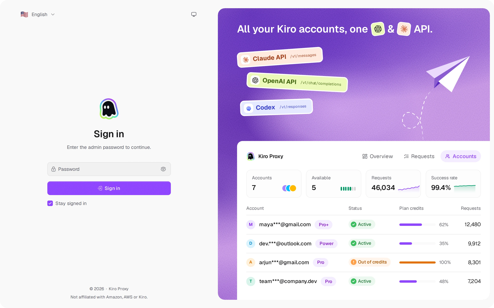
  </picture>
   <b>Login</b> — sign-in with theme and language switches

## Overview

  <picture>
    <source media="(prefers-color-scheme: dark)" srcset="../screenshots/en/overview-dark.webp">
    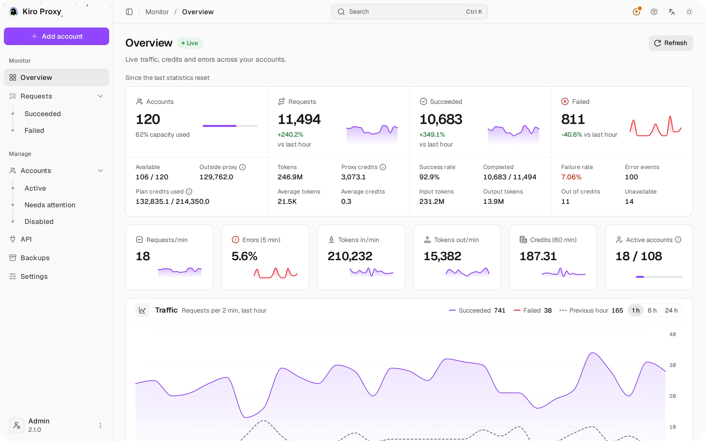
  </picture>
   <b>Overview</b> — live traffic, credits and errors across accounts

## Accounts

  <picture>
    <source media="(prefers-color-scheme: dark)" srcset="../screenshots/en/accounts-dark.webp">
    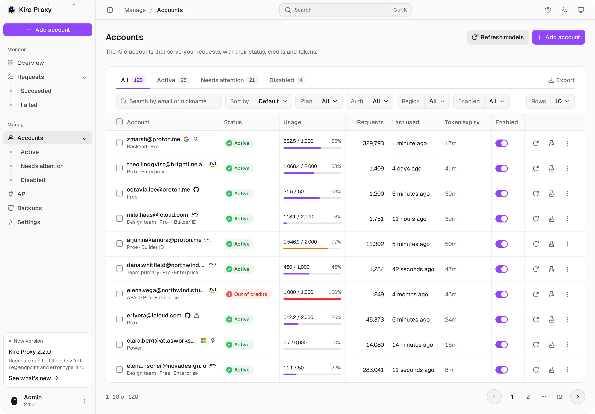
  </picture>
   <b>Accounts</b> — plan credits, status tabs, filters, batch actions and export

  <picture>
    <source media="(prefers-color-scheme: dark)" srcset="../screenshots/en/accounts-add-dark.webp">
    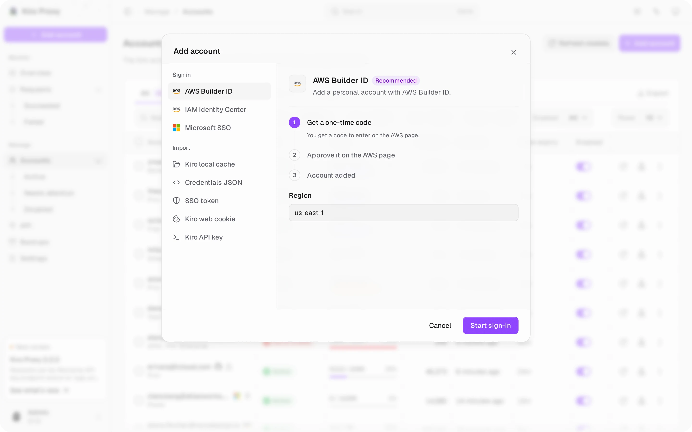
  </picture>
   <b>Add account</b> — every sign-in and import method in one dialog, each with its steps

  <picture>
    <source media="(prefers-color-scheme: dark)" srcset="../screenshots/en/accounts-detail-dark.webp">
    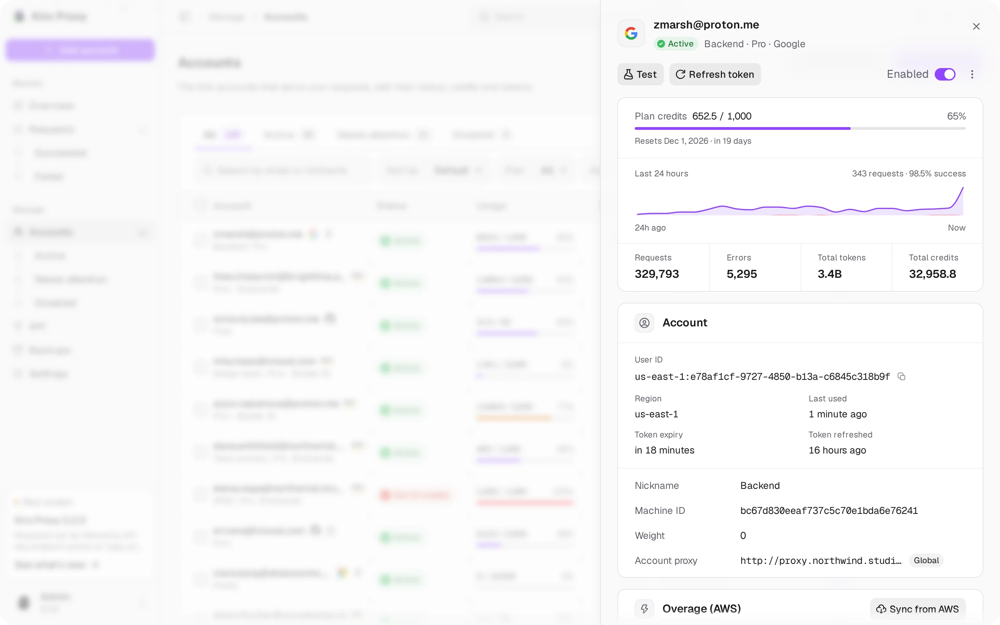
  </picture>
   <b>Account details</b> — the sheet a row opens: plan credits, the last 24 hours, totals and settings

  <picture>
    <source media="(prefers-color-scheme: dark)" srcset="../screenshots/en/accounts-tester-dark.webp">
    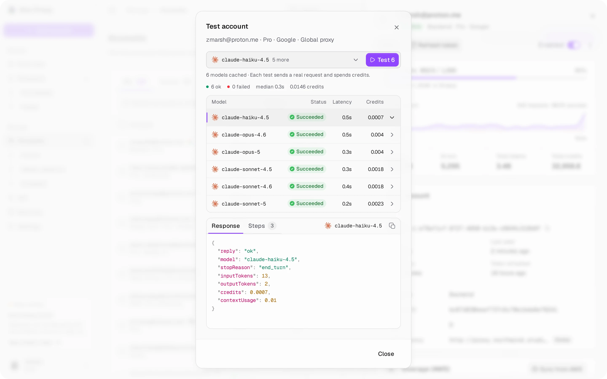
  </picture>
   <b>Test account</b> — test one model or every cached model at once; tap a row for its response and steps

## Requests

  <picture>
    <source media="(prefers-color-scheme: dark)" srcset="../screenshots/en/requests-dark.webp">
    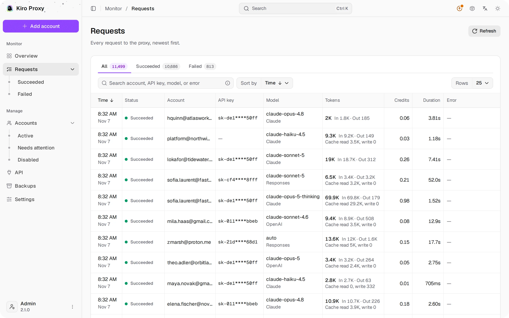
  </picture>
   <b>Requests</b> — status tabs, search, sorting and a detail view

  <picture>
    <source media="(prefers-color-scheme: dark)" srcset="../screenshots/en/requests-detail-dark.webp">
    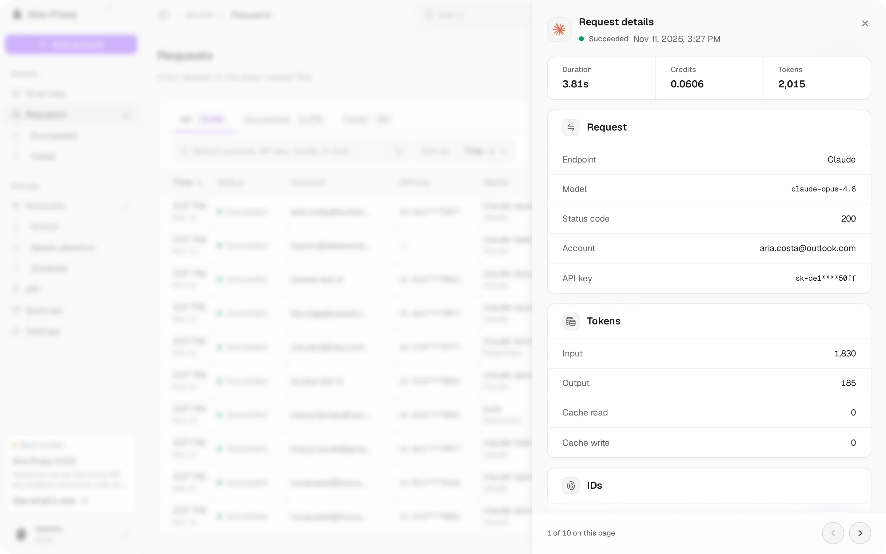
  </picture>
   <b>Request details</b> — the sheet a row opens: duration, credits, tokens and IDs

## API

  <picture>
    <source media="(prefers-color-scheme: dark)" srcset="../screenshots/en/api-dark.webp">
    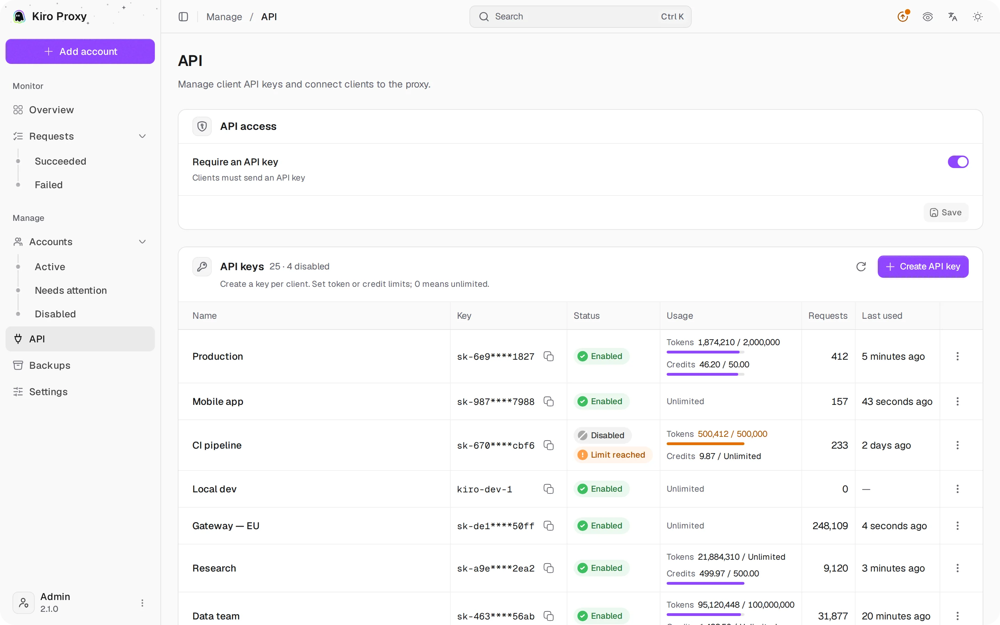
  </picture>
   <b>API</b> — API access, per-client keys with limits, highlighted client setup

## Backups

  <picture>
    <source media="(prefers-color-scheme: dark)" srcset="../screenshots/en/backups-dark.webp">
    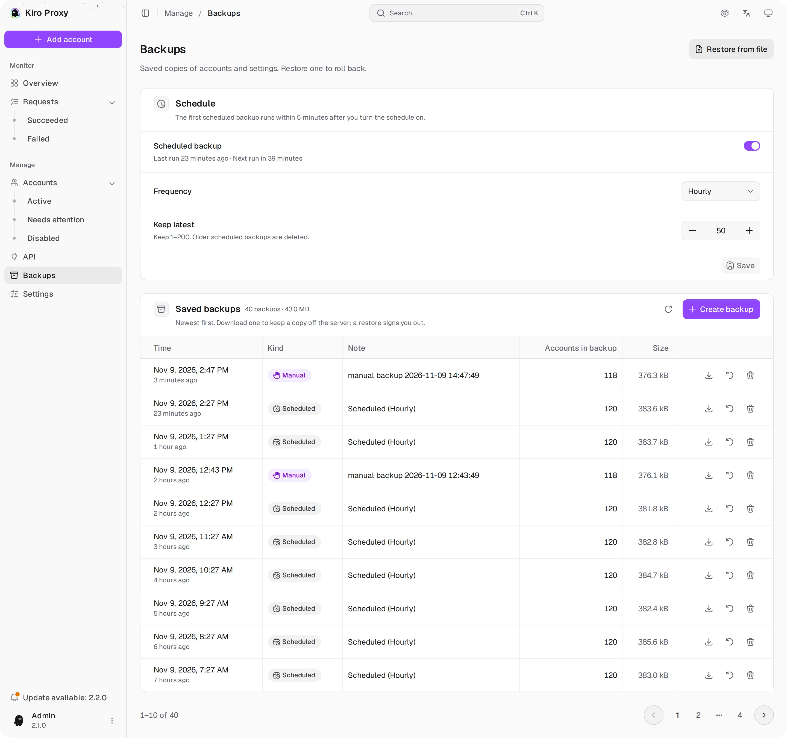
  </picture>
   <b>Backups</b> — manual and scheduled backups, one-click restore

## Settings

  <picture>
    <source media="(prefers-color-scheme: dark)" srcset="../screenshots/en/settings-1-dark.webp">
    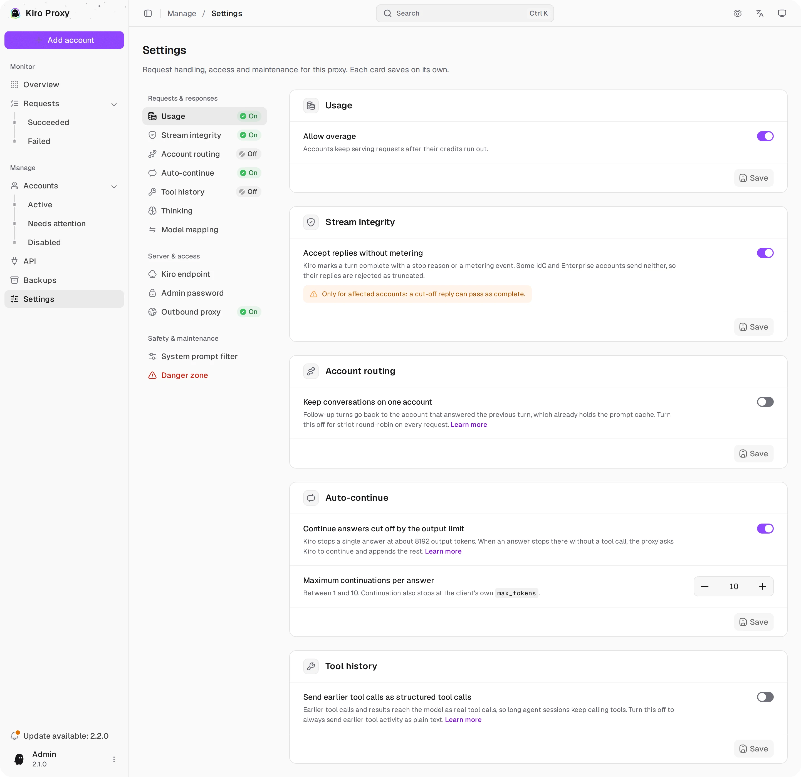
  </picture>
   <b>Settings</b> — usage, stream integrity, routing, auto-continue

  <picture>
    <source media="(prefers-color-scheme: dark)" srcset="../screenshots/en/settings-2-dark.webp">
    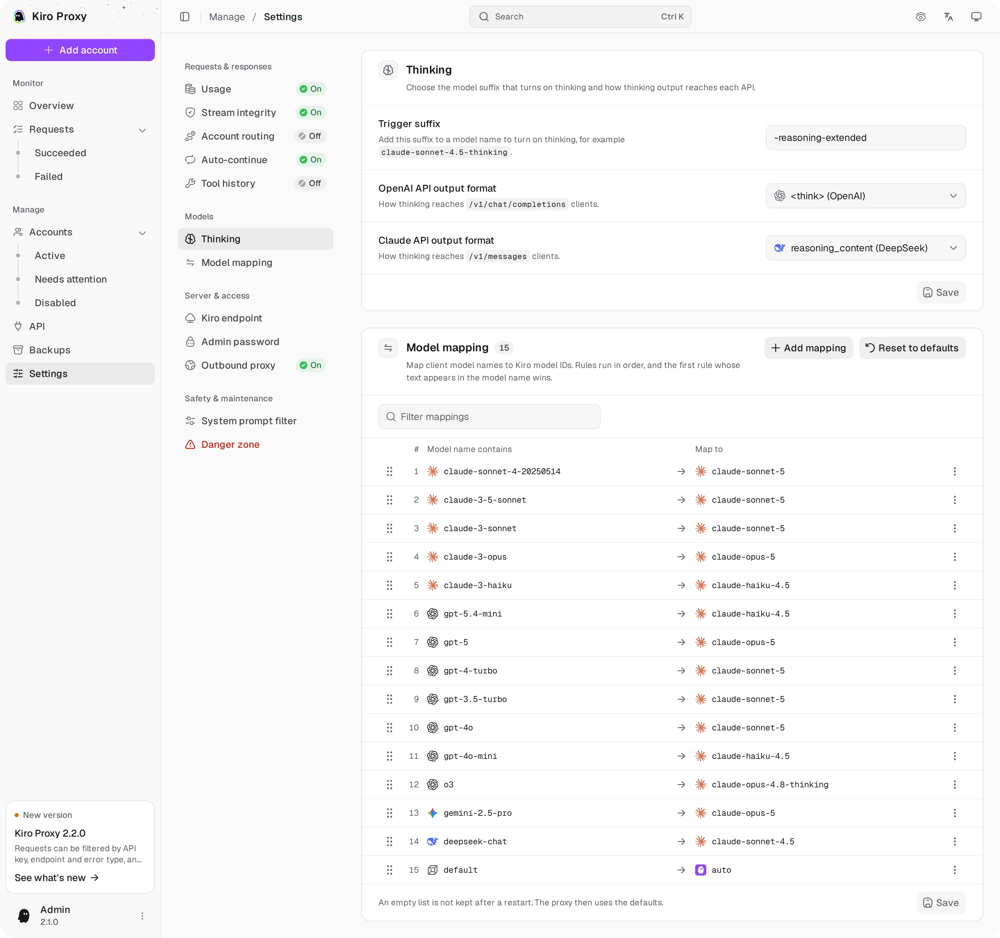
  </picture>
   <b>Settings</b> — thinking and model mappings

  <picture>
    <source media="(prefers-color-scheme: dark)" srcset="../screenshots/en/settings-3-dark.webp">
    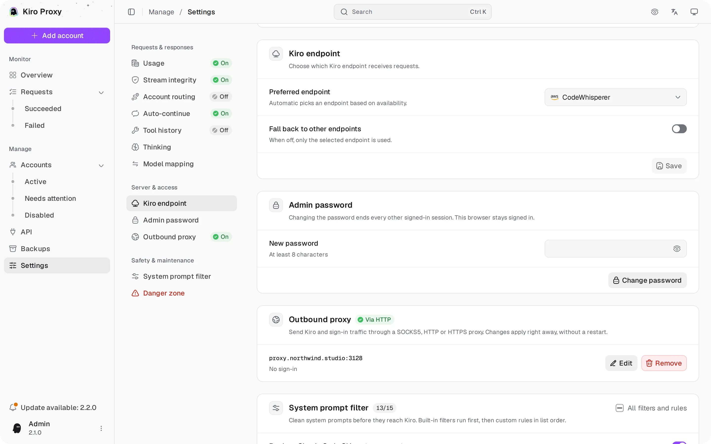
  </picture>
   <b>Settings</b> — Kiro endpoint, admin password, outbound proxy

[← Back to README](../README.md)
