

# 🖼 界面截图

[English](SCREENSHOTS.md) • [简体中文](SCREENSHOTS_CN.md) • [Português (Brasil)](SCREENSHOTS_PT-BR.md) • [Tiếng Việt](SCREENSHOTS_VI.md)

[← 返回 README](../README_CN.md)

管理面板的每个页面。图片会跟随你的 GitHub 主题显示浅色或深色。

[登录](#登录) · [概览](#概览) · [账号](#账号) · [请求](#请求) · [接口](#接口) · [备份](#备份) · [设置](#设置)

## 登录

  <picture>
    <source media="(prefers-color-scheme: dark)" srcset="../screenshots/zh/login-dark.webp">
    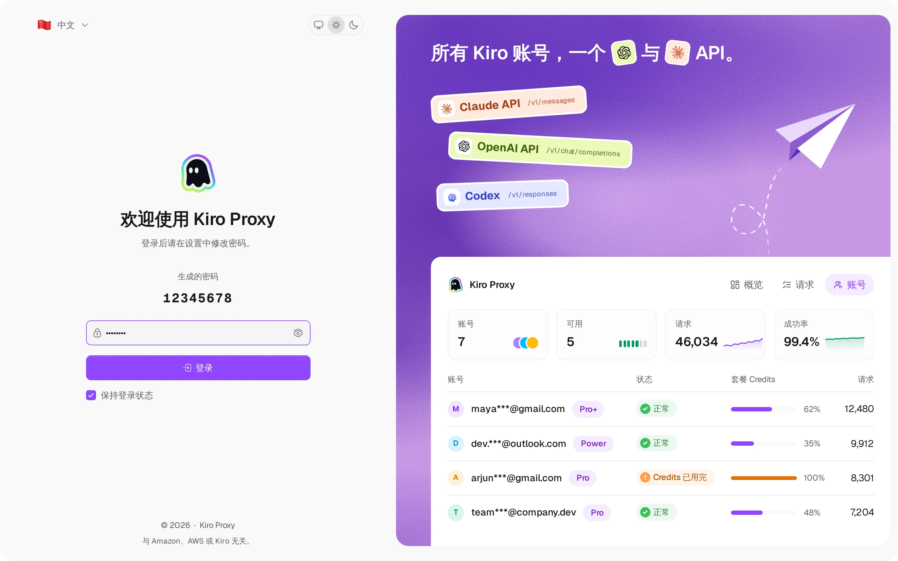
  </picture>
   <b>登录</b> — 登录页可切换主题与界面语言

## 概览

  <picture>
    <source media="(prefers-color-scheme: dark)" srcset="../screenshots/zh/overview-dark.webp">
    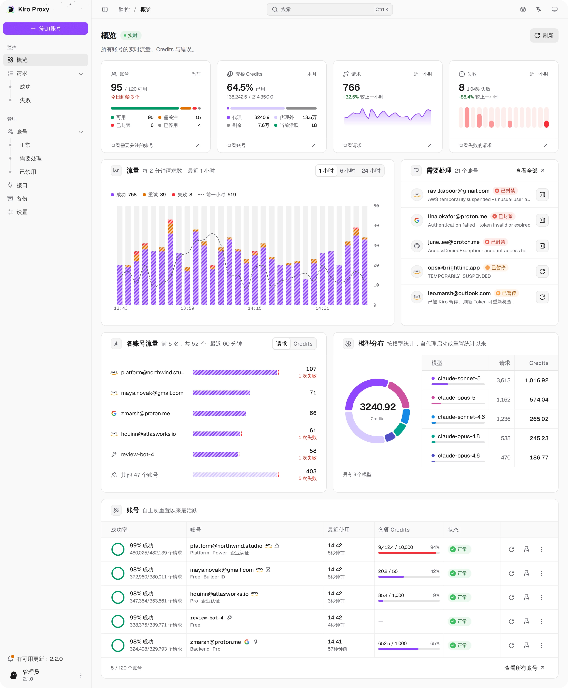
  </picture>
   <b>概览</b> — 各账号的实时流量、Credits 与错误

## 账号

  <picture>
    <source media="(prefers-color-scheme: dark)" srcset="../screenshots/zh/accounts-dark.webp">
    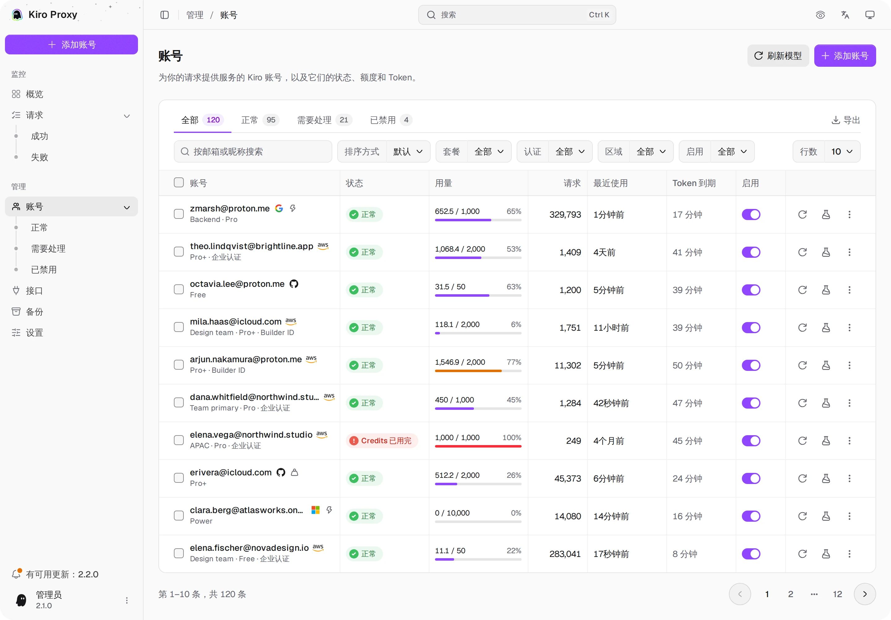
  </picture>
   <b>账号</b> — 套餐 Credits、状态标签、筛选、批量操作与导出

  <picture>
    <source media="(prefers-color-scheme: dark)" srcset="../screenshots/zh/accounts-add-dark.webp">
    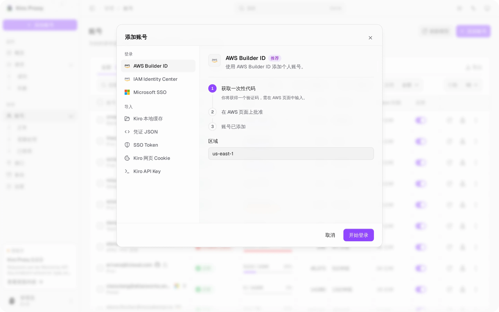
  </picture>
   <b>添加账号</b> — 一个对话框列出全部登录与导入方式，每种都有步骤说明

  <picture>
    <source media="(prefers-color-scheme: dark)" srcset="../screenshots/zh/accounts-detail-dark.webp">
    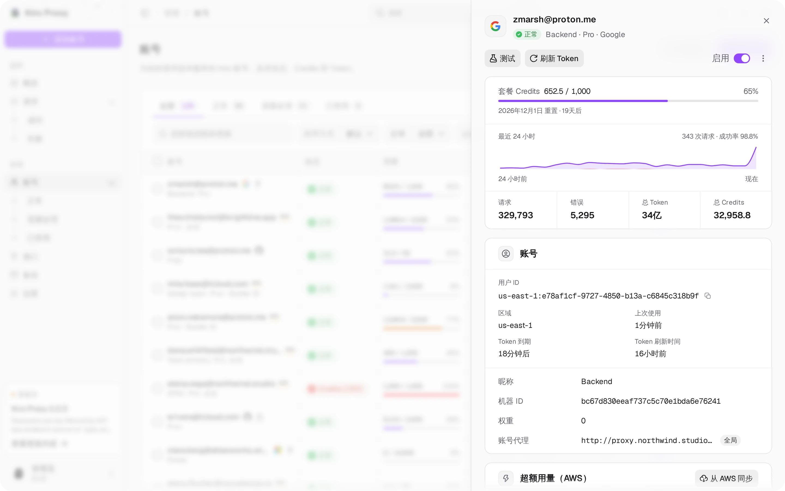
  </picture>
   <b>账号详情</b> — 点击一行打开的详情面板：套餐 Credits、最近 24 小时、汇总与设置

  <picture>
    <source media="(prefers-color-scheme: dark)" srcset="../screenshots/zh/accounts-tester-dark.webp">
    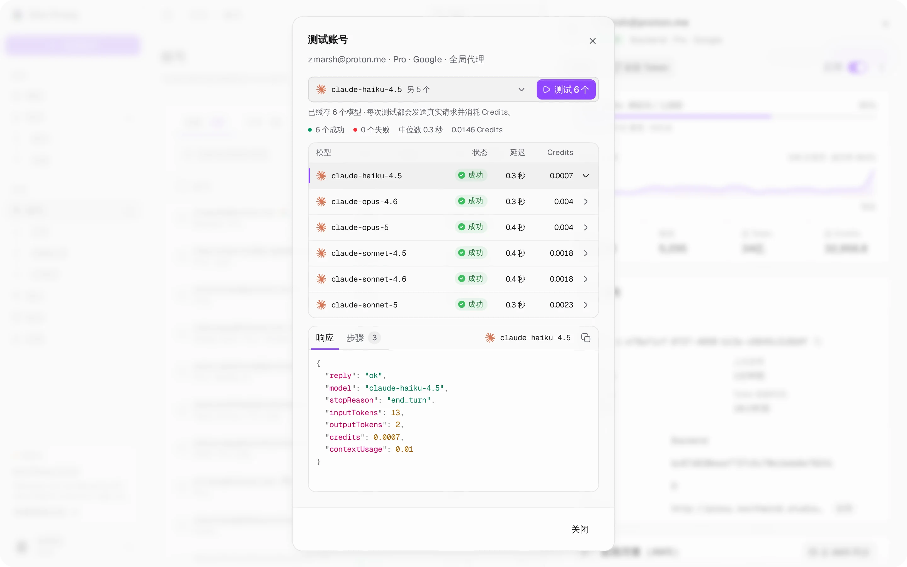
  </picture>
   <b>测试账号</b> — 一次测试一个或全部已缓存的模型；点击一行查看响应与步骤

## 请求

  <picture>
    <source media="(prefers-color-scheme: dark)" srcset="../screenshots/zh/requests-dark.webp">
    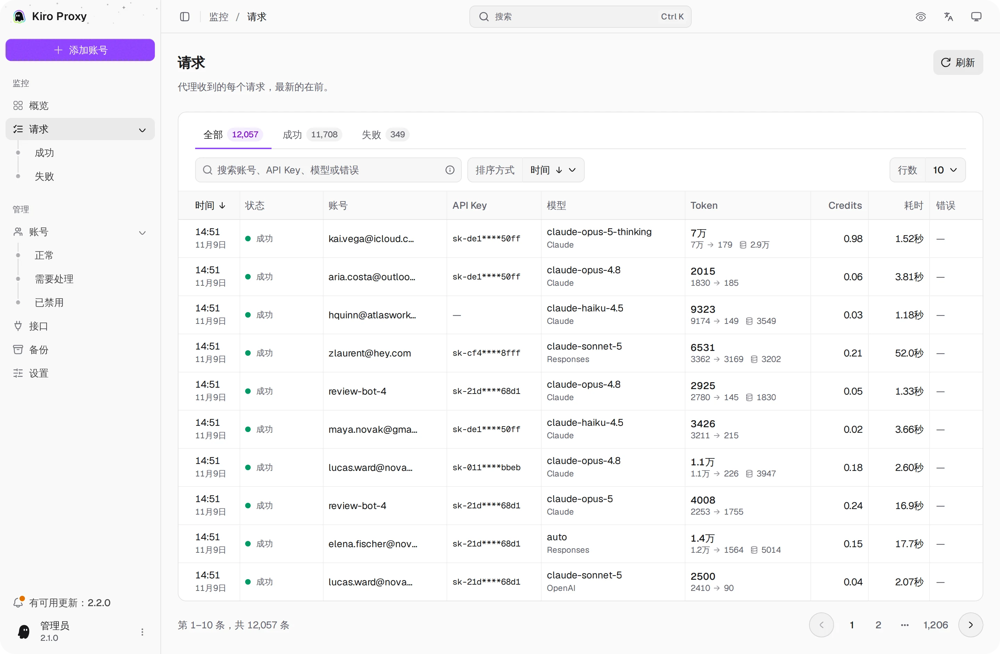
  </picture>
   <b>请求</b> — 状态标签、搜索、排序与详情视图

  <picture>
    <source media="(prefers-color-scheme: dark)" srcset="../screenshots/zh/requests-detail-dark.webp">
    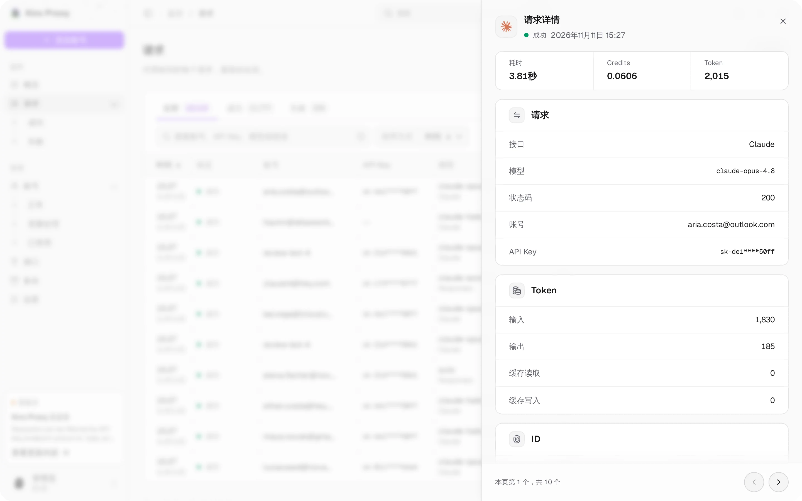
  </picture>
   <b>请求详情</b> — 点击一行打开的详情面板：耗时、Credits、Token 与 ID

## 接口

  <picture>
    <source media="(prefers-color-scheme: dark)" srcset="../screenshots/zh/api-dark.webp">
    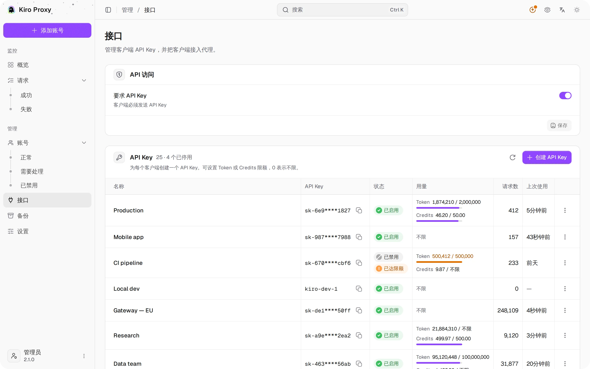
  </picture>
   <b>接口</b> — API 访问、带限额的客户端 Key 与高亮的客户端配置

## 备份

  <picture>
    <source media="(prefers-color-scheme: dark)" srcset="../screenshots/zh/backups-dark.webp">
    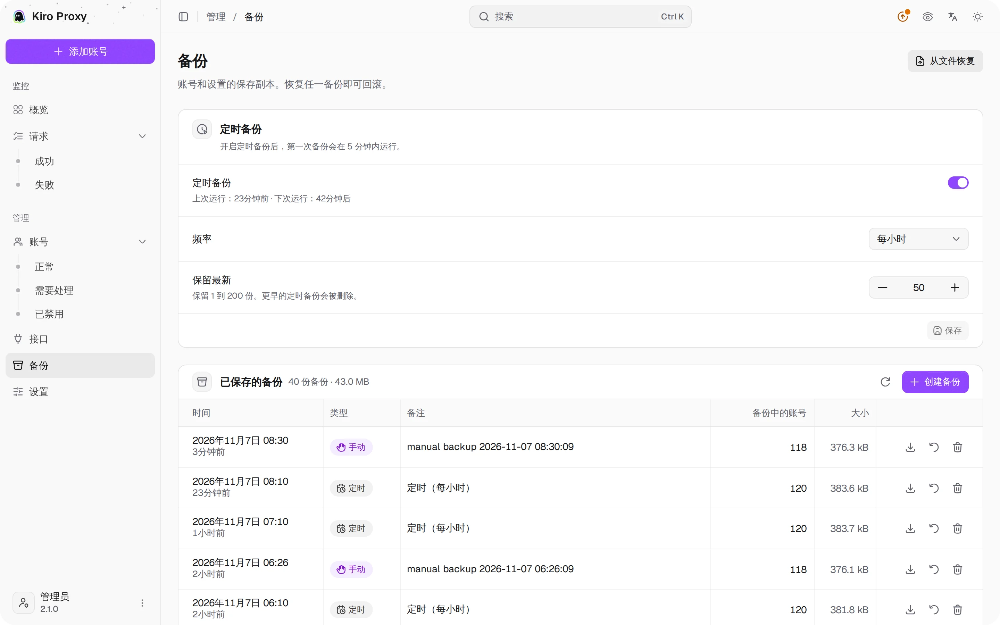
  </picture>
   <b>备份</b> — 手动与定时备份、一键恢复

## 设置

  <picture>
    <source media="(prefers-color-scheme: dark)" srcset="../screenshots/zh/settings-1-dark.webp">
    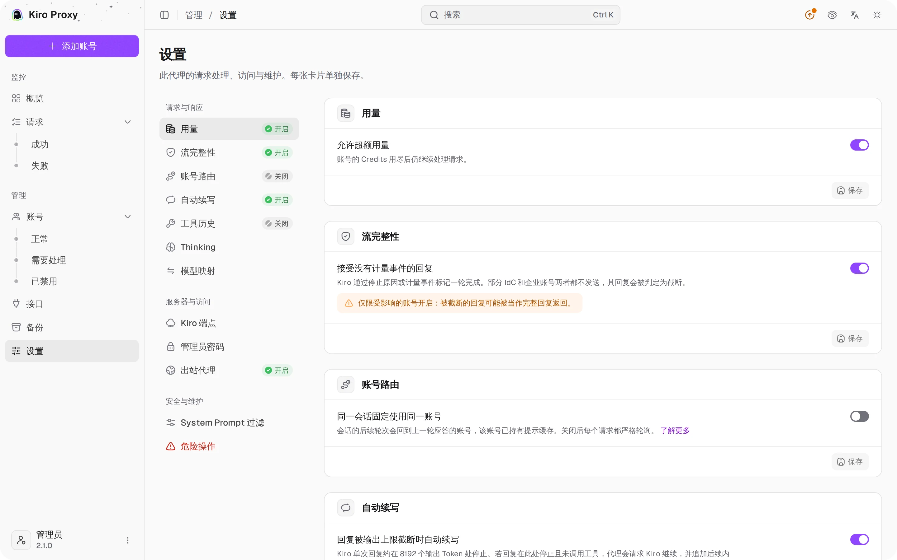
  </picture>
   <b>设置</b> — 用量、流完整性、账号路由、自动续写

  <picture>
    <source media="(prefers-color-scheme: dark)" srcset="../screenshots/zh/settings-2-dark.webp">
    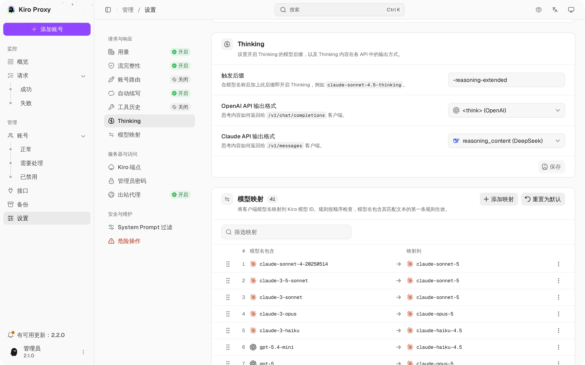
  </picture>
   <b>设置</b> — Thinking 与模型映射

  <picture>
    <source media="(prefers-color-scheme: dark)" srcset="../screenshots/zh/settings-3-dark.webp">
    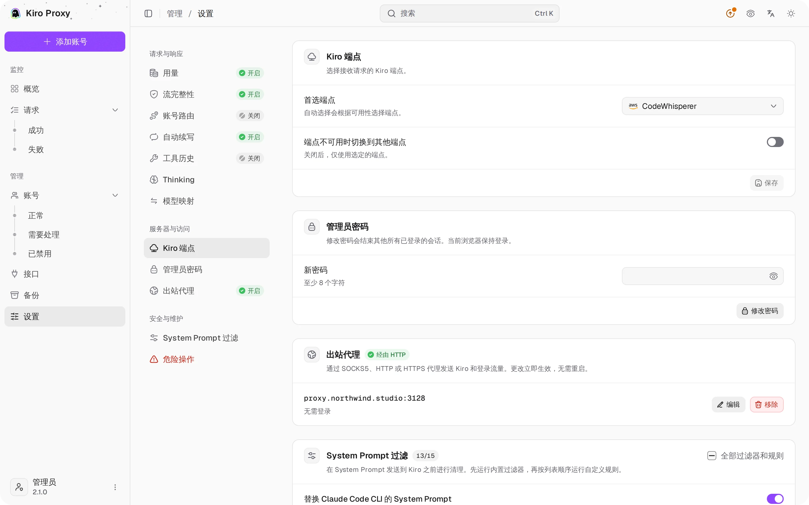
  </picture>
   <b>设置</b> — Kiro 端点、管理员密码、出站代理

[← 返回 README](../README_CN.md)
