

# 🖼 スクリーンショット

[English](SCREENSHOTS.md) • [简体中文](SCREENSHOTS_CN.md) • [日本語](SCREENSHOTS_JA.md) • [Português (Brasil)](SCREENSHOTS_PT-BR.md) • [Tiếng Việt](SCREENSHOTS_VI.md)

[← README に戻る](../README_JA.md)

管理パネルの全ページです。各画像は GitHub のテーマに合わせて、ライトまたはダークで表示されます。

[サインイン](#サインイン) · [概要](#概要) · [アカウント](#アカウント) · [リクエスト](#リクエスト) · [API](#api) · [バックアップ](#バックアップ) · [設定](#設定)

## サインイン

  <picture>
    <source media="(prefers-color-scheme: dark)" srcset="../screenshots/en/login-dark.webp">
    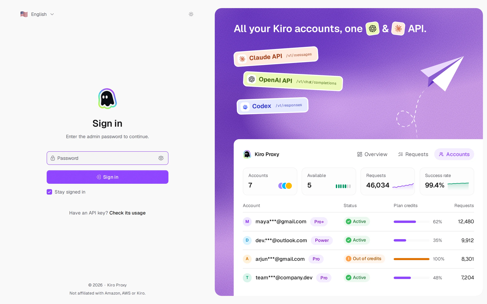
  </picture>
   <b>サインイン</b> — テーマと言語を切り替えられるサインイン画面

## 概要

  <picture>
    <source media="(prefers-color-scheme: dark)" srcset="../screenshots/en/overview-dark.webp">
    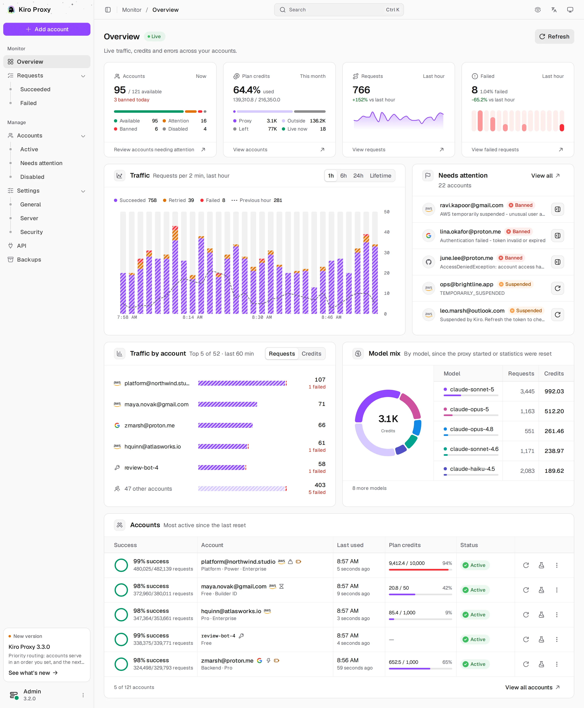
  </picture>
   <b>概要</b> — 全アカウントのリアルタイムのトラフィック、クレジット、エラー

## アカウント

  <picture>
    <source media="(prefers-color-scheme: dark)" srcset="../screenshots/en/accounts-dark.webp">
    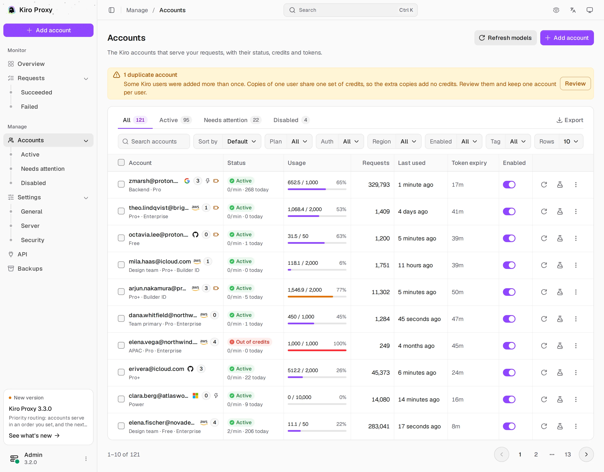
  </picture>
   <b>アカウント</b> — プランクレジット、ステータスタブ、フィルター、一括操作、エクスポート

  <picture>
    <source media="(prefers-color-scheme: dark)" srcset="../screenshots/en/accounts-add-dark.webp">
    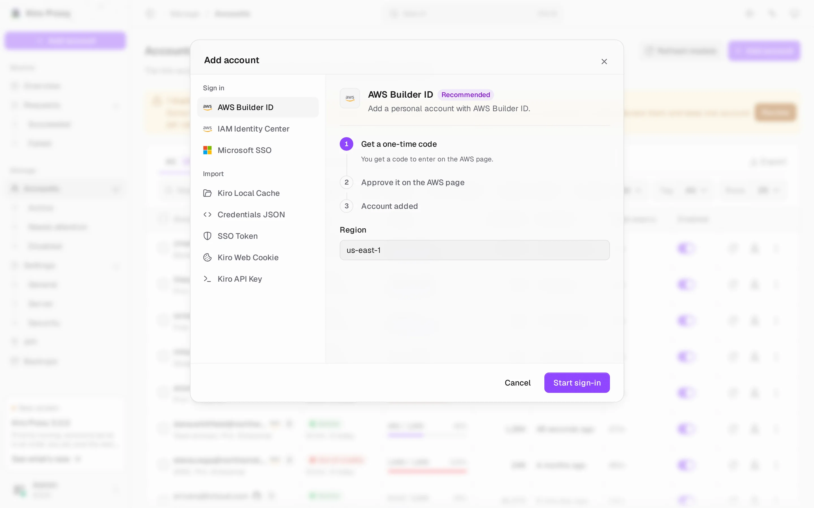
  </picture>
   <b>アカウントを追加</b> — すべてのサインイン方法とインポート方法を 1 つのダイアログにまとめ、それぞれの手順を表示

  <picture>
    <source media="(prefers-color-scheme: dark)" srcset="../screenshots/en/accounts-detail-dark.webp">
    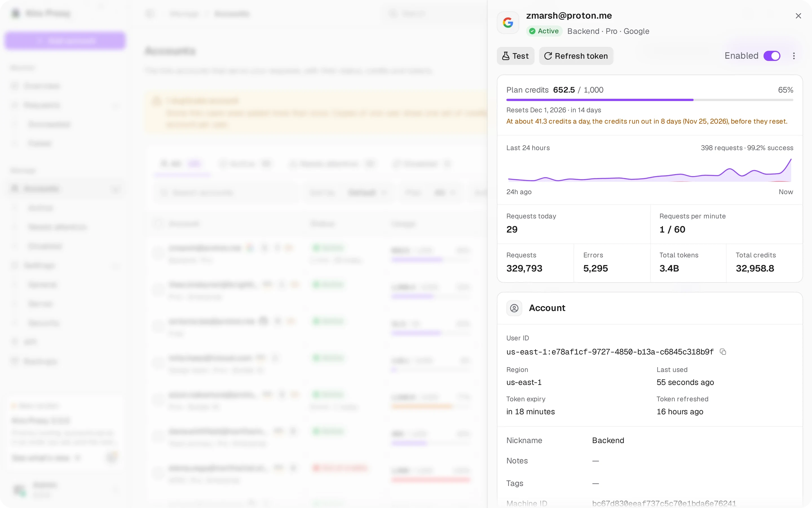
  </picture>
   <b>アカウントの詳細</b> — 行をクリックすると開くシート：プランクレジット、直近 24 時間、合計、設定

  <picture>
    <source media="(prefers-color-scheme: dark)" srcset="../screenshots/en/accounts-tester-dark.webp">
    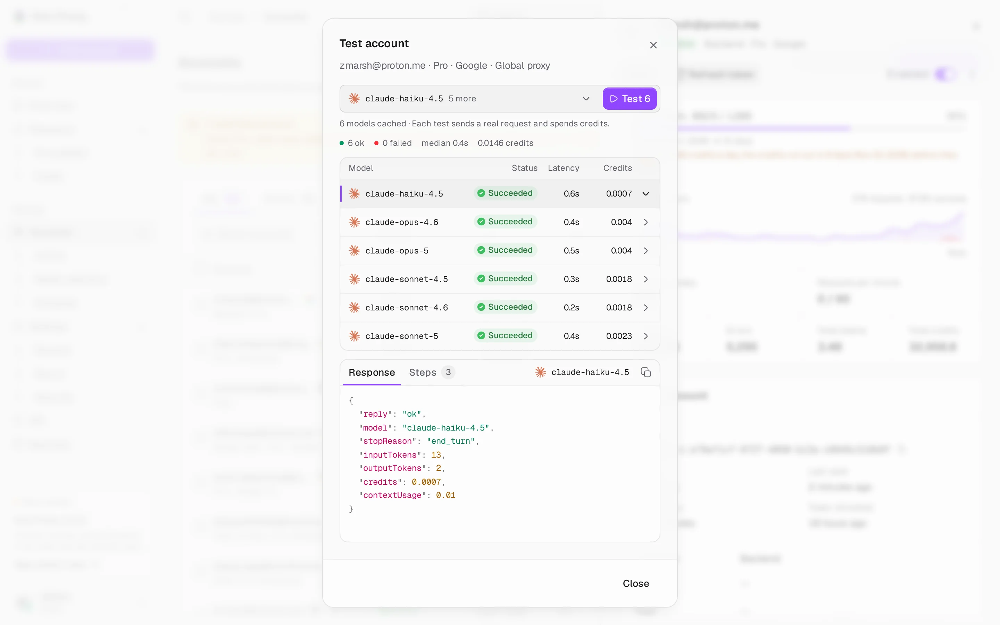
  </picture>
   <b>アカウントをテスト</b> — 1 つのモデル、またはキャッシュ済みのすべてのモデルを一度にテスト。行をタップするとレスポンスとステップを表示

## リクエスト

  <picture>
    <source media="(prefers-color-scheme: dark)" srcset="../screenshots/en/requests-dark.webp">
    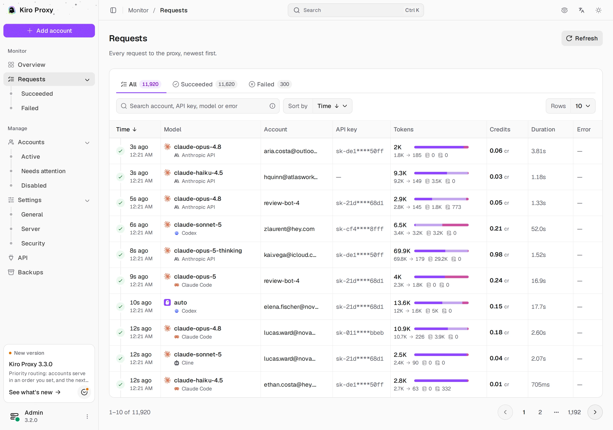
  </picture>
   <b>リクエスト</b> — ステータスタブ、検索、並べ替え、詳細ビュー

  <picture>
    <source media="(prefers-color-scheme: dark)" srcset="../screenshots/en/requests-detail-dark.webp">
    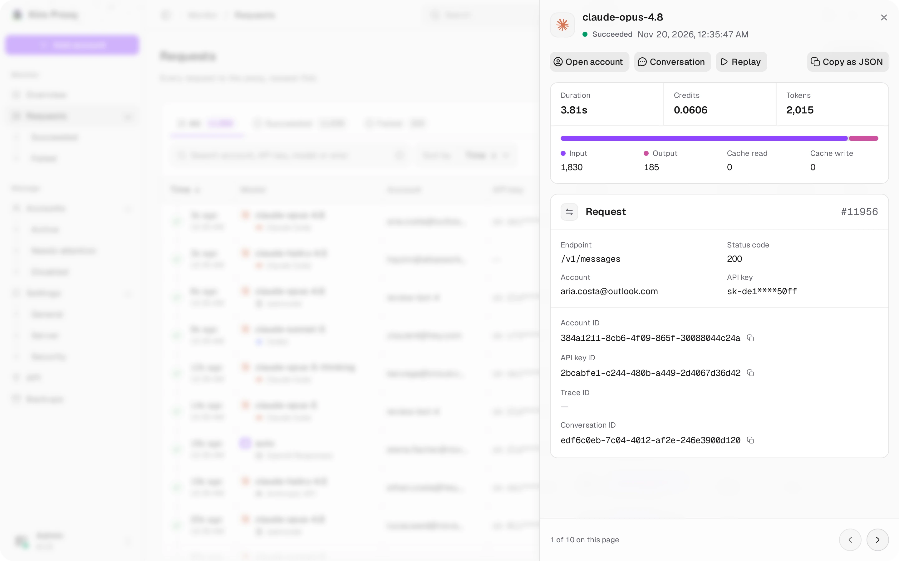
  </picture>
   <b>リクエストの詳細</b> — 行をクリックすると開くシート：所要時間、クレジット、トークン、ID、会話と再送信

## API

  <picture>
    <source media="(prefers-color-scheme: dark)" srcset="../screenshots/en/api-dark.webp">
    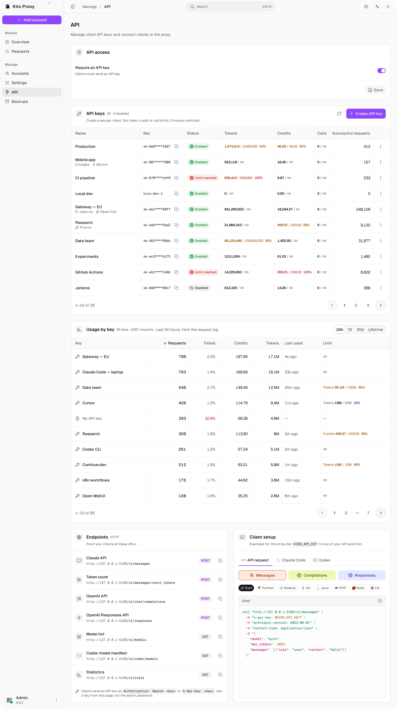
  </picture>
   <b>API</b> — API アクセス、上限付きのクライアント別キー、キー別の使用量、ハイライト表示のクライアント設定

## バックアップ

  <picture>
    <source media="(prefers-color-scheme: dark)" srcset="../screenshots/en/backups-dark.webp">
    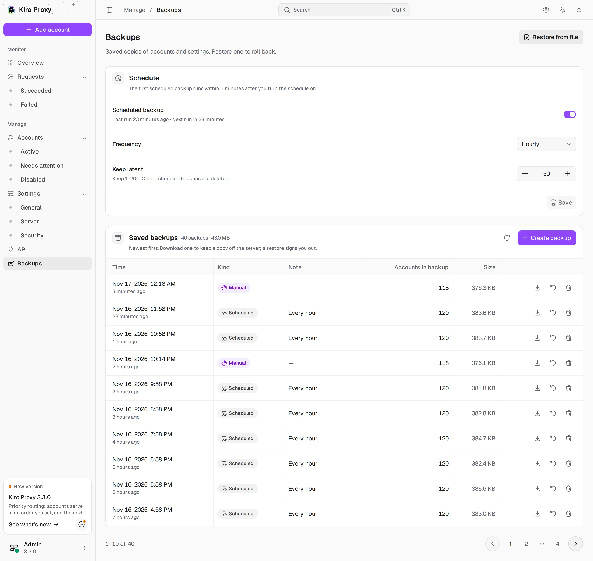
  </picture>
   <b>バックアップ</b> — 手動バックアップと定期バックアップ、ワンクリック復元

## 設定

  <picture>
    <source media="(prefers-color-scheme: dark)" srcset="../screenshots/en/settings-1-dark.webp">
    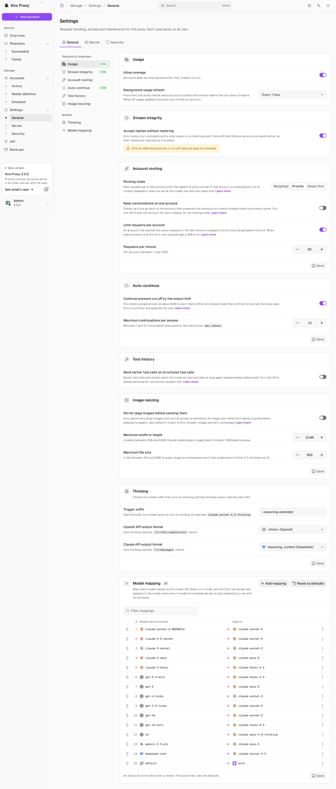
  </picture>
   <b>設定 · 一般</b> — 使用量、ストリームの完全性、アカウントのルーティング、自動継続、ツール履歴、画像のリサイズ、思考、モデルマッピング

  <picture>
    <source media="(prefers-color-scheme: dark)" srcset="../screenshots/en/settings-2-dark.webp">
    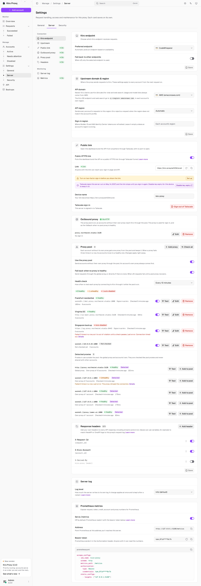
  </picture>
   <b>設定 · サーバー</b> — Kiro エンドポイントとチャット API、アップストリームのドメインとリージョン、公開リンク（Tailscale キーの有効期限を含む）、送信プロキシ、プロキシプール、レスポンスヘッダー、サーバーログ、Prometheus メトリクス

  <picture>
    <source media="(prefers-color-scheme: dark)" srcset="../screenshots/en/settings-3-dark.webp">
    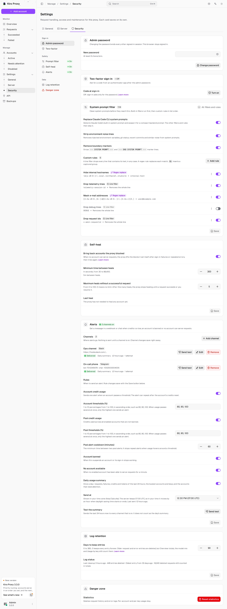
  </picture>
   <b>設定 · セキュリティ</b> — 管理者パスワード、2 段階認証、システムプロンプトフィルター、自動修復、アラート、ログの保持、危険な操作

[← README に戻る](../README_JA.md)
