

# 🖼 Capturas de tela

[English](SCREENSHOTS.md) • [简体中文](SCREENSHOTS_CN.md) • [Português (Brasil)](SCREENSHOTS_PT-BR.md) • [Tiếng Việt](SCREENSHOTS_VI.md)

[← Voltar ao README](../README_PT-BR.md)

Todas as páginas do painel de administração. Cada imagem segue o tema do seu GitHub, claro ou escuro.

[Entrar](#entrar) · [Visão geral](#visão-geral) · [Contas](#contas) · [Requisições](#requisições) · [API](#api) · [Backups](#backups) · [Configurações](#configurações)

## Entrar

  <picture>
    <source media="(prefers-color-scheme: dark)" srcset="../screenshots/pt-BR/login-dark.webp">
    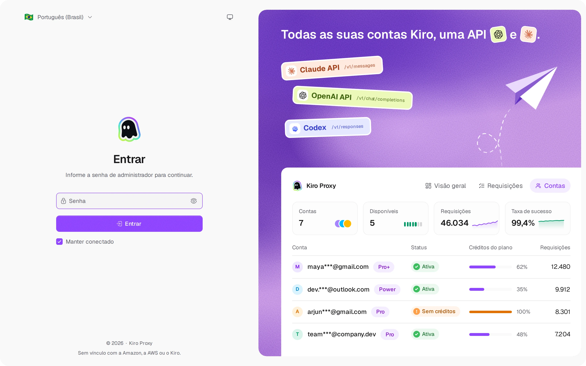
  </picture>
   <b>Entrar</b> — login com seletores de tema e idioma

## Visão geral

  <picture>
    <source media="(prefers-color-scheme: dark)" srcset="../screenshots/pt-BR/overview-dark.webp">
    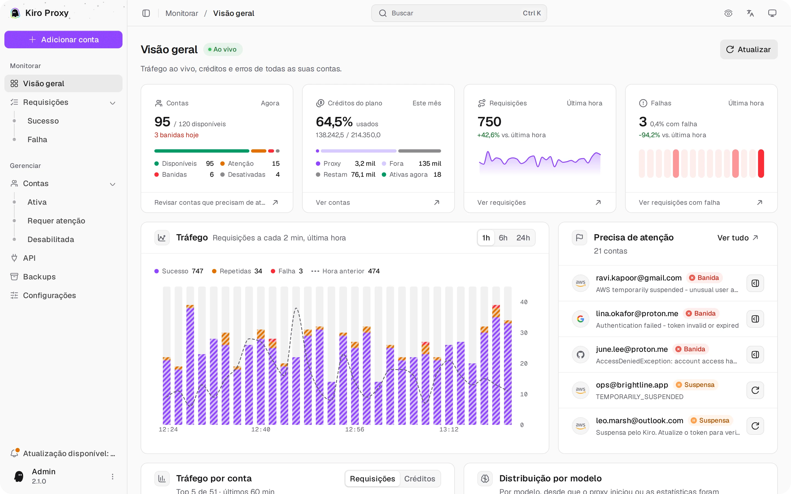
  </picture>
   <b>Visão geral</b> — tráfego ao vivo, créditos e erros de todas as contas

## Contas

  <picture>
    <source media="(prefers-color-scheme: dark)" srcset="../screenshots/pt-BR/accounts-dark.webp">
    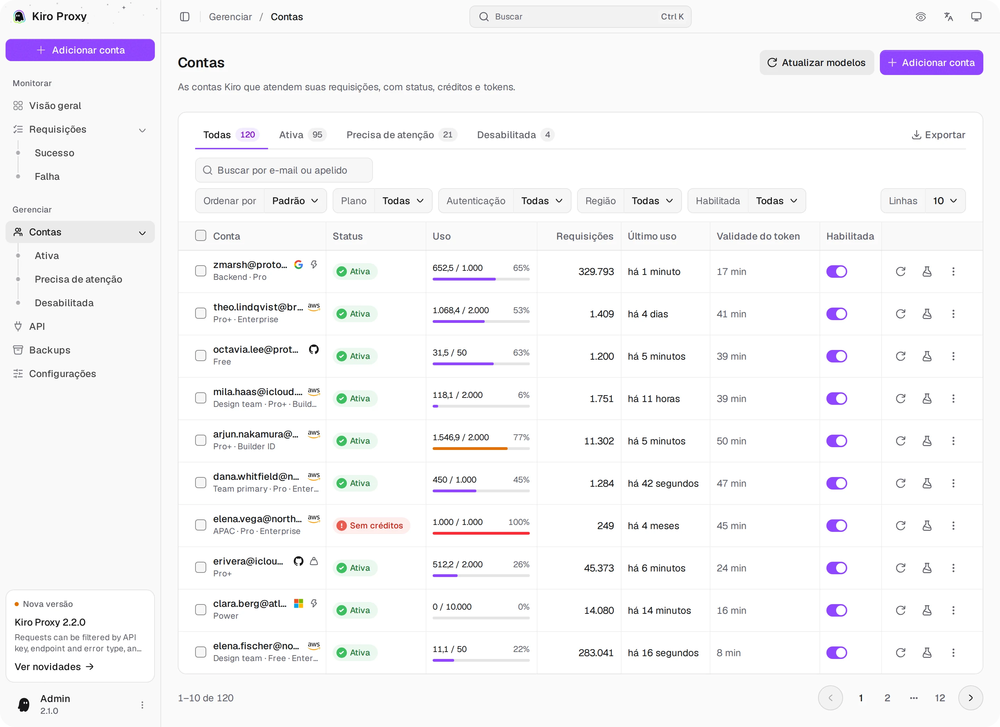
  </picture>
   <b>Contas</b> — créditos do plano, abas de status, filtros, ações em lote e exportação

  <picture>
    <source media="(prefers-color-scheme: dark)" srcset="../screenshots/pt-BR/accounts-add-dark.webp">
    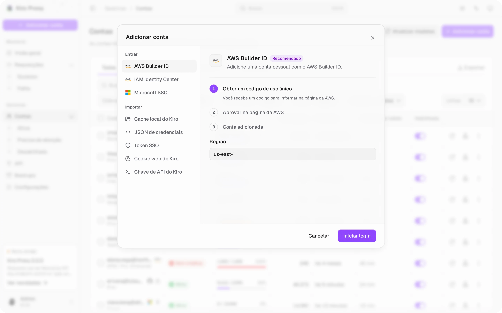
  </picture>
   <b>Adicionar conta</b> — todos os métodos de login e importação num só diálogo, cada um com seus passos

  <picture>
    <source media="(prefers-color-scheme: dark)" srcset="../screenshots/pt-BR/accounts-detail-dark.webp">
    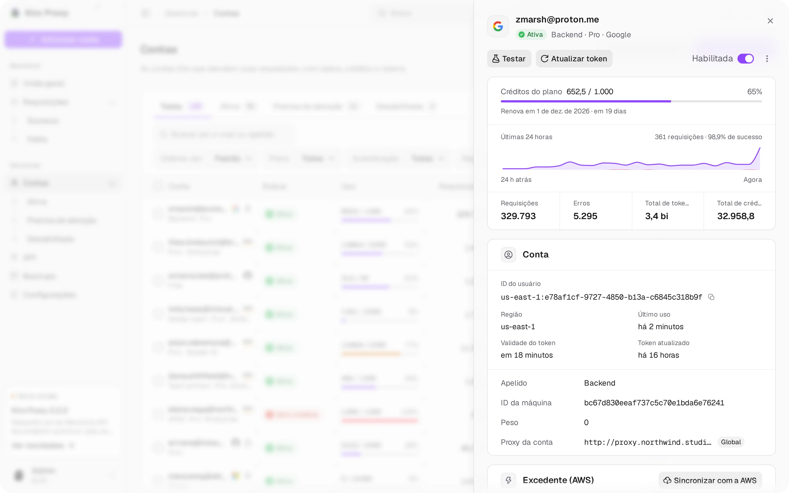
  </picture>
   <b>Detalhes da conta</b> — o painel que cada linha abre: créditos do plano, últimas 24 horas, totais e configurações

  <picture>
    <source media="(prefers-color-scheme: dark)" srcset="../screenshots/pt-BR/accounts-tester-dark.webp">
    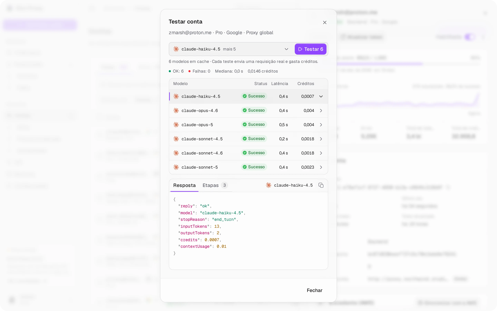
  </picture>
   <b>Testar conta</b> — teste um modelo ou todos os modelos em cache de uma vez; toque numa linha para ver a resposta e as etapas

## Requisições

  <picture>
    <source media="(prefers-color-scheme: dark)" srcset="../screenshots/pt-BR/requests-dark.webp">
    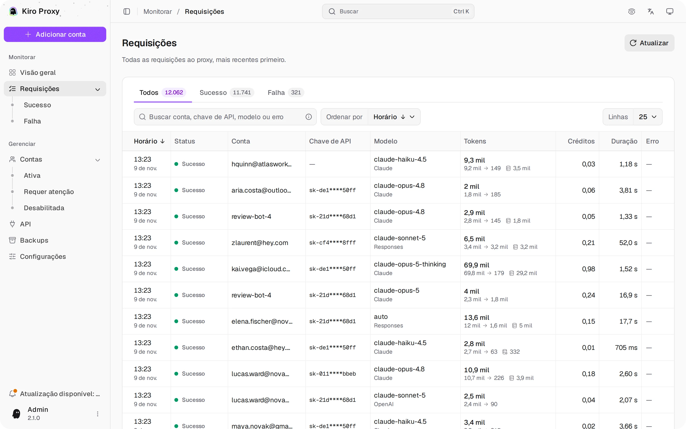
  </picture>
   <b>Requisições</b> — abas de status, busca, ordenação e visão de detalhes

  <picture>
    <source media="(prefers-color-scheme: dark)" srcset="../screenshots/pt-BR/requests-detail-dark.webp">
    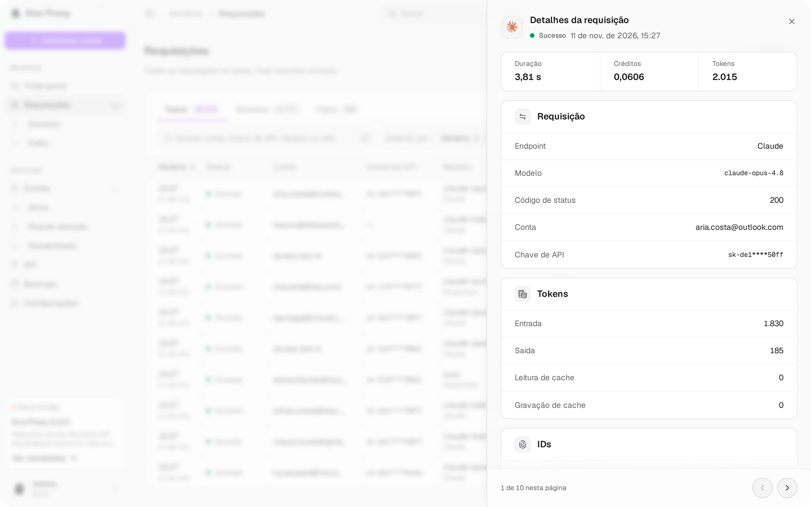
  </picture>
   <b>Detalhes da requisição</b> — o painel que cada linha abre: duração, créditos, tokens e IDs

## API

  <picture>
    <source media="(prefers-color-scheme: dark)" srcset="../screenshots/pt-BR/api-dark.webp">
    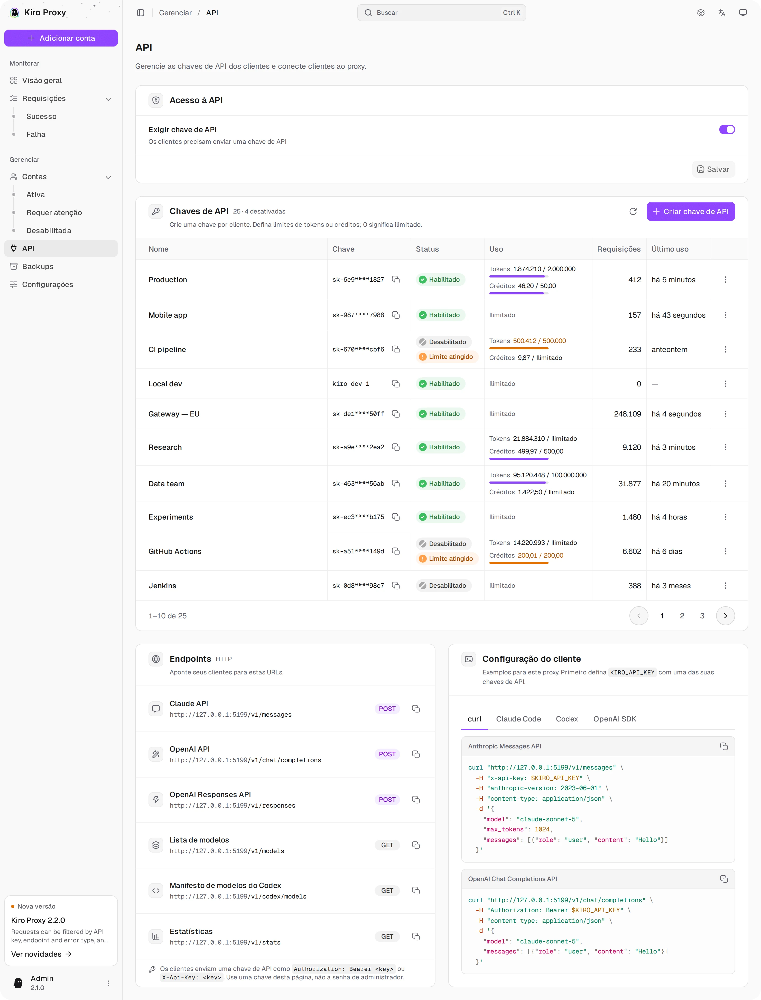
  </picture>
   <b>API</b> — acesso à API, chaves por cliente com limites, configuração do cliente destacada

## Backups

  <picture>
    <source media="(prefers-color-scheme: dark)" srcset="../screenshots/pt-BR/backups-dark.webp">
    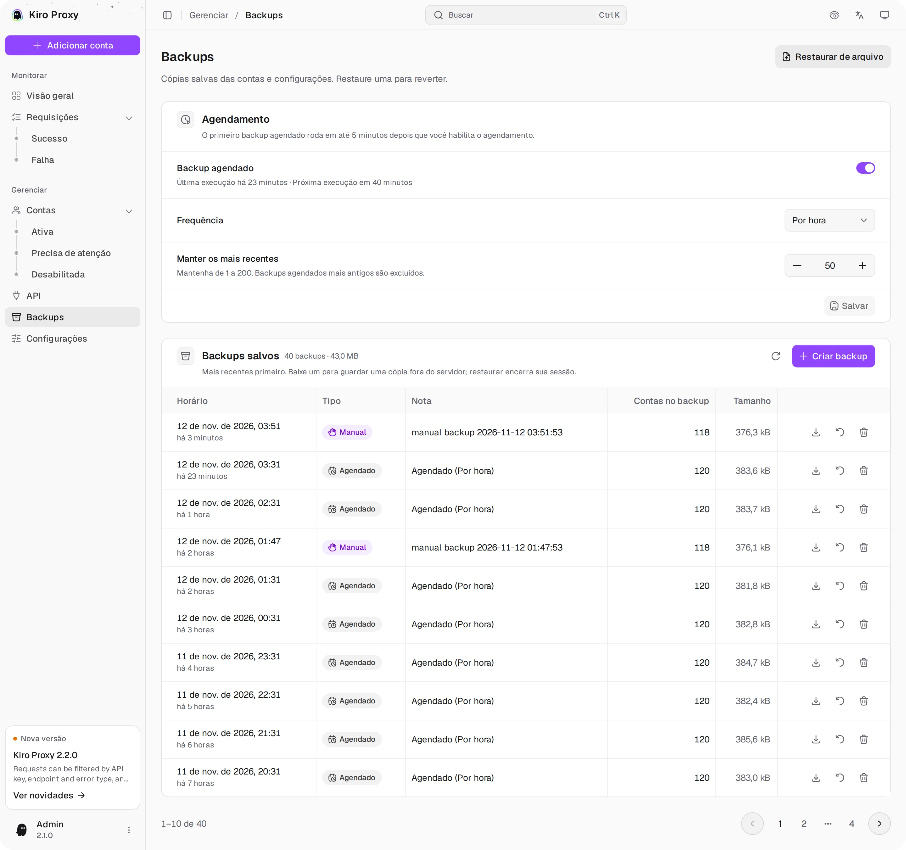
  </picture>
   <b>Backups</b> — backups manuais e agendados, restauração com um clique

## Configurações

  <picture>
    <source media="(prefers-color-scheme: dark)" srcset="../screenshots/pt-BR/settings-1-dark.webp">
    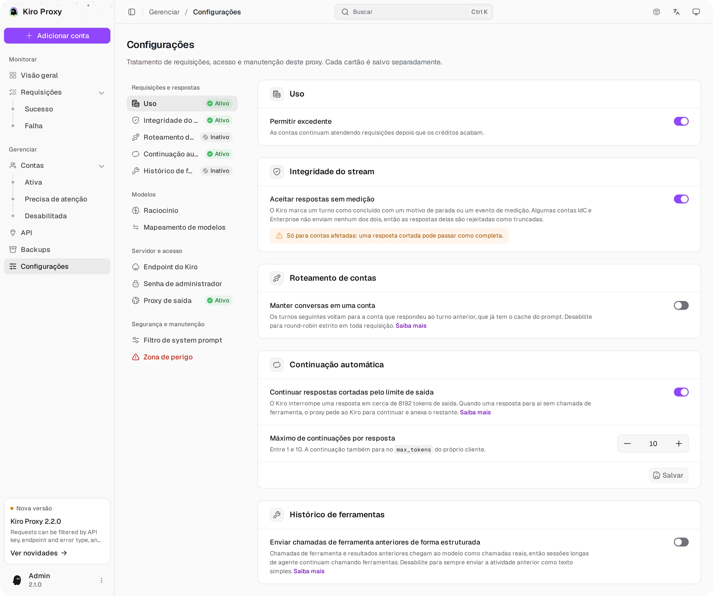
  </picture>
   <b>Configurações</b> — uso, integridade do stream, roteamento, continuação automática

  <picture>
    <source media="(prefers-color-scheme: dark)" srcset="../screenshots/pt-BR/settings-2-dark.webp">
    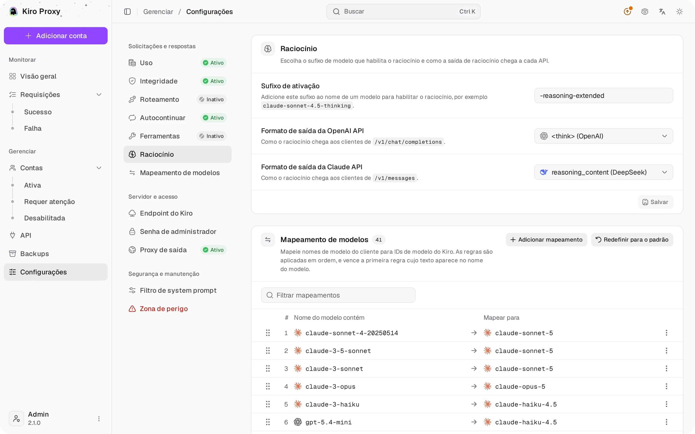
  </picture>
   <b>Configurações</b> — raciocínio e mapeamento de modelos

  <picture>
    <source media="(prefers-color-scheme: dark)" srcset="../screenshots/pt-BR/settings-3-dark.webp">
    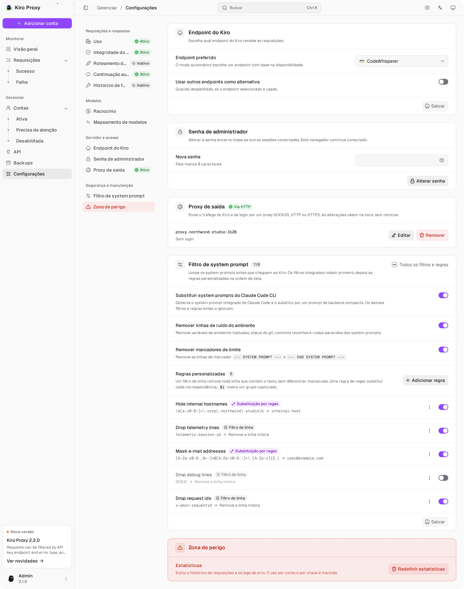
  </picture>
   <b>Configurações</b> — endpoint do Kiro, senha de administrador, proxy de saída

[← Voltar ao README](../README_PT-BR.md)
