

# 🖼 Ảnh chụp màn hình

[English](SCREENSHOTS.md) • [简体中文](SCREENSHOTS_CN.md) • [Português (Brasil)](SCREENSHOTS_PT-BR.md) • [Tiếng Việt](SCREENSHOTS_VI.md)

[← Quay lại README](../README_VI.md)

Mọi trang của trang quản trị. Mỗi ảnh hiển thị sáng hoặc tối theo giao diện GitHub của bạn.

[Đăng nhập](#đăng-nhập) · [Tổng quan](#tổng-quan) · [Tài khoản](#tài-khoản) · [Yêu cầu](#yêu-cầu) · [API](#api) · [Sao lưu](#sao-lưu) · [Cài đặt](#cài-đặt)

## Đăng nhập

  <picture>
    <source media="(prefers-color-scheme: dark)" srcset="../screenshots/vi/login-dark.webp">
    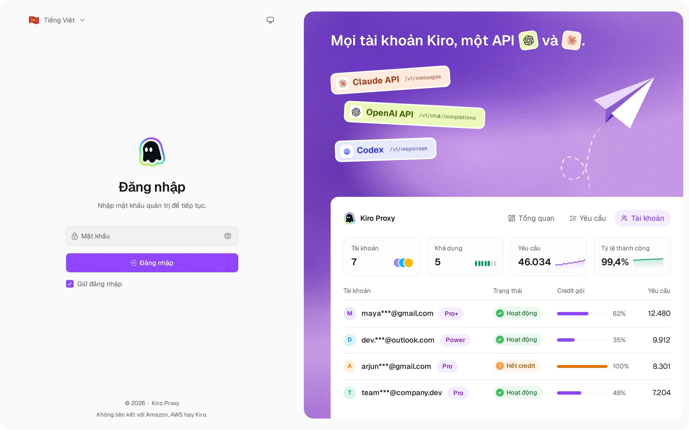
  </picture>
   <b>Đăng nhập</b> — trang đăng nhập với nút chuyển giao diện và ngôn ngữ

## Tổng quan

  <picture>
    <source media="(prefers-color-scheme: dark)" srcset="../screenshots/vi/overview-dark.webp">
    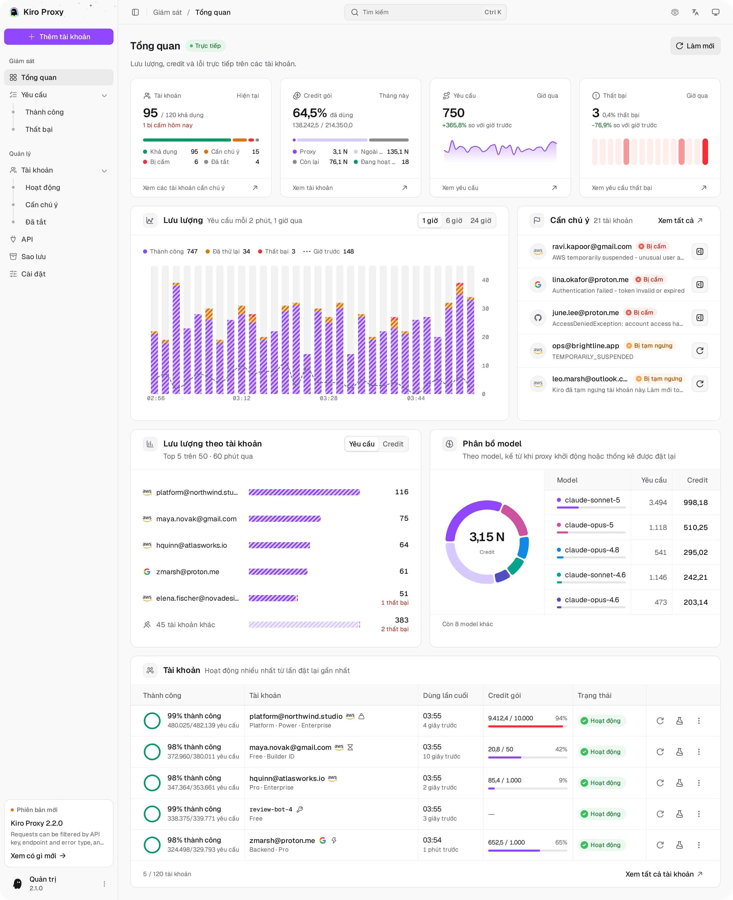
  </picture>
   <b>Tổng quan</b> — lưu lượng, credit và lỗi trực tiếp trên các tài khoản

## Tài khoản

  <picture>
    <source media="(prefers-color-scheme: dark)" srcset="../screenshots/vi/accounts-dark.webp">
    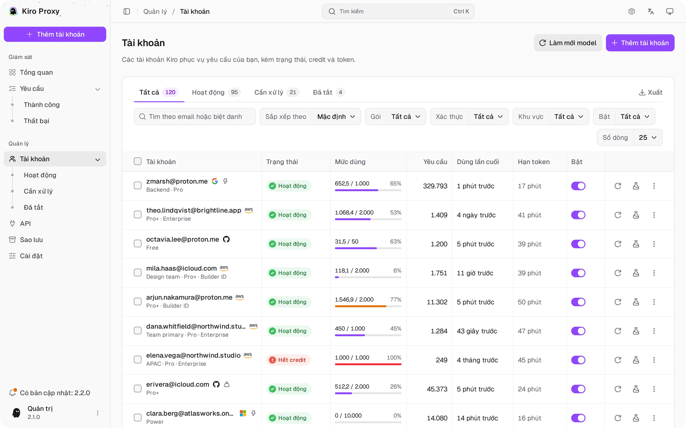
  </picture>
   <b>Tài khoản</b> — credit gói, tab trạng thái, bộ lọc, thao tác hàng loạt và xuất

  <picture>
    <source media="(prefers-color-scheme: dark)" srcset="../screenshots/vi/accounts-add-dark.webp">
    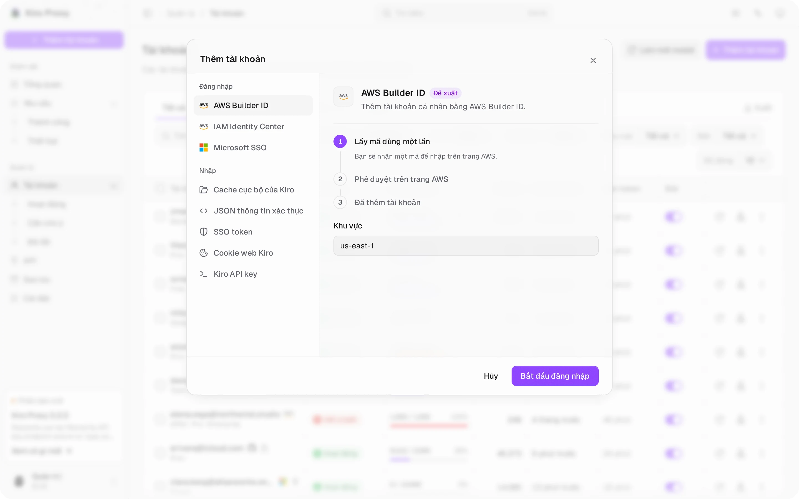
  </picture>
   <b>Thêm tài khoản</b> — mọi cách đăng nhập và nhập trong một hộp thoại, mỗi cách kèm các bước

  <picture>
    <source media="(prefers-color-scheme: dark)" srcset="../screenshots/vi/accounts-detail-dark.webp">
    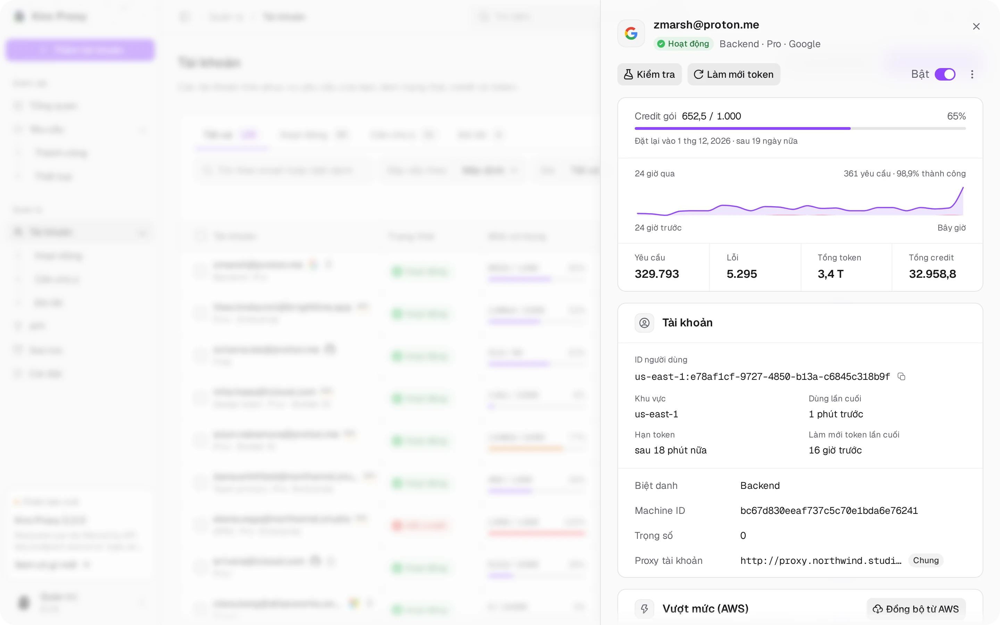
  </picture>
   <b>Chi tiết tài khoản</b> — bảng mở ra khi bấm một dòng: credit gói, 24 giờ qua, tổng số và cài đặt

  <picture>
    <source media="(prefers-color-scheme: dark)" srcset="../screenshots/vi/accounts-tester-dark.webp">
    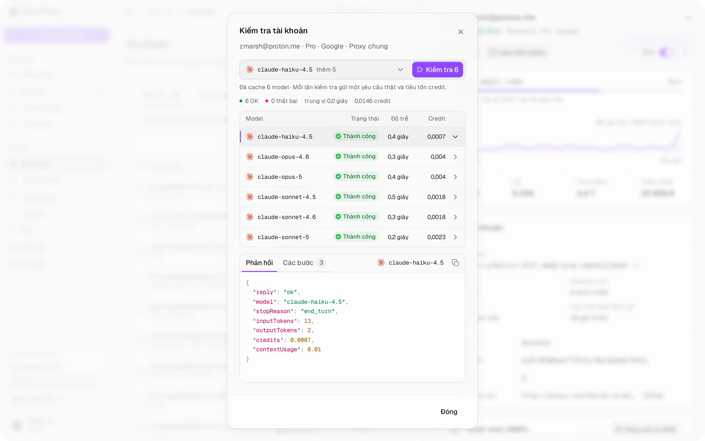
  </picture>
   <b>Kiểm tra tài khoản</b> — kiểm tra một model hoặc mọi model đã lưu cùng lúc; chạm vào một dòng để xem phản hồi và các bước

## Yêu cầu

  <picture>
    <source media="(prefers-color-scheme: dark)" srcset="../screenshots/vi/requests-dark.webp">
    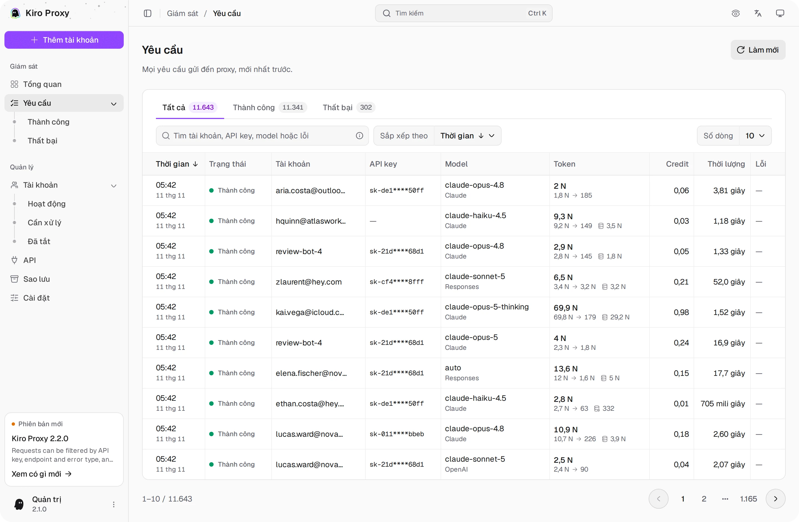
  </picture>
   <b>Yêu cầu</b> — tab trạng thái, tìm kiếm, sắp xếp và xem chi tiết

  <picture>
    <source media="(prefers-color-scheme: dark)" srcset="../screenshots/vi/requests-detail-dark.webp">
    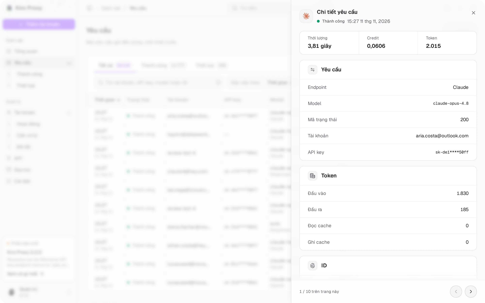
  </picture>
   <b>Chi tiết yêu cầu</b> — bảng mở ra khi bấm một dòng: thời lượng, credit, token và ID

## API

  <picture>
    <source media="(prefers-color-scheme: dark)" srcset="../screenshots/vi/api-dark.webp">
    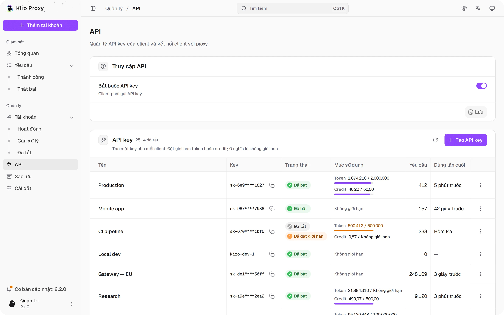
  </picture>
   <b>API</b> — truy cập API, key riêng cho từng client kèm giới hạn, thiết lập client có tô sáng

## Sao lưu

  <picture>
    <source media="(prefers-color-scheme: dark)" srcset="../screenshots/vi/backups-dark.webp">
    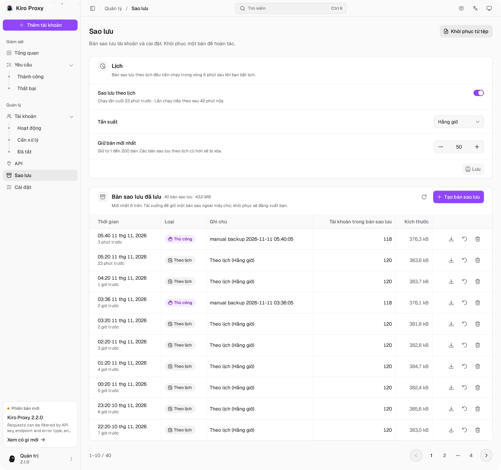
  </picture>
   <b>Sao lưu</b> — sao lưu thủ công và theo lịch, khôi phục bằng một cú nhấp

## Cài đặt

  <picture>
    <source media="(prefers-color-scheme: dark)" srcset="../screenshots/vi/settings-1-dark.webp">
    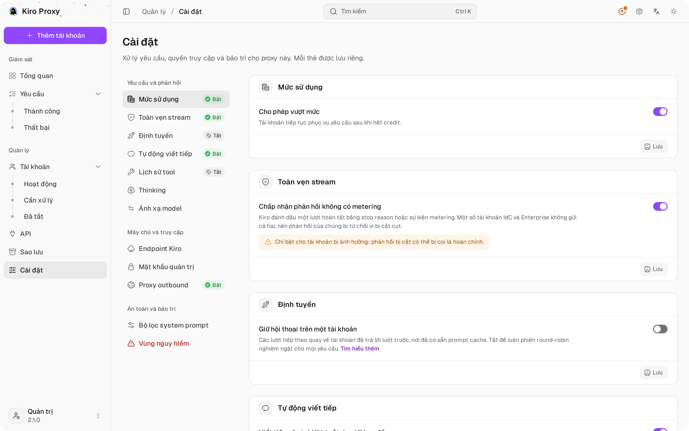
  </picture>
   <b>Cài đặt</b> — mức sử dụng, toàn vẹn stream, định tuyến, tự động viết tiếp

  <picture>
    <source media="(prefers-color-scheme: dark)" srcset="../screenshots/vi/settings-2-dark.webp">
    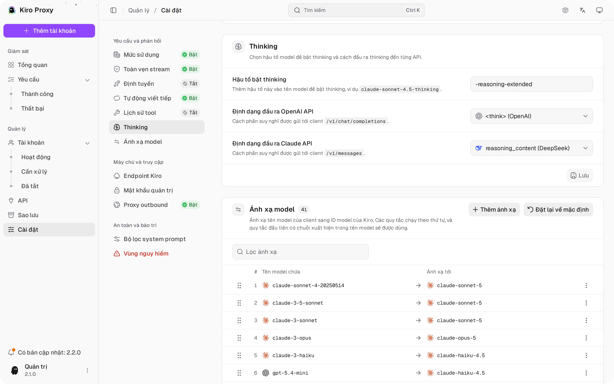
  </picture>
   <b>Cài đặt</b> — thinking và ánh xạ model

  <picture>
    <source media="(prefers-color-scheme: dark)" srcset="../screenshots/vi/settings-3-dark.webp">
    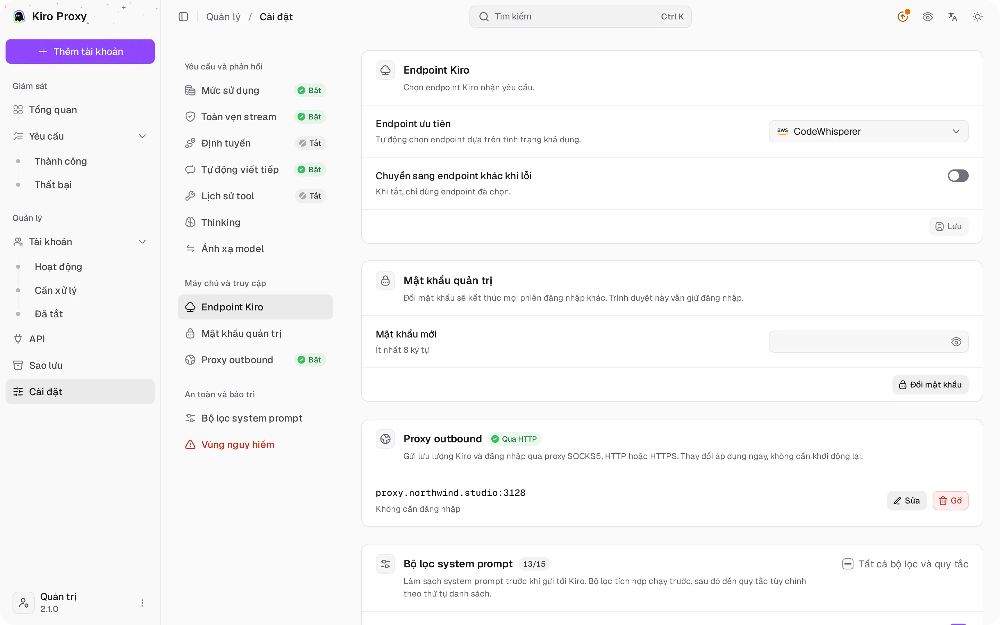
  </picture>
   <b>Cài đặt</b> — endpoint Kiro, mật khẩu quản trị, proxy outbound

[← Quay lại README](../README_VI.md)
